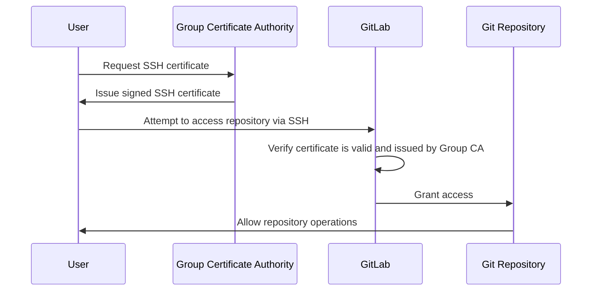



- Tier: 专业版，旗舰版
- Offering: JihuLab.com



使用 SSH 证书控制并管理对 JihuLab.com 上托管的项目和群组的 Git 访问。

SSH 证书是经过加密签名的文档，用于验证用户的身份和权限。SSH 证书由受信任的证书颁发机构（CA）签发，包含用户身份、有效期和权限等信息。

如果您是极狐GitLab 私有化部署实例管理员，可以使用实例级 SSH 证书方案。请选择以下方法之一：

- [使用 `gitlab-sshd`的实例级 SSH 证书](../../administration/operations/gitlab_sshd_ssh_certificates.md)：
  直接在 `gitlab-sshd`中配置受信任的 CA 密钥，无需修改系统 OpenSSH 的 `sshd_config`。
- [使用 OpenSSH `AuthorizedPrincipalsCommand` 进行用户查找](../../administration/operations/ssh_certificates.md)：
  使用系统 OpenSSH 守护进程配置 SSH 证书。

SSH 证书身份验证的优势包括：

- 集中式访问控制：您可以通过中央 CA 管理访问权限，而无需依赖各个用户自行管理的 SSH 密钥。
- 增强的安全性：SSH 证书比传统 SSH 密钥更安全。
- 限时访问：您可以将证书设置为在特定时间段后过期。
- 简化的凭据管理：组织可以维护一份用于代码仓库访问的已批准 SSH 证书凭据列表。
- 独立于用户管理的凭据：访问权限由群组管理的证书控制，而不是用户的个人公共 SSH 密钥。

<a id="ssh-certificates-and-ssh-keys"></a>

## SSH 证书和 SSH 密钥

下表比较了 SSH 证书和 SSH 密钥：

| 功能               | SSH 证书                      | SSH 密钥 |
| --------------------- | ------------------------------------- | -------- |
| 访问控制        | 通过群组管理的 CA 集中控制。 | 分散在各个用户账号中。 |
| 过期            | 内置过期机制。                  | 无内置过期机制。 |
| 凭据管理 | 由群组所有者管理。              | 由各个用户管理。 |
| 设置复杂度      | 初始设置更复杂。           | 初始设置更简单。 |

<a id="authentication-flow"></a>

## 身份验证流程

下图说明了 SSH 证书身份验证在极狐GitLab 中的工作方式，从请求证书到访问代码仓库：



身份验证过程会在允许访问代码仓库之前，验证用户是否持有有效的 SSH 证书。

<a id="add-a-ca-certificate-to-a-top-level-group"></a>

## 将 CA 证书添加到顶级群组

先决条件：

- 您必须具有该群组的所有者角色。
- 该群组必须是顶级群组，而不是子群组。

要将 CA 证书添加到群组：

1. 生成一个 SSH 密钥对，用作证书颁发机构文件：

   ```plaintext
   ssh-keygen -f CA
   ```

1. 使用[群组 SSH 证书 API](../../api/group_ssh_certificates.md#add-a-group-ssh-certificate) 将公钥添加到顶级群组，
   以授予对该群组及其子群组中项目的访问权限。

<a id="issue-ca-certificates-for-users"></a>

## 为用户签发 CA 证书

先决条件：

- 您必须具有该群组的所有者角色。
- 用户证书只能用于访问顶级群组及其子群组中的项目。
- 必须指定用户的用户名或主邮箱（`user` 或 `user@example.com`），以便将
  极狐GitLab 用户与用户证书关联。
- 该用户必须是[企业用户](../enterprise_user/_index.md)。

要签发用户证书，请使用您[之前创建](#add-a-ca-certificate-to-a-top-level-group)的密钥对中的私钥：

```shell
ssh-keygen -s CA -I user@example.com -V +1d user-key.pub
```

（`user-key.pub`）密钥是用户用于 SSH 身份验证的 SSH 密钥对中的公钥。该 SSH 密钥对由用户生成，或由群组所有者基础设施连同 SSH 证书一起预配。

过期日期（`+1d`）标识该 SSH 证书可用于访问群组项目的时长。

用户证书只能用于访问顶级群组中的项目。

<a id="certificate-principals"></a>

### 证书主体

前面的 `ssh-keygen` 示例未设置任何证书主体（`-n` 标志）。如果不设置主体，OpenSSH 会接受该证书用于任何 SSH 登录用户。极狐GitLab 会根据身份（`-I`）值将证书映射到某个用户。

如果您使用一个或多个主体对证书进行签名，则该列表必须包含 `git`，因为用户以 `git` 用户身份通过 SSH 向极狐GitLab 进行身份验证（例如 `git@jihulab.com`）：

```shell
ssh-keygen -s CA -I user@example.com -n git -V +1d user-key.pub
```

如果非空的主体列表中缺少 `git`，极狐GitLab 会拒绝该证书，并显示类似如下错误：

```plaintext
ssh: principal "git" not in the set of valid principals for given certificate: ["user@example.com"]
```

<a id="enforce-ssh-certificates"></a>

## 强制使用 SSH 证书

您可以强制使用 SSH 证书，并限制用户使用 SSH 密钥和访问令牌进行身份验证。

强制使用 SSH 证书时：

- 仅影响个人用户账号。
- 不适用于服务账号、部署密钥和其他类型的内部账号。
- 只有由所有者添加到群组的 SSH 证书才用于验证代码仓库访问。

> [!note]
> 强制使用 SSH 证书会禁用普通用户的 HTTPS 访问。

先决条件：

- 您必须具有该群组的所有者角色。

要强制使用 SSH 证书：

1. 在顶部栏中，选择**搜索或跳转到**，然后找到您的群组。
1. 在左侧边栏中，选择**设置** > **通用**。
1. 展开**权限和群组功能**部分。
1. 选中**强制使用 SSH 证书**复选框。
1. 选择**保存更改**。
