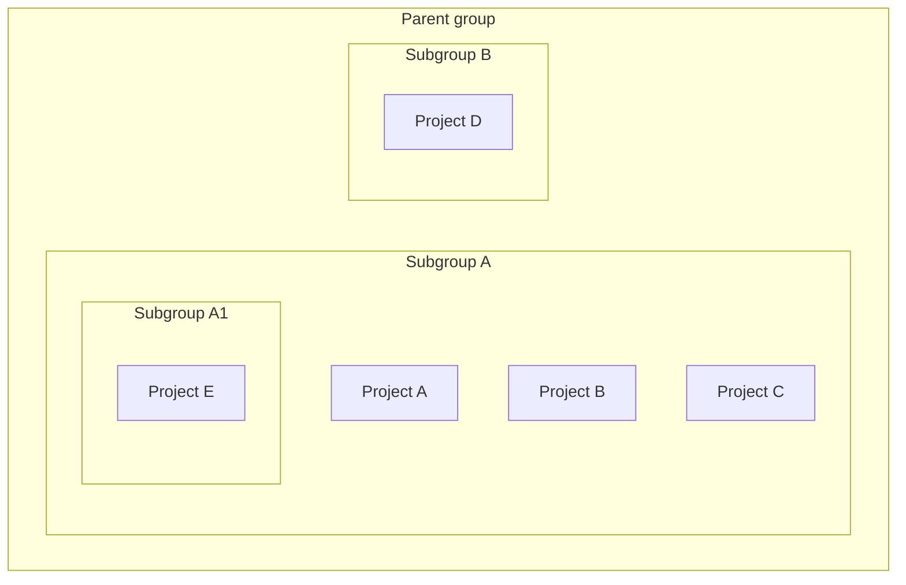
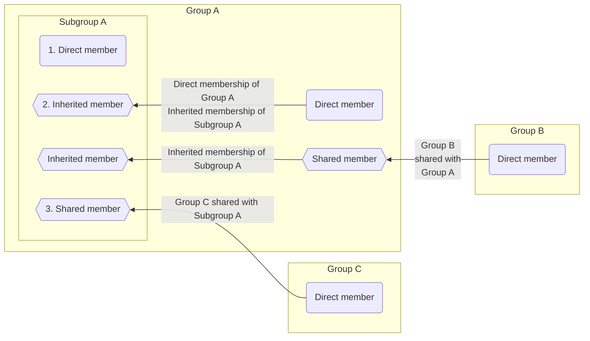
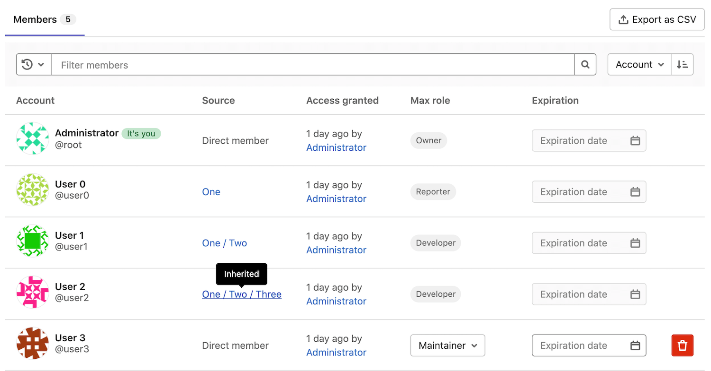



- Tier: 基础版，专业版，旗舰版
- Offering: JihuLab.com，私有化部署



您可以将极狐GitLab [群组](../_index.md)组织为子群组。您可以使用子群组来：

- 分隔内部和外部内容。由于每个子群组都可以有自己的
  [可见性级别](../../public_access.md)，您可以在同一父群组下托管用于不同
  目的的群组。
- 组织大型项目。您可以使用子群组来管理谁可以访问部分
  源代码。
- 管理权限。为每个用户在其[成员身份](#subgroup-membership)所属的每个群组中授予不同的
  [角色](../../permissions.md#group-permissions)。

子群组可以：

- 属于一个直接父群组。
- 拥有多个子群组。
- 最多嵌套 20 层。
  为避免性能问题，群组嵌套层级最多为五层或更少。
  更多信息，请参阅[群组结构的建议限制](../_index.md#recommended-limits-for-group-structure)。
- 使用注册到父群组的 [runner](../../../ci/runners/_index.md)：
  - 为父群组配置的密钥可供子群组作业使用。
  - 在属于子群组的项目中拥有维护者或所有者角色的用户，可以查看注册到
    父群组的 runner 的详细信息。

例如：

## 查看群组的子群组

先决条件：

- 要查看私有嵌套子群组，您必须是该私有子群组的直接成员或继承成员。

要查看群组的子群组：

1. 在顶部栏中，选择**搜索或跳转到**，然后找到您的群组。
1. 在左侧边栏中，选择**子群组和项目**标签页。
1. 选择您要查看的子群组。
   要查看嵌套子群组，请展开 () 一个子群组。

### 公开父群组中的私有子群组

在层级列表中，带有私有子群组的公开群组会显示一个展开选项 ()，表示该群组包含嵌套子群组。所有用户都可以看到该展开选项 ()，但只有私有子群组的直接成员或继承成员才能查看该私有群组。

如果您希望将嵌套子群组的存在信息保持私密，应仅将私有子群组添加到私有父群组中。

## 创建子群组

先决条件：

- 您必须具有以下任一条件：
  - 群组的维护者或所有者角色。
  - [由设置决定的角色](#change-who-can-create-subgroups)。即使用户设置中群组创建已被
    [管理员禁用](../../../administration/admin_area.md#prevent-a-user-from-creating-top-level-groups)，这些用户仍可创建
    子群组。

> [!note]
> 您无法使用顶级域名托管 GitLab Pages 子群组网站。例如，`subgroupname.example.io`。

要创建子群组：

1. 在顶部栏中，选择**搜索或跳转到**，然后找到您要在其中创建子群组的群组。
1. 在父群组的概览页面右上角，选择**新建子群组**。
1. 填写字段。查看不能用作群组名称的[保留名称](../../reserved_names.md)列表。
1. 选择**创建子群组**。

### 更改谁可以创建子群组

先决条件：

- 您必须在群组上拥有维护者或所有者角色，具体取决于群组的设置。

要更改群组中谁可以创建子群组：

- 作为在群组上拥有所有者角色的用户：
  1. 在顶部栏中，选择**搜索或跳转到**，然后找到您的群组。
  1. 选择**设置** > **常规**。
  1. 展开**权限和群组功能**。
  1. 从**允许创建子群组的角色**中，选择一个选项。
  1. 选择**保存更改**。
- 作为管理员：
  1. 在右上角，选择**管理员**。
  1. 在左侧边栏中，选择**概览** > **群组**，然后找到您的群组。
  1. 在群组所在行中，选择**编辑**。
  1. 从**允许创建子群组**下拉列表中，选择一个选项。
  1. 选择**保存更改**。

更多信息，请参阅[权限表](../../permissions.md#group-permissions)。

## 子群组成员资格

当您将成员添加到群组时，该成员也会被添加到该群组的所有子群组中。该成员的权限会从群组继承到所有子群组中。

子群组成员可以是：

1. 子群组的[直接成员](../../project/members/_index.md#add-users-to-a-project)。
1. 子群组的[继承成员](../../project/members/_index.md)，从子群组的父群组继承而来。
1. [与子群组的顶级群组共享](../../project/members/sharing_projects_groups.md#invite-a-group-to-a-group)的群组的成员。
1. [间接成员](../../project/members/_index.md)包括继承成员，以及[被邀请到子群组或其祖先群组](../../project/members/sharing_projects_groups.md#invite-a-group-to-a-group)的群组的成员。

成员的群组权限只能由以下方式更改：

- 在群组上拥有所有者角色的用户。
- 更改该成员被添加到的群组的配置。

### 确定成员资格继承

要查看成员是否从父群组继承了权限：

1. 在顶部栏中，选择**搜索或跳转到**，然后找到您的群组。
1. 在左侧边栏中，选择**管理** > **成员**。
   成员的继承情况显示在**来源**列中。

示例子群组 **Four**的成员列表：

在上面的截图中：

- 有五位成员可以访问群组 **Four**。
- 用户 0 在群组 **Four** 上拥有报告者角色，并从群组 **One** 继承了其权限：
  - 用户 0 是群组 **One**的直接成员。
  - 群组 **One** 在层级中位于群组 **Four** 之上。
- 用户 1 在群组 **Four** 上拥有开发者角色，并从群组 **Two** 继承了其权限：
  - 用户 1 是群组 **Two**的直接成员，而群组 **Two** 是群组 **One**的子群组。
  - 群组 **One** / **Two** 在层级中位于群组 **Four** 之上。
- 用户 2 在群组 **Four** 上拥有开发者角色，并从群组 **Three** 继承了其权限：
  - 用户 2 是群组 **Three**的直接成员，而群组 **Three** 是群组 **Two**的子群组。群组 **Two** 是群组
    **One**的子群组。
  - 群组 **One** / **Two** / **Three** 在层级中位于群组 **Four** 之上。
- 用户 3 是群组 **Four**的直接成员。这意味着他们直接从群组 **Four** 获得维护者角色。
- 管理员在群组 **Four** 上拥有所有者角色，并且是所有子群组的成员。因此，与用户 3 一样，
  **来源**列显示他们是直接成员。

成员可以[按继承成员资格或直接成员资格进行筛选](../_index.md#filter-a-group)。

### 覆盖祖先群组成员资格

在子群组中拥有所有者角色的用户可以向其中添加成员。

您不能为用户在子群组中授予低于该用户在父群组中所拥有角色的角色。要覆盖用户在父群组中的角色，请以更高的角色再次将该用户添加到子群组中。例如：

- 如果用户 1 以开发者角色被添加到群组 **Two**，则用户 1 会在群组 **Two**的每个子群组中继承该角色。
- 要为用户 1 授予群组 **Four**（位于 **One / Two / Three** 下）中的维护者角色，请以
  维护者角色再次将用户 1 添加到群组 **Four**。
- 如果用户 1 从群组 **Four**中移除，该用户的角色会回退到其在群组 **Two**中的角色。用户 1 会再次在群组
  **Four**中拥有开发者角色。

## 提及子群组

在史诗、议题、提交和合并请求中提及子群组（[`@<subgroup_name>`](../../discussions/_index.md#mentions)）会通知该群组的所有直接成员。提及不会通知子群组的继承成员。提及的工作方式与项目和群组相同，您可以选择要通知的成员群组。
