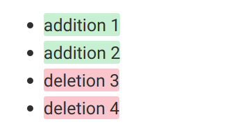
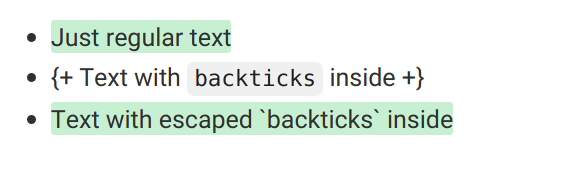
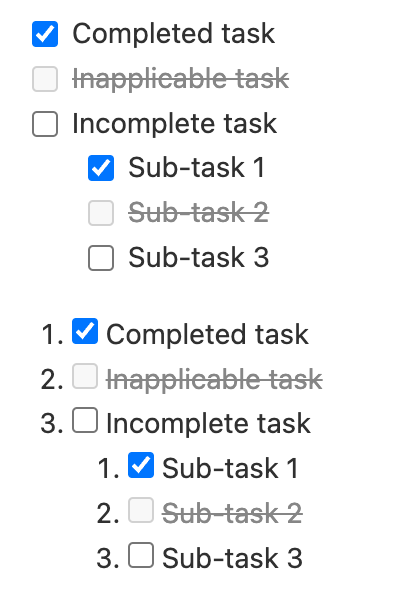
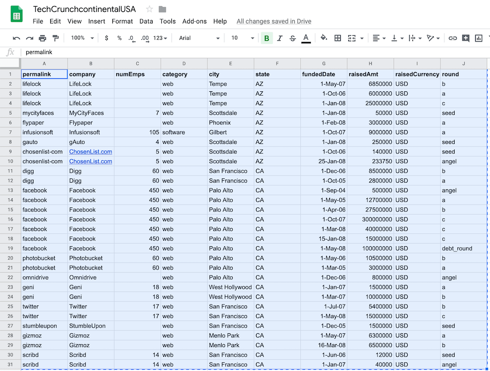
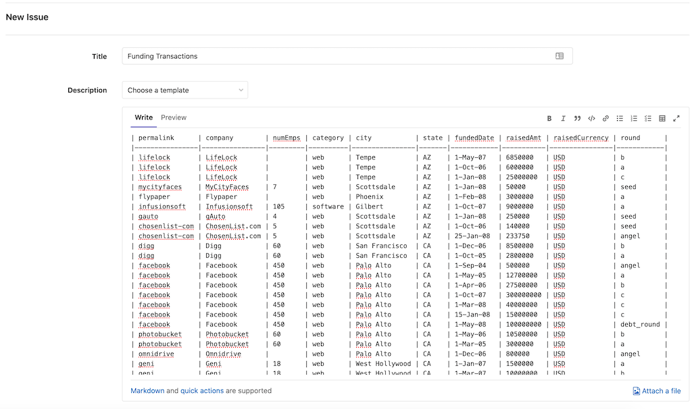
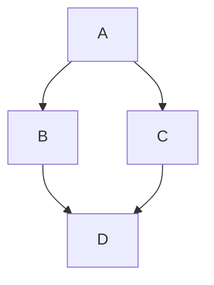
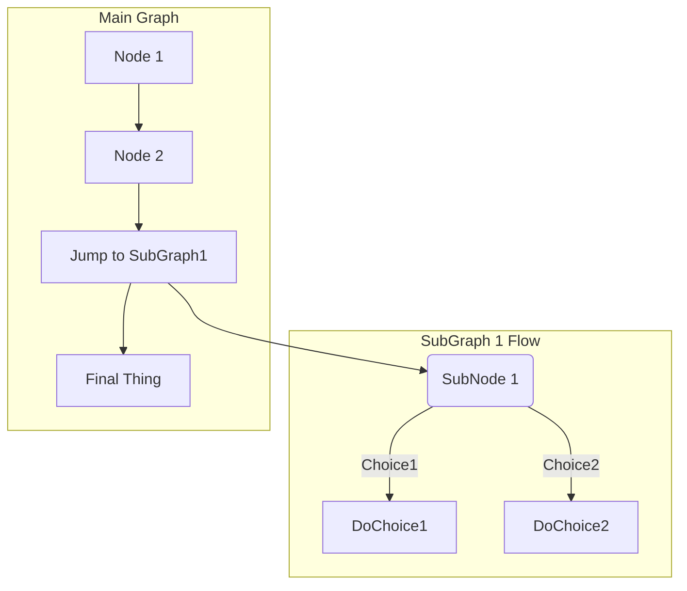
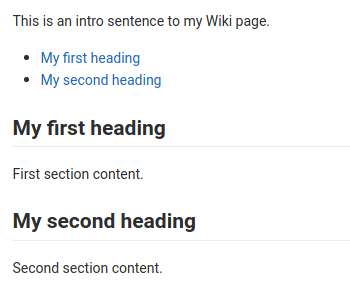



- Tier: 基础版，专业版，旗舰版
- Offering: JihuLab.com，私有化部署



极狐GitLab 风格 Markdown (GLFM) 是一种标记语言，用于在极狐GitLab 用户界面中设置文本格式。
GLFM：

- 创建支持代码、图表、数学公式和多媒体的丰富内容。
- 通过交叉引用链接议题、合并请求和其他极狐GitLab 内容。
- 使用任务列表、表格和可折叠区块组织信息。
- 支持 100 多种编程语言的语法高亮。
- 通过语义化标题结构和图片描述确保可访问性。

当您在极狐GitLab UI 中输入文本时，极狐GitLab 会假定该文本采用极狐GitLab 风格 Markdown。

您可以在以下位置使用极狐GitLab 风格 Markdown：

- 评论
- 议题
- 史诗
- 合并请求
- 里程碑
- 代码片段（代码片段必须以 `.md` 扩展名命名）
- Wiki 页面
- 代码仓库中的 Markdown 文档
- 发布

您还可以在极狐GitLab 中使用其他富文本文件。为此，您可能需要安装依赖项。有关更多信息，请参阅 [`gitlab-markup` gem 项目](https://gitlab.com/gitlab-org/gitlab-markup)。

> [!note]
> 此 Markdown 规范仅适用于极狐GitLab。我们会尽力在此忠实地渲染 Markdown，
> 但 [极狐GitLab 文档网站](https://gitlab.cn/docs/)和 [GitLab 手册](https://handbook.gitlab.com)
> 使用不同的 Markdown 渲染器。

要查看极狐GitLab 如何渲染这些示例的准确效果：

1. 复制相关的原始 Markdown 示例（而不是示例的渲染版本）。
1. 将 Markdown 粘贴到极狐GitLab 中支持 Markdown 预览的任意位置，例如
   议题或合并请求的评论或描述，或新建的 Markdown 文件。
1. 选择**预览**以查看极狐GitLab 渲染的 Markdown。

<a id="differences-with-standard-markdown"></a>

## 与标准 Markdown 的差异

<!--
Use this topic to list features that are not present in standard Markdown.
Don't repeat this information in each individual topic, unless there's a specific
reason, like in "Newlines".
-->

极狐GitLab 风格 Markdown 包含以下内容：

- 基于 [CommonMark 规范](https://spec.commonmark.org/current/)的核心 Markdown 功能。
- 来自 [GitHub Flavored Markdown](https://github.github.com/gfm/)的扩展。
- 专为极狐GitLab 制作的扩展。

所有标准 Markdown 格式在极狐GitLab 中都应该能按预期工作。部分标准功能通过附加特性进行了扩展，而不影响标准用法。

以下功能在标准 Markdown 中不存在：

- [提醒](#alerts)
- [以 `HEX`、`RGB` 或 `HSL` 书写的色块](#colors)
- [描述列表](#description-lists)
- [图表和流程图](#diagrams-and-flowcharts)
- [表情符号](#emoji)
- [脚注](#footnotes)
- [前置元数据](#front-matter)
- [极狐GitLab 专用引用](#gitlab-specific-references)（Markdown 代码片段文件不支持。）
- [包含](#includes)
- [占位符](#placeholders)
- [行内差异](#inline-diff)
- [以 LaTeX 书写的数学公式和符号](#math-equations)
- [删除线](#emphasis)
- [目录](#table-of-contents)
- [表格](#tables)
- [任务列表](#task-lists)
- [Wiki 专用 Markdown](project/wiki/markdown.md)

以下功能是从标准 Markdown 扩展而来的：

| 标准 Markdown                     | 极狐GitLab 中的扩展 Markdown |
|---------------------------------------|-----------------------------|
| [块引用](#blockquotes)           | [多行块引用](#multiline-blockquote) |
| [代码块](#code-spans-and-blocks) | [彩色代码和语法高亮](#syntax-highlighting) |
| [标题](#headings)                 | [可链接的标题锚点](#heading-anchors) |
| [图片](#images)                     | [嵌入视频](#videos)和[音频](#audio) |
| [链接](#links)                       | [自动链接 URL](#url-auto-linking) |

<a id="markdown-and-accessibility"></a>

## Markdown 与可访问性

当您使用极狐GitLab 风格 Markdown 时，您正在创建数字内容。此内容应尽可能方便您的受众访问。以下列表并不详尽，但它为某些需要特别留意的极狐GitLab 风格 Markdown 样式提供了指导：

<a id="accessible-headings"></a>

### 可访问的标题

使用标题格式创建逻辑清晰的标题结构。页面上的标题结构应合理，就像一份良好的目录。确保页面上只有一个 `h1` 元素，标题层级不跳级，并且正确嵌套。

<a id="accessible-tables"></a>

### 可访问的表格

为保持表格可访问且易于浏览，表格不应包含任何空单元格。如果某个单元格没有其他有意义的值，可考虑输入“N/A”或“None”。

<a id="accessible-images-and-videos"></a>

### 可访问的图片和视频

在 `[alt text]` 中描述图片或视频。使描述准确、简洁且唯一。不要在描述中使用 `image of` 或 `video of`。有关更多信息，请参阅 [WebAim 替代文本](https://webaim.org/techniques/alttext/)。

<a id="work-item-and-merge-request-titles"></a>

## 工作项和合并请求标题

议题、合并请求、史诗和其他工作项的标题不支持完整的极狐GitLab 风格 Markdown。标题仅支持：

- 代码段（`` `code` ``），不支持[使用额外的反引号](#use-additional-backticks)或转义。
- 表情符号（`:emoji:` 短代码和自定义表情符号）。
- 自动链接的 URL。
- [极狐GitLab 专用引用](#gitlab-specific-references)，例如 `#123`、
  `@user` 和 `!456`。

加粗、斜体、链接、标题、列表和其他块级格式等标准 Markdown 语法不会在标题中处理。例如，标题 `` **Merge request title** `` 不会以粗体显示，而是会连同星号一起显示。

<a id="headings"></a>

## 标题

使用 `#` 创建 1 到 6 级标题。

```markdown
# H1
## H2
### H3
#### H4
##### H5
###### H6
```

或者，对于 H1 和 H2，使用下划线样式：

```markdown
Alt-H1
======

Alt-H2
------
```

<a id="heading-anchors"></a>

### 标题锚点

极狐GitLab 会自动为每个 Markdown 标题添加锚点，以便您可以链接到它。

悬停时，指向这些锚点的链接会变为可见，以便更轻松地复制指向该标题的链接，以便在其他地方使用。

锚点根据标题内容按以下规则生成：

1. 所有文本转换为小写。
1. 除字母、数字、连字符和下划线之外的所有字符都会被移除。
1. 所有空格转换为连字符。
1. 如果已生成具有相同锚点的标题，
   则追加一个唯一的递增数字，从 1 开始。

示例：

<!--
Translation note: DO NOT TRANSLATE this example. The example must stay untranslated
to stay in sync with the example anchors.
-->

```markdown
# This heading has spaces in it
## This heading has a :thumbsup: in it
# This heading has Unicode in it: 한글
## This heading has spaces in it
### This heading has spaces in it
## This heading has 3.5 in it (and parentheses)
## This heading has  multiple spaces and --- hyphens_and_underscores
```

将生成以下标题锚点：

1. `#this-heading-has-spaces-in-it`
1. `#this-heading-has-a-thumbsup-in-it`
1. `#this-heading-has-unicode-in-it-한글`
1. `#this-heading-has-spaces-in-it-1`
1. `#this-heading-has-spaces-in-it-2`
1. `#this-heading-has-35-in-it-and-parentheses`
1. `#this-heading-has--multiple-spaces-and-----hyphens_and_underscores`

在代码片段中，标题还会获得一个从文件名派生的前缀，以防止跨多个文件出现锚点冲突。例如，名为 `README.md`的文件中的 `## TL;DR` 标题会获得锚点 `#readme-tldr`，而不是 `#tldr`。

<a id="line-breaks"></a>

## 换行

如果前一段文本以两个换行符结尾，则会插入一个换行（开始一个新段落）。例如，当您连续按两次 <kbd>Enter</kbd> 时。如果您只使用一个换行符（按一次 <kbd>Enter</kbd>），下一句仍属于同一段落。如果您希望避免长行换行，并保持其可编辑，请使用此方法：

```markdown
Here's a line for us to start with.

This longer line is separated from the one above by two newlines, so it is a *separate paragraph*.

This line is also a separate paragraph, but...
These lines are only separated by single newlines,
so they *do not break* and just follow the previous lines
in the *same paragraph*.
```

渲染后，该示例看起来类似于：

> 这是我们开始的一行。
>
> 这一较长的行与上面那行由两个换行符分隔，因此它是一个*单独的段落*。
>
> 这一行也是一个单独的段落，但是……
> 这些行仅由单个换行符分隔，
> 因此它们*不会换行*，只是接续前面的行，
> 位于*同一段落*中。

<a id="newlines"></a>

### 换行符

一个段落是一行或多行连续的文本，由一个或多个空行分隔（第一个段落末尾的两个换行符），如[换行](#line-breaks)中所述。

需要对换行或软回车进行更多控制？通过在行末添加反斜杠或两个或更多空格来添加单个换行。连续两个换行符会创建一个新段落，中间有一个空行：

```markdown
First paragraph.
Another line in the same paragraph.
A third line in the same paragraph, but this time ending with two spaces.<space><space>
A new line directly under the first paragraph.

Second paragraph.
Another line, this time ending with a backslash.\
A new line due to the previous backslash.
```

渲染后，该示例看起来类似于：

> 第一个段落。
> 同一段落中的另一行。
> 同一段落中的第三行，但这次以两个空格结尾。<br>
> 直接位于第一个段落下方的新行。
>
> 第二个段落。
> 另一行，这次以反斜杠结尾。\
> 由于前面的反斜杠而产生的新行。

此语法遵循 Markdown 规范中关于处理[段落和换行](https://spec.commonmark.org/current/)的规定。

<a id="emphasis"></a>

## 强调

您可以通过多种方式强调文本。使用斜体、粗体、删除线，或将这些强调样式组合在一起。

示例：

```markdown
Emphasis, or italics, with *asterisks* or _underscores_.

Strong emphasis, or bold, with double **asterisks** or __underscores__.

Combined emphasis with **asterisks and _underscores_**.

Strikethrough with double tildes. ~~Scratch this.~~
```

渲染后，该示例看起来类似于：

> 使用*星号*或*下划线*表示强调，即斜体。
>
> 使用双**星号**或**下划线**表示强烈强调，即粗体。
>
> 使用**星号和 *下划线***组合强调。
>
> 使用双波浪线表示删除线。~~删除此内容。~~

<a id="mid-word-emphasis"></a>

### 词中强调

避免将单词的一部分设为斜体，尤其是在您处理经常出现多个下划线的代码和名称时。

极狐GitLab 风格 Markdown 会忽略单词中的多个下划线，以便更好地渲染讨论代码的 Markdown 文档：

<!--
Translation note: DO NOT TRANSLATE these examples or the rendered versions.
The mid-word emphasis examples do not work in all languages and must stay in English to render correctly.
-->

```markdown
perform_complicated_task

do_this_and_do_that_and_another_thing

but_emphasis is_desired _here_
```

渲染后，该示例看起来类似于：

<!-- vale gitlab_base.Spelling = NO -->

> perform_complicated_task
>
> do_this_and_do_that_and_another_thing
>
> but_emphasis is_desired _here_

<!-- vale gitlab_base.Spelling = YES -->

如果您只想强调单词的一部分，仍然可以使用星号来实现：

```markdown
perform*complicated*task

do*this*and*do*that*and*another thing
```

渲染后，该示例看起来类似于：

> perform*complicated*task
>
> do*this*and*do*that*and*another thing

<a id="inline-diff"></a>

### 行内差异

使用行内差异标签，您可以显示 `{+ additions +}` 或 `[- deletions -]`。

包裹标签可以是花括号或方括号：

<!--
Translation note: DO NOT TRANSLATE this example. The example must stay untranslated
to stay in sync with the image.
-->

```markdown
- {+ addition 1 +}
- [+ addition 2 +]
- {- deletion 3 -}
- [- deletion 4 -]
```



---

但是，您不能混用包裹标签：

```markdown
- {+ addition +]
- [+ addition +}
- {- deletion -]
- [- deletion -}
```

差异高亮不适用于 `` `inline code` ``。如果您的文本包含反引号（`` ` ``），请[转义](#escape-characters)每个反引号，使用反斜杠 ` \ `：

<!--
Translation note: DO NOT TRANSLATE this example. The example must stay untranslated
to stay in sync with the image.
-->

```markdown
- {+ Just regular text +}
- {+ Text with `backticks` inside +}
- {+ Text with escaped \`backticks\` inside +}
```



<a id="horizontal-rule"></a>

## 水平分隔线

使用三个或更多连字符、星号或下划线创建水平分隔线：

```markdown
---

***

___
```

渲染后，所有水平分隔线看起来类似于：

> ---

<a id="lists"></a>

## 列表

您可以创建有序列表和无序列表。

对于有序列表，在每行开头添加您希望列表开始的数字，例如 `1.`，后跟一个空格。在第一个数字之后，使用什么数字并不重要。有序列表会按垂直顺序自动编号，因此在同一列表的所有项中重复使用 `1.` 很常见。如果您以 `1.` 以外的数字开头，它会将该数字用作第一个数字，并从此开始计数。

示例：

```markdown
1. First ordered list item
2. Another item
   - Unordered sub-list.
1. Actual numbers don't matter, just that it's a number
   1. Ordered sub-list
   1. Next ordered sub-list item
4. And another item.
```

<!--
The "2." and "4." in the previous example are changed to "1." in the following example,
to match the style standards on <https://docs.gitlab.com>.
See <https://docs.gitlab.com/development/documentation/styleguide/#lists>.
-->

渲染后，该示例看起来类似于：

> 1. 第一个有序列表项
> 1. 另一项
>    - 无序子列表。
> 1. 实际数字并不重要，只要是数字即可
>    1. 有序子列表
>    1. 下一个有序子列表项
> 1. 还有另一项。

对于无序列表，在每行开头添加 `-`、`*` 或 `+`，后跟一个空格。不要在同一列表中混用这些字符。

```markdown
Unordered lists can:

- use
- minuses

They can also:

* use
* asterisks

They can even:

+ use
+ pluses
```

<!--
The "*" and "+" in the previous example are changed to "-" in the following example,
to match the style standards on <https://docs.gitlab.com>.
See <https://docs.gitlab.com/development/documentation/styleguide/#lists>.
-->

渲染后，该示例看起来类似于：

> 无序列表可以：
>
> - 使用
> - 减号
>
> 它们也可以：
>
> - 使用
> - 星号
>
> 它们甚至可以：
>
> - 使用
> - 加号

---

如果列表项包含多个段落，则每个后续段落都应缩进到与列表项文本开头相同的级别。

示例：

```markdown
1. First ordered list item

   Second paragraph of first item.

1. Another item
```

渲染后，该示例看起来类似于：

> 1. 第一个有序列表项
>
>    第一个项的第二段。
>
> 1. 另一项

如果第一个项的段落没有使用正确数量的空格缩进，该段落会出现在列表之外。使用正确数量的空格在列表项下正确缩进。例如：

```markdown
1. First ordered list item

  (Misaligned paragraph of first item.)

1. Another item
```

渲染后，该示例看起来类似于：

<!-- markdownlint-disable MD027 -->

> 1. 第一个有序列表项
>
>   （第一个项未对齐的段落。）
>
> 1. 另一项

<!-- markdownlint-enable MD027 -->

---

作为无序列表项的第一个子项的有序列表，如果不以 `1.` 开头，则必须有一个前置空行。

例如，带空行时：

```markdown
- Unordered list item

  5. First ordered list item
```

渲染后，该示例看起来类似于：

<!-- markdownlint-disable MD029 -->

> - 无序列表项
>
>   5. 第一个有序列表项

<!-- markdownlint-enable MD029 -->

如果缺少空行，第二个列表项会渲染为第一个列表项的一部分：

```markdown
- Unordered list item
  5. First ordered list item
```

渲染后，该示例看起来类似于：

> - 无序列表项
>   5. 第一个有序列表项

---

CommonMark 会忽略有序列表项和无序列表项之间的空行，并将它们视为单个列表的一部分。这些项会渲染为[松散](https://spec.commonmark.org/0.30/#loose)列表。每个列表项都包含在段落标签中，因此具有段落间距和边距。这会使列表看起来像是每个项之间有额外的间距。

例如：

```markdown
- First list item
- Second list item

- A different list
```

渲染后，该示例看起来类似于：

> - 第一个列表项
> - 第二个列表项
>
> - 一个不同的列表

CommonMark 会忽略空行，并将其渲染为一个带段落间距的列表。

<a id="description-lists"></a>

### 描述列表

描述列表是带有相应描述的术语列表。每个术语可以有多个描述。在 HTML 中，这由 `<dl>`、`<dt>` 和 `<dd>` 标签表示。

要创建描述列表，请将术语放在一行，描述放在下一行，并以冒号开头。

```markdown
Fruits
: apple
: orange

Vegetables
: broccoli
: kale
: spinach
```

您也可以在术语和描述之间留一个空行。

```markdown
Fruits

: apple

: orange
```

> [!note]
> 富文本编辑器不支持插入新的描述列表。要插入新的描述列表，请使用
> 纯文本编辑器。有关更多信息，请参阅[议题 535956](https://gitlab.com/gitlab-org/gitlab/-/issues/535956)。

<a id="task-lists"></a>

### 任务列表

您可以在任何支持 Markdown 的位置添加任务列表。

- 在议题、合并请求、史诗和评论中，您可以选择复选框。
- 在所有其他位置，您无法选择复选框。您必须手动编辑 Markdown，
  在方括号中添加或移除 `x`。

除了完成和未完成之外，任务还可以是不适用。在议题、合并请求、史诗或评论中选择不适用的复选框不会产生任何效果。

要创建任务列表，请遵循有序列表或无序列列表的格式：

<!--
Translation note: DO NOT TRANSLATE this example. The example must stay untranslated
to stay in sync with the image.
-->

```markdown
- [x] Completed task
- [~] Inapplicable task
- [ ] Incomplete task
  - [x] Sub-task 1
  - [~] Sub-task 2
  - [ ] Sub-task 3

1. [x] Completed task
1. [~] Inapplicable task
1. [ ] Incomplete task
   1. [x] Sub-task 1
   1. [~] Sub-task 2
   1. [ ] Sub-task 3
```



您还可以将任务列表添加到[表格单元格](#task-lists-in-tables)。

<a id="links"></a>

## 链接

您可以通过多种方式创建链接：

```markdown
- This line shows an [inline-style link](https://example.com)
- This line shows a [link to a repository file in the same directory](permissions.md)
- This line shows a [relative link to a file one directory higher](../_index.md)
- This line shows a [link that also has title text](https://example.com "This link takes you to Example!")
```

渲染后，这些示例看起来类似于：

> - 此行显示一个[行内样式链接](https://example.com)
> - 此行显示一个[指向同一目录中代码仓库文件的链接](permissions.md)
> - 此行显示一个[指向上一级目录中文件的相对链接](../_index.md)
> - 此行显示一个[同时带有标题文本的链接](https://example.com "此链接会将您带到 Example！")

您不能使用相对链接在 Wiki 页面中引用项目文件，也不能在项目文件中引用 Wiki 页面。存在此限制是因为在极狐GitLab 中 Wiki 始终位于单独的 Git 代码仓库中。例如，`[I'm a reference-style link](style)` 仅在链接位于 Wiki Markdown 文件内时指向 `wikis/style`。
有关更多信息，请参阅 [Wiki 专用 Markdown](project/wiki/markdown.md)。

使用标题锚点链接到页面中的特定章节：

```markdown
- This line links to [a section on a different Markdown page, using a `#` and the heading anchor](permissions.md#project-permissions)
- This line links to [a different section on the same page, using a `#` and the heading anchor](#heading-anchors)
```

渲染后，这些示例看起来类似于：

> - 此行链接到[另一个 Markdown 页面上的某个章节，使用 `#` 和标题锚点](permissions.md#project-permissions)
> - 此行链接到[同一页面上的另一个章节，使用 `#` 和标题锚点](#heading-anchors)

使用链接引用：

<!--
The following codeblock uses extra spaces to avoid the Vale ReferenceLinks test.
Do not remove the two-space nesting.
-->

  ```markdown
  - This line shows a [reference-style link, see below][Arbitrary case-insensitive reference text]
  - You can [use numbers for reference-style link definitions, see below][1]
  - Or leave it empty and use the [link text itself][], see below.

  Some text to show that the reference links can follow later.

  [arbitrary case-insensitive reference text]: https://www.mozilla.org/en-US/
  [1]: https://slashdot.org
  [link text itself]: https://about.gitlab.com/
  ```

<!--
The example below uses in-line links to pass the Vale ReferenceLinks test.
Do not change to reference style links.
-->

渲染后，该示例看起来类似于：

> - 此行是一个[引用样式链接，见下文](https://www.mozilla.org/en-US/)
> - 您可以[使用数字作为引用样式链接定义，见下文](https://slashdot.org)
> - 或者将其留空并使用[链接文本本身](https://about.gitlab.com/)，见下文。
>
> 一些文本，用于表明引用链接可以出现在后面。

<a id="url-auto-linking"></a>

### URL 自动链接

您放入文本中的几乎任何 URL 都会被自动链接：

```markdown
- https://example.com
- ftp://ftp.us.debian.org/debian/
- smb://foo/bar/baz
- irc://irc.freenode.net/
- http://localhost:3000
```

渲染后，该示例看起来类似于：

> - <https://example.com>
> - <ftp://ftp.us.debian.org/debian/>
> - <a href="smb://foo/bar/baz/">smb://foo/bar/baz</a>
> - <a href="irc://irc.freenode.net">irc://irc.freenode.net</a>
> - <http://localhost:3000>

<a id="gitlab-specific-references"></a>

## 极狐GitLab 专用引用

极狐GitLab 风格 Markdown 会渲染极狐GitLab 专用引用。例如，您可以引用
一个议题、一次提交、一位团队成员，甚至整个项目团队。极狐GitLab 风格 Markdown 会将该引用转换为链接，以便您可以在它们之间导航。所有对项目的引用都应使用**项目路径**，而不是项目名称。

此外，极狐GitLab 风格 Markdown 还能识别某些跨项目引用，并且有一种简写形式，用于从同一命名空间引用其他项目。

> [!note]
> Markdown 代码片段文件不支持极狐GitLab 专用引用。

极狐GitLab 风格 Markdown 可识别以下内容：

| 引用                                                                           | 输入                                                 | 跨项目引用                        | 同一命名空间内的快捷方式 |
|--------------------------------------------------------------------------------------|-------------------------------------------------------|------------------------------------------------|------------------------------------|
| 特定用户                                                                        | `@user_name`                                          |                                                |                                    |
| 特定群组                                                                       | `@group_name`                                         |                                                |                                    |
| 整个团队                                                                          | [`@all`](discussions/_index.md#mentioning-all-members) |                                               |                                    |
| 项目                                                                              | `namespace/project>`                                  |                                                |                                    |
| 议题                                                                                | ``#123``、`GL-123` 或 `[issue:123]`                  | `namespace/project#123` 或 `[issue:namespace/project/123]` | `project#123` 或 `[issue:project/123]` |
| [工作项](work_items/_index.md)                                                    | `[work_item:123]`                                     | `[work_item:namespace/project/123]`            | `[work_item:project/123]`          |
| 合并请求                                                                        | `!123`                                                | `namespace/project!123`                        | `project!123`                      |
| 代码片段 <sup>3</sup>                                                                              | `$123`                                                | `namespace/project$123`                        | `project$123`                      |
| 个人代码片段 <sup>3</sup>                                                                     | `$123`                                                |                                                |                                    |
| [史诗](group/epics/_index.md)                                                        | `#123`、`&123`、`[work_item:123]` 或 `[epic:123]`    | `group1/subgroup#123`、`group1/subgroup&123`、`[work_item:group1/subgroup/123]` 或 `[epic:group1/subgroup/123]` |  |
| [迭代](group/iterations/_index.md)                                              | `*iteration:"iteration title"`                        |                                                |                                    |
| 按 ID 引用[迭代节奏](group/iterations/_index.md)<sup>1</sup>                    | `[cadence:123]`                                       |                                                |                                    |
| 按标题（单个词）引用[迭代节奏](group/iterations/_index.md)<sup>1</sup>      | `[cadence:plan]`                                      |                                                |                                    |
| 按标题（多个词）引用[迭代节奏](group/iterations/_index.md)<sup>1</sup> | `[cadence:"plan a"]`                                 |                                                |                                    |
| [漏洞](application_security/vulnerabilities/_index.md)                       | `[vulnerability:123]`                                | `[vulnerability:namespace/project/123]`        | `[vulnerability:project/123]`      |
| 功能标志                                                                         | `[feature_flag:123]`                                  | `[feature_flag:namespace/project/123]`         | `[feature_flag:project/123]`       |
| 按 ID 引用标记 <sup>2</sup>                                                             | `~123`                                                | `namespace/project~123`                        | `project~123`                      |
| 按名称（单个词）引用标记 <sup>2</sup>                                                | `~bug`                                                | `namespace/project~bug`                        | `project~bug`                      |
| 按名称（多个词）引用标记 <sup>2</sup>                                          | `~"feature request"`                                  | `namespace/project~"feature request"`          | `project~"feature request"`        |
| 按名称（限定作用域）引用标记 <sup>2</sup>                                                  | `~"priority::high"`                                   | `namespace/project~"priority::high"`           | `project~"priority::high"`         |
| 按 ID 引用项目里程碑 <sup>2</sup>                                                 | `%123`                                                | `namespace/project%123`                        | `project%123`                      |
| 按名称（单个词）引用里程碑 <sup>2</sup>                                            | `%v1.23`                                              | `namespace/project%v1.23`                      | `project%v1.23`                    |
| 按名称（多个词）引用里程碑 <sup>2</sup>                                      | `%"release candidate"`                                | `namespace/project%"release candidate"`        | `project%"release candidate"`      |
| 提交（特定）                                                                    | `9ba12248`                                            | `namespace/project@9ba12248`                   | `project@9ba12248`                 |
| 提交范围比较                                                              | `9ba12248...b19a04f5`                                 | `namespace/project@9ba12248...b19a04f5`        | `project@9ba12248...b19a04f5`      |
| 代码仓库文件引用                                                            | `[README](doc/README.md)`                             |                                                |                                    |
| 代码仓库文件引用（特定行）                                            | `[README](doc/README.md#L13)`                         |                                                |                                    |
| [提醒](../operations/incident_management/alerts.md)                                 | `^alert#123`                                          | `namespace/project^alert#123`                  | `project^alert#123`                |
| [联系人](crm/_index.md#contacts)                                                    | `[contact:test@example.com]`                          |                                                |                                    |
| [Wiki 页面](project/wiki/_index.md)（如果页面路径与标题相同）      | `[[Home]]` 或 `[wiki_page:Home]`                      | `[wiki_page:namespace/project:Home]` 或 `[wiki_page:group1/subgroup:Home]` |        |
| [Wiki 页面](project/wiki/_index.md)（如果页面路径与标题不同）   | `[[How to use GitLab\|how-to-use-gitlab]]`            |                                                |                                    |

**脚注**：

1. 迭代节奏引用始终按 `[cadence:<ID>]` 格式渲染。
   例如，如果所引用的迭代节奏的 ID 为 `1`，则文本引用 `[cadence:"plan"]` 会渲染为 `[cadence:1]`。
1. 对于标记或里程碑，在 `namespace/project` 前加上 `/`，以指定确切的标记
   或里程碑，从而消除任何可能的歧义。
1. 代码片段 ID 在个人代码片段和项目代码片段中是唯一的，因此给定的 ID 始终标识
   单个代码片段。

例如，使用 `#123` 引用议题会将输出格式化为指向议题编号 123 的链接，文本为 `#123`。同样，指向议题编号 123 的链接也会被识别并格式化为文本 `#123`。如果您不希望 `#123` 链接到议题，请在前面添加反斜杠 `\#123`。

除此之外，指向某些对象的链接也会被识别并格式化。例如：

- 议题上的评论：`"https://gitlab.com/gitlab-org/gitlab/-/issues/1234#note_101075757"`，渲染为 `#1234 (comment 101075757)`
- 议题的设计标签页：`"https://gitlab.com/gitlab-org/gitlab/-/issues/1234/designs"`，渲染为 `#1234 (designs)`。
- 指向单个设计的链接：`"https://gitlab.com/gitlab-org/gitlab/-/issues/1234/designs/layout.png"`，渲染为 `#1234[layout.png]`。

<a id="show-item-title"></a>

### 显示项标题

要在议题、任务、目标、关键结果、合并请求或史诗的渲染链接中包含标题：

- 在引用末尾添加一个加号（`+`）。

例如，像 `#123+` 这样的引用会渲染为 `The issue title (#123)`。

像 `https://gitlab.com/gitlab-org/gitlab/-/issues/1234+` 这样的 URL 引用也会被展开。

<a id="show-item-summary"></a>

### 显示项摘要

要在史诗、议题、任务、目标、关键结果或合并请求的渲染链接中包含扩展摘要：

- 在引用末尾添加 `+s`。

摘要包含所引用项的**指派人**、**里程碑**和**健康状态**信息（视工作项类型而定）。

例如，像 `#123+s` 这样的引用会渲染为
`The issue title (#123) • First Assignee, Second Assignee+ • v15.10 • Needs attention`。

像 `https://gitlab.com/gitlab-org/gitlab/-/issues/1234+s` 这样的 URL 引用也会被展开。

如果指派人、里程碑或健康状态发生变化，要更新渲染的引用：

- 刷新页面。

<a id="comment-preview-on-hover"></a>

### 悬停时预览评论

将鼠标悬停在指向评论的链接上会显示作者和评论的第一行。

<a id="embed-observability-dashboards"></a>

### 嵌入可观测性仪表板

您可以嵌入极狐GitLab 可观测性 UI 仪表板的描述和评论，例如在史诗、议题和合并请求中。

要嵌入可观测性仪表板 URL：

1. 在极狐GitLab 可观测性 UI 中，复制地址栏中的 URL。
1. 将您的链接粘贴到评论或描述中。极狐GitLab 风格 Markdown 会识别该 URL 并显示来源。

<a id="tables"></a>

## 表格

创建表格时：

- 第一行包含表头，由竖线字符（`|`）分隔。
- 第二行将表头与单元格分隔开。
  - 单元格只能包含空格、连字符，以及（可选）用于水平对齐的冒号。
  - 每个单元格必须至少包含一个连字符，但向单元格添加更多连字符不会改变单元格的渲染效果。
  - 不允许使用连字符、空白或冒号以外的任何内容
- 第三行及后续行包含单元格值。
  - 在 Markdown 中，单元格不能跨多行分隔，它们必须保持在单行内，但可以非常长。如果需要，您还可以包含 HTML `<br>` 标签来强制换行。
  - 单元格大小不必彼此匹配。它们是灵活的，但必须由竖线（`|`）分隔。
  - 您可以有空单元格。
- 列宽根据单元格内容动态计算。
- 要在文本中使用竖线字符（`|`）而不是作为表格分隔符，您必须使用反斜杠（`\|`）对其进行[转义](#escape-characters)。

示例：

```markdown
| header 1 | header 2 | header 3 |
| ---      | ------   | -------- |
| cell 1   | cell 2   | cell 3   |
| cell 4 | cell 5 is longer | cell 6 is much longer than the others, but that's ok. It eventually wraps the text when the cell is too large for the display size. |
| cell 7   |          | cell 9   |
```

渲染后，该示例看起来类似于：

> | header 1 | header 2 | header 3 |
> | ---      | ------   | -------- |
> | cell 1   | cell 2   | cell 3   |
> | cell 4 | cell 5 is longer | cell 6 is much longer than the others, but that's ok. It eventually wraps the text when the cell is too large for the display size. |
> | cell 7   |          | cell 9   |

<a id="alignment"></a>

### 对齐

此外，您可以通过在第二行的“短横线”两侧添加冒号（`:`）来选择列中文本的对齐方式。这会影响该列中的每个单元格：

```markdown
| Left Aligned | Centered | Right Aligned |
| :----------- | :------: | ------------: |
| Cell 1       | Cell 2   | Cell 3        |
| Cell 4       | Cell 5   | Cell 6        |
```

渲染后，该示例看起来类似于：

> | Left Aligned | Centered | Right Aligned |
> | :----------- | :------: | ------------: |
> | Cell 1       | Cell 2   | Cell 3        |
> | Cell 4       | Cell 5   | Cell 6        |

在极狐GitLab 中，表格表头在 Chrome 和 Firefox 中始终左对齐，在 Safari 中居中。
有关更多信息，请参阅[表格](#tables)。

<a id="cells-with-multiple-lines"></a>

### 多行单元格

您可以使用 HTML 格式来调整表格的渲染效果。例如，您可以使用 `<br>` 标签强制单元格具有多行：

```markdown
| Name  | Details |
| ----- | ------- |
| Item1 | This text is on one line |
| Item2 | This item has:<br>- Multiple items<br>- That we want listed separately |
```

渲染后，该示例看起来类似于：

> | Name  | Details |
> | ----- | ------- |
> | Item1 | This text is on one line |
> | Item2 | This item has:<br>- Multiple items<br>- That we want listed separately |

<a id="task-lists-in-tables"></a>

### 表格中的任务列表

您可以在 Markdown 表格单元格中添加任务项复选框。该复选框必须是单元格中唯一的内容：

```markdown
| Complete | Task                    |
| -------- | ----------------------- |
|   [x]    | Refactor the backend    |
|   [ ]    | Refactor the frontend   |
|   [~]    | Inapplicable task       |
```

渲染后，该示例看起来类似于：


要在单个单元格中添加多个任务项，或添加带有附加文本的任务项，请使用在单元格中包含 Markdown 的 HTML 表格：

```html
<table>
<thead>
<tr><th>header 1</th><th>header 2</th></tr>
</thead>
<tbody>
<tr>
<td>cell 1</td>
<td>cell 2</td>
</tr>
<tr>
<td>cell 3</td>
<td>

- [ ] Task one
- [ ] Task two

</td>
</tr>
</tbody>
</table>
```

您也可以[在富文本编辑器中创建表格](rich_text_editor.md#tables)，然后插入任务列表。

<a id="copy-and-paste-from-a-spreadsheet"></a>

### 从电子表格复制和粘贴

如果您在电子表格软件（例如 Microsoft Excel、Google
Sheets 或 Apple Numbers）中工作，当您从电子表格复制并粘贴时，极狐GitLab 会创建一个 Markdown 表格。例如，假设您有以下电子表格：



选择单元格并将其复制到剪贴板。打开极狐GitLab Markdown 输入框并粘贴电子表格：



<a id="sort-tables"></a>

### 对表格排序



- Status: 测试版



> [!flag]
> 此功能的可用性由功能标志控制。
> 此功能可用于测试，但尚未准备好用于生产环境。

在渲染后的表格中，您可以按列中的值对行进行排序。

要对表格排序：

1. 选择一个列标题。
   行会按升序排序，标题中的箭头会显示排序方向。
1. 要按降序排序，请再次选择同一列标题。

要使用键盘排序，请将焦点移动到列标题并按 <kbd>Enter</kbd> 或
<kbd>Space</kbd>。

排序行为：

- 值按字母顺序排序，且不区分大小写。
- 数字和日期按文本排序，而不是按其数值或时间顺序排序。
- 空单元格在升序和降序中始终排在表格底部。

您一次只能按一列排序。当您按不同列排序时，之前的排序会被清除。要恢复行的原始顺序，请重新加载页面。

排除项：

- 数据行少于两行或多于 1,000 行的表格。
- [JSON 表格](#json-tables)。
- [富文本编辑器](rich_text_editor.md)中的表格。

<a id="json-tables"></a>

### JSON 表格

要使用 JSON 代码块渲染表格，请使用以下语法：

````markdown
```json:table
{}
```
````

> [!note]
> 管理员可以启用 Markdown 中 iframe 的渲染，并配置实例允许哪些嵌入提供商。
> 您可以使用[应用设置 API](../api/settings.md#available-settings) 管理这些设置，使用：
>
> - `iframe_rendering_enabled`
> - `iframe_rendering_allowlist`
> - `iframe_rendering_allowlist_raw`。

`items` 属性是表示数据点的对象列表。

````markdown
```json:table
{
    "items" : [
      {"a": "11", "b": "22", "c": "33"}
    ]
}
```
````

要指定表格标签，请使用 `fields` 属性。

````markdown
```json:table
{
    "fields" : ["a", "b", "c"],
    "items" : [
      {"a": "11", "b": "22", "c": "33"}
    ]
}
```
````

并非 `items`的所有元素都必须在 `fields`中有对应的值。

````markdown
```json:table
{
    "fields" : ["a", "b", "c"],
    "items" : [
      {"a": "11", "b": "22", "c": "33"},
      {"a": "211", "c": "233"}
    ]
}
```
````

当未明确指定 `fields` 时，标签会从 `items`的第一个元素中选取。

````markdown
```json:table
{
    "items" : [
      {"a": "11", "b": "22", "c": "33"},
      {"a": "211", "c": "233"}
    ]
}
```
````

您可以为 `fields` 指定自定义标签。

````markdown
```json:table
{
    "fields" : [
        {"key": "a", "label": "AA"},
        {"key": "b", "label": "BB"},
        {"key": "c", "label": "CC"}
    ],
    "items" : [
      {"a": "11", "b": "22", "c": "33"},
      {"a": "211", "b": "222", "c": "233"}
    ]
}
```
````

您可以为 `fields`的各个元素启用排序。

````markdown
```json:table
{
    "fields" : [
        {"key": "a", "label": "AA", "sortable": true},
        {"key": "b", "label": "BB"},
        {"key": "c", "label": "CC"}
    ],
    "items" : [
      {"a": "11", "b": "22", "c": "33"},
      {"a": "211", "b": "222", "c": "233"}
    ]
}
```
````

您可以使用 `filter` 属性来渲染一个内容根据用户输入动态筛选的表格。

````markdown
```json:table
{
    "fields" : [
        {"key": "a", "label": "AA"},
        {"key": "b", "label": "BB"},
        {"key": "c", "label": "CC"}
    ],
    "items" : [
      {"a": "11", "b": "22", "c": "33"},
      {"a": "211", "b": "222", "c": "233"}
    ],
    "filter" : true
}
```
````

您可以使用 `markdown` 属性，以允许在项和标题中使用极狐GitLab 风格 Markdown，
包括极狐GitLab 引用。字段不支持 Markdown。

````markdown
```json:table
{
    "fields" : [
        {"key": "a", "label": "AA"},
        {"key": "b", "label": "BB"},
        {"key": "c", "label": "CC"}
    ],
    "items" : [
      {"a": "11", "b": "**22**", "c": "33"},
      {"a": "#1", "b": "222", "c": "233"}
    ],
    "markdown" : true
}
```
````

默认情况下，每个 JSON 表格的标题为 `Generated with JSON data`。您可以通过指定 `caption` 属性来覆盖此标题。

````markdown
```json:table
{
    "items" : [
      {"a": "11", "b": "22", "c": "33"}
    ],
    "caption" : "Custom caption"
}
```
````

如果 JSON 无效，则会发生错误。

````markdown
```json:table
{
    "items" : [
      {"a": "11", "b": "22", "c": "33"}
    ],
}
```
````

<a id="multimedia"></a>

## 多媒体

嵌入图片、视频和音频。您可以使用 Markdown 语法添加多媒体，以链接文件、设置尺寸并以内联方式显示它们。格式选项可让您自定义标题、指定宽度和高度，并控制媒体在渲染输出中的显示方式。

<a id="images"></a>

### 图片

使用前置 `!` 的行内或引用式[链接](#links)嵌入图片。例如：

<!--
DO NOT change the name of `markdown_logo_v17_11.png`. This file is used for a test in
spec/controllers/help_controller_spec.rb.
-->

```markdown

```

> 

在图片链接中：

- 方括号（`[ ]`）中的文本会成为图片替代文本。
- 图片链接路径后双引号中的文本会成为标题文本。
  要查看标题文本，请将鼠标悬停在图片上。

有关更多信息，请参阅[可访问的图片和视频](#accessible-images-and-videos)。

当图片被选中时，它会在叠加层中打开。

如果图片有透明区域，请将鼠标悬停在其上并选择**切换透明度棋盘格**以显示棋盘格背景。棋盘格使透明区域在任何主题下都可见。如果 PNG、WebP 和 GIF 图片至少有 5% 的像素具有某种程度的透明度（并非完全不透明），则会出现**切换透明度棋盘格**。透明像素少于 5% 的图片不会显示该切换按钮。

<a id="videos"></a>

### 视频

链接到具有视频扩展名的文件的图片标签会自动转换为视频播放器。有效的视频扩展名为 `.mp4`、`.m4v`、`.mov`、`.webm` 和 `.ogv`：

以下是一个示例视频：

```markdown

```

此示例仅在[在 GitLab 中渲染](https://gitlab.com/gitlab-org/gitlab/-/blob/master/doc/user/markdown.md#videos)时有效：

> 

<a id="change-image-or-video-dimensions"></a>

### 更改图片或视频尺寸

您可以通过在图片后添加属性列表来控制图片或视频的宽度和高度。该值必须是整数，单位为 `px`（默认）或 `%`。

例如

```markdown
{width=100 height=100px}

{width=75%}
```

此示例仅在[在 GitLab 中渲染](https://gitlab.com/gitlab-org/gitlab/-/blob/master/doc/user/markdown.md#change-image-or-video-dimensions)时有效：

> {width=100 height=100px}

您也可以使用 `img` HTML 标签代替 Markdown，并设置其 `height` 和 `width` 参数。

当您将更高分辨率的 PNG 图片粘贴到 Markdown 文本框中时（[在 GitLab 17.1 及更高版本中](https://gitlab.com/gitlab-org/gitlab/-/issues/419913)），尺寸始终会被附加。尺寸会自动调整以适应视网膜（和其他更高分辨率）显示器。例如，144ppi 的图片会调整为原尺寸的 50%，而 96ppi 的图片会调整为原尺寸的 75%。

选中后，图片会在叠加层中打开，缩放为 100% 或适合窗口的最大尺寸。

<a id="audio"></a>

### 音频

与视频类似，具有音频扩展名的文件的链接标签会自动转换为音频播放器。有效的音频扩展名为 `.mp3`、`.oga`、`.ogg`、`.spx` 和 `.wav`：

以下是一个示例音频片段：

```markdown

```

此示例仅在[在 GitLab 中渲染](https://gitlab.com/gitlab-org/gitlab/-/blob/master/doc/user/markdown.md#audio)时有效：

> 

<a id="blockquotes"></a>

## 块引用

使用块引用突出显示信息，例如旁注。它通过以 `>` 开始块引用的各行来生成：

```markdown
> Blockquotes help you emulate reply text.
> This line is part of the same quote.

Quote break.

> This very long line is still quoted properly when it wraps. Keep writing to make sure this line is long enough to actually wrap for everyone. You can also *use* **Markdown** in a blockquote.
```

渲染后，该示例看起来类似于：

> > 块引用可帮助您模拟回复文本。
> > 此行是同一引用的一部分。
>
> 引用分隔。
>
> > 这一非常长的行在换行时仍会被正确引用。继续书写，以确保这一行足够长，能够对每个人都实际换行。您还可以在块引用中*使用* **Markdown**。

<a id="multiline-blockquote"></a>

### 多行块引用

创建由 `>>>` 围起来的多行块引用：

```markdown
>>>
If you paste a message from somewhere else

that spans multiple lines,

you can quote that without having to manually prepend `>` to every line!
>>>
```

> 如果您从其他地方粘贴一条消息，
>
> 它跨越多行，
>
> 您可以引用它，而无需手动在每一行前面添加 `>`！

<a id="code-spans-and-blocks"></a>

## 代码段和代码块

高亮任何应被视为代码而非标准文本的内容。

行内代码使用单个反引号 `` ` `` 格式化：

```markdown
Inline `code` has `back-ticks around` it.
```

渲染后，该示例看起来类似于：

> 行内 `code` 周围有 `back-ticks around`。

对于更大的代码示例，您可以使用代码块来获得类似效果。要创建代码块：

- 使用三个反引号（```` ``` ````）围住整个代码块。您可以使用三个以上的反引号，
  只要开始和结束的反引号数量相同即可。
- 使用三个波浪线（`~~~`）围住整个代码块。
- 将其缩进四个或更多空格。

例如：

````markdown
Python code block:

```python
def function():
    #indenting works just fine in the fenced code block
    s = "Python code"
    print(s)
```

Markdown code block using 4 spaces:

    Using 4 spaces
    is like using
    3-backtick fences.

JavaScript code block using tildes:

~~~javascript
const s = "JavaScript syntax highlighting";
alert(s);
~~~
````

前面三个示例的渲染结果如下：

> Python 代码块：
>
> ```python
> def function():
>     #indenting works just fine in the fenced code block
>     s = "Python code"
>     print(s)
> ```
>
> 使用 4 个空格的 Markdown 代码块：
>
> ```plaintext
> Using 4 spaces
> is like using
> 3-backtick fences.
> ```
>
> 使用波浪线的 JavaScript 代码块：
>
> ```javascript
> const s = "JavaScript syntax highlighting";
> alert(s);
> ```

<a id="syntax-highlighting"></a>

### 语法高亮

极狐GitLab 使用 [Rouge Ruby 库](https://github.com/rouge-ruby/rouge)在代码块中实现更丰富多彩的语法高亮。有关支持的语言列表，请访问
[Rouge 项目 Wiki](https://github.com/rouge-ruby/rouge/wiki/List-of-supported-languages-and-lexers)。
语法高亮仅在代码块中受支持，因此您无法高亮行内代码。

要围住代码块并对其应用语法高亮，请在开始代码声明中、三个反引号（```` ``` ````）或三个波浪线（`~~~`）之后附加代码语言。

使用 `plaintext` 或未指定代码语言的代码块没有语法高亮：

````plaintext
```
No language indicated, so **no** syntax highlighting.
s = "No highlighting is shown for this line."
But let's throw in a <b>tag</b>.
```
````

渲染后，该示例看起来类似于：

> ```plaintext
> No language indicated, so **no** syntax highlighting.
> s = "No highlighting is shown for this line."
> But let's throw in a <b>tag</b>.
> ```

<a id="embed-code-from-a-repository"></a>

## 嵌入代码仓库中的代码

当您粘贴指向代码仓库中文件各行的[永久链接](project/repository/files/_index.md#create-permalinks)时，极狐GitLab 会将该链接替换为这些行的语法高亮代码片段。嵌入标题会显示文件路径以及嵌入所显示的行。要转到该提交处的文件，请选择标题或行号。

要嵌入代码仓库中的代码：

1. [创建永久链接](project/repository/files/_index.md#create-permalinks)，指向文件中的单行或
   行范围。
1. 将永久链接粘贴到评论或描述中，并使其单独成为一个段落。

例如：

```markdown
The external URL is configured here:

https://gitlab.com/gitlab-org/gitlab/-/blob/d768310246d88433a5534576776939d81846f19e/config/gitlab.yml.example#L35-37
```

永久链接必须：

- 指向同一极狐GitLab 实例上的项目。
- 包含完整的 40 个字符的提交 SHA。使用分支或标签名称的链接不会被嵌入。
- 以行或行范围锚点结尾，例如 `#L27` 或 `#L27-30`。
- 是其段落中唯一的内容，并且其链接文本必须与其 URL 匹配。
  以纯文本形式粘贴的永久链接满足这两个条件。

<a id="limits"></a>

### 限制

极狐GitLab 不会嵌入：

- 超过 100 行的范围，或在第 5000 行之后结束的范围。
- 在文件最后一行之后开始的范围。
- 二进制文件、大于 10 MB 的文件，以及存储在 [Git LFS](../topics/git/lfs/_index.md)中的文件。
- 单个 Markdown 文档中超过 10 个嵌入。

如果范围在文件最后一行之后结束，极狐GitLab 仍会嵌入它，并且嵌入会在最后一行停止。

<a id="cross-project-permalinks"></a>

### 跨项目永久链接

指向不同项目的永久链接仅对可以查看该项目中代码的用户嵌入。其他用户会看到永久链接，因此您和您评论的读者可能看不到相同的内容。

<a id="email-notifications"></a>

### 电子邮件通知

仅当以下两者的差异预览都打开时，极狐GitLab 才会在电子邮件通知中嵌入代码：

- 通知来自的项目或群组。
- 永久链接指向的项目。

极狐GitLab 从不在服务台电子邮件中嵌入代码。在这些情况下，电子邮件会显示永久链接作为替代。您可以为[项目](project/settings/_index.md#turn-off-diff-previews-in-project-email-notifications)或[群组中的所有项目](group/manage.md#disable-diff-previews-in-email-notifications)关闭差异预览。

<a id="diagrams-and-flowcharts"></a>

## 图表和流程图

您可以使用以下工具从文本生成图表：

- [Mermaid](https://mermaidjs.github.io/)
- [PlantUML](https://plantuml.com)
- [Kroki](https://kroki.io)，用于创建各种各样的图表。

在 Wiki 中，您还可以添加和编辑使用 [diagrams.net 编辑器](project/wiki/markdown.md#diagramsnet-editor)创建的图表。

<a id="mermaid"></a>

### Mermaid

有关更多详细信息，请访问[官方页面](https://mermaidjs.github.io/)。[Mermaid 实时编辑器](https://mermaid-js.github.io/mermaid-live-editor/)可帮助您学习 Mermaid 并调试 Mermaid 代码中的问题。使用它来识别并解决图表中的问题。

极狐GitLab 支持 Mermaid 11 版本。

要生成图表或流程图，请在 `mermaid` 块中编写文本：

````markdown

````

> [!note]
> 在极狐GitLab 私有化部署上，如果您配置了 `Cross-Origin-Resource-Policy` 请求头，值为
> `same-site` 或 `same-origin`，Mermaid 图表会静默渲染失败。要解决此问题，请改用
> `cross-origin`。有关更多信息，请参阅
> [`Cross-Origin-Resource-Policy` 请求头和 Mermaid 图表](https://gitlab.cn/docs/omnibus/settings/nginx/#cross-origin-resource-policy-header-and-mermaid-diagrams)。

渲染后，该示例看起来类似于：


您还可以包含子图：

````markdown

````

渲染后，该示例看起来类似于：


要渲染文件或目录树，请使用 `treeView-beta` 图表。缩进定义层级，末尾的 `/` 表示目录：

````markdown

````

渲染后，该示例看起来类似于：


<a id="plantuml"></a>

### PlantUML

PlantUML 集成已在 JihuLab.com 上启用。要在极狐GitLab 私有化部署
安装中提供 PlantUML，极狐GitLab 管理员[必须启用它](../administration/integration/plantuml.md)。

启用 PlantUML 后，不再需要图表分隔符 `@startuml`/`@enduml`，因为它们会被 `plantuml` 块替代。例如：

````markdown
```plantuml
Bob -> Alice : hello
Alice -> Bob : hi
```
````

您可以使用 `::include` 指令，从代码仓库中的单独文件包含或嵌入 PlantUML 图表。有关更多信息，请参阅[包含图表文件](../administration/integration/plantuml.md#include-diagram-files)。

<a id="kroki"></a>

### Kroki

要在极狐GitLab 中提供 Kroki，极狐GitLab 管理员必须启用它。有关更多信息，请参阅 [Kroki 集成](../administration/integration/kroki.md)页面。

<a id="math-equations"></a>

## 数学公式

以 LaTeX 语法书写的数学公式使用 [KaTeX](https://github.com/KaTeX/KaTeX) 渲染。
KaTeX 仅支持 LaTeX 的[子集](https://katex.org/docs/supported.html)。
此语法也适用于使用 `:stem: latexmath`的 AsciiDoc Wiki 和文件。有关详细信息，请参阅
[Asciidoctor 用户手册](https://asciidoctor.org/docs/user-manual/#activating-stem-support)。

为防止恶意活动，极狐GitLab 仅渲染前 1000 个行内数学实例。您可以为[群组](../api/graphql/reference/_index.md#mutationgroupupdate)或整个[极狐GitLab 私有化部署实例](../administration/instance_limits.md#math-rendering-limits)禁用此限制。

数学块的数量也根据渲染时间受到限制。如果超出限制，极狐GitLab 会将超出的数学实例渲染为文本。Wiki 和代码仓库文件没有这些限制。

写在带有反引号的美元符号之间（``` $`...`$ ```）或单个美元符号之间（`$...$`）的数学公式会与文本一起行内渲染。

写在双美元符号之间（`$$...$$`）或在语言声明为 `math`的[代码块](#code-spans-and-blocks)中的数学公式会单独一行渲染：

<!--
Translation note: DO NOT TRANSLATE this example. The example must stay untranslated
to stay in sync with the image.
-->

`````markdown
This math is inline: $`a^2+b^2=c^2`$.

This math is on a separate line using a ` ```math ` block:

```math
a^2+b^2=c^2
```

This math is on a separate line using inline `$$`: $$a^2+b^2=c^2$$

This math is on a separate line using a `$$...$$` block:

$$
a^2+b^2=c^2
$$
`````

渲染后，该示例看起来像：


> [!note]
> 富文本编辑器不支持插入新的数学块。要插入新的数学块，请使用
> 纯文本编辑器。有关更多信息，请参阅[议题 366527](https://gitlab.com/gitlab-org/gitlab/-/issues/366527)。

<a id="table-of-contents"></a>

## 目录

目录是一个无序列表，链接到文档中的子标题。您可以将目录添加到议题、合并请求和史诗，但不能将其添加到评论中。

在受支持内容类型中任意一种的**描述**字段中，将这些标签之一单独放在一行：

<!--
Tags for the table of contents are presented in a code block to work around a Markdown bug.
Do not change the code block back to single backticks.
For more information, see <https://gitlab.com/gitlab-org/gitlab/-/issues/359077>.
-->

```markdown
[[_TOC_]]
or
[TOC]
```

- Markdown 文件。
- Wiki 页面。
- 议题。
- 合并请求。
- 史诗。

> [!note]
> 当您在单个方括号中使用 TOC 代码时，目录也会渲染，无论
> 它是否单独占一行。此行为是意外的。
> 有关更多信息，请参阅[议题 359077](https://gitlab.com/gitlab-org/gitlab/-/issues/359077)。

<!--
Translation note: DO NOT TRANSLATE this example. The example must stay untranslated
to stay in sync with the image.
-->

```markdown
This is an intro sentence to my wiki page.

[[_TOC_]]

## My first heading

First section content.

## My second heading

Second section content.
```



<a id="alerts"></a>

## 提醒

提醒可用于突出显示或引起对某事的注意。提醒语法使用 Markdown 块引用语法，后跟提醒类型。您可以在任何支持 Markdown 的文本框中使用提醒。

您可以使用以下类型的提醒：

<!--
Translation note: DO NOT TRANSLATE any examples in this section. The examples must stay untranslated
to stay in sync with the image.
-->

- 备注：用户即使只是浏览也应考虑的信息：

  ```markdown
  > [!note]
  > The following information is useful.
  ```

- 提示：帮助用户更成功的可选信息：

  ```markdown
  > [!tip]
  > Tip of the day.
  ```

- 重要：用户成功所必需的关键信息：

  ```markdown
  > [!important]
  > This is something important you should know.
  ```

- 注意：某个操作可能带来的负面后果：

  ```markdown
  > [!caution]
  > You need to be very careful about the following.
  ```

- 警告：严重潜在风险：

  ```markdown
  > [!warning]
  > The following would be dangerous.
  ```

提醒显示的标题文本默认为提醒的名称。例如，`> [!warning]` 提醒的标题为 `Warning`。

要覆盖提醒块的标题，请在同一行输入任意文本。例如，要使用警告颜色但将 `Data deletion` 作为标题：

```markdown
> [!warning] Data deletion
> The following instructions will make your data unrecoverable.
```

[多行块引用](#multiline-blockquote)也支持提醒语法。这允许您将大型且更复杂的文本包裹在提醒中。

```markdown
>>> [!note] Things to consider
You should consider the following ramifications:

1. consideration 1
1. consideration 2
>>>
```

提醒的渲染效果如下：


<a id="colors"></a>

## 颜色

Markdown 不支持更改文本颜色。

您可以按以下格式书写颜色代码：`HEX`、`RGB` 或 `HSL`。

- `HEX`：`` `#RGB[A]` `` 或 `` `#RRGGBB[AA]` ``
- `RGB`：`` `RGB[A](R, G, B[, A])` ``
- `HSL`：`` `HSL[A](H, S, L[, A])` ``

不支持命名颜色。

在极狐GitLab 应用程序中（但不在极狐GitLab 文档中），反引号中的颜色代码会在颜色代码旁边显示一个色块。例如：

```markdown
- `#F00`
- `#F00A`
- `#FF0000`
- `#FF0000AA`
- `RGB(0,255,0)`
- `RGB(0%,100%,0%)`
- `RGBA(0,255,0,0.3)`
- `HSL(540,70%,50%)`
- `HSLA(540,70%,50%,0.3)`
```

此示例仅在[在 GitLab 中渲染](https://gitlab.com/gitlab-org/gitlab/-/blob/master/doc/user/markdown.md#colors)时有效：

- `#F00`
- `#F00A`
- `#FF0000`
- `#FF0000AA`
- `RGB(0,255,0)`
- `RGB(0%,100%,0%)`
- `RGBA(0,255,0,0.3)`
- `HSL(540,70%,50%)`
- `HSLA(540,70%,50%,0.3)`

<a id="escape-color-codes"></a>

### 转义颜色代码

要将颜色代码显示为行内代码而不生成色块，请在其前面加上反斜杠（`` \ ``）。

例如：

- `\#FF0000`
- `\RGB(255,0,0)`
- `\HSL(0,100%,50%)`

在所有情况下，反斜杠都会被移除，并且输出中不会渲染色块。

当您希望在行内代码中包含议题编号等值而不意外触发色块时，请使用此方法。

<a id="emoji"></a>

## Emoji

您可以在任何支持极狐GitLab 风格 Markdown 的地方使用 emoji。
例如：

```markdown
Sometimes you want to :monkey: around a bit and add some :star2: to your
:speech_balloon:. Well we have a gift for you: emoji!

You can use it to point out a :bug: or warn about :speak_no_evil: patches.
And if someone improves your really :snail: code, send them some :birthday:.
People :heart: you for that.

If you're new to this, don't be :fearful:. You can join the emoji :family:.
Just look up one of the supported codes.
```

渲染后，该示例大致如下：

> 有时您想 
> 四处逛逛，并为您的一些 
> 添加一些 。
> 那么，我们为您准备了一份礼物：emoji！
>
> 您可以用它来指出一个 
> 或对 
> 补丁发出警告。如果有人改进了您非常 
> 的代码，请送给他们一些 。
> 人们会因此 
> 您。
>
> 如果您是新手，不要 。
> 您可以加入 emoji 。
> 只需查找一个受支持的代码即可。

有关更多信息，请参阅 [emoji 速查表](https://www.webfx.com/tools/emoji-cheat-sheet/)，其中列出了所有受支持的 emoji 代码。

<a id="emoji-and-your-operating-system"></a>

### Emoji 与您的操作系统

前面的 emoji 示例使用的是硬编码图像。在极狐GitLab 中渲染的 emoji 可能因所使用的操作系统和浏览器而有所不同。

大多数 emoji 在 macOS、Windows、iOS、Android 上原生支持，在不支持的地方则回退为基于图像的
emoji。

<!-- vale gitlab_base.Spelling = NO -->

在 Linux 上，您可以下载 [Noto Color Emoji](https://github.com/googlefonts/noto-emoji)
以获得完整的原生 emoji 支持。Ubuntu 22.04（与许多现代 Linux 发行版一样）默认已安装此字体。

<!-- vale gitlab_base.Spelling = YES -->

有关添加自定义 emoji 的更多信息，请参阅[自定义 emoji](emoji_reactions.md#custom-emoji)。

<a id="front-matter"></a>

## Front matter

Front matter 是包含在 Markdown 文档开头、位于内容之前的元数据。这些数据可供
[Jekyll](https://jekyllrb.com/docs/front-matter/)、
[Hugo](https://gohugo.io/content-management/front-matter/) 等静态站点生成器以及许多其他应用程序使用。

当您查看由极狐GitLab 渲染的 Markdown 文件时，front matter 会按原样显示在
文档顶部的框中。HTML 内容显示在 front matter 之后。要查看示例，您可以在 [GitLab 文档文件](https://gitlab.com/gitlab-org/gitlab/-/blob/master/doc/_index.md)的源代码和渲染版本之间切换。

在极狐GitLab 中，front matter 仅用于 Markdown 文件和 Wiki 页面，而不用于其他
支持 Markdown 格式的地方。它必须位于文档的最顶部，并且必须位于分隔符之间。

支持以下分隔符：

- YAML（`---`）：

  ```yaml
  ---
  title: About Front Matter
  example:
    language: yaml
  ---
  ```

- TOML（`+++`）：

  ```toml
  +++
  title = "About Front Matter"
  [example]
  language = "toml"
  +++
  ```

- JSON（`;;;`）：

  ```json
  ;;;
  {
    "title": "About Front Matter",
    "example": {
      "language": "json"
    }
  }
  ;;;
  ```

其他语言可通过向任何现有分隔符添加说明符来支持。例如：

```php
---php
$title = "About Front Matter";
$example = array(
  'language' => "php",
);
---
```

<a id="includes"></a>

## 包含

使用包含（或包含指令）可将一个文档的内容添加到另一个文档中。

例如，一本书可以拆分为多个章节，然后每个章节都可以包含在主书文档中：

```markdown
::include{file=chapter1.md}

::include{file=chapter2.md}
```

在极狐GitLab 中，包含指令仅用于 Markdown 文件和 Wiki 页面，而不用于其他
支持 Markdown 格式的地方。

在 Markdown 文件中使用包含指令：

```markdown
::include{file=example_file.md}
```

在 Wiki 页面中使用包含指令：

```markdown
::include{file=example_page.md}
```

每个 `::include` 都必须从行首开始，并通过 `file=` 指定文件或 URL。指定文件（或 URL）的内容会包含在 `::include` 所在的位置，并
与其余 Markdown 一起处理。

被包含文件内部的包含指令会被忽略。例如，如果 `file1` 包含 `file2`，而 `file2` 包含 `file3`，那么处理 `file1` 时，它不包含 `file3`的内容。

<a id="include-limits"></a>

### 包含限制

为保证良好的系统性能并防止恶意文档造成问题，极狐GitLab 对文档中处理的包含指令数量实施最大限制。默认情况下，一个文档最多可以有 32 个包含指令。

要自定义处理的包含指令数量，管理员可以使用[应用程序设置 API](../api/settings.md#available-settings) 更改 `asciidoc_max_includes` 应用程序设置。

<a id="use-includes-from-external-urls"></a>

### 使用来自外部 URL 的包含

要使用来自单独 Wiki 页面或外部 URL 的包含，管理员可以启用
`wiki_asciidoc_allow_uri_includes`
[应用程序设置](../administration/wikis/_index.md#allow-uri-includes-for-asciidoc)。

```markdown
<!-- define application setting wiki_asciidoc_allow_uri_includes to true to allow content to be read from URI -->
::include{file=https://example.org/installation.md}
```

<a id="use-includes-in-code-blocks"></a>

### 在代码块中使用包含

您可以在代码块内使用 `::include` 指令，以添加代码仓库中文件的内容。例如，如果您的代码仓库包含文件 `javascript_code.js`：

```javascript
const s = "JavaScript syntax highlighting";
alert(s);
```

您可以将其包含在您的 Markdown 文件中：

````markdown
Our script contains:

```javascript
::include{file=javascript_code.js}
```
````

渲染后，该示例大致如下：

> 我们的脚本包含：
>
> ```javascript
> const s = "JavaScript syntax highlighting";
> alert(s);
> ```

<a id="placeholders"></a>

## 占位符

> [!flag]
> 此功能的可用性由功能标志控制。
> 此功能可用于测试，但尚未准备好用于生产环境。

占位符可用于显示某些类型的可变数据，例如项目的标题或最新标签。它们会在每次渲染 Markdown 时填充。

语法为 `%{PLACEHOLDER}`。

| 占位符               | 示例值       | 描述 |
|---------------------------|---------------------|-------------|
| `%{gitlab_server}`        | `gitlab.com`        | 项目的服务器 |
| `%{gitlab_pages_domain}`  | `pages.gitlab.com`  | 托管 GitLab Pages 的域名 |
| `%{project_path}`         | `gitlab-org/gitlab` | 项目的路径，包括父群组 |
| `%{project_name}`         | `gitlab`            | 项目的名称 |
| `%{project_id}`           | `278964`            | 与项目关联的数据库 ID |
| `%{project_namespace}`    | `gitlab-org`        | 项目的项目命名空间 |
| `%{project_title}`        | `GitLab`            | 项目的标题 |
| `%{group_name}`           | `gitlab-org`        | 项目所属的群组 |
| `%{default_branch}`       | `main`              | 为项目代码仓库配置的默认分支名称 |
| `%{current_ref}`          | `feature-branch`    | 当前正在查看的引用（分支、标签或提交 SHA） |
| `%{commit_sha}`           | `ad10e011ce65492322037633ebc054efde37b143` | 项目代码仓库默认分支上最近一次提交的 ID |
| `%{latest_tag}`           | `v17.10.7-ee`       | 添加到项目代码仓库的最新标签 |
| `%{merge_request_iid}`    | `57`                | 合并请求 URL 的项目级 IID。仅在创建合并请求后可用。 |

<a id="escape-characters"></a>

## 转义字符

Markdown 保留以下 ASCII 字符用于格式化页面：

```plaintext
! " # $ % & ' ( ) * + , - . / : ; < = > ? @ [ \ ] ^ _ ` { | } ~
```

要在文本中使用这些保留字符之一，请在保留字符前紧接添加反斜杠字符（` \ `）。当您将反斜杠放在保留字符之前时，Markdown 解析器会省略反斜杠，并将该保留字符视为普通文本。

示例：

```plaintext
\# Not a heading

| Food  | Do you like this food? (circle) |
|-------|---------------------------------|
| Pizza | Yes \| No                       |

\**Not bold, just italic text placed between some asterisks*\*
```

渲染后，该示例大致如下：

> \# 不是标题
>
> | 食物  | 您喜欢这种食物吗？（圈出） |
> |-------|---------------------------------|
> | 披萨 | 是 \| 否                       |
>
> \**不是粗体，只是放在一些星号之间的斜体文本*\*

反斜杠并不总能转义其后的字符。在以下情况下，反斜杠会显示为普通文本：

- 当反斜杠出现在非保留字符之前时，例如 `A`、`3` 或空格。
- 当反斜杠出现在以下 Markdown 元素内部时：
  - 自动链接
  - 行内 HTML，例如 `<kbd>`
  - 代码块
  - 代码段

在这些情况下，您可能需要使用等效的 HTML 实体，例如用 `&#93;` 表示 `]`。

<a id="use-additional-backticks"></a>

### 使用额外的反引号

前面的建议不适用于代码块或代码段，其中的字面内容始终会显示。此时，请使用额外的反引号来嵌套代码。

如果您需要在代码块中包含三个反引号，请使用更多数量的反引号来创建代码块：

`````markdown
To create a code block in Markdown, use three or more matching backticks:

````markdown
```
code
```
````
`````

渲染后，该示例大致如下：

> 要在 Markdown 中创建代码块，请使用三个或更多匹配的反引号：
>
> ````markdown
> ```
> code
> ```
> ````

要在代码段中包含一个或多个反引号，请使用更多数量的匹配反引号来创建代码段。如果内容以空格开头和结尾，这些空格也会被去除：

```markdown
To create a code span in Markdown, use matching backticks: `` `hello, world` ``
```

渲染后，该示例大致如下：

> 要在 Markdown 中创建代码段，请使用匹配的反引号：`` `hello, world` ``

<a id="use-backslash-with-backticks"></a>

### 将反斜杠与反引号一起使用

当反斜杠（` \ `）字符位于行内代码示例末尾时，该反斜杠可以转义最后一个反引号。在这种情况下，请在行内代码周围添加额外的空格，例如：

```markdown
Use the backslash ` \ ` character to escape inline code that ends in a ` backslash\ `.
```

渲染后，该示例大致如下：

> 使用反斜杠 ` \ ` 字符来转义以 ` backslash\ ` 结尾的行内代码。

<a id="footnotes"></a>

## 脚注

脚注会添加一个指向在 Markdown 文件末尾渲染的注释的链接。

要创建脚注，您需要一个引用标记，以及文件任意位置包含注释内容的单独一行。

无论标记名称如何，引用标记的相对顺序决定了渲染后的编号。

无论您将注释放在哪里，它始终显示在渲染文件的底部。

> [!note]
> 富文本编辑器不支持插入新脚注。要插入新脚注，请使用
> 纯文本编辑器。有关更多信息，请参阅[议题 365265](https://gitlab.com/gitlab-org/gitlab/-/issues/365265)。

例如：

- 引用脚注：

  ```markdown
  A footnote reference tag looks like this:[^1]

  This reference tag is a mix of letters and numbers. [^footnote-42]
  ```

- 在文件的其他部分定义脚注：

  ```markdown
  [^1]: This text is inside a footnote.
  [^footnote-42]: This text is another footnote.
  ```

渲染后，脚注大致如下：

> 脚注引用标记如下所示：[^1]
>
> 此引用标记由字母和数字混合组成。[^footnote-42]
>
> [^1]: 此文本位于脚注内。
>
> [^footnote-42]: 此文本是另一个脚注。

<a id="inline-html"></a>

## 行内 HTML

您还可以在 Markdown 中使用原始 HTML，它通常运行得相当不错。

有关允许的 HTML 标签和属性列表，请参阅 `HTML::Pipeline`的 [SanitizationFilter](https://github.com/gjtorikian/html-pipeline/blob/v2.12.3/lib/html/pipeline/sanitization_filter.rb#L42)
类的文档。除了默认的 `SanitizationFilter` 允许名单外，极狐GitLab 还允许 `span`、`abbr`、`details` 和 `summary` 元素。链接上允许使用 `rel="license"`，以支持 [Rel-License 微格式](https://microformats.org/wiki/rel-license)和许可证署名。

```html
<dl>
  <dt>Definition list</dt>
  <dd>Is something people use sometimes.</dd>

  <dt>Markdown in HTML</dt>
  <dd>Does *not* work **very** well. HTML <em>tags</em> do <b>work</b>, in most cases.</dd>
</dl>
```

渲染后，该示例大致如下：

> <dl>
>   <dt>定义列表</dt>
>   <dd>是人们有时会使用的东西。</dd>
>
>   <dt>HTML 中的 Markdown</dt>
>   <dd>*不*能**很好地**工作。HTML <em>标签</em>在大多数情况下<b>确实</b>有效。</dd>
> </dl>

仍然可以在 HTML 标签内使用 Markdown，但前提是包含 Markdown
的行必须分隔为各自独立的行：

```html
<dl>
  <dt>Markdown in HTML</dt>
  <dd>

  Does *not* work **very** well. HTML tags work, in most cases.

  </dd>
</dl>
```

渲染后，该示例大致如下：

<!--
The example below uses HTML to force correct rendering on `docs.gitlab.com`,
Markdown is fine in GitLab.
-->

<!-- markdownlint-disable MD027 -->

> <dl>
>   <dt>HTML 中的 Markdown</dt>
>
>   在大多数情况下，<em>不</em>能<b>很好地</b>工作。HTML 标签在大多数情况下有效。
>
>   </dd>
> </dl>

<!-- markdownlint-enable MD027 -->

<a id="collapsible-section"></a>

### 可折叠区块

可以使用 HTML 的 [`<details>`](https://developer.mozilla.org/en-US/docs/Web/HTML/Reference/Elements/details) 和 [`<summary>`](https://developer.mozilla.org/en-US/docs/Web/HTML/Reference/Elements/summary) 标签来折叠内容。例如，折叠一个很长的日志文件，使其占用更少的屏幕空间。

```html
<details>
<summary>Click to expand</summary>

These details <em>remain</em> <strong>hidden</strong> until expanded.

<pre><code>PASTE LOGS HERE</code></pre>

</details>
```

渲染后，该示例大致如下：

> <details>
> <summary>点击展开</summary>
>
> 这些详细信息在展开之前 <em>保持</em> <strong>隐藏</strong>。
>
> <pre><code>在此粘贴日志</code></pre>
>
> </details>

---

也支持这些标签内的 Markdown。

请记住在任何 Markdown 区块前后留一个空行，如示例所示：

````html
<details>
<summary>

Click to _expand._

</summary>

These details _remain_ **hidden** until expanded.

```
PASTE LOGS HERE
```

</details>
````

<!--
The example below uses HTML to force correct rendering on `docs.gitlab.com`, Markdown
works correctly in GitLab.
-->

渲染后，该示例大致如下：

> <details>
> <summary>点击 <em>展开。</em></summary>
>
> 这些详细信息在展开之前 <em>保持</em> <b>隐藏</b>。
>
> <pre><code>在此粘贴日志</code></pre>
>
> </details>

<a id="keyboard-html-tag"></a>

### 键盘 HTML 标签

`<kbd>` 元素用于标识表示用户键盘输入的文本。由 `<kbd>` 标签包围的文本通常以浏览器的默认等宽字体显示。

```html
Press <kbd>Enter</kbd> to go to the next page.
```

渲染后，该示例大致如下：

> 按 <kbd>Enter</kbd> 转到下一页。

<a id="superscripts-and-subscripts"></a>

### 上标和下标

极狐GitLab 风格 Markdown 不支持 Redcarpet 上标语法（`x^2`）。
对于上标和下标，请使用标准 HTML 语法：

```html
The formula for water is H<sub>2</sub>O
while the equation for the theory of relativity is E = mc<sup>2</sup>.
```

<!-- vale gitlab_base.Spelling = NO -->

渲染后，该示例大致如下：

> 水的化学式是 H<sub>2</sub>O，
> 而相对论的方程式是 E = mc<sup>2</sup>。

<!-- vale gitlab_base.Spelling = YES -->

极狐GitLab 风格 Markdown 不支持 Redcarpet 上标语法（`x^2`）。

<a id="html-comments"></a>

### HTML 注释

您可以在极狐GitLab 风格 Markdown 中使用 HTML 注释来添加在渲染输出中不可见的注释或说明。

使用 HTML 注释可以：

- 为其他贡献者添加注释。
- 在不删除内容的情况下临时隐藏内容。
- 提供不应出现在最终文档中的上下文或说明。
- 添加元数据或处理指令。

使用 HTML 注释时，您应该：

- 谨慎使用，避免使源代码杂乱。
- 保持简洁且相关。
- 将其用于临时注释，而非永久文档。
- 避免包含敏感或机密信息。任何能查看 Markdown 源代码的人都可以看到 HTML 注释。

HTML 注释使用标准 HTML 语法 `<!-- comment text -->`，可以跨单行或多行：

```html
<!-- This is a single-line comment -->

<!--
This is a multi-line comment
that spans several lines
and won't be visible in the rendered output
-->

This text is visible.
<!-- This comment between paragraphs is hidden -->
This text is also visible.
```

渲染后，仅显示可见文本：

> 此文本可见。
>
> 此文本也可见。

<a id="comments-in-code-blocks"></a>

#### 代码块中的注释

代码块内的 HTML 注释会被视为字面文本并显示出来：

````markdown
```html
<!-- This comment will be visible in the code block -->
<div>Content</div>
```
````
