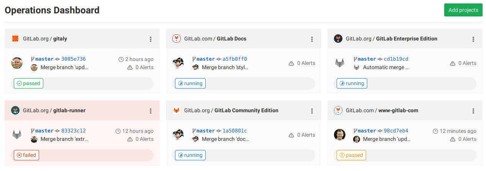



- Tier: 专业版，旗舰版
- Offering: JihuLab.com，私有化部署



运维仪表板提供每个项目运维健康状况的摘要，包括流水线和告警状态。

要访问该仪表板：

1. 在顶部栏中，选择**搜索或跳转到**。
1. 选择**您的工作**。
1. 选择**运维**。

## 将项目添加到仪表板

要将项目添加到仪表板：

1. 确保[您在 Prometheus 中设置的告警](../../operations/incident_management/integrations.md#expected-prometheus-request-attributes)已填充 `gitlab_environment_name` 标签。
   该值应与极狐GitLab 中您的环境名称一致。
   您只能显示 `production` 环境的告警。
1. 在仪表板的主屏幕中选择**添加项目**。
1. 使用**搜索您的项目**字段搜索并添加一个或多个项目。
1. 选择**添加项目**。

添加后，仪表板会显示该项目的活动告警数量、上次提交、流水线状态以及上次部署时间。

运维仪表板和[环境](../../ci/environments/environments_dashboard.md)仪表板共享同一项目列表。在其中一个仪表板中添加或移除项目，也会在另一个仪表板中添加或移除该项目。

## 在仪表板上排列项目

您可以拖动项目卡片来更改它们的顺序。卡片顺序目前仅保存在您的浏览器中，因此不会更改其他人的仪表板。

## 将其设为登录时的默认仪表板

运维仪表板也可以设为登录时显示的默认极狐GitLab 仪表板。要将其设为默认，请参阅[个人资料偏好设置](../profile/preferences.md)。
