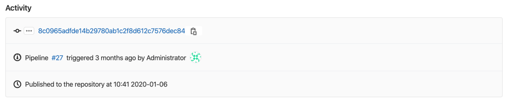



- Tier: 基础版，专业版，旗舰版
- Offering: JihuLab.com，私有化部署



借助极狐GitLab 软件包仓库，您可以将极狐GitLab 用作私有或公开软件包仓库，用于存放各种[受支持的软件包管理器](supported_functionality.md)的软件包。您可以发布和共享软件包，下游项目可以将这些软件包作为依赖项使用。

## 软件包工作流

了解如何使用极狐GitLab 软件包仓库构建您自己的自定义软件包工作流：

- [将项目用作软件包仓库](../workflows/project_registry.md)，
  以将所有软件包发布到一个项目。

- 从一个[单仓库项目](../workflows/working_with_monorepos.md)发布多个不同的软件包。

## 查看软件包

您可以查看项目或群组的软件包：

1. 转到项目或群组。
1. 转到**部署** > **软件包仓库**。

您可以在此页面上搜索、排序和筛选软件包。您可以复制并粘贴浏览器中的 URL，以共享搜索结果。

您还可以找到用于配置软件包管理器或安装给定软件包的有用代码片段。

在群组中查看软件包时：

- 将显示发布到该群组及其项目的所有软件包。
- 仅显示您可以访问的项目。
- 如果项目是私有的，或者您不是该项目的成员，则不会显示该项目的软件包。

要了解如何创建和上传软件包，请按照您的[软件包类型](supported_functionality.md)的说明操作。

## 使用极狐GitLab CI/CD

您可以使用[极狐GitLab CI/CD](../../../ci/_index.md) 构建软件包或将软件包导入软件包仓库。

### 构建软件包

您可以使用 `CI_JOB_TOKEN` 向极狐GitLab 进行身份验证。

要开始使用，您可以使用可用的 [CI/CD 模板](https://gitlab.com/gitlab-org/gitlab/-/tree/master/lib/gitlab/ci/templates)。

有关将极狐GitLab 软件包仓库与 CI/CD 配合使用的更多信息，请参阅：

- [通用](../generic_packages/_index.md#publish-a-package)
- [Maven](../maven_repository/_index.md#create-maven-packages-with-gitlab-cicd)
- [npm](../npm_registry/_index.md#publish-a-package-with-a-cicd-pipeline)
- [NuGet](../nuget_repository/_index.md#with-a-cicd-pipeline)
- [PyPI](../pypi_repository/_index.md#authenticate-with-the-gitlab-package-registry)
- [Terraform](../terraform_module_registry/_index.md#authenticate-to-the-terraform-module-registry)

如果您使用 CI/CD 构建软件包，则在查看软件包详情时会显示扩展的活动信息：

您可以查看是哪个流水线发布了该软件包，以及触发它的提交和用户。但是，历史记录仅限于给定软件包的最近五次更新。

### 导入软件包

如果您已在其他仓库中构建了软件包，可以使用[软件包导入器](https://gitlab.com/gitlab-org/ci-cd/package-stage/pkgs_importer)将它们导入到您的极狐GitLab 软件包仓库中。

有关受支持的软件包列表，请参阅[从其他仓库导入软件包](supported_functionality.md#importing-packages-from-other-repositories)。

## 减少存储用量

有关减少软件包仓库存储用量的信息，请参阅[减少软件包仓库存储用量](reduce_package_registry_storage.md)。

## 关闭软件包仓库

软件包仓库会自动开启。

在极狐GitLab 私有化部署实例上，您的管理员可以从极狐GitLab 边栏中移除**软件包与镜像库**菜单项。有关更多信息，请参阅[极狐GitLab 软件包仓库管理](../../../administration/packages/_index.md)。

您也可以专门为您的项目移除软件包仓库：

1. 在您的项目中，转到**设置** > **通用**。
1. 展开**可见性、项目功能、权限**部分，并禁用
   **软件包**功能。
1. 选择**保存更改**。

**部署** > **软件包仓库**条目将从边栏中移除。

## 软件包仓库可见性权限

[项目权限](../../permissions.md)决定哪些成员和用户可以下载、推送或删除软件包。

软件包仓库的可见性独立于代码仓库，可以从您的项目设置中进行控制。例如，如果您有一个公开项目并将代码仓库可见性设置为**仅项目成员**，则软件包仓库仍为公开。关闭**软件包仓库**开关会关闭所有软件包仓库操作。

| 项目可见性 | 操作                | 所需的最低[角色](../../permissions.md#roles)     |
|--------------------|-----------------------|---------------------------------------------------------|
| 公开             | 查看软件包仓库 | 不适用。互联网上的任何人都可以执行此操作。    |
| 公开             | 发布软件包     | 开发者                                               |
| 公开             | 拉取软件包        | 不适用。互联网上的任何人都可以执行此操作。    |
| 内部           | 查看软件包仓库 | 访客                                                   |
| 内部           | 发布软件包     | 开发者                                               |
| 内部           | 拉取软件包        | 访客 (1)                                               |
| 私有            | 查看软件包仓库 | 报告者                                                |
| 私有            | 发布软件包     | 开发者                                               |
| 私有            | 拉取软件包        | 报告者 (1)                                            |

### 允许任何人从软件包仓库拉取

要允许任何人从软件包仓库拉取，无论项目可见性如何：

1. 在顶部栏中，选择**搜索或跳转到**并找到您的私有或内部项目。
1. 选择**设置** > **通用**。
1. 展开**可见性、项目功能、权限**。
1. 开启**允许任何人从软件包仓库拉取**开关。
1. 选择**保存更改**。

互联网上的任何人都可以访问该项目的软件包仓库。

#### 禁用允许任何人拉取

先决条件：

- 您必须是管理员。

要全局隐藏**允许任何人从软件包仓库拉取**开关：

- [更新应用程序设置](../../../api/settings.md#update-application-settings)，将 `package_registry_allow_anyone_to_pull_option` 设置为 `false`。

匿名下载将被关闭，即使对于已开启**允许任何人从软件包仓库拉取**开关的项目也是如此。

当您允许任何人从软件包仓库拉取时，存在若干已知问题：

- 支持项目的端点。
- 支持群组的 NuGet 仓库端点。但是，由于 NuGet 客户端发送身份验证凭据的方式，不允许匿名下载。即使开启了此设置，也只有极狐GitLab 用户可以从软件包仓库拉取。
- 支持群组的 Maven 仓库端点。
- 支持命名空间的 Terraform 模块仓库端点。
- 其他群组和实例端点未完全支持。群组端点的支持已在 [史诗 14234](https://gitlab.com/groups/gitlab-org/-/epics/14234)中提出。
- 它不适用于 [Composer](../composer_repository/_index.md#install-a-composer-package)，因为 Composer 只有一个群组端点。
- 它适用于 Conan，但使用 [`conan search`](../conan_1_repository/_index.md#search-for-conan-packages-in-the-package-registry) 不起作用。

## 审计事件



- Tier: 专业版，旗舰版
- Offering: JihuLab.com，私有化部署



在发布或删除软件包时创建审计事件。命名空间所有者可以通过 [GraphQL API](../../../api/graphql/reference/_index.md#packagesettings) 开启 `audit_events_enabled` 设置。

您可以查看审计事件：

- 如果软件包的项目位于群组中，则在[**群组审计事件**](../../compliance/audit_events.md#group-audit-events)页面上查看。
- 如果软件包的项目位于用户命名空间中，则在[**项目审计事件**](../../compliance/audit_events.md#project-audit-events)页面上查看。

## 接受贡献

下表列出了不受支持的软件包格式。请考虑为 GitLab 贡献，以添加对这些格式的支持。

<!-- vale gitlab_base.Spelling = NO -->

| 格式    | 状态                                                        |
| --------- | ------------------------------------------------------------- |
| Conda     | [#36891](https://gitlab.com/gitlab-org/gitlab/-/issues/36891) |
| CRAN      | [#36892](https://gitlab.com/gitlab-org/gitlab/-/issues/36892) |
| RPM       | [#5932](https://gitlab.com/groups/gitlab-org/-/epics/5128)    |
| Swift     | [#12233](https://gitlab.com/gitlab-org/gitlab/-/issues/12233) |

<!-- vale gitlab_base.Spelling = YES -->
