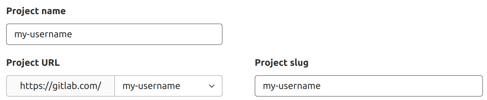



- Tier: 基础版，专业版，旗舰版
- Offering: JihuLab.com，私有化部署



每个极狐GitLab 账号都有一个用户个人资料，其中包含关于您以及您的极狐GitLab 活动的信息。

您的个人资料还包含设置，您可以使用这些设置来自定义您的极狐GitLab 使用体验。

<a id="access-your-user-profile"></a>

## 访问您的用户个人资料

要访问您的个人资料：

1. 在右上角，选择您的头像。
1. 选择您的姓名或用户名。

您还可以使用 ID 代替用户名来访问用户个人资料页面，地址为 `https://gitlab.example.com/-/u/<id>`。例如，如果您的用户名是 `gitlab-user`，ID 是 `12345`，您可以通过 `https://gitlab.example.com/gitlab-user` 或 `https://gitlab.example.com/-/u/12345` 访问该个人资料页面。

<a id="find-the-user-id"></a>

## 查找用户 ID

如果您想通过[极狐GitLab API](../../api/_index.md) 与用户 ID 交互，可能需要用到它。

要查找用户 ID：

1. 转到该用户的个人资料页面。
1. 在个人资料页面的右上角，选择 **操作**（）。
1. 选择 **复制用户 ID**。

<a id="access-your-user-settings"></a>

## 访问您的用户设置

要访问您的用户设置：

1. 在右上角，选择您的头像。
1. 选择 **编辑资料**。

<a id="generate-or-change-your-support-pin"></a>

## 生成或更改您的支持 PIN

极狐GitLab 支持可能会要求您提供个人识别码（PIN）以验证您的身份。PIN 在创建七天后过期。

要生成新的支持 PIN：

1. 在右上角，选择您的头像。
1. 选择 **编辑资料**。
1. 在左侧边栏中，选择 **账户**。
1. 选择 **生成新 PIN**。

<a id="access-your-support-pin"></a>

## 访问您的支持 PIN

如果您之前创建过支持 PIN，该 PIN 可在您的个人资料中访问，并在创建七天后过期。

要访问您的支持 PIN：

1. 在右上角，选择您的头像。
1. 选择 **编辑资料**。
1. 在左侧边栏中，选择 **账户**。

<a id="change-your-username"></a>

## 更改您的用户名

您的用户名具有唯一的[命名空间](../namespace/_index.md)，当您更改用户名时，该命名空间也会更新。在更改用户名之前，请阅读[重定向的行为方式](../project/repository/_index.md#repository-path-changes)。如果您不想更新命名空间，可以改为创建一个新的用户或群组，并将项目转移到其中。

先决条件：

- 您的命名空间不得：
  - 包含带有[容器镜像仓库](../packages/container_registry/_index.md)标记的项目。
  - 拥有托管 [GitLab Pages](../project/pages/_index.md)的项目。
- 您的用户名：
  - 长度必须在 2 到 255 个字符之间。
  - 只能包含非重音字母、数字、`_`、`-` 和 `.`。
  - 不得：
    - 以 `_`、`-` 或 `.` 开头。
    - 包含 emoji。
    - 以 `.` 或 `.<reserved file extension>` 结尾，例如 `jon.png`、`jon.git` 或 `jon.atom`。不过，
      `jonpng` 是有效的。

要更改您的用户名：

1. 在右上角，选择您的头像。
1. 选择 **编辑资料**。
1. 在左侧边栏中，选择 **账户**。
1. 在 **更改用户名** 部分，输入新的用户名作为路径。
1. 选择 **更新用户名**。

<a id="add-emails-to-your-user-profile"></a>

## 向您的用户个人资料添加电子邮件地址

要向您的账号添加新的电子邮件地址：

1. 在右上角，选择您的头像。
1. 选择 **编辑资料**。
1. 在左侧边栏中，选择 **电子邮件**。
1. 选择 **添加新电子邮件**。
1. 在 **电子邮件地址** 文本框中，输入新的电子邮件地址。
1. 选择 **添加电子邮件地址**。
1. 使用收到的验证电子邮件验证您的电子邮件地址。

新的电子邮件地址会作为备用电子邮件地址添加。您可以使用备用电子邮件地址重置密码，但不能用于身份验证。您可以更新您的[主电子邮件地址](#change-your-primary-email)。

> [!note]
> [将您的电子邮件设为非公开](#set-your-public-email)并不会阻止其用于提交匹配和
> [群组与项目导入](../import/_index.md)。

<a id="delete-email-addresses-from-your-user-profile"></a>

## 从您的用户个人资料中删除电子邮件地址

您可以从您的账号中删除备用电子邮件地址。您无法删除您的主电子邮件地址。

如果被删除的电子邮件地址用于任何用户电子邮件，这些用户电子邮件将改为发送到主电子邮件地址。

未验证的备用电子邮件地址会在三天后自动删除。

要从您的账号中删除电子邮件地址：

1. 在右上角，选择您的头像。
1. 选择 **编辑资料**。
1. 在左侧边栏中，选择 **电子邮件**。
1. 选择 **删除**（）并确认您要 **移除**。

您也可以[使用 API 删除备用电子邮件地址](../../api/user_email_addresses.md#delete-an-email-address)。

<a id="make-your-user-profile-page-private"></a>

## 将您的用户个人资料页面设为私有

您可以将您的用户个人资料设为仅您自己和极狐GitLab 管理员可见。

> [!note]
> 极狐GitLab 管理员可以[禁用](../../administration/settings/account_and_limit_settings.md#prevent-users-from-making-their-profiles-private)此设置，从而强制将所有个人资料设为公开。

要将您的个人资料设为私有：

1. 在右上角，选择您的头像。
1. 选择 **编辑资料**。
1. 选中 **私有资料** 复选框。
1. 选择 **更新资料设置**。

以下内容将从您的用户个人资料页面（`https://gitlab.example.com/username`）中隐藏：

- Atom 订阅源
- 账号创建日期
- 活动、群组、贡献的项目、个人项目、加星标的项目、代码片段的标签页

> [!note]
> 将您的用户个人资料页面设为私有并不会从
> REST 或 GraphQL API 中隐藏您的所有公开资源。例如，与您的提交
> 签名关联的电子邮件地址仍可访问，除非您[使用自动生成的私有提交电子邮件](#use-an-automatically-generated-private-commit-email)。

<a id="user-visibility"></a>

### 用户可见性

用户的公开页面位于 `/username`，无论您是否已登录，该页面始终可见。

访问用户的公开页面时，您只能看到您有权限查看的项目。

如果[公开级别受到限制](../../administration/settings/visibility_and_access_controls.md#restrict-visibility-levels)，则用户个人资料仅对已通过身份验证的用户可见。

<a id="add-details-to-your-profile-with-a-readme"></a>

## 使用 README 向您的个人资料添加详细信息

您可以使用 README 文件向您的个人资料页面添加更多信息。当您用信息填充 README 文件时，这些信息会包含在您的个人资料页面中。

<a id="from-a-new-project"></a>

### 通过新项目

要创建一个新项目并将其 README 添加到您的个人资料：

1. 在右上角，选择 **新建**（）和 **新建项目/仓库**。
1. 选择 **创建空白项目**。
1. 输入项目详细信息：
   - 在 **项目名称** 字段中，输入新项目的名称。
   - 在 **项目 URL** 字段中，选择您的极狐GitLab 用户名。
   - 在 **项目别名** 字段中，输入您的极狐GitLab 用户名。
     所有这些字段都区分大小写。如果您的用户名包含大写字母，请在项目 slug 字段中输入时保留这些大写字母。
1. 对于 **可见性级别**，选择 **公开**。
   
1. 对于 **项目配置**，确保已选中 **使用 README 初始化仓库**。
1. 选择 **创建项目**。
1. 在此项目中创建一个 README 文件。该文件可以是任何有效的 [README 或索引文件](../project/repository/files/_index.md#readme-and-index-files)。
1. 使用 [Markdown](../markdown.md) 或其他[支持的标记语言](../project/repository/files/_index.md#supported-markup-languages)填充 README 文件。

极狐GitLab 会在您的贡献图下方显示 README 的内容。

<a id="from-an-existing-project"></a>

### 通过现有项目

要将现有项目的 README 添加到您的个人资料，请[更新该项目的路径](../project/working_with_projects.md#rename-a-repository)以匹配您的用户名。

<a id="add-external-accounts-to-your-user-profile-page"></a>

## 向您的用户个人资料页面添加外部账号

您可以添加指向您可能拥有的某些其他外部账号的链接，例如 Discord 和 X（原 Twitter）。它们可以帮助其他用户在其他平台上与您联系。

要添加指向其他账号的链接：

1. 在右上角，选择您的头像。
1. 选择 **编辑资料**。
1. 在 **主要设置** 部分，添加您的：
   - Discord [用户 ID](https://support.discord.com/hc/en-us/articles/206346498-Where-can-I-find-my-User-Server-Message-ID)。
   - BlueSky [`did:plc` 标识符](https://atproto.com/specs/did)。要查找您的标识符，请[解析您的用户句柄](https://bsky.social/xrpc/com.atproto.identity.resolveHandle?handle=USER_HANDLE)。
   - Discord [用户 ID](https://support.discord.com/hc/en-us/articles/206346498-Where-can-I-find-my-User-Server-Message-ID)。
   - GitHub 用户名。
   - LinkedIn 个人资料名称。
   - [Mastodon 句柄](#add-a-mastodon-handle)。
   - [ORCID](https://orcid.org/)。
   - X（原 Twitter）@用户名。

   您的用户 ID 或用户名不得超过 500 个字符。
1. 选择 **更新资料设置**。

<a id="add-a-mastodon-handle"></a>

### 添加 Mastodon 句柄

要添加 Mastodon 句柄：

1. 将 Mastodon 句柄添加到您的极狐GitLab 个人资料。
   1. 登录极狐GitLab。
   1. 在右上角，选择您的头像。
   1. 选择 **编辑资料**。
   1. 在 **社交账户** 部分，转到 **Mastodon** 并输入您的句柄。例如：`@alex.garcia@exampleServer`。
   1. 选择 **更新资料设置**。
1. 获取验证 URI。
   1. 在右上角，选择您的头像。
   1. 选择您的姓名或用户名。
   1. 在右侧，选择您的 Mastodon 句柄。
   1. 从打开的页面中复制 URI。
1. 向 Mastodon 添加验证。
   1. 转到您的 Mastodon 个人资料设置。
   1. 在 **额外字段** 部分，输入之前的 URI。
   1. 保存您的 Mastodon 个人资料更改。

确认在 Mastodon 中您的极狐GitLab 站点额外字段旁边显示绿色对勾。如果未显示绿色对勾，您可能需要执行其他故障排除。

<a id="show-private-contributions-on-your-user-profile-page"></a>

## 在您的用户个人资料页面显示私有贡献

在用户贡献日历图和最近活动列表中，您可以看到您对私有项目的[贡献操作](contributions_calendar.md#user-contribution-events)。

要显示私有贡献：

1. 在右上角，选择您的头像。
1. 选择 **编辑资料**。
1. 在 **主要设置** 部分，选中 **在资料中包含私有贡献** 复选框。
1. 选择 **更新资料设置**。

<a id="add-your-gender-pronouns"></a>

## 添加您的性别代词

您可以将您的性别代词添加到您的极狐GitLab 账号，以便在个人资料中您的姓名旁边显示。

要指定您的代词：

1. 在右上角，选择您的头像。
1. 选择 **编辑资料**。
1. 在 **代词** 文本框中，输入您的代词。文本不得超过 50 个字符。
1. 选择 **更新资料设置**。

<a id="add-your-name-pronunciation"></a>

## 添加您的姓名发音

您可以将您的姓名发音添加到您的极狐GitLab 账号。这会在您的个人资料中您的姓名下方显示。

要添加您的姓名发音：

1. 在右上角，选择您的头像。
1. 选择 **编辑资料**。
1. 在 **发音** 文本框中，输入您的姓名如何发音。发音必须是纯文本且不超过 255 个字符。
1. 选择 **更新资料设置**。

<a id="set-your-status"></a>

## 设置您的状态

设置您的状态，让他人了解您的可用情况。当他人将鼠标悬停在您的头像、姓名或用户名上时，可以看到您的状态。即使您[将用户个人资料页面设为私有](#make-your-user-profile-page-private)，您的状态仍公开可见。

您的状态由以下元素组成。您可以分别使用每个元素来表示您的状态。

- 用于表示您状态的 emoji。
- 描述您可用情况的消息。您可以包含诸如 `:palm_tree:` 或 `:bulb:` 之类的 emoji 代码。最多 100 个字符。
- 一个复选框，用于向您的状态添加 `Busy` 徽章。

要设置您的当前状态：

1. 在右上角，选择您的头像。
1. 选择 **设置状态**。如果您之前设置过状态，请改为选择 **编辑状态**。
1. 可选。输入状态消息。
1. 可选。选中 **将自己设为忙碌** 复选框。
1. 可选。从 **清除状态于** 下拉列表中选择一个值。
1. 选择 **设置状态**。

您的状态已更新。您也可以从[用户设置](#access-your-user-settings)页面或使用 [Users API](../../api/users.md#set-your-user-status) 设置您的状态。

<a id="set-your-time-zone"></a>

## 设置您的时区

您可以将您的本地时区设置为：

- 在您的个人资料中，以及在将鼠标悬停在您的姓名上会显示关于您的信息的位置，显示您的本地时间。
- 使您的贡献日历与您的本地时间对齐，以更好地反映您做出贡献的时间

要设置您的时区：

1. 在右上角，选择您的头像。
1. 选择 **编辑资料**。
1. 在 **时间设置** 部分，从下拉列表中选择您的时区。

<a id="change-the-email-displayed-on-your-commits"></a>

## 更改您提交中显示的电子邮件地址

提交电子邮件是极狐GitLab 界面中执行的每个 Git 相关操作所显示的电子邮件地址。

您自己任何已验证的电子邮件地址都可以用作提交电子邮件。默认使用您的主电子邮件地址。

要更改您的提交电子邮件：

1. 在右上角，选择您的头像。
1. 选择 **编辑资料**。
1. 在 **提交电子邮件** 下拉列表中，选择一个电子邮件地址。
1. 选择 **更新资料设置**。

<a id="change-your-primary-email"></a>

## 更改您的主电子邮件地址

您的主电子邮件地址是用于登录、提交电子邮件和通知电子邮件的默认电子邮件地址。如果您的主电子邮件地址发生更改，您原来的主电子邮件地址会作为备用电子邮件地址添加。此功能使使用您原来主电子邮件地址所做的提交仍与您的账号关联。

要更改您的主电子邮件地址：

1. 在右上角，选择您的头像。
1. 选择 **编辑资料**。
1. 在 **电子邮件地址** 字段中，输入您的新电子邮件地址。
1. 选择 **更新资料设置**。
1. 可选。如果您之前未将此电子邮件地址添加到您的 JihuLab.com 账号，请选择确认电子邮件。

<a id="set-your-public-email"></a>

## 设置您的公开电子邮件地址

您可以选择您[已配置的电子邮件地址](#add-emails-to-your-user-profile)之一，以在您的公开个人资料中显示：

1. 在右上角，选择您的头像。
1. 选择 **编辑资料**。
1. 在 **公开电子邮件** 字段中，选择一个可用的电子邮件地址。
1. 选择 **更新资料设置**。

<a id="use-an-automatically-generated-private-commit-email"></a>

### 使用自动生成的私有提交电子邮件

极狐GitLab 提供自动生成的私有提交电子邮件地址，以便您可以对自己的电子邮件信息保密。

要使用私有提交电子邮件：

1. 在右上角，选择您的头像。
1. 选择 **编辑资料**。
1. 在 **提交电子邮件** 下拉列表中，选择 **使用私有电子邮件**。
1. 选择 **更新资料设置**。

每个 Git 相关操作都会使用该私有提交电子邮件。

要完全匿名，您还可以复制该私有提交电子邮件，并使用以下命令在您的本地机器上进行配置：

```shell
git config --global user.email <your email address>
```

<a id="follow-users"></a>

## 关注用户

您可以从以下任一位置关注或取消关注用户：

- 他们的[用户个人资料](#access-your-user-profile)。
- 将鼠标悬停在用户名上时出现的小弹出窗口。

您最多可以关注 300 个用户。

被屏蔽的用户不会出现在用户个人资料的关注者列表中。

<a id="disable-following-and-being-followed-by-other-users"></a>

### 禁用关注其他用户和被其他用户关注

您可以禁用关注其他用户和被其他用户关注。

1. 在右上角，选择您的头像。
1. 选择 **编辑资料**。
1. 选择 **偏好设置**。
1. 清除 **启用关注用户** 复选框。
1. 选择 **保存更改**。

> [!note]
> 禁用此功能时，所有当前的关注/被关注关系都会被删除。

<a id="view-a-users-activity"></a>

## 查看用户的活动

极狐GitLab 会跟踪[用户贡献活动](contributions_calendar.md)。要查看用户的活动：

1. 转到该用户的个人资料。
1. 在极狐GitLab 菜单中，选择 **活动**。

将显示 **最近活动** 贡献列表。

<a id="view-your-activity"></a>

## 查看您的活动

要查看您的活动：

1. 在顶部栏中，选择 **搜索或跳转到**。
1. 选择 **您的工作**。
1. 选择 **活动**。
1. 可选。要按贡献类型筛选您的活动，请在 **您的活动** 标签页中选择一个标签页：

   - **全部**：您在群组和项目中所做的所有贡献。
   - **推送事件**：您在项目中所做的推送事件。
   - **合并事件**：您在项目中接受的合并请求。
   - **议题事件**：您在项目中打开和关闭的议题。
   - **评论**：您在项目中发布的评论。
   - **Wiki**：您在项目中创建和更新的 Wiki 页面。
   - **设计**：您在项目中添加、更新和移除的设计。
   - **团队**：您加入和离开的项目。
1. 可选。要订阅此活动的 RSS 订阅源，请在右上角
   选择订阅源符号（）。

该订阅源始终包含您是成员的项目中的所有活动，无论您选择了哪个标签页或筛选条件。订阅源 URL 包含一个[订阅源令牌](../../security/tokens/_index.md#feed-token)，用于对您进行身份验证。

<a id="sign-in-services"></a>

## 登录服务

您可以使用登录服务来代替常规的用户名和密码登录极狐GitLab。

<a id="connect-a-sign-in-service"></a>

### 连接登录服务

要连接用于登录极狐GitLab 的登录服务：

1. 在右上角，选择您的头像。
1. 选择 **编辑资料**。
1. 在左侧边栏中，选择 **访问** > **密码和身份验证**。
1. 找到 **服务登录** 部分。
1. 在 **已连接账户** 部分下，选择与您想用于登录的服务相对应的按钮。
1. 按照所选服务的说明开始使用它登录。

<a id="disconnect-a-sign-in-service"></a>

### 断开登录服务

要断开用于登录极狐GitLab 的登录服务：

1. 在右上角，选择您的头像。
1. 选择 **编辑资料**。
1. 在左侧边栏中，选择 **访问** > **密码和身份验证**。
1. 找到 **服务登录** 部分。
1. 在 **已连接账户** 部分下，选择与您不再想用于登录的服务相对应的按钮旁边的 **断开连接**。

<a id="session-duration"></a>

## 会话时长

<a id="stay-signed-in-for-one-week"></a>

### 保持登录一周

默认情况下，在您停止活动七天后（10080 分钟），或直到您关闭浏览器窗口，以先发生者为准，您会从极狐GitLab 中退出登录。

极狐GitLab 管理员可以[更改此默认值](../../administration/settings/account_and_limit_settings.md#customize-the-default-session-duration)。

<a id="stay-signed-in-indefinitely"></a>

### 无限期保持登录

要无限期保持登录，请在极狐GitLab 登录页面上选中 **记住我** 复选框。

您会保持登录状态，因为尽管服务器将会话时间设置为一周，但您的浏览器会存储一个安全令牌，从而实现自动重新身份验证。

对于出于安全或合规目的需要会话定期过期的环境，极狐GitLab 管理员可以[关闭 **记住我** 设置](../../administration/settings/account_and_limit_settings.md#session-duration)。

<a id="cookies-used-for-sign-in"></a>

### 用于登录的 Cookie

当您登录时，会设置三个 Cookie：

- 一个名为 `_gitlab_session`的会话 Cookie。
  此 Cookie 没有设置过期日期。但是，它会根据其 `session_expire_delay` 过期。
- 一个名为 `gitlab_user`的会话 Cookie。
  此 Cookie 由[营销站点](https://about.gitlab.com/)用于确定用户是否具有活动的极狐GitLab 会话。不会向该 Cookie 传递任何用户信息，它会在登录两周后过期。
- 一个名为 `remember_user_token`的持久 Cookie，仅当您在登录页面上选中 **记住我** 时才会设置。

当您关闭浏览器时，`_gitlab_session` 和 `gitlab_user` Cookie 通常会在客户端被清除。当它过期或不可用时，极狐GitLab：

- 使用 `remember_user_token` Cookie 为您获取新的 `_gitlab_session` Cookie 并保持您登录，即使您关闭了浏览器。
- 将 `gitlab_user` 设置为 `true`。

当 `remember_user_token` 和 `_gitlab_session` Cookie 都不存在或已过期时，您必须重新登录。

> [!note]
> 当任何会话退出登录时，或当某个会话从
> [活动会话列表](active_sessions.md)中被撤销时，所有 **记住我** 令牌都会被撤销。
> 当其他会话仍处于活动状态时，如果浏览器关闭或现有会话过期，**记住我** 功能不会恢复
> 会话。
