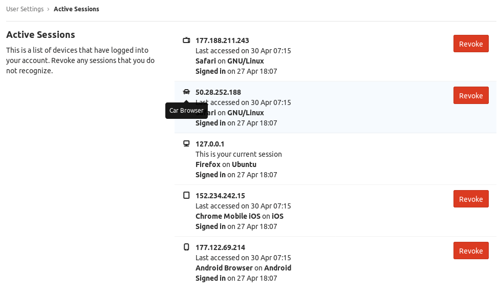



- Tier: 基础版，专业版，旗舰版
- Offering: JihuLab.com，私有化部署



极狐GitLab 会列出所有已登录您账号的设备。您可以查看这些会话，并撤销任何您不认识的会话。

<a id="list-all-active-sessions"></a>

## 列出所有活跃会话

要列出所有活跃会话：

1. 在右上角，选择您的头像。
1. 选择**编辑个人资料**。
1. 在左侧边栏中，选择**访问** > **活跃会话**。



<a id="active-sessions-limit"></a>

## 活跃会话数量限制

极狐GitLab 允许用户同时最多拥有 100 个活跃会话。如果活跃会话数量超过 100，最早的会话将被删除。

<a id="revoke-a-session"></a>

## 撤销会话

要撤销一个活跃会话：

1. 在右上角，选择您的头像。
1. 选择**编辑个人资料**。
1. 在左侧边栏中，选择**访问** > **活跃会话**。
1. 在某个会话旁选择**撤销**。当前会话无法撤销，因为这样会让您退出极狐GitLab 登录。

> [!note]
> 当任何会话被撤销时，所有设备的**记住我**令牌都会被撤销。有关**记住我**的详细信息，请参阅
> [用于登录的 Cookie](_index.md#cookies-used-for-sign-in)。

<a id="revoke-sessions-through-the-rails-console"></a>

## 通过 Rails 控制台撤销会话

您也可以通过 Rails 控制台撤销用户会话。您可以使用此方式同时撤销多个会话。

<a id="revoke-all-sessions-for-all-users"></a>

### 撤销所有用户的所有会话

要撤销所有用户的所有会话：

1. [启动 Rails 控制台会话](../../administration/operations/rails_console.md#starting-a-rails-console-session)。
1. 可选。使用以下命令列出所有活跃会话：

   ```ruby
   # Show all users with active sessions
    puts "=== Currently Logged In Users ==="
    User.find_each do |user|
        sessions = ActiveSession.list(user)
        if sessions.any?
            puts "\n#{user.username} (#{user.name}):"
            sessions.each do |session|
                puts "  - IP: #{session.ip_address}, Browser: #{session.browser}, Last active: #{session.updated_at}"
            end
        end
    end
   ```

1. 使用以下命令撤销所有会话：

   ```ruby
   User.find_each do |user|
      ActiveSession.destroy_all_but_current(user, nil)
   end
   ```

1. 可选。再次运行“列出所有活跃会话”命令，确认所有会话均已撤销。

<a id="revoke-all-sessions-for-all-users-of-a-group"></a>

### 撤销某个群组所有用户的所有会话

1. 将以下脚本保存到您的极狐GitLab 实例。例如，`scripts/session_revocation/revoke_group_sessions.rb`。

   ```ruby
   # frozen_string_literal: true
   #
   # Revoke all active sessions for members of a group, including:
   # - Direct and inherited members of the top-level group
   # - Direct members of all subgroups
   # - Members invited via group shares at the top-level and subgroup level
   #
   # Usage (Rails console):
   #   DRY_RUN = true
   #   GROUP_IDENTIFIER = 'your-group-path' # or numeric ID
   #   load 'scripts/session_revocation/revoke_group_sessions.rb'

   DRY_RUN = true unless defined?(DRY_RUN)
   # Replace `your-group-path` with your group ID or the full path to your group
   GROUP_IDENTIFIER = 'your-group-path' unless defined?(GROUP_IDENTIFIER)

   # ---------------------------------------------------------------

   def find_group(identifier)
      # Try finding by full path first (handles numeric group names)
      group = Group.find_by_full_path(identifier.to_s)
      return group if group

      # Fallback to ID lookup if path not found and identifier is numeric
      if identifier.is_a?(Integer) || identifier.to_s.match?(/\A\d+\z/)
         Group.find_by(id: identifier)
      end
   end

   def collect_member_user_ids(group)
      user_ids = Set.new

      # Direct and inherited members of the top-level group
      user_ids.merge(group.members_with_parents.pluck(:user_id))

      # Members invited via group shares into the top-level group
      group.shared_with_group_links.each do |link|
         user_ids.merge(link.shared_with_group.members_with_parents.pluck(:user_id))
      end

      # Traverse all subgroups
      group.descendants.find_each do |subgroup|
         # Direct members of each subgroup
         user_ids.merge(subgroup.members.pluck(:user_id))

         # Members invited via group shares into each subgroup
         subgroup.shared_with_group_links.each do |link|
            user_ids.merge(link.shared_with_group.members_with_parents.pluck(:user_id))
         end
      end

      user_ids.to_a
   end

   def revoke_sessions_for_group(group, dry_run:)
      member_user_ids = collect_member_user_ids(group)

      puts "Found #{member_user_ids.count} unique members in group '#{group.full_path}' (including subgroups and group shares)"

      # Only process active, non-bot human users to avoid unnecessary Redis lookups
      users = User.active.human.id_in(member_user_ids)

      revoked_sessions = 0
      affected_users = []
      skipped_users = []

      users.find_each do |user|
         sessions = ActiveSession.list(user)

         if sessions.empty?
            skipped_users << user.username
            next
         end

         session_ids = sessions.map(&:session_private_id).compact

         if session_ids.empty?
            puts "  [WARN] User #{user.username} has sessions but all session_private_ids are nil, skipping."
            skipped_users << user.username
            next
         end

         unless dry_run
            Gitlab::Redis::Sessions.with do |redis|
               ActiveSession.destroy_sessions(redis, user, session_ids)
            end

            # Emit audit event for security traceability
            Gitlab::AppLogger.info(
               message: "Sessions revoked via admin script",
               user_id: user.id,
               username: user.username,
               session_count: session_ids.size,
               group: group.full_path,
               performed_at: Time.current.iso8601
            )
         end

         revoked_sessions += session_ids.size
         affected_users << user.username
      end

      [revoked_sessions, affected_users, skipped_users]
   end

   # ---------------------------------------------------------------

   group = find_group(GROUP_IDENTIFIER)

   if group.nil?
      puts "ERROR: Group '#{GROUP_IDENTIFIER}' not found. Aborting."
   end

   puts "=== Session Revocation #{DRY_RUN ? '(DRY RUN)' : '(LIVE)'} ==="
   puts "Group: #{group.full_path} (ID: #{group.id})"
   puts

   revoked_sessions, affected_users, skipped_users = revoke_sessions_for_group(group, dry_run: DRY_RUN)

   prefix = DRY_RUN ? "[DRY RUN] Would revoke" : "Revoked"
   puts "#{prefix} #{revoked_sessions} sessions for #{affected_users.size} users"
   puts "Users affected: #{affected_users.sort.join(', ')}" if affected_users.any?
   puts "Users skipped (no active sessions): #{skipped_users.size}" if skipped_users.any?

   if DRY_RUN && revoked_sessions.positive?
      puts "\nTo actually revoke sessions, set DRY_RUN = false and run again."
   end
   ```

1. [启动 Rails 控制台会话](../../administration/operations/rails_console.md#starting-a-rails-console-session)。
1. 运行以下命令以指定目标群组。将 `your-group-path` 替换为您的群组 ID 或群组的完整路径：

   ```ruby
   GROUP_IDENTIFIER = 'your-group-path'
   ```

1. 运行以下命令以列出该群组中的所有活跃会话：

   ```ruby
   DRY_RUN = true
   load 'scripts/session_revocation/revoke_group_sessions.rb'
   ```

1. 运行以下命令以撤销该群组中的所有会话：

   ```ruby
   DRY_RUN = false
   load 'scripts/session_revocation/revoke_group_sessions.rb'
   ```

1. 运行以下命令以确认所有会话均已关闭。输出应显示 0 个活跃会话：

   ```ruby
   DRY_RUN = true
   load 'scripts/session_revocation/revoke_group_sessions.rb'
   ```

<a id="revoke-all-sessions-for-a-user"></a>

### 撤销某个用户的所有会话

要撤销特定用户的所有会话：

1. [启动 Rails 控制台会话](../../administration/operations/rails_console.md#starting-a-rails-console-session)。
1. 使用以下命令查找该用户：

   - 按用户名：

     ```ruby
     user = User.find_by_username 'exampleuser'
     ```

   - 按用户 ID：

     ```ruby
     user = User.find(123)
     ```

   - 按电子邮件地址：

     ```ruby
     user = User.find_by(email: 'user@example.com')
     ```

1. 可选。使用以下命令列出该用户的所有活跃会话：

   ```ruby
   ActiveSession.list(user)
   ```

1. 使用以下命令撤销所有会话：

   ```ruby
   ActiveSession.list(user).each { |session| ActiveSession.destroy_session(user, session.session_private_id) }
   ```

1. 使用以下命令确认所有会话均已关闭：

   ```ruby
   # If all sessions are closed, returns an empty array.
   ActiveSession.list(user)
   ```
