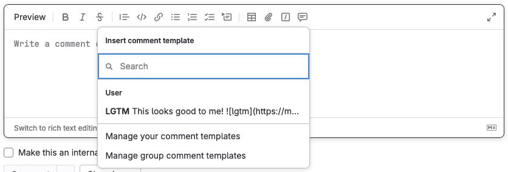



- Tier: 基础版，专业版，旗舰版
- Offering: JihuLab.com，私有化部署



使用评论模板，可以为以下任意文本区域创建和复用文本：

- 合并请求，包括差异。
- 议题，包括设计管理评论。
- 史诗。
- 工作项。

评论模板可以很短，例如批准一个合并请求并取消指派自己，也可以很长，例如您经常使用的成段样板文本：

## 在文本区域中使用评论模板

要将评论模板的文本包含在您的评论中：

1. 在评论的编辑器工具栏中，选择**评论模板**（）。
1. 选择您想要的评论模板。

## 创建评论模板

您可以创建供自己使用的评论模板，也可以创建与群组所有成员共享的评论模板。

创建供自己使用的评论模板：

1. 在右上角，选择您的头像。
1. 从下拉列表中，选择**偏好设置**。
1. 在左侧边栏中，选择**评论模板**（）。
1. 选择**添加新的**。
1. 为您的评论模板提供一个**名称**。
1. 输入回复的**内容**。您可以使用在其他极狐GitLab 文本区域中使用的任何格式。
1. 选择**保存**，页面将重新加载并显示您的评论模板。

### 为群组创建



- Tier: 专业版，旗舰版



创建与群组所有成员共享的评论模板：

1. 在评论的编辑器工具栏中，选择**评论模板**
   （），然后选择**管理群组评论模板**。
1. 选择**添加新的**。
1. 为您的评论模板提供一个**名称**。
1. 输入回复的**内容**。您可以使用在其他极狐GitLab 文本区域中使用的任何格式。
1. 选择**保存**，页面将重新加载并显示您的评论模板。

### 为项目创建



- Tier: 专业版，旗舰版



创建与项目所有成员共享的评论模板：

1. 在评论的编辑器工具栏中，选择**评论模板**
   （），然后选择**管理项目评论模板**。
1. 选择**添加新的**。
1. 为您的评论模板提供一个**名称**。
1. 输入回复的**内容**。您可以使用在其他极狐GitLab 文本区域中使用的任何格式。
1. 选择**保存**，页面将重新加载并显示您的评论模板。

## 查看评论模板

查看现有的评论模板：

1. 在右上角，选择您的头像。
1. 从下拉列表中，选择**偏好设置**。
1. 在左侧边栏中，选择**评论模板**（）。
1. 滚动到**评论模板**。

### 为群组查看



- Tier: 专业版，旗舰版



1. 在评论的编辑器工具栏中，选择**评论模板**
   （）。
1. 选择**管理群组评论模板**。

### 为项目查看



- Tier: 专业版，旗舰版



1. 在评论的编辑器工具栏中，选择**评论模板**
   （）。
1. 选择**管理项目评论模板**。

## 编辑或删除评论模板

编辑或删除现有的评论模板：

1. 在右上角，选择您的头像。
1. 从下拉列表中，选择**偏好设置**。
1. 在左侧边栏中，选择**评论模板**（）。
1. 滚动到**评论模板**，找到您想要编辑的评论模板。
1. 要编辑，选择**编辑**（）。
1. 要删除，选择**删除**（），然后在对话框中再次选择**删除**。

### 为群组编辑或删除



- Tier: 专业版，旗舰版



1. 在评论的编辑器工具栏中，选择**评论模板**
   （），然后选择**管理群组评论模板**。
1. 要编辑，选择**编辑**（）。
1. 要删除，选择**删除**（），然后在对话框中再次选择**删除**。

### 为项目编辑或删除



- Tier: 专业版，旗舰版



1. 在评论的编辑器工具栏中，选择**评论模板**
   （），然后选择**管理项目评论模板**。
1. 要编辑，选择**编辑**（）。
1. 要删除，选择**删除**（），然后在对话框中再次选择**删除**。
