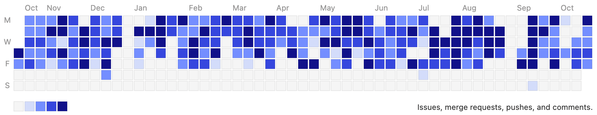



- Tier: 基础版，专业版，旗舰版
- Offering: JihuLab.com，私有化部署



贡献日历显示过去 12 个月内[用户的事件](#user-contribution-events)。
这包括在 forked 代码仓库和[私有](#show-private-contributions-on-your-user-profile-page)代码仓库中做出的贡献。

方块的颜色渐变表示每天做出的贡献数量。渐变范围从空白（0 次贡献）到深蓝色（超过 30 次贡献）。

> [!note]
> 贡献日历只显示过去 12 个月内的贡献，但议题 [24264](https://gitlab.com/gitlab-org/gitlab/-/issues/24264) 提议将其改为超过 12 个月。议题 [8488](https://gitlab.com/groups/gitlab-org/-/epics/8488) 提议对用户个人资料进行整体改进。

要全面查看所有群组成员的贡献事件，您可以使用[贡献分析](../group/contribution_analytics/_index.md)。

## 用户贡献事件

极狐GitLab 跟踪以下贡献事件：

| 事件 | 贡献 |
| ----- | ------------ |
| `approved` | 合并请求 |
| `closed` | [史诗](../group/epics/_index.md)、议题、合并请求、里程碑、工作项 |
| `commented`：对任何 `Noteable` 记录发表评论。 | 警报、提交、设计、议题、合并请求、代码片段 |
| `created` | 设计、史诗、议题、合并请求、里程碑、项目、Wiki 页面、工作项 |
| `destroyed` | 设计、里程碑、Wiki 页面 |
| `expired` | 项目成员资格 |
| `joined` | 项目成员资格 |
| `left` | 项目成员资格 |
| `merged` | 合并请求 |
| `pushed`：向代码仓库推送提交（或从代码仓库删除提交），可单个或批量进行。 | 项目 |
| `reopened` | 史诗、议题、合并请求、里程碑 |
| `updated` | 设计、Wiki 页面 |

### 查看每日贡献

要查看您的每日贡献：

1. 在右上角，选择您的头像。
1. 从下拉列表中选择您的姓名。
1. 在贡献日历中：
   - 要查看某一天的贡献数量，请将鼠标悬停在一个方块上。
   - 要查看某一天的所有贡献，请选择一个方块。列表会显示所有贡献及其发生时间。

### 在用户个人资料页面上显示私有贡献

贡献日历图和最近活动列表会显示您对私有项目的
[贡献操作](#user-contribution-events)。

要查看私有贡献：

1. 在右上角，选择您的头像。
1. 选择**编辑个人资料**。
1. 在**主要设置**部分，选中**在我的个人资料中包含私有贡献**复选框。
1. 选择**更新个人资料设置**。

## 用户活动

### 关注用户的活动

如果您对某位用户的活动感兴趣，可以关注该用户。您最多可以关注 300 个用户。

要关注用户，您可以：

- 在用户个人资料中，选择**关注**。
- 将鼠标悬停在用户名上，然后选择**关注**。

要查看您关注的用户的活动：

1. 在极狐GitLab 菜单中，选择**活动**。
1. 选择**已关注用户**标签页。

### 以 Feed 形式获取用户活动

极狐GitLab 提供用户活动的 RSS Feed。要订阅
用户活动的 RSS Feed：

1. 转到[用户个人资料](_index.md#access-your-user-profile)。
1. 在右上角，选择 Feed 符号（）。

结果的 URL 同时包含 Feed 令牌和您有权查看的用户活动。您可以将此 URL 添加到您的 Feed 阅读器。

### 重置用户活动 Feed 令牌

Feed 令牌很敏感，可能会泄露机密议题中的信息。如果您认为您的 Feed 令牌已泄露，应将其重置。

要重置您的 Feed 令牌：

1. 在右上角，选择您的头像。
1. 选择**编辑个人资料**。
1. 在左侧边栏中，选择**访问** > **个人访问令牌**。
1. 向下滚动。在 **Feed 令牌**部分，选择
   **重置此令牌**链接。
1. 在确认对话框中，选择**确定**。

系统会生成一个新令牌。

### 事件时间段限制

出于性能原因，极狐GitLab 会从事件表中移除超过 3 年的用户活动事件。
