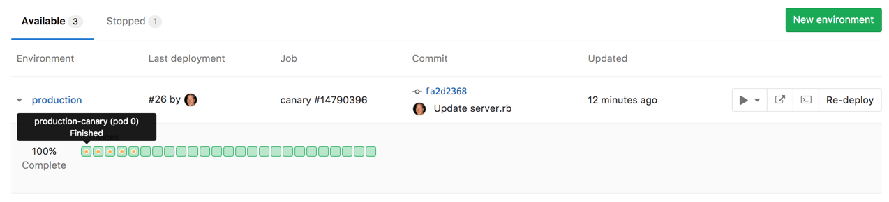
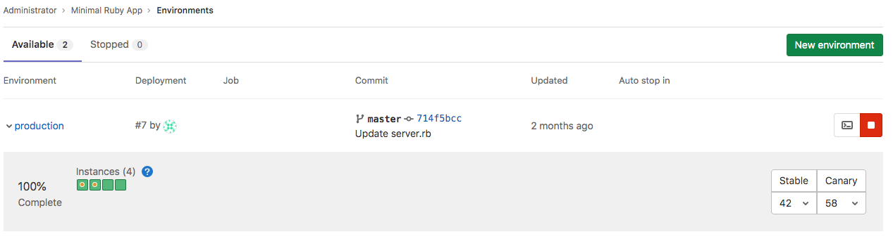



- Tier: 基础版，专业版，旗舰版
- Offering: JihuLab.com，私有化部署



金丝雀部署是一种流行的[持续部署](https://en.wikipedia.org/wiki/Continuous_deployment)策略，其中一小部分应用实例会更新到应用程序的新版本。

在采用[持续交付](https://about.gitlab.com/blog/continuous-integration-delivery-and-deployment-with-gitlab/)时，组织需要决定使用哪种部署策略。最流行的策略之一是金丝雀部署，即先将一小部分应用实例更新到新版本。这个子集，也就是金丝雀，随后就充当了众所周知的[煤矿中的金丝雀](https://en.wiktionary.org/wiki/canary_in_a_coal_mine)。

如果应用程序的新版本出现问题，只有一小部分用户会受到影响，并且可以修复或快速回退该变更。

<a id="use-cases"></a>

## 使用场景

当您希望仅向一部分 Pod 实例发布功能，并在部分用户群访问临时部署的功能时观察其行为，就可以使用金丝雀部署。如果一切正常，您就可以将该功能部署到生产环境，确信它不会引起任何问题。

对于后端重构、性能改进或其他用户界面不变、但您希望确保性能保持不变或有所提升的变更，金丝雀部署也尤为必要。开发者在将金丝雀用于面向用户的变更时需要谨慎，因为默认情况下，来自同一用户的请求会随机分配到金丝雀 Pod 和非金丝雀 Pod，这可能会导致混淆甚至错误。如有需要，您可以考虑[在 Kubernetes 服务定义中将 `service.spec.sessionAffinity` 设置为 `ClientIP`](https://kubernetes.io/docs/concepts/services-networking/service/#virtual-ips-and-service-proxies)，但这超出了本文档的范围。

<a id="advanced-traffic-control-with-canary-ingress"></a>

## 使用 Canary Ingress 进行高级流量控制

使用 [Canary Ingress](https://kubernetes.github.io/ingress-nginx/user-guide/nginx-configuration/annotations/#canary) 可以让金丝雀部署更具策略性，
Canary Ingress 是一种高级流量路由服务，可根据权重、会话、Cookie
等因素控制稳定部署和金丝雀部署之间的传入 HTTP 请求。极狐GitLab 在其[自动部署架构](../../topics/autodevops/upgrading_auto_deploy_dependencies.md#v2-chart-resource-architecture)中使用此服务，让用户能够快速、安全地推出新部署。

<a id="how-to-set-up-a-canary-ingress-in-a-canary-deployment"></a>

### 如何在金丝雀部署中设置 Canary Ingress

如果您的 Auto DevOps 流水线使用
[`v2.0.0+` 版本的 `auto-deploy-image`](../../topics/autodevops/upgrading_auto_deploy_dependencies.md#verify-dependency-versions)，
则会默认安装 Canary Ingress。当您创建新的金丝雀部署时，Canary Ingress 就会可用，并且当
金丝雀部署提升到生产环境时会被销毁。

以下是从零开始的示例设置流程：

1. 准备一个[启用了 Auto DevOps](../../topics/autodevops/_index.md)的项目。
1. 在您的项目中设置一个 [Kubernetes 集群](../infrastructure/clusters/_index.md)。
1. 在您的集群中安装 [NGINX Ingress](https://github.com/kubernetes/ingress-nginx/tree/main/charts/ingress-nginx)。
1. 根据上面分配的 Ingress
   端点设置[基础域名](clusters/gitlab_managed_clusters.md#base-domain)。
1. 检查您的 Auto DevOps 流水线中是否使用了 [`v2.0.0+` 版本的 `auto-deploy-image`](../../topics/autodevops/upgrading_auto_deploy_dependencies.md#verify-dependency-versions)。
   如果没有，请按照文档指定镜像版本。
1. [运行新的 Auto DevOps 流水线](../../ci/pipelines/_index.md#run-a-pipeline-manually)
   并确保 `production` 作业成功并创建生产环境。
1. 为 [Auto DevOps 流水线配置 `canary` 部署作业](../../topics/autodevops/cicd_variables.md#deploy-policy-for-canary-environments)。
1. [运行新的 Auto DevOps 流水线](../../ci/pipelines/_index.md#run-a-pipeline-manually)
   并确保 `canary` 作业成功，并创建带有 Canary Ingress 的金丝雀部署。

<a id="show-canary-ingress-deployments-on-deploy-boards-deprecated"></a>

### 在部署看板上显示 Canary Ingress 部署（已废弃）

> [!warning]
> 此功能已在极狐GitLab 14.5 中[废弃](https://gitlab.com/groups/gitlab-org/configure/-/work_items/8)。

要查看金丝雀部署，您必须正确配置部署看板：

1. 按照步骤[启用部署看板](deploy_boards.md#enabling-deploy-boards)。
1. 要跟踪金丝雀部署，您必须为 Kubernetes 部署和
   Pod 添加 `track: canary` 标签。为了快速上手，您可以使用极狐GitLab 提供的
   [自动部署](../../topics/autodevops/stages.md#auto-deploy)模板来创建金丝雀部署。

根据部署情况，该标签应为 `stable` 或 `canary`。如果标签为空或缺失，极狐GitLab 会假定 track 标签为 `stable`。任何其他 track 标签都被视为 `canary`（临时）。这使极狐GitLab 能够识别部署是稳定部署还是金丝雀部署（临时）。

配置部署看板并且流水线至少运行一次后，转到**流水线** > **环境**下的环境页面。随着流水线的执行，部署看板会清晰地标记金丝雀 Pod，从而快速、清晰地了解每个环境和部署的状态。

金丝雀部署在部署看板中会以黄点标记，以便您快速注意到它们。



<a id="how-to-check-the-current-traffic-weight-on-a-canary-ingress-deprecated"></a>

#### 如何查看 Canary Ingress 上的当前流量权重（已废弃）

> [!warning]
> 此功能已在极狐GitLab 14.5 中[废弃](https://gitlab.com/groups/gitlab-org/configure/-/work_items/8)。

1. 访问[部署看板](deploy_boards.md)。
1. 在右侧查看当前权重。

   

<a id="how-to-change-the-traffic-weight-on-a-canary-ingress-deprecated"></a>

#### 如何更改 Canary Ingress 上的流量权重（已废弃）

> [!warning]
> 此功能已在极狐GitLab 14.5 中[废弃](https://gitlab.com/groups/gitlab-org/configure/-/work_items/8)。

您可以使用 [GraphiQL](../../api/graphql/getting_started.md#graphiql)，
或通过向 [GraphQL API](../../api/graphql/getting_started.md#command-line) 发送请求，在环境的部署看板中更改流量权重。

要使用您的[部署看板](deploy_boards.md)：

1. 转到您项目的**运维** > **环境**。
1. 使用右侧的下拉列表设置新权重。
1. 确认您的选择。

以下是使用 [GraphiQL](../../api/graphql/getting_started.md#graphiql)的示例：

1. 访问 [GraphiQL Explorer](https://jihulab.com/-/graphql-explorer)。
1. 执行 `environmentsCanaryIngressUpdate` GraphQL 变更：

   ```shell
   mutation {
     environmentsCanaryIngressUpdate(input:{
       id: "gid://gitlab/Environment/29",              # Your Environment ID. You can get the ID from the URL of the environment page.
       weight: 45                                      # The new traffic weight. For example, if you set `45`, 45% of traffic goes to a canary deployment and 55% of traffic goes to a stable deployment.
     }) {
       errors
     }
   }
   ```

1. 如果请求成功，`errors` 响应会包含一个空数组。极狐GitLab 会向您的 Kubernetes 集群发送一个 `PATCH`
   请求，以更新 Canary Ingress 上的权重参数。
