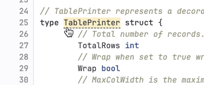
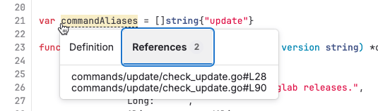



- Tier: 基础版，专业版，旗舰版
- Offering: JihuLab.com，私有化部署



代码智能增加了交互式开发环境（IDE）中常见的功能，包括：

- 类型签名和符号文档。
- 跳转到定义。

代码智能内置于极狐GitLab 中，由 [LSIF](https://lsif.dev/)（Language Server Index Format，语言服务器索引格式）提供支持，这是一种用于预计算代码智能数据的文件格式。极狐GitLab 为每个项目处理一个 LSIF 文件，并且代码智能不支持每个分支使用不同的 LSIF 文件。

[SCIP](https://github.com/scip-code/scip) 是源代码索引工具的下一代演进。您可以使用它来支持以下功能：

- 跳转到定义
- 查找引用

极狐GitLab 本身不支持使用 SCIP 实现代码智能。不过，您可以使用 [SCIP CLI](https://github.com/scip-code/scip/blob/main/docs/CLI.md) 将使用 SCIP 工具生成的索引转换为 LSIF 兼容的文件。有关原生 SCIP 支持的讨论，请参见[议题 412981](https://gitlab.com/gitlab-org/gitlab/-/issues/412981)。

有关即将推出的代码智能增强功能的进展，请参见[史诗 4212](https://gitlab.com/groups/gitlab-org/-/work_items/4212)。

极狐GitLab 还提供[代码导航](code_navigation.md)，它读取 GitLab Orbit 从您的代码构建的知识图谱，而不是 LSIF 文件，因此不需要索引器或 CI/CD 作业。

<a id="configure-code-intelligence"></a>

## 配置代码智能

先决条件：

- 您已检查并确认您的项目所用语言有兼容的索引器：
  - [LSIF 索引器](https://lsif.dev/#implementations-server)
  - [SCIP 索引器](https://github.com/scip-code/scip#tools-using-scip)

要了解您的语言如何获得最佳支持，请查看 [Sourcegraph 推荐的索引器](https://sourcegraph.com/docs/code-search/code-navigation/writing_an_indexer#sourcegraph-recommended-indexers)。

<a id="with-the-cicd-component"></a>

### 使用 CI/CD 组件

极狐GitLab 提供了一个 [CI/CD 组件](../../ci/components/_index.md)，用于在您的 `.gitlab-ci.yml` 文件中配置代码智能。该组件支持以下语言：

- Go 1.21 或更高版本。
- TypeScript 或 JavaScript。
- Java 8、11、17 和 21。
- Python
- .Net/C#

要为该组件贡献更多语言，请在[代码智能组件项目](https://gitlab.com/components/code-intelligence)中提交一个合并请求。

1. 将极狐GitLab CI/CD 组件添加到项目的 `.gitlab-ci.yml`中。例如，以下作业为 Go 生成 LSIF 产物：

   ```yaml
   include:
     - component: ${CI_SERVER_FQDN}/components/code-intelligence/golang-code-intel@v0.0.3
       inputs:
         golang_version: ${GO_VERSION}
   ```

1. 有关[代码智能组件](https://gitlab.com/components/code-intelligence)的配置说明，请查看每种受支持语言的 `README`。
1. 有关更多信息，请参见[使用组件](../../ci/components/_index.md#use-a-component)。

<a id="add-cicd-jobs-for-code-intelligence"></a>

### 为代码智能添加 CI/CD 作业

要为项目启用代码智能，请将极狐GitLab CI/CD 作业添加到项目的 `.gitlab-ci.yml`中。





1. 将作业添加到您的 `.gitlab-ci.yml` 配置中。该作业生成 SCIP 索引并将其转换为 LSIF，以便在极狐GitLab 中使用：

   ```yaml
   "code_navigation":
      rules:
      - if: $CI_COMMIT_REF_NAME == $CI_DEFAULT_BRANCH # the job only needs to run against the default branch
      image: node:latest
      stage: test
      allow_failure: true # recommended
      script:
         - npm install -g @sourcegraph/scip-typescript
         - npm install
         - scip-typescript index
         - |
            env \
            TAG="v0.4.0" \
            OS="$(uname -s | tr '[:upper:]' '[:lower:]')" \
            ARCH="$(uname -m | sed -e 's/x86_64/amd64/')" \
            bash -c 'curl --location "https://github.com/sourcegraph/scip/releases/download/$TAG/scip-$OS-$ARCH.tar.gz"' \
            | tar xzf - scip
         - chmod +x scip
         - ./scip convert --from index.scip --to dump.lsif
      artifacts:
         reports:
            lsif: dump.lsif
   ```

1. 根据您的 CI/CD 配置，您可能需要手动运行该作业，或等待它作为现有流水线的一部分运行。





1. 将作业（`code_navigation`）添加到您的 `.gitlab-ci.yml` 配置中以生成索引：

   ```yaml
   code_navigation:
      rules:
      - if: $CI_COMMIT_REF_NAME == $CI_DEFAULT_BRANCH # the job only needs to run against the default branch
     image: sourcegraph/lsif-go:v1
     allow_failure: true # recommended
     script:
       - lsif-go
     artifacts:
       reports:
         lsif: dump.lsif
   ```

1. 根据您的 CI/CD 配置，您可能需要手动运行该作业，或等待它作为现有流水线的一部分运行。





> [!note]
> 极狐GitLab 通过 [(`ci_max_artifact_size_lsif`)](../../administration/cicd/limits.md#maximum-file-size-per-type-of-artifact) 产物应用限制，将代码生成作业产生的产物限制为 200 MB。在极狐GitLab 私有化部署实例上，实例管理员可以更改此值。

<a id="view-code-intelligence-results"></a>

## 查看代码智能结果

作业成功后，浏览您的代码仓库以查看代码智能信息：

1. 在顶部栏中，选择**搜索或跳转到**，然后找到您的项目。
1. 在左侧边栏中，选择**代码** > **代码仓库**。
1. 转到代码仓库中的文件。如果您知道文件名，可以：
   - 输入 `/~` 键盘快捷键打开文件查找器，然后输入文件名。
   - 在右上角，选择**查找文件**。
1. 将鼠标指向代码行。该行中带有代码智能信息的项下方会显示一条虚线：

   

1. 选择该项以了解更多信息。

<a id="find-references"></a>

## 查找引用

使用代码智能查看某个对象的所有使用位置：

1. 在顶部栏中，选择**搜索或跳转到**，然后找到您的项目。
1. 在左侧边栏中，选择**代码** > **代码仓库**。
1. 转到代码仓库中的文件。如果您知道文件名，可以：
   - 输入 `/~` 键盘快捷键打开文件查找器，然后输入文件名。
   - 在右上角，选择**查找文件**。
1. 将鼠标指向该对象，然后选择它。
1. 在对话框中，选择：
   - **定义**以查看该对象的定义。
   - **引用**以查看使用该对象的文件列表。

   
