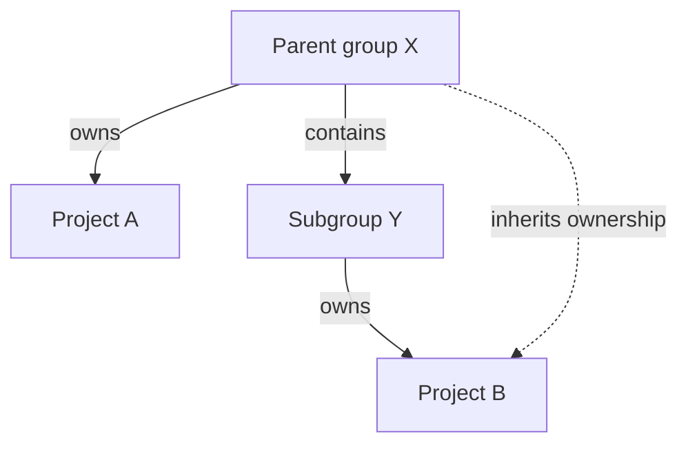



- Tier: 专业版，旗舰版
- Offering: JihuLab.com，私有化部署



`CODEOWNERS` 文件可帮助您定义谁负责特定文件和目录。您可以使用模式匹配、分节和继承规则，为合并请求指派审核人，并要求他们在合并前批准。

<a id="pattern-matching"></a>

## 模式匹配

极狐GitLab 使用 `File::fnmatch` 进行模式匹配，并设置了 `File::FNM_DOTMATCH` 和 `File::FNM_PATHNAME` 标志：

- 代码仓库结构被视为一个独立的文件系统。
- 模式遵循 shell 文件名通配规则的一个子集，而不是正则表达式。
- `File::FNM_DOTMATCH` 标志允许 `*` 匹配像 `.gitignore` 这样的点文件。
- `File::FNM_PATHNAME` 标志阻止 `*` 匹配 `/` 路径分隔符。
- `**` 递归匹配目录。例如，`**/*.rb` 匹配 `config/database.rb`
  和 `app/controllers/users/stars_controller.rb`。

<a id="default-code-owners-and-optional-sections"></a>

## 默认代码所有者和可选分节

要将默认所有者的语法与[可选分节](reference.md#optional-sections)和必需审批结合使用，请将默认所有者放在末尾：

```plaintext
[Documentation][2] @docs-team
docs/
README.md

^[Database] @database-team
model/db/
config/db/database-setup.md @docs-team
```

<a id="regular-entries-and-sections"></a>

## 常规条目和分节

如果您为分节之外的路径设置了默认代码所有者，则始终需要其审批。此类条目不会被分节覆盖。没有分节的条目会被视为另一个未命名的分节：

```plaintext
# Required for all files
* @general-approvers

[Documentation] @docs-team
docs/
README.md
*.txt

[Database] @database-team
model/db/
config/db/database-setup.md @docs-team
```

在此示例中：

- `@general-approvers` 拥有各处的所有项，且不会被覆盖。
- `@docs-team` 拥有 `Documentation` 分节中的所有项。
- `@database-team` 拥有 `Database` 分节中的所有项，但
  `config/db/database-setup.md` 除外，该文件通过覆盖规则指派给 `@docs-team`。
- 修改 `model/db/CHANGELOG.txt`的合并请求需要三次审批：分别来自
  `@general-approvers`、`@docs-team` 和 `@database-team` 群组各一次。

请将此行为与仅使用[分节的默认所有者](reference.md#set-default-code-owner-for-a-section)时的情况进行比较，此时分节中的特定条目会覆盖分节默认值。

<a id="sections-with-duplicate-names"></a>

## 名称重复的分节

如果多个分节具有相同的名称，它们会被合并。此外，分节标题不区分大小写。例如：

```plaintext
[Documentation]
ee/docs/    @docs
docs/       @docs

[Database]
README.md  @database
model/db/   @database

[DOCUMENTATION]
README.md  @docs
```

此代码会在 `Documentation` 分节标题下产生三个条目，并在 `Database` 下产生两个条目。在分节 `Documentation` 和 `DOCUMENTATION` 下定义的条目会被合并，并采用第一个分节的大小写形式。

<a id="define-code-owners-for-specific-files-or-directories"></a>

## 为特定文件或目录定义代码所有者

当某个文件或目录匹配 `CODEOWNERS` 文件中的多个条目时，将使用最后一个匹配该文件或目录的模式中的用户。这使您能够在以合理方式排列条目的情况下，为定义更具体的文件或目录定义更具体的所有者。

例如，在以下 `CODEOWNERS` 文件中：

```plaintext
# This line would match the file terms.md
*.md @doc-team

# This line would also match the file terms.md
terms.md @legal-team
```

`terms.md`的代码所有者将是 `@legal-team`。

<a id="require-multiple-approvals-from-code-owners"></a>

## 要求代码所有者进行多次审批

您可以在合并请求的“审批”区域中为代码所有者分节要求多次审批。在分节名称后附加方括号中的数字 `n`，例如 `[2]` 或 `[3]`。这要求该分节中的代码所有者提供 `n` 次审批。`n`的有效值为整数 `≥ 1`。`[1]` 是可选的，因为它是默认值。`n`的无效值会被视为 `1`。

> [!warning]
> [议题 384881](https://gitlab.com/gitlab-org/gitlab/-/issues/385881) 提议更改
> 此设置的行为。请勿故意设置无效值。它们可能会
> 在未来变为有效，并导致意外行为。

要求代码所有者进行多次审批：

1. 在顶部栏中，选择**搜索或跳转到**，找到您的项目。
1. 在左侧边栏中，选择**设置** > **代码仓库**。
1. 展开**分支规则**。
1. 在默认分支旁边，选择**查看详情**。
1. 打开**代码所有者审批**下的开关。
1. 编辑 `CODEOWNERS` 文件，添加多次审批的规则。

例如，要为 `[Documentation]` 分节要求两次审批：

```plaintext
[Documentation][2]
*.md @tech-writer-team

[Ruby]
*.rb @dev-team
```

“审批”区域中的 `Documentation` 代码所有者分节会显示需要两次审批：


<a id="group-inheritance-and-eligibility"></a>

## 群组继承和资格



在此示例中：

- 父群组 X（`group-x`）拥有项目 A。
- 父群组 X 还包含一个子群组，即子群组 Y（`group-x/subgroup-y`）。
- 子群组 Y 拥有项目 B。

符合条件的代码所有者为：

- 项目 A：仅群组 X 的成员，因为项目 A 不属于子群组 Y。
- 项目 B：群组 X 和子群组 Y 的成员。

<a id="groups-shared-with-parent-groups"></a>

### 与父群组共享的群组

要使某个群组的成员有资格成为他们并不直接所属项目的代码所有者，您可以[邀请该群组](../members/sharing_projects_groups.md#invite-a-group-to-a-group)加入项目的父群组。当您邀请某个群组时，其直接成员将成为该父群组层级中所有项目的合格代码所有者。

先决条件：

- 您必须对要邀请其他群组加入的群组拥有所有者角色。
- 邀请该群组时，您必须为其指派开发者、维护者或所有者角色。

例如，在此层级中：

```plaintext
group-x
├── engineering-group
└── product-group
    └── project-a
```

如果您将 `engineering-group` 邀请到 `product-group`，则 `engineering-group`的成员将成为 `project-a`的合格代码所有者。您无需将 `engineering-group` 直接邀请到 `project-a`。

只有被邀请群组的直接成员才有资格成为代码所有者。继承被邀请群组成员身份的成员没有资格。

<a id="error-handling"></a>

## 错误处理

<a id="entries-with-spaces"></a>

### 包含空格的条目

使用反斜杠转义路径中的空白字符：

```plaintext
path\ with\ spaces/*.md @owner
```

如果不进行转义，极狐GitLab 会将 `folder with spaces/*.md @group` 解析为：`path: "folder", owners: " with spaces/*.md @group"`。

<a id="unparsable-sections"></a>

### 无法解析的分节

如果无法解析分节标题，则该分节会：

1. 被解析为一个条目。
1. 被添加到前一个分节。
1. 如果不存在前一个分节，则该分节会被添加到默认分节。

<a id="after-the-default-section"></a>

#### 在默认分节之后

```plaintext
* @group

[Section name
docs/ @docs_group
```

极狐GitLab 会将标题 `[Section name` 识别为一个条目。默认分节包含 3 条规则：

- 默认分节
  - `*` 由 `@group` 拥有
  - `[Section` 由 `name` 拥有
  - `docs/` 由 `@docs_group` 拥有

<a id="after-a-named-section"></a>

#### 在具名分节之后

```plaintext
[Docs]
docs/**/* @group

[Section name
docs/ @docs_group
```

极狐GitLab 会将标题 `[Section name` 识别为一个条目。`[Docs]` 分节包含 3 条规则：

- `docs/**/*` 由 `@group` 拥有
- `[Section` 由 `name` 拥有
- `docs/` 由 `@docs_group` 拥有

<a id="malformed-owners"></a>

### 格式错误的所有者

每个条目必须包含一个或多个所有者。格式错误的所有者无效，会被忽略：

```plaintext
/path/* @group user_without_at_symbol @user_with_at_symbol
```

此条目由 `@group` 和 `@user_with_at_symbol` 拥有。

<a id="inaccessible-or-incorrect-owners"></a>

### 无法访问或不正确的所有者

极狐GitLab 会忽略无法访问或不正确的所有者。例如：

```plaintext
* @group @grou @username @i_left @i_dont_exist example@gitlab.com invalid@gitlab.com
```

如果只有 `@group`、`@username` 和 `example@gitlab.com` 可访问，极狐GitLab 会忽略其他所有者。

<a id="zero-owners"></a>

### 零所有者

如果某个条目不包含任何所有者，或者不存在任何[可访问的所有者](#inaccessible-or-incorrect-owners)，则该条目无效。由于此规则永远无法满足，极狐GitLab 会在合并请求中自动批准它。

> [!note]
> 当受保护分支启用了 `Require code owner approval` 时，
> 零所有者的规则仍会被遵循。

<a id="minimum-approvals"></a>

### 最低审批次数

为分节[定义审批次数](#require-multiple-approvals-from-code-owners)时，最低审批次数为 `1`。将审批次数设置为 `0` 会导致极狐GitLab 要求一次审批。
