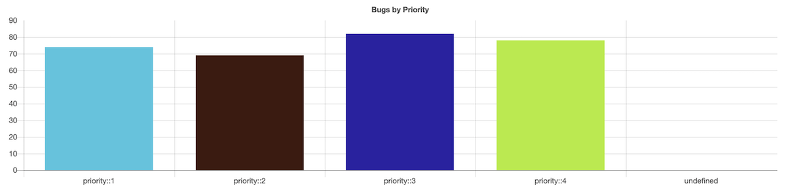
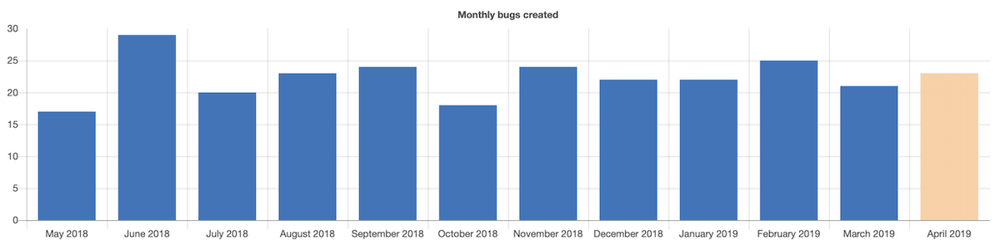
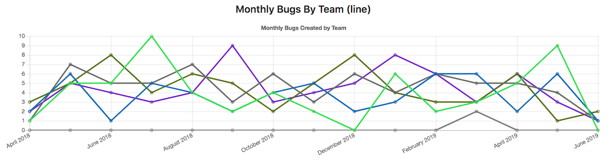
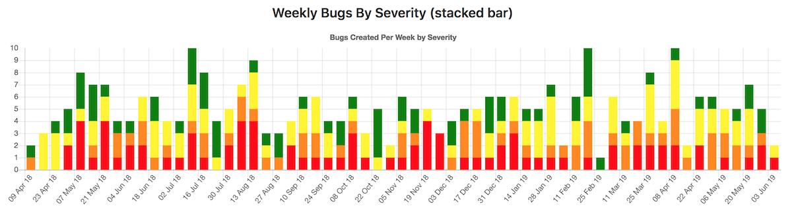



- Tier: 旗舰版
- Offering: JihuLab.com，私有化部署



洞察是交互式条形图，按月显示条目数量（例如创建的缺陷数）。

为您的项目和群组配置洞察并创建自定义报告，以探索以下数据：

- 在指定时间段内创建和关闭的议题。
- 合并请求被合并的平均时间。
- 排查情况。

<a id="view-insights"></a>

## 查看洞察

先决条件：

- 对于项目洞察，您必须有权访问该项目，并有权查看其合并请求和议题的相关信息。
- 对于群组洞察，您必须有权查看该群组。

查看项目或群组的洞察：

1. 在顶部栏中，选择**搜索或跳转到**，然后找到您的项目或群组。
1. 在左侧边栏中，选择**分析** > **洞察**。
1. 要查看报告，请从**选择报告**下拉列表中选择您要查看的报告。
   要查看注释，请将鼠标悬停在图表中的每个条形上。
1. 可选。筛选结果：
   - 要仅显示 90 天范围内某一部分的数据，请选择暂停图标（），并沿水平轴滑动它们。
   - 要从图表中排除某个维度，请在图表下方的图例中选择该维度的名称。

<a id="drill-down-on-charts"></a>

### 深入查看图表

您可以深入查看所有 `query.data_source` 为 `issuables`的图表数据。

要深入查看某个月中特定优先级或严重级别的数据报告：

- 在图表上，选择您要深入查看的堆叠条形。

<a id="create-a-report-deep-link"></a>

### 创建报告深层链接

您可以使用深层链接 URL 将用户引导至洞察中的特定报告。

要创建深层链接，请将报告键追加到洞察报告 URL 的末尾。例如，键为 `bugsCharts`的 GitLab 报告，其深层链接 URL 为 `https://gitlab.com/gitlab-org/gitlab/insights/#/bugsCharts`。

<a id="configuration"></a>

## 配置

<a id="default-file"></a>

### 默认文件

极狐GitLab 从
[默认配置文件](https://gitlab.com/gitlab-org/gitlab/-/blob/master/ee/fixtures/insights/default.yml)读取洞察。

项目洞察通过项目中的 [`.gitlab/insights.yml`](#configuration) 文件进行配置。如果项目没有配置文件，则使用[群组配置](#for-groups)。

`.gitlab/insights.yml` 文件是一个 YAML 文件，您可以在其中定义：

- 报告中图表的结构和顺序。
- 项目或群组报告中显示的图表样式。

在 `.gitlab/insights.yml` 文件中：

- [配置参数](#parameters)定义图表行为。
- 每个报告都有一个唯一的键和一组要获取并显示的图表。
- 每个图表定义由键值对组成的哈希构成。

<a id="example"></a>

#### 示例

以下示例展示了一个单一配置，用于显示包含一个图表的报告：

```yaml
bugsCharts:
  title: "Charts for bugs"
  charts:
    - title: "Monthly bugs created"
      description: "Open bugs created per month"
      type: bar
      query:
        data_source: issuables
        params:
          issuable_type: issue
          issuable_state: opened
          filter_labels:
            - bug
          group_by: month
          period_limit: 24
```

以下示例展示了 `.gitlab/insights.yml` 文件的完整配置，用于显示三个图表：

```yaml
.projectsOnly: &projectsOnly
  projects:
    only:
      - 3
      - groupA/projectA
      - groupA/subgroupB/projectC

bugsCharts:
  title: "Charts for bugs"
  charts:
    - title: "Monthly bugs created"
      description: "Open bugs created per month"
      type: bar
      <<: *projectsOnly
      query:
        data_source: issuables
        params:
          issuable_type: issue
          issuable_state: opened
          filter_labels:
            - bug
          group_by: month
          period_limit: 24

    - title: "Weekly bugs by severity"
      type: stacked-bar
      <<: *projectsOnly
      query:
        data_source: issuables
        params:
          issuable_type: issue
          issuable_state: opened
          filter_labels:
            - bug
          collection_labels:
            - S1
            - S2
            - S3
            - S4
          group_by: week
          period_limit: 104

    - title: "Monthly bugs by team"
      type: line
      <<: *projectsOnly
      query:
        data_source: issuables
        params:
          issuable_type: merge_request
          issuable_state: opened
          filter_labels:
            - bug
          collection_labels:
            - Manage
            - Plan
            - Create
          group_by: month
          period_limit: 24
```

<a id="parameters"></a>

### 参数

下表列出了图表参数：

| 关键字                                            | 描述 |
|:---------------------------------------------------|:------------|
| [`title`](#title)                                  | 图表的标题。显示在洞察页面上。 |
| [`description`](#description)                      | 单个图表的描述。显示在相关图表的上方。 |
| [`type`](#type)                                    | 图表类型：`bar`、`line` 或 `stacked-bar`。 |
| [`query`](#query)                                  | 一个哈希，用于定义图表的数据源和筛选条件。 |

<a id="title"></a>

#### `title`

使用 `title` 更新图表标题。该标题显示在洞察报告中。

**示例**：

```yaml
monthlyBugsCreated:
  title: "Monthly bugs created"
```

<a id="description"></a>

#### `description`

使用 `description` 添加图表描述。该描述显示在图表上方、标题下方。

**示例**：

```yaml
monthlyBugsCreated:
  title: "Monthly bugs created"
  description: "Open bugs created per month"
```

<a id="type"></a>

#### `type`

使用 `type` 定义图表类型。

**支持的值**：

| 名称  | 示例： |
| ----- | ------- |
| `bar` |  |
| `bar`（使用 `group_by`的时间序列） |  |
| `line` |  |
| `stacked-bar` |  |

`dora` 数据源支持 `bar` 和 `line` [图表类型](#type)。

**示例**：

```yaml
monthlyBugsCreated:
  title: "Monthly bugs created"
  type: bar
```

<a id="query"></a>

#### `query`

使用 `query` 定义图表的数据源和筛选条件。

**示例**：

```yaml
monthlyBugsCreated:
  title: "Monthly bugs created"
  description: "Open bugs created per month"
  type: bar
  query:
    data_source: issuables
    params:
      issuable_type: issue
      issuable_state: opened
      filter_labels:
        - bug
      collection_labels:
        - S1
        - S2
        - S3
        - S4
      group_by: week
      period_limit: 104
```

不带 `data_source` 参数的旧版格式仍然受支持：

```yaml
monthlyBugsCreated:
  title: "Monthly bugs created"
  description: "Open bugs created per month"
  type: bar
  query:
    issuable_type: issue
    issuable_state: opened
    filter_labels:
      - bug
    collection_labels:
      - S1
      - S2
      - S3
      - S4
    group_by: week
    period_limit: 104
```

<a id="querydata_source"></a>

##### `query.data_source`

使用 `data_source` 定义公开数据的数据源。

**支持的值**：

- `issuables`：公开合并请求或议题数据。
- `dora`：公开 DORA 指标。

<a id="issuable-query-parameters"></a>

##### `issuable` 查询参数

<a id="queryparamsissuable_type"></a>

###### `query.params.issuable_type`

使用 `query.params.issuable_type` 定义要为其创建图表的可议题化对象类型。

**支持的值**：

- `issue`：图表显示议题数据。
- `merge_request`：图表显示合并请求数据。

<a id="queryparamsissuable_state"></a>

###### `query.params.issuable_state`

使用 `query.params.issuable_state` 按所查询可议题化对象的当前状态进行筛选。

默认应用 `opened` 状态筛选。

**支持的值**：

- `opened`：打开的议题或合并请求。
- `closed`：已关闭的议题或合并请求。
- `locked`：讨论已锁定的议题或合并请求。
- `merged`：已合并的合并请求。
- `all`：所有状态的议题或合并请求。

<a id="queryparamsfilter_labels"></a>

###### `query.params.filter_labels`

使用 `query.params.filter_labels` 按应用于所查询可议题化对象的标记进行筛选。

默认不应用标记筛选。必须将定义的所有标记都应用于该可议题化对象，它才会被选中。

**示例**：

```yaml
monthlyBugsCreated:
  title: "Monthly regressions created"
  type: bar
  query:
    data_source: issuables
    params:
      issuable_type: issue
      issuable_state: opened
      filter_labels:
        - bug
        - regression
```

<a id="queryparamscollection_labels"></a>

###### `query.params.collection_labels`

使用 `query.params.collection_labels` 按配置的标记对可议题化对象进行分组。默认不应用分组。

**示例**：

```yaml
weeklyBugsBySeverity:
  title: "Weekly bugs by severity"
  type: stacked-bar
  query:
    data_source: issuables
    params:
      issuable_type: issue
      issuable_state: opened
      filter_labels:
        - bug
      collection_labels:
        - S1
        - S2
        - S3
        - S4
```

<a id="querygroup_by"></a>

###### `query.group_by`

使用 `query.group_by` 定义图表的 X 轴。

**支持的值**：

- `day`：按天对数据分组。
- `week`：按周对数据分组。
- `month`：按月对数据分组。

<a id="queryperiod_limit"></a>

###### `query.period_limit`

使用 `query.period_limit` 定义查询可议题化对象的时间回溯范围（使用 `query.period_field`）。

单位与 `query.group_by`中定义的值相关。例如，如果您定义了 `query.group_by: 'day'` 和 `query.period_limit: 365`，图表将显示过去 365 天的数据。

默认情况下，会根据您定义的 `query.group_by` 应用默认值。

| `query.group_by` | 默认值 |
| ---------------- | ------------- |
| `day`            | 30            |
| `week`           | 4             |
| `month`          | 12            |

<a id="queryperiod_field"></a>

##### `query.period_field`

使用 `query.period_field` 定义用于对可议题化对象进行分组的时间戳字段。

**支持的值**：

- `created_at`（默认）：使用 `created_at` 字段对数据分组。
- `closed_at`：使用 `closed_at` 字段对数据分组（仅适用于议题）。
- `merged_at`：使用 `merged_at` 字段对数据分组（仅适用于合并请求）。

`period_field` 会自动设置为：

- 如果 `query.issuable_state` 为 `closed`，则为 `closed_at`
- 如果 `query.issuable_state` 为 `merged`，则为 `merged_at`
- 否则为 `created_at`

> [!note]
> 在[此缺陷](https://gitlab.com/gitlab-org/gitlab/-/issues/26911)解决之前，
> 您可能会看到 `created_at` 代替 `merged_at`。实际使用的是 `created_at`。

<a id="dora-query-parameters"></a>

##### `DORA` 查询参数

将 DORA 专用查询与 `dora` 数据源结合使用，以创建 DORA 图表定义。

**示例**：

```yaml
dora:
  title: "DORA charts"
  charts:
    - title: "DORA deployment frequency"
      type: bar # or line
      query:
        data_source: dora
        params:
          metric: deployment_frequency
          group_by: day
          period_limit: 10
      projects:
        only:
          - 38
    - title: "DORA lead time for changes"
      description: "DORA lead time for changes"
      type: bar
      query:
        data_source: dora
        params:
          metric: lead_time_for_changes
          group_by: day
          environment_tiers:
            - staging
          period_limit: 30
```

<a id="querymetric"></a>

###### `query.metric`

使用 `query.metric` 定义要查询的 [DORA 指标](../../../api/dora/metrics.md#the-value-field)。

**支持的值**：

- `deployment_frequency`（默认）
- `lead_time_for_changes`
- `time_to_restore_service`
- `change_failure_rate`

<a id="querygroup_by-1"></a>

###### `query.group_by`

使用 `query.group_by` 定义图表的 X 轴。

**支持的值**：

- `day`（默认）：按天对数据分组。
- `month`：按月对数据分组。

<a id="queryperiod_limit-1"></a>

###### `query.period_limit`

使用 `query.period_limit` 定义指标在过去多长时间内被查询（默认值：15）。最长周期为 180 天或 6 个月。

<a id="queryenvironment_tiers"></a>

###### `query.environment_tiers`

使用 `query.environment_tiers` 定义要纳入计算的环境数组。

**支持的值**：

- `production`（默认）
- `staging`
- `testing`
- `development`
- `other`

<a id="projects"></a>

#### `projects`

使用 `projects` 限制从哪些位置查询可议题化对象：

- 如果 `.gitlab/insights.yml` 用于群组的洞察，请使用 `projects` 定义要从中查询可议题化对象的项目。默认使用该群组下的所有项目。
- 如果 `.gitlab/insights.yml` 用于项目的洞察，指定其他项目不会产生结果。默认使用该项目。

<a id="projectsonly"></a>

##### `projects.only`

使用 `projects.only` 指定要从中查询可议题化对象的项目。

在以下情况下，此参数中列出的项目会被忽略：

- 它们不存在。
- 当前用户没有足够的权限读取它们。
- 它们不在该群组内。

**示例**：

```yaml
monthlyBugsCreated:
  title: "Monthly bugs created"
  description: "Open bugs created per month"
  type: bar
  query:
    data_source: issuables
    params:
      issuable_type: issue
      issuable_state: opened
      filter_labels:
        - bug
  projects:
    only:
      - 3                         # You can use the project ID
      - groupA/projectA           # Or full project path
      - groupA/subgroupB/projectC # Projects in subgroups can be included
      - groupB/project            # Projects outside the group will be ignored
```

<a id="configure-insights"></a>

### 配置洞察

您可以为项目和群组配置洞察。在项目中创建 `.gitlab/insights.yml` 文件后，您还可以将其用于该项目的群组。

> [!note]
> 自定义 `.gitlab/insights.yml` 文件会覆盖默认配置。
> 要保留原始配置，请复制[默认配置文件](https://gitlab.com/gitlab-org/gitlab/-/blob/master/ee/fixtures/insights/default.yml)的内容作为基础。

<a id="for-projects"></a>

#### 针对项目

先决条件：

- 您必须具有该项目的开发者、维护者或所有者角色。

要配置项目洞察，请创建 `.gitlab/insights.yml` 文件，方式如下：

- 在本地，于项目的根目录中创建，然后推送您的更改。
- 从 UI 中：
  1. 在顶部栏中，选择**搜索或跳转到**，然后找到您的项目。
  1. 在文件列表上方，选择要提交到的分支，选择加号图标，然后选择**新建文件**。
  1. 在**文件名**中，输入 `.gitlab/insights.yml`。
  1. 在文件编辑器中，输入配置。
     请参阅[配置示例](#example)。
  1. 选择**提交更改**。

<a id="for-groups"></a>

#### 针对群组

先决条件：

- 您群组中的某个项目必须具有 `.gitlab/insights.yml` 文件。

要配置群组洞察：

1. 在顶部栏中，选择**搜索或跳转到**，然后找到您的群组。
1. 在左侧边栏中，选择**设置** > **分析**。
1. 在**洞察**部分，选择包含 `.gitlab/insights.yml` 配置文件的某个项目。
1. 选择**保存更改**。
