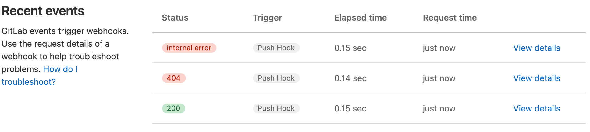
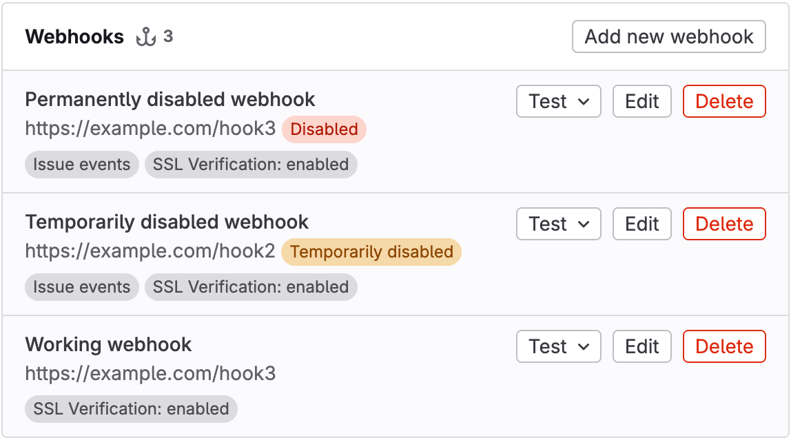



- Tier: 基础版，专业版，旗舰版
- Offering: JihuLab.com，私有化部署



Webhook 通过实时通知将极狐GitLab 与您的其他工具和系统连接起来。当极狐GitLab 中发生重要事件时，Webhook 会将这些信息直接发送到您的外部应用程序。通过响应合并请求、代码推送和议题更新，构建自动化工作流。

借助 Webhook，您的团队可以在变更发生时保持同步：

- 当极狐GitLab 议题发生变化时，外部议题跟踪器会自动更新。
- 聊天应用程序会向团队成员通知流水线完成情况。
- 当代码到达主分支时，自定义脚本会部署应用程序。
- 监控系统会跟踪整个组织内的开发活动。

<a id="webhook-events"></a>

## Webhook 事件

极狐GitLab 中的各种事件都可以触发 Webhook。例如：

- 将代码推送到代码仓库。
- 在议题上发布评论。
- 创建合并请求。

<a id="webhook-limits"></a>

## Webhook 限制

JihuLab.com 会强制执行 [Webhook 限制](../../jihulab_com/_index.md#webhooks)，包括：

- 每个项目或群组的最大 Webhook 数量。
- 每分钟的 Webhook 调用次数。
- Webhook 超时时长。

对于极狐GitLab 私有化部署，管理员可以修改这些限制。

<a id="push-event-limits"></a>

### 推送事件限制

极狐GitLab 会限制包含多个变更的推送事件所触发的 Webhook：

- 默认限制：每次推送 3 个分支或标签。
- 超出限制时的行为：整个推送事件不会触发任何 Webhook。
- 适用范围：项目 Webhook 和系统钩子。
- 配置：极狐GitLab 私有化部署管理员可以通过应用程序设置 API 修改 `push_event_hooks_limit`
  设置。

如果您经常同时推送多个标签或分支，并且需要 Webhook 通知，请联系您的极狐GitLab 管理员提高此限制。

<a id="group-webhooks"></a>

## 群组 Webhook



- Tier: 专业版，旗舰版



群组 Webhook 是自定义 HTTP 回调，用于为群组及其子群组中所有项目的事件发送通知。

<a id="types-of-group-webhook-events"></a>

### 群组 Webhook 事件的类型

您可以将群组 Webhook 配置为监听：

- 群组和子群组中项目内发生的所有事件
- 群组特有的事件，包括群组成员事件、项目事件和子群组事件

<a id="webhooks-in-both-a-project-and-a-group"></a>

### 项目与群组中同时存在 Webhook

如果您在群组和该群组中的某个项目里配置了相同的 Webhook，那么该项目中的事件会同时触发这两个 Webhook。这样可以在极狐GitLab 组织的不同层级灵活处理事件。

<a id="configure-webhooks"></a>

## 配置 Webhook

在极狐GitLab 中创建并配置 Webhook，以便与您的项目工作流集成。使用这些功能来设置满足您特定需求的 Webhook。

<a id="create-a-webhook"></a>

### 创建 Webhook

对于新的 Webhook，请使用签名令牌而不是密钥令牌。签名令牌会基于负载计算 HMAC-SHA256 签名，因此您的端点可以验证请求的真实性和完整性。密钥令牌仅在请求头中提供明文值，其保障较弱。不建议在新的 Webhook 中使用密钥令牌。

创建 Webhook，以发送有关项目或群组中事件的通知。

先决条件：

- 对于项目 Webhook，您必须拥有该项目的维护者或所有者角色。
- 对于群组 Webhook，您必须拥有该群组的所有者角色。

创建 Webhook：

1. 在顶部栏中，选择**搜索或跳转到**，找到您的项目或群组。
1. 在左侧边栏中，选择**设置** > **Webhook**。
1. 选择**添加新 Webhook**。
1. 在 **URL**中，输入 Webhook 端点的 URL。
   特殊字符请使用百分号编码。
1. 可选。为 Webhook 输入**名称**和**描述**。
1. 可选。配置请求认证。使用签名令牌可获得更强的安全性：
   - **签名令牌**（推荐）：选择**生成签名令牌**。
     立即复制并保存该令牌，因为它只显示一次。
     您的 Webhook 端点可以使用此令牌来[验证 HMAC-SHA256 签名](#verify-the-signature)。
   - **密钥令牌**（不推荐）：在**密钥令牌**字段中输入令牌。
     该令牌会以明文形式在 `X-Gitlab-Token` HTTP 请求头中发送，其安全性保障弱于
     签名令牌。对于新的 Webhook，请改用签名令牌。
1. 在**触发器**部分，选择要触发 Webhook 的事件。
1. 可选。要将极狐GitLab Duo 任务流生命周期事件发送到此 Webhook，请在
   **极狐GitLab Duo Agent Platform** 下，选中**将 Duo 任务流事件发送到此 Webhook** 复选框。
   此部分仅在
   [极狐GitLab Duo 任务流 Webhook 回调](../../duo_agent_platform/flows/webhook_callbacks.md)
   可用时显示。
1. 可选。要禁用 SSL 验证，请清除**启用 SSL 验证**复选框。
1. 选择**添加 Webhook**。

<a id="signing-tokens"></a>

### 签名令牌

使用签名令牌可以验证 Webhook 负载来自极狐GitLab 且未被篡改。与密钥令牌不同，签名令牌用于基于负载计算 HMAC-SHA256 签名。这意味着接收方可以独立验证所接收负载的真实性和完整性。

极狐GitLab Webhook 的投递遵循 [Standard Webhooks](https://www.standardwebhooks.com/)
规范。每个 Webhook 请求都包含 `webhook-id` 和 `webhook-timestamp` 请求头。配置签名令牌后，极狐GitLab 还会包含带有 HMAC-SHA256 签名的 `webhook-signature` 请求头。每个签名的格式为 `v1,{base64_signature}`。该请求头可能包含多个以空格分隔的签名。极狐GitLab 目前只发送一个签名，但将来可能会改变。签名基于字符串 `{message_id}.{timestamp}.{body}` 计算，其中：

- `{message_id}` 是 `webhook-id` 请求头的值。
- `{timestamp}` 是 `webhook-timestamp` 请求头的值。
- `{body}` 是原始 JSON 请求正文。

<a id="verify-the-signature"></a>

#### 验证签名

要在您的 Webhook 端点中验证签名：

1. 获取 `webhook-id`、`webhook-timestamp` 和 `webhook-signature` 请求头的值。
1. 按空格拆分 `webhook-signature`的值，得到签名列表。
1. 构造消息字符串：`"{message_id}.{timestamp}.{body}"`。
1. 解码签名令牌：去掉 `whsec_` 前缀，然后对剩余部分进行 base64 解码。
1. 使用解码后的密钥计算 HMAC-SHA256 摘要。
1. 将摘要编码为 base64，并加上前缀 `v1,`。
1. 检查计算出的签名是否与签名列表中的任一条目匹配。
   使用恒定时间比较以防止时序攻击。

Ruby 示例：

```ruby
require 'base64'
require 'openssl'

def valid_signature?(signing_token, message_id, timestamp, body, received_signatures)
  raw_key = Base64.strict_decode64(signing_token.delete_prefix('whsec_'))
  message = "#{message_id}.#{timestamp}.#{body}"
  digest = OpenSSL::HMAC.digest('sha256', raw_key, message)
  expected = "v1,#{Base64.strict_encode64(digest)}"
  received_signatures.split(' ').any? do |sig|
    ActiveSupport::SecurityUtils.secure_compare(expected, sig)
  end
end
```

Python 示例：

```python
import base64
import hashlib
import hmac

def valid_signature(signing_token, message_id, timestamp, body, received_signatures):
    raw_key = base64.b64decode(signing_token.removeprefix('whsec_'))
    message = f"{message_id}.{timestamp}.{body}".encode('utf-8')
    digest = hmac.new(raw_key, message, hashlib.sha256).digest()
    expected = "v1," + base64.b64encode(digest).decode('utf-8')
    return any(
        hmac.compare_digest(expected, sig)
        for sig in received_signatures.split(' ')
    )
```

<a id="backward-compatibility"></a>

#### 向后兼容性

签名令牌可与现有的密钥令牌一起使用。您可以在同一个 Webhook 上同时配置两者：

- 如果配置了密钥令牌，仍会发送 `X-Gitlab-Token` 请求头。
- 如果配置了签名令牌，则会发送 `webhook-signature` 和 `webhook-id` 请求头。

要在不中断服务的情况下将使用密钥令牌的现有 Webhook 迁移到签名令牌，请在过渡期间在同一个 Webhook 上同时配置两种令牌。更新您的接收方，使其在存在 `webhook-signature` 时验证签名，否则回退到密钥令牌。

当您的接收方能够正确处理签名后，您可以从 Webhook 设置中移除密钥令牌。

<a id="security-considerations"></a>

#### 安全注意事项

为防止重放攻击，请在处理负载之前验证 `webhook-timestamp`中的时间戳是否为近期时间。

API 永远不会返回签名令牌。

<a id="mask-sensitive-portions-of-webhook-urls"></a>

### 掩码 Webhook URL 中的敏感部分

掩码 Webhook URL 中的敏感部分以增强安全性。掩码部分在执行 Webhook 时会被替换为配置的值，不会被记录到日志中，并且在数据库中静态加密。

要掩码 Webhook URL 中的敏感部分：

1. 在顶部栏中，选择**搜索或跳转到**，找到您的项目或群组。
1. 在左侧边栏中，选择**设置** > **Webhook**。
1. 在 **URL**中，输入 Webhook 的完整 URL。
1. 要定义掩码部分，请选择**添加 URL 掩码**。
1. 在 **URL 的敏感部分**中，输入您要掩码的 URL 部分。
1. 在**在 UI 中的显示方式**中，输入用于替代掩码部分显示的值。
   变量名只能包含小写字母（`a-z`）、数字（`0-9`）或下划线（`_`）。
1. 选择**保存更改**。

掩码值在 UI 中显示为隐藏状态。例如，如果您定义了变量 `path` 和 `value`，Webhook URL 可能如下所示：

```plaintext
https://webhook.example.com/{path}?key={value}
```

<a id="custom-headers"></a>

### 自定义请求头

为 Webhook 请求添加自定义请求头，以便向外部服务进行认证。每个 Webhook 最多可以配置 20 个自定义请求头。

自定义请求头必须：

- 不覆盖投递请求头的值。
- 仅包含字母数字字符、句点、短横线或下划线。
- 以字母开头，并以字母或数字结尾。
- 不包含连续的句点、短横线或下划线。

自定义请求头会在**最近事件**中显示，其值会被掩码。

<a id="custom-webhook-template"></a>

### 自定义 Webhook 模板

为您的 Webhook 创建自定义负载模板，以控制请求正文中发送的数据。

<a id="create-a-custom-webhook-template"></a>

#### 创建自定义 Webhook 模板

- 对于项目 Webhook，您必须拥有该项目的维护者或所有者角色。
- 对于群组 Webhook，您必须拥有该群组的所有者角色。

创建自定义 Webhook 模板：

1. 转到您的 Webhook 配置。
1. 设置自定义 Webhook 模板。
1. 确保模板渲染为有效的 JSON。

在模板中使用事件负载中的字段。例如：

- 作业事件使用 `{{build_name}}`
- 部署事件使用 `{{deployable_url}}`

要访问嵌套属性，请使用句点分隔路径段。

<a id="example-custom-webhook-template"></a>

#### 自定义 Webhook 模板示例

对于此自定义负载模板：

```json
{
  "event": "{{object_kind}}",
  "project_name": "{{project.name}}"
}
```

`push` 事件生成的请求负载为：

```json
{
  "event": "push",
  "project_name": "Example"
}
```

自定义 Webhook 模板无法访问数组中的属性。

<a id="filter-push-events-by-branch"></a>

### 按分支筛选推送事件

按分支名称筛选发送到 Webhook 端点的 `push` 事件。使用以下筛选选项之一：

- **所有分支**：接收来自所有分支的推送事件。
- **通配符模式**：接收来自匹配通配符模式的分支的推送事件。
- **正则表达式**：接收来自匹配正则表达式（regex）的分支的推送事件。

<a id="use-a-wildcard-pattern"></a>

#### 使用通配符模式

使用通配符模式进行筛选：

1. 在 Webhook 配置中，选择**通配符模式**。
1. 输入模式。
   例如：
   - `*-stable` 匹配以 `-stable` 结尾的分支。
   - `production/*` 匹配 `production/` 命名空间中的分支。

<a id="use-a-regular-expression"></a>

#### 使用正则表达式

使用正则表达式进行筛选：

1. 在 Webhook 配置中，选择**正则表达式**。
1. 输入遵循 [RE2 语法](https://github.com/google/re2/wiki/Syntax)的正则表达式模式。

例如，要排除 `main` 分支，请使用：

```plaintext
^(?:.{0,3}|.{5,}|[^m].*|m[^a].*|ma[^i].*|mai[^n].*)$
```

<a id="configure-webhooks-to-support-mutual-tls"></a>

### 配置 Webhook 以支持双向 TLS



- Offering: 私有化部署



通过设置 PEM 格式的全局客户端证书，配置 Webhook 以支持双向 TLS。

先决条件：

- 您必须是极狐GitLab 管理员。

为 Webhook 配置双向 TLS：

1. 准备 PEM 格式的客户端证书。
1. 可选。使用 PEM 密码短语保护该证书。
1. 配置极狐GitLab 以使用该证书。





1. 编辑 `/etc/gitlab/gitlab.rb`：

   ```ruby
   gitlab_rails['http_client']['tls_client_cert_file'] = '<PATH TO CLIENT PEM FILE>'
   gitlab_rails['http_client']['tls_client_cert_password'] = '<OPTIONAL PASSWORD>'
   ```

1. 保存文件并重新配置极狐GitLab：

   ```shell
   sudo gitlab-ctl reconfigure
   ```





1. 编辑 `docker-compose.yml`：

   ```yaml
   version: "3.6"
   services:
     gitlab:
       image: 'registry.gitlab.cn/omnibus/gitlab-jh:latest'
       restart: always
       hostname: 'gitlab.example.com'
       environment:
         GITLAB_OMNIBUS_CONFIG: |
            gitlab_rails['http_client']['tls_client_cert_file'] = '<PATH TO CLIENT PEM FILE>'
            gitlab_rails['http_client']['tls_client_cert_password'] = '<OPTIONAL PASSWORD>'
   ```

1. 保存文件并重启极狐GitLab：

   ```shell
   docker compose up -d
   ```





1. 编辑 `/home/git/gitlab/config/gitlab.yml`：

   ```yaml
   production: &base
     http_client:
       tls_client_cert_file: '<PATH TO CLIENT PEM FILE>'
       tls_client_cert_password: '<OPTIONAL PASSWORD>'
   ```

1. 保存文件并重启极狐GitLab：

   ```shell
   # For systems running systemd
   sudo systemctl restart gitlab.target

   # For systems running SysV init
   sudo service gitlab restart
   ```





配置完成后，极狐GitLab 会在 Webhook 连接的 TLS 握手期间向服务器出示此证书。

<a id="configure-firewalls-for-webhook-traffic"></a>

### 为 Webhook 流量配置防火墙

根据极狐GitLab 发送 Webhook 的方式为 Webhook 流量配置防火墙：

- 从 Sidekiq 节点异步发送（最常见）
- 从 Rails 节点同步发送（在特定情况下）

当您在 UI 中测试或重试 Webhook 时，Webhook 会从 Rails 节点同步发送。

配置防火墙时，请确保 Sidekiq 和 Rails 节点都能发送 Webhook 流量。

<a id="manage-webhooks"></a>

## 管理 Webhook

在极狐GitLab 中监控和维护您配置的 Webhook。

<a id="view-webhook-request-history"></a>

### 查看 Webhook 请求历史

查看 Webhook 请求历史，以监控其性能并排查问题。

先决条件：

- 对于项目 Webhook，您必须拥有该项目的维护者或所有者角色。
- 对于群组 Webhook，您必须拥有该群组的所有者角色。

查看 Webhook 的请求历史：

1. 在顶部栏中，选择**搜索或跳转到**，找到您的项目或群组。
1. 在左侧边栏中，选择**设置** > **Webhook**。
1. 为 Webhook 选择**编辑**。
1. 转到**最近事件**部分。

**最近事件**部分显示过去两天内向 Webhook 发出的所有请求。该表格包含：

- HTTP 状态码：
  - `200`-`299` 状态码显示为绿色
  - 其他状态码显示为红色
  - 投递失败显示为 `internal error`
- 触发的事件
- 请求的耗时
- 请求发出的相对时间



<a id="inspect-request-and-response-details"></a>

#### 检查请求和响应详情

先决条件：

- 对于项目 Webhook，您必须拥有该项目的维护者或所有者角色。
- 对于群组 Webhook，您必须拥有该群组的所有者角色。

**最近事件**中的每个 Webhook 请求都有一个**请求详情**页面。此页面包含以下内容的正文和请求头：

- 极狐GitLab 从 Webhook 接收方端点收到的响应
- 极狐GitLab 发送的 Webhook 请求

检查 Webhook 事件的请求和响应详情：

1. 在顶部栏中，选择**搜索或跳转到**，找到您的项目或群组。
1. 在左侧边栏中，选择**设置** > **Webhook**。
1. 为 Webhook 选择**编辑**。
1. 转到**最近事件**部分。
1. 为该事件选择**查看详情**。

要使用相同的数据和相同的 `Idempotency-Key` 请求头再次发送请求，请选择**重新发送请求**。如果 Webhook URL 已更改，则无法重新发送请求。您也可以通过项目 Webhook API 以编程方式重新发送请求。

<a id="test-a-webhook"></a>

### 测试 Webhook

测试 Webhook 以确保其正常工作，或重新启用已禁用的 Webhook。

先决条件：

- 对于项目 Webhook，您必须拥有该项目的维护者或所有者角色。
- 对于群组 Webhook，您必须拥有该群组的所有者角色。
- 要测试 `push events`，您的项目必须至少有一个提交。

测试 Webhook：

1. 在顶部栏中，选择**搜索或跳转到**，找到您的项目或群组。
1. 在左侧边栏中，选择**设置** > **Webhook**，查看此项目的所有 Webhook。
1. 要直接从已配置的 Webhook 列表中测试 Webhook：
   1. 找到您要测试的 Webhook。
   1. 从**测试**下拉列表中，选择要测试的事件类型。
1. 要在编辑 Webhook 时测试它：
   1. 找到您要测试的 Webhook，然后选择**编辑**。
   1. 对 Webhook 进行更改。
   1. 选择**测试**下拉列表，然后选择要测试的事件类型。

项目 Webhook 和群组 Webhook 的某些事件类型不支持测试。更多信息，请参见[议题 379201](https://gitlab.com/gitlab-org/gitlab/-/issues/379201)。

<a id="webhook-reference"></a>

## Webhook 参考

使用此技术参考可以：

- 了解极狐GitLab Webhook 的工作原理。
- 将 Webhook 与您的系统集成。
- 设置、排查和优化您的 Webhook 配置。

<a id="webhook-receiver-requirements"></a>

### Webhook 接收方要求

实现快速且稳定的 Webhook 接收方端点，以确保可靠的 Webhook 投递。

缓慢、不稳定或配置错误的接收方可能会被自动禁用。无效的 HTTP 响应会被视为失败的请求。

要优化您的 Webhook 接收方：

1. 快速响应 `200` 或 `201` 状态码：
   - 避免在同一个请求中处理 Webhook。
   - 使用队列在接收 Webhook 后进行处理。
   - 在超时限制之前响应，以防止在 JihuLab.com 上被自动禁用。
1. 处理可能出现的重复事件：
   - 如果 Webhook 超时，请做好处理重复事件的准备。
   - 确保您的端点始终保持快速和稳定。
1. 尽量减少响应头和正文：
   - 极狐GitLab 会存储响应头和正文以供后续检查。
   - 限制返回的请求头数量和大小。
   - 考虑返回空正文。
1. 使用适当的状态码：
   - 仅对配置错误的 Webhook 返回客户端错误状态响应（`4xx` 范围）。
   - 对于不支持的事件，返回 `400` 或忽略负载。
   - 对于已处理的事件，避免返回 `500` 服务器错误响应。

<a id="auto-disabled-webhooks"></a>

### 自动禁用的 Webhook

> [!flag]
> 此功能的可用性由功能标志控制。

极狐GitLab 会自动禁用连续失败四次的项目或群组 Webhook。

查看自动禁用的 Webhook：

1. 在顶部栏中，选择**搜索或跳转到**，找到您的项目或群组。
1. 在左侧边栏中，选择**设置** > **Webhook**。

在 Webhook 列表中，自动禁用的 Webhook 显示为：

- 如果连续失败四次，显示为**暂时禁用**
- 如果连续失败 40 次，显示为**已禁用**



<a id="temporarily-disabled-webhooks"></a>

#### 暂时禁用的 Webhook

如果 Webhook 连续失败四次，则会被暂时禁用。如果 Webhook 连续失败 40 次，则会变为永久禁用。

以下情况视为失败：

- Webhook 接收方返回 `4xx` 或 `5xx` 范围内的响应码。
- Webhook 在尝试连接 Webhook 接收方时发生超时。
- Webhook 遇到其他 HTTP 错误。

暂时禁用的 Webhook 最初会被禁用一分钟，后续失败时禁用时长会延长，最长可达 24 小时。此期限过后，这些 Webhook 会自动重新启用。

<a id="permanently-disabled-webhooks"></a>

#### 永久禁用的 Webhook

如果 Webhook 连续失败 40 次，则会被永久禁用。与暂时禁用的 Webhook 不同，这些 Webhook 不会自动重新启用。

在极狐GitLab 17.10 及更早版本中被永久禁用的 Webhook 经过了数据迁移。这些 Webhook 可能在**最近事件**中显示四次失败，即使 UI 可能显示它们有 40 次失败。

<a id="re-enable-disabled-webhooks"></a>

#### 重新启用已禁用的 Webhook

要重新启用已禁用的 Webhook，请发送测试请求。如果测试请求返回 `2xx` 范围内的响应码，则该 Webhook 会被重新启用。

<a id="delivery-headers"></a>

### 投递请求头

极狐GitLab 会在发送到您端点的 Webhook 请求中包含以下请求头。

| 请求头                   | 描述                                                                                                                                                     | 示例 |
|:-------------------------|:----------------------------------------------------------------------------------------------------------------------------------------------------------------|:--------|
| `Idempotency-Key`        | 在 Webhook 重试之间保持一致的唯一 ID。出于历史原因提供。建议优先使用 `webhook-id`。                                                                 | `"f5e5f430-f57b-4e6e-9fac-d9128cd7232f"` |
| `User-Agent`             | 格式为 `"Gitlab/<VERSION>"` 的用户代理。                                                                                                                  | `"GitLab/15.5.0-pre"` |
| `webhook-id`             | 在 Webhook 重试之间保持一致的唯一消息 ID。等同于 `Idempotency-Key`。                                                                                | `"f5e5f430-f57b-4e6e-9fac-d9128cd7232f"` |
| `webhook-signature`      | 以空格分隔的 HMAC-SHA256 签名列表，每个签名的格式为 `v1,{base64_signature}`。仅在配置了[签名令牌](#signing-tokens)时包含。 | `"v1,abc123def456=="` |
| `webhook-timestamp`      | 生成请求时的 Unix 时间戳（自纪元以来的秒数）。                                                                                            | `"1744578123"` |
| `X-Gitlab-Event-UUID`    | 非递归 Webhook 的唯一 ID。递归 Webhook（由先前的 Webhook 触发）共享相同的值。                                                  | `"13792a34-cac6-4fda-95a8-c58e00a3954e"` |
| `X-Gitlab-Event`         | Webhook 类型名称。对应格式为 `"<EVENT> Hook"` 的事件类型。                                                                                   | `"Push Hook"` |
| `X-Gitlab-Instance`      | 发送该 Webhook 的极狐GitLab 实例的主机名。                                                                                                          | `"https://gitlab.com"` |
| `X-Gitlab-Token`         | Webhook 的密钥令牌，以明文形式发送。仅在配置了密钥令牌时包含。                                                              | `"my-secret-token"` |
| `X-Gitlab-Webhook-UUID`  | 每个 Webhook 的唯一 ID。                                                                                                                                     | `"02affd2d-2cba-4033-917d-ec22d5dc4b38"` |

<a id="image-url-display-in-webhook-body"></a>

### Webhook 正文中的图片 URL 显示

极狐GitLab 会将 Webhook 正文中的相对图片引用重写为绝对 URL。

<a id="image-url-rewriting-example"></a>

#### 图片 URL 重写示例

如果合并请求、评论或 Wiki 页面中的原始图片引用为：

```markdown

```

则 Webhook 正文中重写后的图片引用为：

```markdown

```

此示例假设：

- 极狐GitLab 安装在 `gitlab.example.com`。
- 项目 ID 为 `123`。

<a id="exceptions-to-image-url-rewriting"></a>

#### 图片 URL 重写的例外情况

在以下情况下，极狐GitLab 不会重写图片 URL：

- 它们已经使用 HTTP、HTTPS 或协议相对 URL。
- 它们使用了高级 Markdown 功能，例如链接标签。
