

- Tier: 基础版，专业版，旗舰版
- Offering: JihuLab.com，私有化部署



议题板提供了一种可视化的方式来管理和跟踪极狐GitLab 中的工作。议题板：

- 根据标记、里程碑或指派人，将议题以卡片形式显示在可自定义的列表中。
- 跟踪议题在工作流不同阶段中的进展。
- 支持看板和 Scrum 等敏捷方法。
- 为不同的团队和项目组织多个议题板。
- 可视化整个流程中的工作量和进度。

您的议题以卡片形式显示在垂直列表中，并按分配的[标记](labels.md)、[里程碑](#milestone-lists)、[迭代](#iteration-lists)、[指派人](#assignee-lists)或[状态](#status-lists)进行组织。

为议题添加元数据，然后为现有议题创建相应的列表。准备就绪后，您可以将议题卡片从一个列表拖到另一个列表。

议题板可以支持[看板](https://en.wikipedia.org/wiki/Kanban_(development))和 [Scrum](https://en.wikipedia.org/wiki/Scrum_(software_development)) 等常见框架。

要让团队成员组织各自的工作流，请使用[多个议题板](#multiple-issue-boards)。这样可以在同一项目中创建多个议题板。

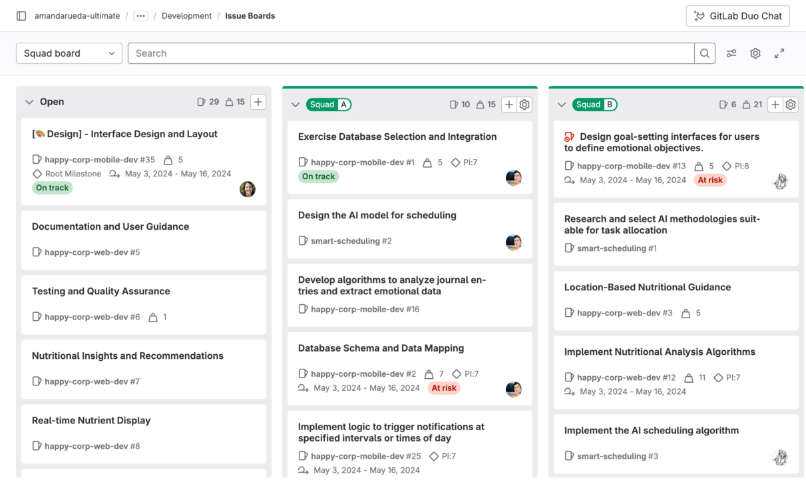

不同的议题板功能在不同的[极狐GitLab 版本](https://gitlab.cn/pricing)中提供：

| 版本     | 项目议题板数量 | [群组议题板](#group-issue-boards)数量 | [可配置议题板](#configurable-issue-boards) | [指派人列表](#assignee-lists) |
| -------- | ------------------------------ | --------------------------------------------------- | ------------------------------------------------------- | --------------------------------- |
| 基础版     | 多个                       | 1                                                   |                                   |             |
| 专业版  | 多个                       | 多个                                            |                                   |             |
| 旗舰版 | 多个                       | 多个                                            |                                   |             |

详细了解[议题板的极狐GitLab 企业版功能](#gitlab-enterprise-features-for-issue-boards)。

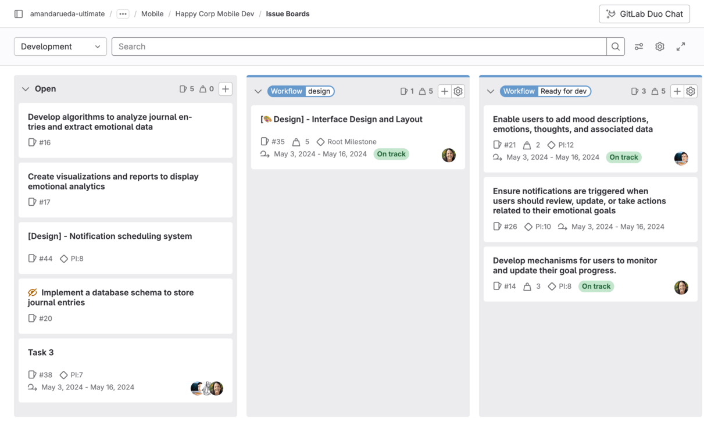


<a id="multiple-issue-boards"></a>

## 多个议题板

多个议题板允许为以下对象创建多个议题板：

- 所有版本中的项目
- 专业版和旗舰版中的群组

对于拥有多个团队的大型项目、一个代码仓库托管多个产品的代码，以及您希望创建议题板来支持软件开发生命周期中不同工作流的情况，多个议题板非常有用。

使用菜单顶部的搜索框，您可以筛选列出的议题板。

当您有十个或更多议题板可用时，菜单中还会显示一个 **最近** 部分，其中包含您最近访问的四个议题板的快捷方式。

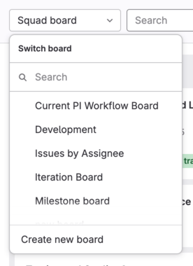

当您在拥有多个议题板的项目或群组中重新访问某个议题板时，极狐GitLab 会自动加载您上次访问的议题板。

<a id="create-an-issue-board"></a>

### 创建议题板

先决条件：

- 您必须拥有该项目的计划者、报告者、开发者、维护者或所有者角色。

要创建新议题板：

1. 在议题板页面的左上角，选择带有当前议题板名称的下拉列表。
1. 选择 **创建新议题板**。
1. 输入新议题板的名称并选择其范围：里程碑、迭代、标记、指派人或权重。
1. 选择 **创建议题板**

<a id="delete-an-issue-board"></a>

### 删除议题板

先决条件：

- 您必须拥有保存该议题板的项目或群组的计划者、报告者、开发者、维护者或所有者角色。

要删除当前打开的议题板：

1. 在议题板页面的右上角，选择 **配置议题板** ()。
1. 选择 **删除议题板**。
1. 选择 **删除** 以确认。

如果您删除的议题板是最后一个，则会创建一个新的 `Development` 议题板。

<a id="issue-boards-use-cases"></a>

## 议题板使用场景

您可以根据自己偏好的工作流定制极狐GitLab 议题板。有关基于工作流的文档，请参阅[规划并跟踪您的工作教程](../../tutorials/plan_and_track.md)。

<a id="use-cases-for-a-single-issue-board"></a>

### 单个议题板的使用场景

使用 [GitLab Flow](https://about.gitlab.com/topics/version-control/what-is-gitlab-flow/)，您可以在议题中讨论提案、为其添加标记，并使用议题板组织和排定其优先级。

例如，让我们考虑这个简化的开发工作流：

1. 您有一个托管应用程序代码库的代码仓库，您的团队积极贡献代码。
1. 您的 **后端** 团队开始进行新的实现，收集反馈和批准，然后
   将其移交给 **前端** 团队。
1. 前端完成后，新功能会部署到 **预发布环境**进行测试。
1. 测试成功后，它会部署到 **生产环境**。

如果您有 **后端**、**前端**、**预发布环境** 和
**生产环境** 标记，并且有一个为每个标记都创建了列表的议题板，您可以：

- 可视化从开发生命周期开始到部署到生产环境的整个实现流程。
- 通过垂直移动列表中的议题来排定其优先级。
- 在列表之间移动议题，以根据您设置的标记来组织它们。
- 通过选择一个或多个现有议题，将多个议题添加到议题板中的列表。

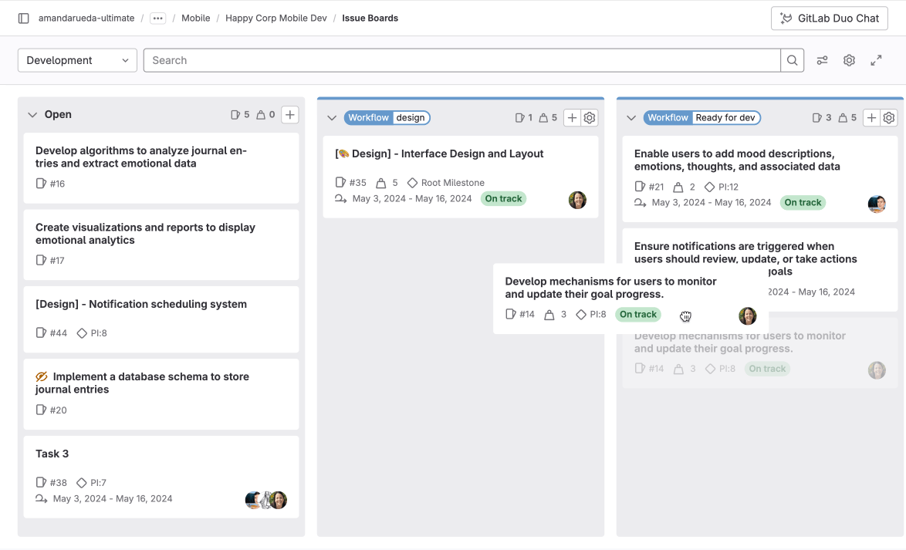

<a id="scrum-team"></a>

### Scrum 团队

在 Scrum 团队中，使用[多个议题板](#multiple-issue-boards)，让每个 Scrum 团队都有自己的议题板。在 Scrum 议题板上，您可以推动议题经过流程的每个
部分。例如：**待办**、**进行中** 和 **已完成**。

<a id="quick-assignments"></a>

### 快速指派

要快速将议题指派给团队成员：

1. 为每个团队成员创建[指派人列表](#assignee-lists)。
1. 将议题拖到该团队成员的列表上。

<a id="issue-board-terminology"></a>

## 议题板术语

**议题板**表示您议题的一种独特视图。它可以有多个列表，每个列表由以卡片表示的议题组成。

**列表**是议题板上的一列，用于显示匹配特定属性的议题。除了默认的“打开”和“已关闭”列表外，每个附加列表都会显示匹配您所选标记、指派人或里程碑的议题。在每个列表的顶部，您可以看到属于该列表的议题数量。列表类型包括：

- **打开**（默认）：所有不属于其他列表的未关闭议题。
  始终显示为最左侧的列表。
- **已关闭**（默认）：所有已关闭议题。始终显示为最右侧的列表。
- **标记列表**：某个标记的所有未关闭议题。
- [**指派人列表**](#assignee-lists)：指派给某个用户的所有未关闭议题。
- [**里程碑列表**](#milestone-lists)：某个里程碑的所有未关闭议题。
- [**迭代列表**](#iteration-lists)：某个迭代的所有未关闭议题。
- [**状态列表**](#status-lists)：具有某个状态的所有议题。

**卡片**是列表上的一个方框，表示一个议题。您可以将卡片从一个列表拖到另一个列表，以更改其标记、指派人或里程碑。您可以在卡片上看到的信息包括：

- 议题标题
- 关联的标记
- 议题编号
- 指派人
- 权重
- 里程碑
- 迭代（在专业版和旗舰版中）
- 截止日期
- 时间跟踪预估
- 健康状态

**泳道**是议题板上议题的水平分组，例如按父史诗分组。

<a id="ordering-issues-in-a-list"></a>

## 对列表中的议题排序

先决条件：

- 您必须拥有该项目的计划者、报告者、开发者、维护者或所有者角色。

创建议题时，系统会分配一个相对顺序值，该值大于该议题所属项目或顶级群组的最大值。这意味着该议题会出现在其所在任何议题列表的底部。

当您访问议题板时，议题会在任何列表中按顺序显示。您可以通过拖动议题来更改该顺序。更改后的顺序会被保存，因此之后访问同一议题板的任何人都会看到重新排序的结果，但有一些例外。

每当您拖动并重新排序议题时，其相对顺序值会相应更改。之后，每当该议题出现在任何议题板中时，都会根据更新后的相对顺序值进行排序。如果您极狐GitLab 实例中的用户将议题 `A` 拖到议题 `B` 上方，那么当这两个议题随后在同一实例中的任何议题板中加载时，该顺序都会保持不变。例如，这可能是不同的项目议题板或不同的群组议题板。

此排序也会影响[议题列表](issues/sorting_issue_lists.md)。更改议题板中的顺序会更改议题列表中的顺序，反之亦然。

<a id="focus-mode"></a>

## 专注模式

在专注模式下，导航 UI 会被隐藏，让您可以专注于议题板中的议题。要打开或关闭专注模式，请在右上角选择 **切换专注模式** ()。

<a id="group-issue-boards"></a>

## 群组议题板

群组议题板可在群组导航层级访问，提供与项目议题板相同的功能。它可以显示该群组及其后代子群组下所有项目的议题。

极狐GitLab 基础版用户可以使用单个群组议题板。

<a id="gitlab-enterprise-features-for-issue-boards"></a>

## 议题板的极狐GitLab 企业版功能

极狐GitLab 议题板在基础版中可用，但一些
高级功能仅在[更高版本](https://gitlab.cn/pricing)中提供。

<a id="configurable-issue-boards"></a>

### 可配置议题板



- Tier: 专业版，旗舰版
- Offering: JihuLab.com，私有化部署



议题板可以与[里程碑](milestones/_index.md)、[标记](labels.md)、指派人、权重和当前[迭代](../group/iterations/_index.md)关联，从而自动相应地筛选议题板中的议题。通过这些筛选器，您可以根据团队的需求创建独特的议题板。

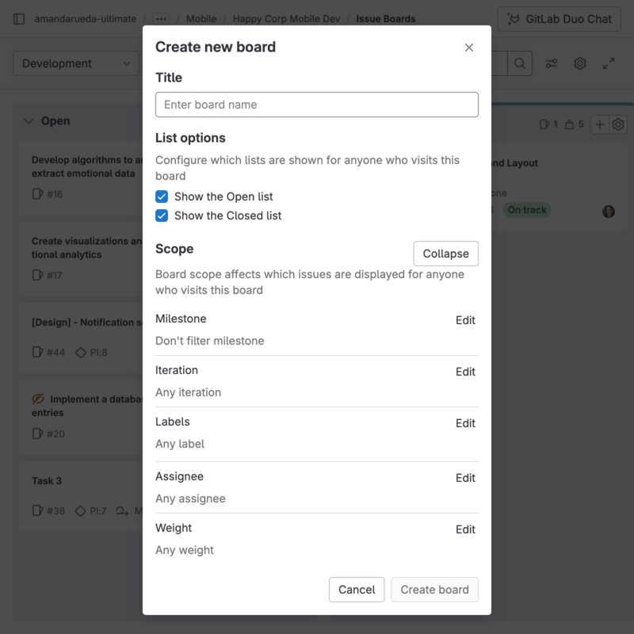

您可以在创建议题板时定义其范围，也可以通过选择 **配置议题板** () 按钮来定义。将里程碑、迭代、指派人或权重分配给议题板后，您将无法再在搜索栏中通过这些条件进行筛选。为此，您需要从议题板中移除所需的范围（例如里程碑、指派人或权重）。

如果您没有议题板的编辑权限，您仍然可以通过
选择 **议题板配置** () 来查看配置。

<a id="assignee-lists"></a>

### 指派人列表



- Tier: 专业版，旗舰版
- Offering: JihuLab.com，私有化部署



就像显示具有所选标记的所有议题的常规列表一样，您可以添加一个指派人列表，显示指派给某个用户的所有议题。您可以拥有同时包含标记列表和指派人列表的议题板。

先决条件：

- 您必须拥有该项目的计划者、报告者、开发者、维护者或所有者角色。

要添加指派人列表：

1. 选择 **新建列表**。
1. 选择 **指派人**。
1. 在下拉列表中，选择一个用户。
1. 选择 **添加到议题板**。

添加指派人列表后，您可以通过[移动议题](#move-issues-and-lists)进出指派人列表，来为该用户指派或取消指派议题。要移除指派人列表，就像移除标记列表一样，选择垃圾桶图标。

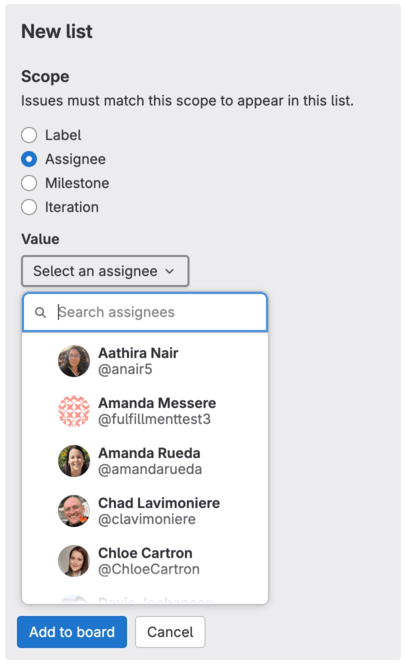

<a id="milestone-lists"></a>

### 里程碑列表



- Tier: 专业版，旗舰版
- Offering: JihuLab.com，私有化部署



您可以创建里程碑列表，按分配的里程碑筛选议题，让您在议题板上拥有更多自由度和可见性。

先决条件：

- 您必须拥有该项目的计划者、报告者、开发者、维护者或所有者角色。

要添加里程碑列表：

1. 选择 **新建列表**。
1. 选择 **里程碑**。
1. 在下拉列表中，选择一个里程碑。
1. 选择 **添加到议题板**。

要更改议题的里程碑，请[拖动议题卡片](#move-issues-and-lists)进出里程碑列表。

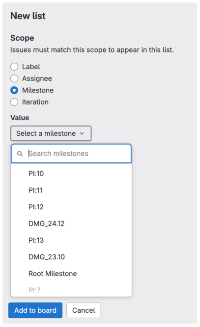

<a id="iteration-lists"></a>

### 迭代列表



- Tier: 专业版，旗舰版
- Offering: JihuLab.com，私有化部署



您可以创建迭代中议题的列表。

先决条件：

- 您必须拥有该项目的计划者、报告者、开发者、维护者或所有者角色。

要添加迭代列表：

1. 选择 **新建列表**。
1. 选择 **迭代**。
1. 在下拉列表中，选择一个迭代。
1. 选择 **添加到议题板**。

要更改议题的迭代，请[拖动议题卡片](#move-issues-and-lists)进出迭代列表。

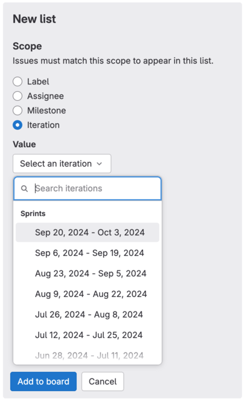

<a id="status-lists"></a>

### 状态列表



- Tier: 专业版，旗舰版
- Offering: JihuLab.com，私有化部署



创建具有特定状态的议题列表。状态列表可帮助您按工作流阶段组织议题，例如 **进行中** 或 **已完成**。

有关更多信息，请参阅[状态部分](../work_items/status.md)。

状态列表的行为与其他列表类型不同：

- **状态列表**：可以包含未关闭和已关闭议题，具体取决于该状态映射到未关闭状态还是已关闭状态。
- **其他列表**（如指派人或里程碑）：始终只显示未关闭议题。

先决条件：

- 您必须拥有该项目的计划者、报告者、开发者、维护者或所有者角色。

要添加状态列表：

1. 选择 **新建列表**。
1. 选择 **状态**。
1. 从下拉列表中，选择状态。
1. 选择 **添加到议题板**。

状态列表会添加到议题板中，并显示具有该状态的议题。

要更改议题的状态，请[拖动议题卡片](#move-issues-and-lists)进出状态列表。


<a id="group-issues-in-swimlanes"></a>

### 在泳道中对议题分组



- Tier: 专业版，旗舰版
- Offering: JihuLab.com，私有化部署



使用泳道，您可以可视化按史诗分组的议题。您的议题板保留所有其他功能，但议题的视觉组织方式不同。此功能对项目和群组均可用。

先决条件：

- 您必须拥有该项目的计划者、报告者、开发者、维护者或所有者角色。

要在议题板中按史诗对议题分组：

1. 选择 **查看选项** ()。
1. 选择 **史诗泳道**。

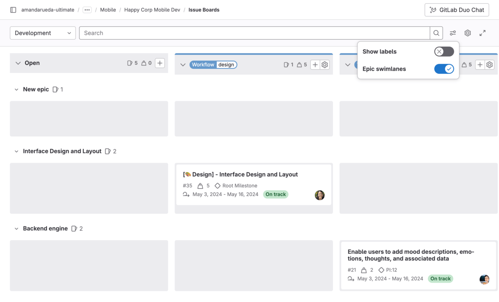

然后，您可以在不离开此视图的情况下[编辑](#edit-an-issue)议题，并[拖动](#move-issues-and-lists)它们以更改其位置和史诗分配：

- 要重新排序议题，请将其拖到列表中的新位置。
- 要将议题分配给另一个史诗，请将其拖到该史诗的水平泳道。
- 要从史诗中移除议题，请将其拖到 **未分配史诗的议题** 泳道。
- 要同时将议题移动到另一个史诗和另一个列表，请沿对角线拖动该议题。

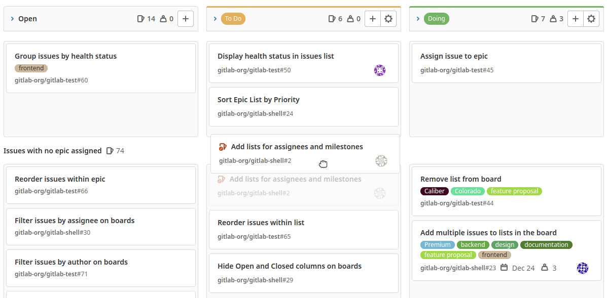

<a id="sum-of-issue-weights"></a>

### 议题权重总和



- Tier: 专业版，旗舰版
- Offering: JihuLab.com，私有化部署



每个列表的顶部会显示属于该列表的议题的权重总和。当您使用议题板进行容量分配时，该总和很有帮助，尤其是与[指派人列表](#assignee-lists)结合使用时。

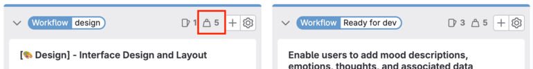

<a id="work-in-progress-limits"></a>

### 在制品限制



- Tier: 专业版，旗舰版
- Offering: JihuLab.com，私有化部署



您可以为议题板上的每个议题列表设置在制品 (WIP) 限制。设置限制后，当前状态和配置的限制会显示在议题板列表标题中。

列表中的一条线将处于限制内的条目与超出限制的条目分开。您不能为默认列表（**打开** 和 **已关闭**）设置 WIP 限制。

<a id="types-of-limits"></a>

#### 限制类型

极狐GitLab 支持两种类型的 WIP 限制：

- **条目**：限制列表中的议题数量，不考虑其权重。
  议题板标题会显示列表中的议题数量和条目限制。

  例如，如果有 4 个议题且条目限制为 3，则标题显示 **4/3**。

  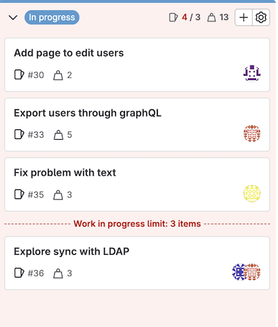

- **权重**：限制列表中议题的总权重。
  议题板标题会显示列表中议题的总权重和权重限制。

  例如，如果议题的权重总和为 8 且权重限制为 5，则标题显示 **8/5**。

  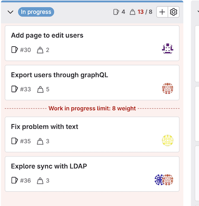

示例：

- 当您有一个包含四个议题的列表且条目限制为五时，标题显示 **4/5**。
  如果超出限制，当前议题数量会以红色显示。
- 您有一个包含五个议题的列表，条目限制为五。当您将另一个议题移动到该列表时，
  列表标题会显示 **6/5**，其中六以红色显示。在制品限制线显示在第六个议题之前。
- 使用权重限制时，如果您有三个权重分别为 1、2 和 5 的议题（总权重为 8）且权重限制为 5，则标题显示 **8/5**，其中 8 以红色显示。在制品限制线出现在合计权重未超过限制的议题之后，将它们与超出的议题分开。

<a id="set-work-in-progress-limit"></a>

#### 设置在制品限制

先决条件：

- 您必须拥有该项目的计划者、报告者、开发者、维护者或所有者角色。

要为议题板中的列表设置 WIP 限制：

1. 在要编辑的列表顶部，选择 **编辑列表设置** ()。
   列表设置侧边栏会在右侧打开。
1. 在 **在制品限制** 旁边，选择 **编辑**。
1. 从下拉列表中选择限制类型：
   - **条目**：按议题数量限制。
   - **权重**：按议题总权重限制。
1. 输入最大条目数或最大权重。
1. 按 <kbd>Enter</kbd> 保存。

要移除 WIP 限制，请选择 **移除限制**。

<a id="blocked-issues"></a>

### 受阻议题



- Tier: 专业版，旗舰版
- Offering: JihuLab.com，私有化部署



如果某个议题[被另一个议题阻塞](issues/related_issues.md#blocking-issues)，其标题旁边会显示一个图标，以指示其受阻状态。

当您将鼠标悬停在受阻图标 () 上时，会显示详细信息弹出框。

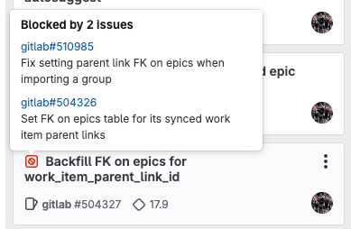

<a id="actions-you-can-take-on-an-issue-board"></a>

## 您可以在议题板上执行的操作

- [编辑议题](#edit-an-issue)。
- [创建新列表](#create-a-new-list)。
- [移除现有列表](#remove-a-list)。
- [从列表中移除议题](#remove-an-issue-from-a-list)。
- [筛选](#filter-issues)议题板上显示的议题。
- [移动议题和列表](#move-issues-and-lists)。
- 拖动并重新排序列表。
- 更改议题标记（通过在列表之间拖动议题）。
- 关闭议题（通过将其拖到 **已关闭** 列表）。

<a id="edit-an-issue"></a>

### 编辑议题

您可以在不离开议题板视图的情况下编辑议题。要打开右侧边栏，请选择议题卡片（而不是其标题）。

先决条件：

- 您必须拥有该项目的计划者、报告者、开发者、维护者或所有者角色。

您可以在右侧边栏中编辑以下议题属性：

- 指派人
- 机密性
- 截止日期
- [史诗](../group/epics/_index.md)
- [健康状态](issues/managing_issues.md#health-status)
- [迭代](../group/iterations/_index.md)
- 标记
- 里程碑
- 通知设置
- 标题
- [权重](../work_items/weight.md)
- 时间跟踪

当您从议题板中选择议题卡片时，议题会在详情面板中打开。在那里，您可以编辑所有字段，包括描述、评论或相关条目。

<a id="create-a-new-list"></a>

### 创建新列表

您可以在两个现有列表之间或议题板右侧创建新列表。

要在两个列表之间创建新列表：

1. 在顶部栏中，选择 **搜索或跳转到** 并找到您的项目。
1. 在左侧边栏中，选择 **计划** > **议题板**。
1. 将鼠标悬停或在两个列表之间移动键盘焦点。
1. 选择 **新建列表**。
   新列表面板会打开。

   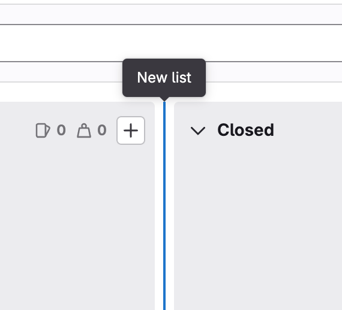

1. 选择新列表所基于的标记、用户、里程碑、迭代或状态。
1. 选择 **添加到议题板**。

新列表会插入到议题板上与新列表面板相同的位置。

要移动和重新排序列表，请拖动它们。

或者，您可以选择议题板最右端的 **新建列表**。新列表会插入到列表的最右端，在 **已关闭** 之前。

<a id="remove-a-list"></a>

### 移除列表

移除列表不会对议题和标记产生任何影响，因为移除的只是列表视图。如果需要，您以后随时可以重新创建它。

先决条件：

- 您必须拥有该项目的计划者、报告者、开发者、维护者或所有者角色。

要从议题板中移除列表：

1. 在要移除的列表顶部，选择 **编辑列表设置** ()。
   列表设置侧边栏会在右侧打开。
1. 选择 **移除列表**。
1. 在确认对话框中，再次选择 **移除列表**。

<a id="add-issues-to-a-list"></a>

### 向列表添加议题

先决条件：

- 您必须拥有该项目的计划者、报告者、开发者、维护者或所有者角色。

如果您的议题板限定为一个或多个属性，请转到要添加的议题并应用与议题板范围相同的属性。

例如，要将议题添加到限定为 `Doing` 标记的列表，在群组议题板中：

1. 转到该群组或其某个子群组或项目中的议题。
1. 添加 `Doing` 标记。

该议题现在应显示在您议题板上的 `Doing` 列表中。

<a id="remove-an-issue-from-a-list"></a>

### 从列表中移除议题

当某个议题不再属于某个列表时，您可以将其移除。

先决条件：

- 您必须拥有该项目的计划者、报告者、开发者、维护者或所有者角色。

步骤取决于列表的范围：

1. 要打开右侧边栏，请选择议题卡片。
1. 移除使该议题保留在列表中的内容。
   如果是标记列表，请移除该标记。如果是[指派人列表](#assignee-lists)，请取消指派该用户。

<a id="filter-issues"></a>

### 筛选议题

您可以使用议题板顶部的筛选器，仅显示您想要的结果。它类似于[议题跟踪器](issues/_index.md)中使用的筛选。

先决条件：

- 您必须拥有该项目的计划者、报告者、开发者、维护者或所有者角色。

您可以按以下条件筛选：

- 指派人
- 作者
- [史诗](../group/epics/_index.md)
- [迭代](../group/iterations/_index.md)
- 标记
- 里程碑
- 我的回应
- 发布
- 类型（议题/事件）
- [权重](../work_items/weight.md)
- [状态](../work_items/status.md)

<a id="filtering-issues-in-a-group-board"></a>

#### 在群组议题板中筛选议题

在群组议题板中[筛选议题](#filter-issues)时，请记住以下行为：

- 里程碑：您可以按属于该群组及其后代群组的里程碑进行筛选。
- 标记：您只能按属于该群组但不属于其后代群组的标记进行筛选。

当您使用右侧边栏单独编辑议题时，您还可以选择该议题所属项目的里程碑和标记。

<a id="move-issues-and-lists"></a>

### 移动议题和列表

您可以通过拖动来移动议题和列表。

先决条件：

- 您必须拥有极狐GitLab 中某个项目的计划者、报告者、开发者、维护者或所有者角色。

要移动议题，请选择议题卡片并将其拖到其当前列表中的另一个位置，或拖到其他列表。请在[在列表之间拖动议题](#dragging-issues-between-lists)中了解可能的效果。

要移动列表，请选择其顶部栏，然后水平拖动它。您不能移动 **打开** 和 **已关闭** 列表，但在编辑议题板时可以隐藏它们。

<a id="move-an-issue-to-the-start-of-the-list"></a>

#### 将议题移动到列表开头

您可以使用菜单快捷方式将议题移动到列表顶部。

即使其他议题被筛选器隐藏，您的议题也会移动到列表顶部。

先决条件：

- 您至少必须拥有该项目的计划者角色。

要将议题移动到列表开头：

1. 在议题板中，将鼠标悬停在要移动的议题卡片上。
1. 选择 **卡片选项** ()，然后选择 **移至列表开头**。

<a id="move-an-issue-to-the-end-of-the-list"></a>

#### 将议题移动到列表末尾

您可以使用菜单快捷方式将议题移动到列表底部。

即使其他议题被筛选器隐藏，您的议题也会移动到列表底部。

先决条件：

- 您至少必须拥有该项目的计划者角色。

要将议题移动到列表末尾：

1. 在议题板中，将鼠标悬停在要移动的议题卡片上。
1. 选择 **卡片选项** ()，然后选择 **移至列表末尾**。

<a id="dragging-issues-between-lists"></a>

#### 在列表之间拖动议题

要将议题移动到另一个列表，请选择议题卡片并将其拖到该列表上。

当您在列表之间拖动议题时，结果会因源列表和目标列表而异。

|                              | 到打开        | 到已关闭   | 到标记 B 列表                | 到指派人 Bob 列表          |
| ---------------------------- | -------------- | ----------- | ------------------------------ | ----------------------------- |
| **从打开**                | -              | 关闭议题 | 添加标记 B                    | 指派 Bob                    |
| **从已关闭**              | 重新打开议题   | -           | 重新打开议题并添加标记 B   | 重新打开议题并指派 Bob   |
| **从标记 A 列表**        | 移除标记 A | 关闭议题 | 移除标记 A 并添加标记 B | 指派 Bob                    |
| **从指派人 Alice 列表** | 取消指派 Alice | 关闭议题 | 添加标记 B                    | 取消指派 Alice 并指派 Bob |

<a id="tips"></a>

## 提示

需要记住的几点：

- 在列表之间移动议题会从议题来源列表中移除该标记，
  并添加议题目标列表中的标记。
- 如果议题有多个标记，它可以存在于多个列表中。
- 如果议题已添加标记，列表会自动填充这些议题。
- 选择卡片内的议题标题会带您转到该议题。
- 选择卡片内的标记会快速筛选整个议题板，
  并仅显示所有列表中具有该标记的议题。
- 当议题从状态列表移动到未关闭列表时，会应用默认的未关闭状态。
  同样，当它移动到已关闭列表时，会应用默认的已关闭状态。
- 出于性能和可见性考虑，每个列表默认显示前 20 个议题
  。如果您有超过 20 个议题，请开始向下滚动，接下来
  20 个议题会出现。

<a id="troubleshooting-issue-boards"></a>

## 故障排除议题板

<a id="there-was-a-problem-fetching-users-on-group-issue-board-when-filtering-by-author-or-assignee"></a>

### 在群组议题板上按作者或指派人筛选时出现 `There was a problem fetching users`

如果在群组议题板上按作者或指派人筛选时，您看到带有 `There was a problem fetching users` 错误的横幅，请确保您已作为成员添加到当前群组。非成员在议题板上按作者或指派人筛选时，没有列出群组成员的权限。

要修复此错误，您应将所有用户以访客、计划者、报告者、开发者、维护者或所有者角色添加到顶级群组。

<a id="use-rails-console-to-fix-issue-boards-not-loading-and-timing-out"></a>

### 使用 Rails 控制台修复议题板无法加载和超时的问题

如果您在 UI 中看到议题板无法加载并超时，请使用 Rails 控制台调用议题再平衡服务来修复它：

1. [启动 Rails 控制台会话](../../administration/operations/rails_console.md#starting-a-rails-console-session)。
1. 运行以下命令：

   ```ruby
   p = Project.find_by_full_path('<username-or-group>/<project-name>')

   Issues::RelativePositionRebalancingService.new(p.root_namespace.all_projects).execute
   ```

1. 要退出 Rails 控制台，请输入 `quit`。
