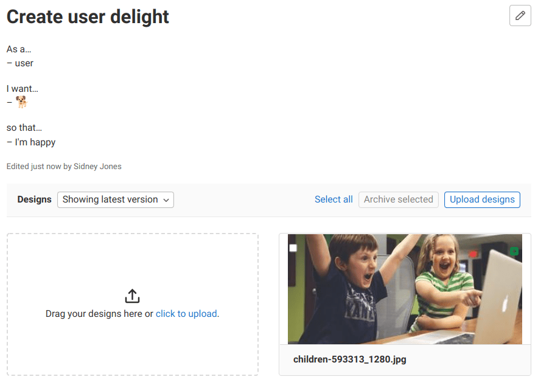
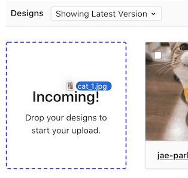

<!--- start_remove The following content will be removed on remove_date: '2027-05-15' -->



- Tier: 基础版，专业版，旗舰版
- Offering: JihuLab.com，私有化部署



> [!warning]
> 此功能在极狐GitLab 18.6 中[已废弃](../../../update/deprecations.md#design-management-deprecated)，
> 并计划在 20.0 中移除。
> 此变更是一项破坏性变更。
> 在极狐GitLab 20.0 及更高版本中，用户将无法再上传新的设计。
> 现有设计在极狐GitLab 21.0 之前仍以只读模式提供，让用户有时间按需保存其设计。
> 极狐GitLab 正在探索能够更好地与设计师已使用的工具集成的替代方案。

<!--- end_remove -->

通过设计管理，您可以将设计资产（包括线框图和效果图）上传到极狐GitLab 议题，并将它们集中存储在一处。产品设计师、产品经理和工程师可以基于单一可信来源协作处理设计。

您可以与团队共享设计效果图，也可以查看并处理视觉回归问题。

<a id="prerequisites"></a>

## 先决条件

- 必须启用 [Git 大文件存储 (LFS)](../../../topics/git/lfs/_index.md)：
  - 在 JihuLab.com 上，LFS 已启用。
  - 在极狐GitLab 私有化部署实例上，极狐GitLab 管理员必须
    [全局启用 LFS](../../../administration/lfs/_index.md)。
  - 在 JihuLab.com 和极狐GitLab 私有化部署实例上，都必须
    [为项目本身启用 LFS](../settings/_index.md#configure-project-features-and-permissions)。
    如果已全局启用，则默认对所有项目启用 LFS。如果您已
    为项目禁用 LFS，则必须重新启用。

  设计以 LFS 对象的形式存储。
  图像缩略图作为其他上传内容存储，它们不与项目关联，而是
  与特定的设计模型关联。

  极狐GitLab 管理员可以通过转到**管理员** > **项目**
  然后选择相应项目，来验证哈希存储项目的相对路径。**相对路径**字段的值中包含 `@hashed`。

如果不满足这些要求，您会在**设计**部分收到通知。

<a id="supported-file-types"></a>

## 支持的文件类型

您可以将以下类型的文件作为设计上传：

- BMP
- GIF
- ICO
- JPEG
- JPG
- PNG
- TIFF
- WEBP

对 PDF 文件的支持情况记录在[议题 32811](https://gitlab.com/gitlab-org/gitlab/-/issues/32811)中。

<a id="view-a-design"></a>

## 查看设计

**设计**部分位于议题描述中。

先决条件：

- 您必须拥有项目的访客、计划者、报告者、开发者、维护者或所有者角色。

要查看设计：

1. 转到某个议题。
1. 在**设计**部分，选择您要查看的设计图像。

您选择的设计会打开。然后您可以[放大](#zoom-in-on-a-design)它，或[创建评论](#add-a-comment-to-a-design)。



查看设计时，您可以移动到其他设计。为此，您可以：

- 在右上角，选择**转到上一个设计** () 或**转到下一个设计** ()。
- 在键盘上按 <kbd>左</kbd> 或 <kbd>右</kbd>。

要返回议题视图，您可以：

- 在左上角，选择关闭图标 ()。
- 在键盘上按 <kbd>Esc</kbd>。

添加设计后，图像缩略图上会显示一个绿色图标 ()。当设计在当前版本中[已更改](#add-a-new-version-of-a-design)时，会显示一个蓝色图标 ()。

<a id="zoom-in-on-a-design"></a>

### 放大设计

您可以通过放大和缩小图像来更详细地查看设计：

- 要控制缩放量，请选择图像底部的加号 (`+`) 和减号 (`-`)。
- 要重置缩放级别，请选择重做图标 ()。

要在放大时移动图像，请拖动图像。

<a id="download-a-design-image-with-an-access-token"></a>

## 使用访问令牌下载设计图像

在没有浏览器会话的情况下，使用访问令牌从 API 客户端（如移动应用、集成和导出工具）下载设计图像。

先决条件：

- 您必须拥有以下令牌之一：
  - 具有 `api` 或 `read_api` 范围的[个人访问令牌](../../profile/personal_access_tokens.md)或
    [OAuth 2.0 令牌](../../../api/oauth2.md)。
  - 具有项目**工作项：读取**权限的[细粒度个人访问令牌](../../../auth/tokens/fine_grained_access_tokens.md)。
- 您必须拥有[查看设计](#view-a-design)的权限。

您不能使用项目访问令牌、群组访问令牌或服务账号令牌来下载设计图像。

要下载设计图像：

1. 从 GraphQL API 获取图像 URL。对于不大于 432x230 像素的预览，
   请使用 `imageV432x230` 字段而不是 `image`：

   ```graphql
   query {
     project(fullPath: "my-group/my-project") {
       issue(iid: "1") {
         designCollection {
           designs {
             nodes {
               filename
               image
             }
           }
         }
       }
     }
   }
   ```

1. 请求该图像 URL，并在 `PRIVATE-TOKEN` 请求头中传递令牌：

   ```shell
   curl --output design.png --header "PRIVATE-TOKEN: <your_access_token>" "<image_url>"
   ```

   对于 OAuth 2.0 令牌，请改用 `Authorization: Bearer <oauth_token>` 请求头。
   您必须在请求头中发送令牌。查询字符串参数中的令牌，
   例如 `private_token`，不被接受。

<a id="add-a-design-to-an-issue"></a>

## 向议题添加设计

先决条件：

- 您必须拥有项目的计划者、报告者、开发者、维护者或所有者角色。
- 上传文件的名称不得超过 255 个字符。

要向议题添加设计：

1. 转到某个议题。
1. 执行以下任一操作：
   - 选择**上传设计**，然后从文件浏览器中选择图像。您一次最多可以选择
     10 个文件。
     <!-- vale gitlab_base.SubstitutionWarning = NO -->
   - 选择**点击上传**，然后从文件浏览器中选择图像。您一次最多可以选择
     10 个文件。
     <!-- vale gitlab_base.SubstitutionWarning = YES -->

   - 从文件浏览器中拖动文件，并将其放到**设计**部分中的放置区域。

     

   - 截取屏幕截图，或将本地图像文件复制到剪贴板，将光标悬停在
     放置区域上，然后按 <kbd>Control</kbd> 或 <kbd>Command</kbd>+<kbd>V</kbd>。

     像这样粘贴图像时，请记住以下几点：

     - 您一次只能粘贴一张图像。当您粘贴多个复制的文件时，只会上传第一个
       文件。
     - 如果您粘贴的是屏幕截图，该图像会作为 PNG 文件添加，其生成的名称格式为：
       `design_<timestamp>.png`。
     - Internet Explorer 不支持此功能。

<a id="add-a-new-version-of-a-design"></a>

## 添加设计的新版本

随着对设计的讨论不断进行，您可能希望上传设计的新版本。

先决条件：

- 您必须拥有项目的计划者、报告者、开发者、维护者或所有者角色。

为此，请使用相同的文件名[添加设计](#add-a-design-to-an-issue)。

要浏览所有设计版本，请使用**设计**部分顶部的下拉列表。它显示为**显示最新版本**或**显示版本 #N**。

<a id="skipped-designs"></a>

### 跳过的设计

当您上传的图像与现有已上传设计的文件名相同且内容也相同时，该图像会被跳过。这意味着不会创建该设计的新版本。当设计被跳过时，会显示一条警告消息。

<a id="archive-a-design"></a>

## 归档设计

您可以归档单个设计，也可以选择多个设计一次性归档。

已归档的设计不会永久丢失。您可以浏览[以前的版本](#add-a-new-version-of-a-design)。

归档设计时，其 URL 会发生变化。如果该设计在最新版本中不可用，则只能使用 URL 中的版本链接到它。

先决条件：

- 您必须拥有项目的计划者、报告者、开发者、维护者或所有者角色。
- 您只能归档设计的最新版本。

要归档单个设计：

1. 选择该设计以放大查看。
1. 在右上角，选择**归档设计** ()。
1. 选择**归档设计**。

要一次性归档多个设计：

1. 选中您要归档的设计上的复选框。
1. 选择**归档所选**。

<a id="design-management-data-persistence"></a>

## 设计管理数据持久性

- 在以下情况下，设计管理数据不会被删除：
  - [项目被销毁](https://gitlab.com/gitlab-org/gitlab/-/issues/13429)。
  - [议题被删除](https://gitlab.com/gitlab-org/gitlab/-/issues/13427)。

<a id="replicate-design-management-data"></a>

### 复制设计管理数据

设计管理数据可以由 Geo [复制](../../../administration/geo/replication/datatypes.md#replicated-data-types)和验证。有关更多信息，请参见[议题 355660](https://gitlab.com/gitlab-org/gitlab/-/issues/355660)。

<a id="markdown-and-rich-text-editors-for-descriptions"></a>

## 用于描述的 Markdown 和富文本编辑器

您可以在设计描述中使用 Markdown 和富文本编辑器。它与您在极狐GitLab 各处用于评论的编辑器相同。

<a id="reorder-designs"></a>

## 重新排序设计

您可以通过将设计拖动到新位置来更改其顺序。

<a id="add-a-comment-to-a-design"></a>

## 向设计添加评论

您可以在已上传的设计上发起[讨论](../../discussions/_index.md)。为此：

1. 转到某个议题。
1. 选择该设计。
1. 选择该图像。该位置会创建一个图钉，标识讨论的位置。
1. 输入您的消息。
1. 选择**评论**。

您可以通过在图像上拖动图钉来调整其位置。当设计的布局发生变化时，或者为了移动图钉以便在其位置添加新图钉时，请使用此功能。

新的讨论串会获得不同的图钉编号，您可以使用这些编号来引用它们。

新讨论会输出到议题活动，以便所有相关人员都能参与讨论。

<a id="delete-a-comment-from-a-design"></a>

## 从设计中删除评论

先决条件：

- 您必须拥有项目的计划者、报告者、开发者、维护者或所有者角色。

要从设计中删除评论：

1. 在您要删除的评论上，选择**更多操作**  > **删除评论**。
1. 在确认对话框中，选择**删除评论**。

<a id="resolve-a-discussion-thread-on-a-design"></a>

## 解决设计上的讨论串

当您完成对设计某部分的讨论后，可以解决该讨论串。

要将讨论串标记为已解决或未解决，您可以：

- 在讨论第一条评论的右上角，选择**解决讨论串**或**重新打开讨论串** ()。
- 向该讨论串添加新评论，然后选中或清除**解决讨论串**复选框。

解决讨论串还会将该讨论串内与评论相关的任何待处理[待办事项](../../todos.md)标记为已完成。只有触发该操作的用户对应的待办事项会受到影响。

已解决的评论图钉会从设计中消失，以便为新讨论腾出空间。要重新查看已解决的讨论，请展开可见讨论串下方的**已解决的评论**。

<a id="add-a-to-do-item-for-a-design"></a>

## 为设计添加待办事项

要为设计添加[待办事项](../../todos.md)，请在设计侧边栏中选择**添加待办事项**。

<a id="refer-to-a-design-in-markdown"></a>

## 在 Markdown 中引用设计

您可以在 [Markdown](../../markdown.md) 文本框中引用设计。将设计的原始 URL 粘贴到评论或描述中。它随后会显示为简短引用。

例如，如果您这样引用某个设计：

```markdown
See https://gitlab.com/gitlab-org/gitlab/-/issues/13195/designs/Group_view.png.
```

极狐GitLab 会自动将原始 URL 渲染为简写[引用](../../markdown.md#gitlab-specific-references)：
`See #13195[Group_view.png].`

链接到图像与在评论或描述中[嵌入图像](../../markdown.md#images)不同。无法通过这种方式嵌入设计。

<a id="design-activity-records"></a>

## 设计活动记录

设计上的用户活动事件（创建、删除和更新）由极狐GitLab 跟踪，并显示在[用户个人资料](../../profile/_index.md#access-your-user-profile)、[群组](../../group/manage.md#view-group-activity)和[项目](../working_with_projects.md#view-project-activity)活动页面上。

<a id="gitlab-figma-plugin"></a>

## GitLab-Figma 插件

您可以使用 GitLab-Figma 插件将 Figma 中的设计直接上传到极狐GitLab 中的
议题。

要在 Figma 中使用该插件，请从 [Figma 目录](https://www.figma.com/community/plugin/860845891704482356/gitlab)安装它，并通过个人访问令牌连接到极狐GitLab。

有关更多信息，请参见[插件文档](https://gitlab.com/gitlab-org/gitlab-figma-plugin/-/wikis/home)。

<a id="troubleshooting"></a>

## 故障排除

使用设计管理时，您可能会遇到以下问题。

<a id="could-not-find-design"></a>

### 找不到设计

您可能会收到一个错误，提示 `Could not find design`。

当某个设计已被[归档](#archive-a-design)，因此它在最新版本中不可用，而您访问的链接未指定版本时，就会出现此问题。

归档设计时，其 URL 会发生变化。如果该设计在最新版本中不可用，则只能使用 URL 中的版本链接到它。

例如，`https://gitlab.example.com/mygroup/myproject/-/issues/123456/designs/menu.png?version=503554`。您无法再通过 `https://gitlab.example.com/mygroup/myproject/-/issues/123456/designs/menu.png` 访问 `menu.png`。

变通方法是从**设计**部分顶部的下拉列表中选择一个以前的版本。它显示为**显示最新版本**或**显示版本 #N**。

[议题 392540](https://gitlab.com/gitlab-org/gitlab/-/issues/392540) 跟踪了对此行为的改进。
