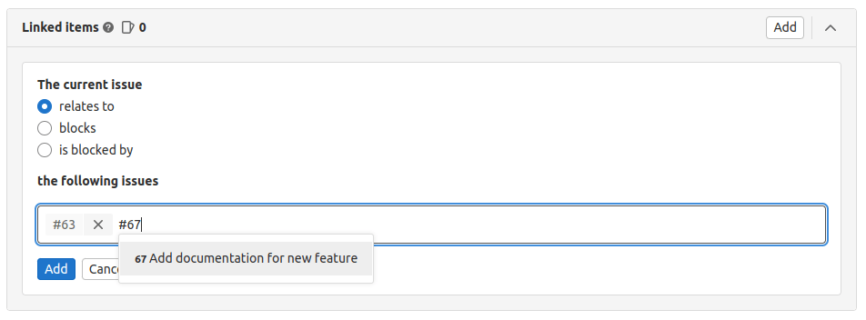
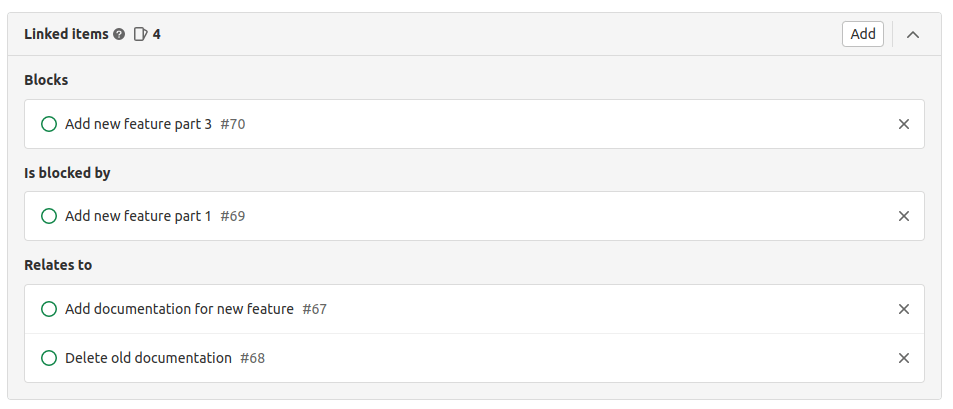
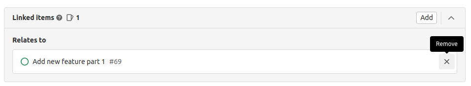



- Tier: 基础版，专业版，旗舰版
- Offering: JihuLab.com，私有化部署



关联议题是任意两个议题之间的双向关系，显示在议题描述下方的区块中。您可以关联不同项目中的议题。

只有当用户可以看到两个议题时，这种关系才会在 UI 中显示。当您尝试关闭一个存在未解决阻塞项的议题时，系统会显示警告。

> [!note]
> 要通过 API 管理关联议题，请参见[议题链接 API](../../../api/issue_links.md)。

## 添加关联议题

先决条件：

- 您必须对两个项目都拥有访客、计划者、报告者、开发者、维护者或所有者角色。

要将一个议题关联到另一个议题：

1. 在议题的**关联条目**部分，
   选择添加关联议题按钮（）。
1. 选择两个议题之间的关系。可以是：
   - **与……相关**
   - [**阻塞**](#blocking-issues)
   - [**被……阻塞**](#blocking-issues)
1. 输入议题编号或粘贴议题的完整 URL。

   

   同一项目中的议题只需通过引用编号指定。
   不同项目中的议题需要额外信息，例如
   群组和项目名称。例如：

   - 同一项目：`#44`
   - 同一群组：`project#44`
   - 不同群组：`group/project#44`

   有效引用会添加到一个临时列表中，供您查看。

1. 添加完所有关联议题后，选择**添加**。

完成所有关联议题的添加后，您可以看到它们已按类别分组，以便更直观地理解它们之间的关系。

您也可以从提交消息或另一个议题或合并请求的描述中添加关联议题。
有关更多信息，请参见[交叉链接议题](crosslinking_issues.md)。

## 移除关联议题

在议题的**关联条目**部分，选择每个议题项右侧的移除按钮（）即可移除。

由于是双向关系，该关系将不再出现在任何一个议题中。

有关更多信息，请访问我们的[权限](../../permissions.md)页面。

## 阻塞议题



- Tier: 专业版，旗舰版
- Offering: JihuLab.com，私有化部署



当您[添加关联议题](#add-a-linked-issue)时，可以表明它**阻塞**或**被另一个议题阻塞**。

被其他议题阻塞的议题在其标题旁边会有一个图标（），显示在
议题列表和[看板](../issue_board.md)中。
当阻塞议题被关闭或其关系被更改或
[移除](#remove-a-linked-issue)时，该图标会消失。

如果您尝试使用“关闭议题”按钮关闭一个被阻塞的议题，系统会显示确认消息。
