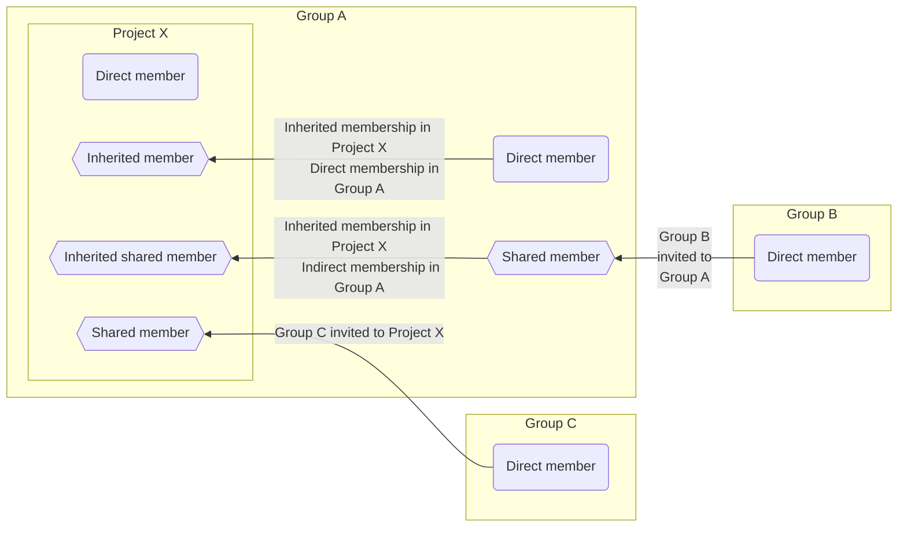
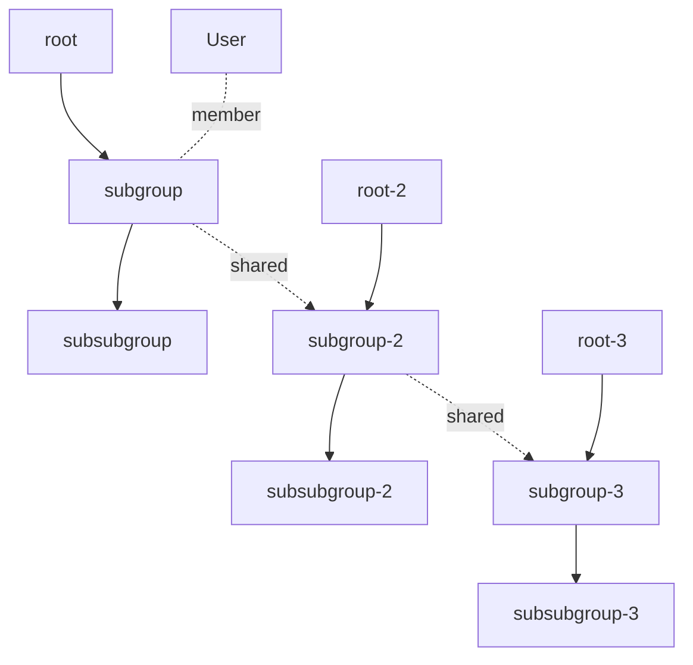



- Tier: 基础版，专业版，旗舰版
- Offering: JihuLab.com，私有化部署



成员是有权访问您项目的用户和群组。成员可以直接添加到您的项目，也可以通过群组继承访问权限。

每个成员都有一个角色，该角色决定他们在项目中可以执行的操作。拥有相应角色的项目成员可以将用户添加到项目、从项目中移除用户，并管理访问请求，以控制对项目资源的访问。

## 成员类型

用户可以直接或间接成为群组或项目的成员。间接成员关系可以是继承、共享或继承共享。

| 成员类型                               | 成员关系形成过程 |
| --------------------------------------------- | ------------------ |
| 直接 | 用户被直接添加到当前群组或项目。 |
| 继承 | 用户是包含当前群组或项目的父群组的成员。 |
| [共享](sharing_projects_groups.md) | 用户是被邀请到当前群组或项目的群组的成员。 |
| [继承共享](sharing_projects_groups.md#invite-a-group-to-a-group) | 用户是被邀请到当前群组或项目上级群组的群组的成员。 |
| 间接 | 继承、共享或继承共享成员的统称。 |

在上面的示例中：

- **Administrator** 是从 **demo** 群组继承的成员。
- **User 0** 是从 **demo** 群组继承的成员。
- **User 1** 是从被邀请到该项目的 **Acme** 群组共享的成员。
- **User 2** 是从被邀请到 **demo** 群组的 **Toolbox** 群组继承共享的成员。
- **User 3** 是直接添加到该项目的成员。

## 安全注意事项

Git 是一种分布式版本控制系统（DVCS）。每个处理源代码的人都拥有完整代码仓库的本地副本。

在极狐GitLab 中，每个拥有报告者、开发者、维护者或所有者角色的项目成员都可以克隆代码仓库以创建本地副本。用户在获得本地副本后，可以将完整代码仓库上传到任何地方，包括：

- 他们控制下的另一个项目。
- 其他服务器。
- 外部托管服务。

访问控制无法阻止已经有权访问代码仓库的用户有意共享源代码。所有 Git 管理平台都具有分布式版本控制系统的这一固有特性。

虽然您无法阻止已授权用户的有意共享，但可以采取以下措施来防止无意共享和信息破坏：

- 控制谁可以[将用户添加到项目](#add-users-to-a-project)。
- 使用[受保护分支](../repository/branches/protected.md)来防止未经授权的强制推送。
- 定期审查项目成员关系，并移除不再需要访问权限的用户。

## 将用户添加到项目

将用户添加到项目，使其成为直接成员并有权执行操作。

先决条件：

- 您必须拥有维护者或所有者角色。
- [群组成员关系锁定](../../group/access_and_permissions.md#prevent-members-from-being-added-to-projects-in-a-group)必须已禁用。
- 对于极狐GitLab 私有化部署实例：
  - 如果[新用户账号已禁用](../../../administration/settings/sign_up_restrictions.md#disable-new-user-account-creation)，则必须由管理员添加该用户。
  - 如果[不允许用户邀请](../../../administration/settings/visibility_and_access_controls.md#prevent-invitations-to-groups-and-projects)，则必须由管理员添加该用户。
  - 如果[已启用管理员审批](../../../administration/settings/sign_up_restrictions.md#turn-on-administrator-approval-for-role-promotions)，则必须由管理员批准该邀请。

要将用户添加到项目：

1. 在顶部栏中，选择**搜索或跳转到**，然后找到您的项目。
1. 在左侧边栏中，选择**管理** > **成员**。
1. 选择**邀请成员**。
1. 如果该用户：

   - 拥有极狐GitLab 账号，请输入其用户名。
   - 没有极狐GitLab 账号，请输入其电子邮件地址。

1. 选择[默认角色](../../permissions.md)或[自定义角色](../../custom_roles/_index.md)。
1. 可选。选择一个**访问到期日期**。
   从该日期起，该用户将无法再访问该项目。

   如果您选择了访问到期日期，项目成员将在访问权限到期前七天收到电子邮件通知。

   > [!warning]
   > 维护者在其角色到期前拥有完整权限，包括延长自己访问到期日期的能力。

1. 选择**邀请**。
   如果您通过以下方式邀请该用户：

   - 极狐GitLab 用户名，则他们会被添加到成员列表中。
   - 电子邮件地址，则会向其电子邮件地址发送邀请，并提示其创建账号。
     如果邀请未被接受，极狐GitLab 会在两天、五天和十天后发送提醒电子邮件。
     未接受的邀请将在 90 天后自动删除。

### 您可以分配哪些角色

您可以分配的最高角色取决于您是否拥有该群组的维护者或所有者角色。例如，您可以设置的最高角色是：

- 所有者（`50`），如果您拥有该项目的所有者角色。
- 维护者（`40`），如果您拥有该项目的维护者角色。

所有者[角色](../../permissions.md#project-permissions)只能为群组添加。

## 查看项目成员

要查看项目的成员：

1. 在顶部栏中，选择**搜索或跳转到**，然后找到您的项目。
1. 在左侧边栏中，选择**管理** > **成员**。

表格会显示成员的：

- **账号**名称和用户名。
- 其[成员关系](#membership-types)的**来源**。
  为保持透明，极狐GitLab 会显示项目成员的所有成员关系来源。
  拥有多个成员关系来源的成员会作为单独的成员显示和计数。
  例如，如果某个成员既被直接添加到项目，又通过继承加入项目，
  则该成员会在**成员**表格中显示两次，来源不同，
  并被计为项目的两个独立成员。
- 在项目中的[**角色**](#which-roles-you-can-assign)。
- 其项目成员关系的**到期**日期。
- 与其账号相关的**活动**。

### 查看待提升的用户

如果[角色提升的管理员审批](../../../administration/settings/sign_up_restrictions.md#turn-on-administrator-approval-for-role-promotions)已开启，则将现有用户提升为计费角色的成员关系请求需要管理员审批。

要查看待提升的用户：

1. 在顶部栏中，选择**搜索或跳转到**，然后找到您的项目。
1. 在左侧边栏中，选择**管理** > **成员**。
1. 选择**角色提升**标签页。

如果未显示**角色提升**标签页，则该项目没有待处理的提升。

## 更新到期日期和角色

如果用户是：

- 项目的直接成员，则可以直接在项目上更新**到期日期**和**角色**字段。
- 继承、共享或继承共享的成员，则必须在成员来源的群组上更新**到期日期**和**角色**字段。

## 与群组共享项目

您可以[与整个群组共享项目](sharing_projects_groups.md)，而不必逐个添加用户。

## 从其他项目导入成员

您可以将其他项目的直接成员导入到您自己的项目中。导入的项目成员保留与您导入他们的项目相同的权限。

> [!note]
> 仅导入项目的直接成员。项目的继承或共享成员不会被导入。

先决条件：

- 您必须拥有维护者或所有者角色。

如果导入成员在目标项目中的角色是：

- 维护者，则源项目中拥有所有者角色的成员会以维护者角色导入。
- 所有者，则源项目中拥有所有者角色的成员会以所有者角色导入。

要导入项目的成员：

1. 在顶部栏中，选择**搜索或跳转到**，然后找到您的项目。
1. 在左侧边栏中，选择**管理** > **成员**。
1. 选择**从项目导入**。
1. 选择项目。您只能查看您是维护者的项目。
1. 选择**导入项目成员**。

如果导入成功，则会显示成功消息。要查看导入的成员，请刷新页面，然后在**成员**标签页中查看。

## 从项目中移除成员

如果用户是：

- 项目的直接成员，则可以直接从项目中移除他们。
- 父群组的继承成员，则只能从父群组本身移除他们。

先决条件：

- 移除不具有所有者角色的成员时，需要维护者或所有者角色。
- 移除具有所有者角色的成员时，需要所有者角色。

要从项目中移除成员：

1. 在顶部栏中，选择**搜索或跳转到**，然后找到您的项目。
1. 在左侧边栏中，选择**管理** > **成员**。
1. 在要移除的项目成员旁边，选择**移除成员**。
1. 可选。在确认对话框中，选中
   **同时从相关议题和合并请求中取消指派该用户**复选框。
1. 为防止私有项目中的敏感信息泄露，请确认
   该成员没有 forked 私有代码仓库或创建 Webhook。现有的 forks 会继续接收
   来自上游项目的更改，Webhook 也会继续接收更新。您可能还需要配置项目，
   以防止群组中的项目
   [被 forked 到其群组之外](../../group/access_and_permissions.md#prevent-project-forking-outside-group)。
1. 选择**移除成员**。

## 确保被移除的用户无法重新邀请自己

拥有维护者或所有者角色的用户可能会利用竞态条件，在管理员将其移除后重新加入群组或项目。

为避免此问题，极狐GitLab 管理员可以：

- 从 [GitLab Rails 控制台](../../../administration/operations/rails_console.md)中移除恶意用户会话。
- 模拟恶意用户以：
  - 从项目中移除该用户。
  - 将该用户从极狐GitLab 中登出。
- 封锁恶意用户账号。
- 移除恶意用户账号。
- 更改恶意用户账号的密码。

## 筛选和排序项目成员

您可以筛选和排序项目中的成员。

### 显示直接成员

1. 在顶部栏中，选择**搜索或跳转到**，然后找到您的项目。
1. 在左侧边栏中，选择**管理** > **成员**。
1. 在**筛选成员**框中，选择 `Membership` `=` `Direct`。
1. 按 <kbd>Enter</kbd>。

### 显示间接成员

1. 在顶部栏中，选择**搜索或跳转到**，然后找到您的项目。
1. 在左侧边栏中，选择**管理** > **成员**。
1. 在**筛选成员**框中，选择 `Membership` `=` `Indirect`。
1. 按 <kbd>Enter</kbd>。

### 在项目中搜索成员

要搜索项目成员：

1. 在顶部栏中，选择**搜索或跳转到**，然后找到您的项目。
1. 在左侧边栏中，选择**管理** > **成员**。
1. 在搜索框中，输入成员的姓名、用户名或电子邮件。
1. 按 <kbd>Enter</kbd>。

### 在项目中排序成员

您可以按以下条件对成员进行升序或降序排序：

- **账号**名称
- **授予访问权限**日期
- 成员在项目中的**角色**
- **用户创建**日期
- **上次活动**日期
- **上次登录**日期

要排序成员：

1. 在顶部栏中，选择**搜索或跳转到**，然后找到您的项目。
1. 在左侧边栏中，选择**管理** > **成员**。
1. 在成员列表顶部，从下拉列表中选择您要排序的依据项。

## 请求访问项目

极狐GitLab 用户可以请求成为项目的成员。

1. 在顶部栏中，选择**搜索或跳转到**。
1. 在右上角，选择垂直省略号（），然后选择**请求访问权限**。

系统会向最近活跃的项目维护者或所有者发送电子邮件。最多会通知十位项目维护者或所有者。任何项目维护者或所有者都可以批准或拒绝该请求。项目维护者无法批准所有者角色的访问请求。

如果项目没有任何直接所有者或维护者，则项目父群组中最近活跃的所有者会收到通知。

### 撤回对项目的访问请求

您可以在请求被批准之前撤回对项目的访问请求。要撤回访问请求：

1. 在顶部栏中，选择**搜索或跳转到**。
1. 在项目名称旁边，选择**撤回访问请求**。

## 阻止用户请求访问项目

您可以阻止用户请求访问项目。

先决条件：

- 您必须拥有该项目的所有者角色。
- 该项目必须是公开的。

1. 在顶部栏中，选择**搜索或跳转到**，然后找到您的项目。
1. 在左侧边栏中，选择**设置** > **通用**。
1. 展开**可见性、项目功能、权限**。
1. 在**项目可见性**下，确保未选中**用户可以请求访问权限**复选框。
1. 选择**保存更改**。

> [!note]
> 禁用**允许用户请求访问权限**设置会阻止新的访问请求。
> 现有的待处理请求不会被移除，仍然可以被批准或拒绝。

## 成员关系和可见性权限

根据成员类型的不同，群组或项目的成员会被授予不同的[可见性级别](../../public_access.md)以及对群组或项目的权限。

下表列出了项目成员的成员关系和可见性权限。

| 操作                                    | 直接项目成员 | 继承项目成员 | 直接共享项目成员 | 继承共享项目成员 |
|-------------------------------------------|-----------------------|--------------------------|------------------------------|---------------------------------|
| 生成看板                           |            |               |                   |                      |
| 查看父群组的议题 1 |            |               |                   |                      |
| 查看父群组的标记              |            |               |                   |                      |
| 查看父群组的里程碑          |            |               |                   |                      |
| 被共享到其他群组               |            |                |                    |                       |
| 被导入到其他项目           |            |                |                    |                       |
| 与其他成员共享项目      |            |               |                   |                      |

**脚注**：

1. 用户只能查看他们有权访问的项目的议题。

下表列出了群组成员的成员关系和可见性权限。

| 操作                           | 直接群组成员 | 继承群组成员 | 直接共享群组成员 | 继承共享群组成员 |
|----------------------------------|---------------------|------------------------|----------------------------|-------------------------------|
| 生成看板                  |          |             |                 |                    |
| 查看父群组的议题     |          |             |                 |                    |
| 查看父群组的标记     |          |             |                 |                    |
| 查看父群组的里程碑 |          |             |                 |                    |

在以下示例中，`User` 是：

- `subgroup`的直接成员。
- `subsubgroup`的继承成员。
- `subgroup-2` 和 `subgroup-3`的间接成员。
- `subsubgroup-2` 和 `subsubgroup-3`的间接继承成员。

