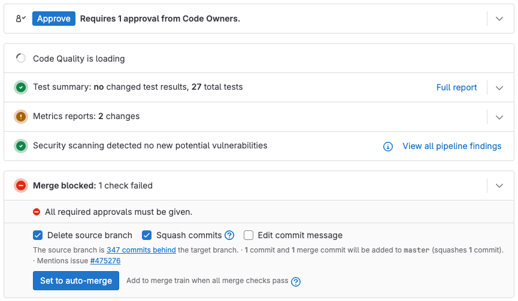
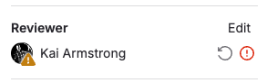



- Tier: 基础版，专业版，旗舰版
- Offering: JihuLab.com，私有化部署



要为项目中的变更设置评审流程，请配置合并请求审批。它们有助于确保变更在合并到项目之前经过评审。您可以根据项目需求和极狐GitLab 版本，将审批配置为可选或必需。

有关审批与指派人及审核人之间关系的信息，请参阅[指派人和审核人](../_index.md#assignees-and-reviewers)。

- [极狐GitLab 基础版](https://gitlab.cn/pricing)允许
  所有至少具有开发者[角色](../../../permissions.md)的用户
  批准合并请求。这些审批是可选的，不会阻止未经批准就合并。
- [极狐GitLab 专业版](https://gitlab.cn/pricing)和
  [极狐GitLab 旗舰版](https://gitlab.cn/pricing)为您提供更大的
  灵活性，以便：

  - 针对所需审批的数量和类型创建必需的[规则](rules.md)。
  - 为特定文件创建[代码所有者](../../codeowners/_index.md)列表。
  - [为整个实例](../../../../administration/merge_requests_approvals.md)配置审批。
  - 配置[群组合并请求审批设置](../../../group/manage.md#group-merge-request-approval-settings)。

    > [!note]
    > 群组合并请求审批设置的支持情况记录在
    > [史诗 4367](https://gitlab.com/groups/gitlab-org/-/work_items/4367)中。

## 配置审批规则

先决条件：

- 您必须具有项目的开发者、维护者或所有者角色。

要配置审批规则：

1. 在顶部栏中，选择**搜索或跳转到**，然后找到您的项目。
1. 在左侧边栏中，选择**设置** > **合并请求**。
1. 转到**合并请求审批**部分。
1. 设置您所需的规则。

您还可以配置：

- 更多[合并请求审批设置](settings.md)，以便更好地控制
  项目所需的监督和安全级别。
- 使用
  [合并请求审批 API](../../../../api/merge_request_approvals.md) 配置合并请求审批规则。

有关配置规则的更多信息，请参阅[审批规则](rules.md)。

### 必需审批



- Tier: 专业版，旗舰版
- Offering: JihuLab.com，私有化部署



必需审批会强制指定用户进行代码评审。没有这些审批，就无法合并。

使用场景包括：

- 强制对合并到代码仓库中的所有代码进行评审。
- 指定审核人和最低审批数量。
- 指定审核人的类别，例如后端、前端、质量保证、数据库或文档。
- 使用 [`CODEOWNERS` 文件](../../codeowners/_index.md#codeowners-file)确定审核人。
- 对[降低测试覆盖率](../../../../ci/testing/code_coverage/coverage_reporting.md#add-a-coverage-check-approval-rule)要求审批。
- 极狐GitLab 旗舰版：对潜在漏洞[要求安全团队审批](../../../application_security/policies/merge_request_approval_policies.md)。

## 查看审批状态

要查看合并请求的审批状态，请查看该合并请求本身，或项目或群组的合并请求列表。

### 对于单个合并请求

[符合条件的审批人](rules.md#eligible-approvers)可以查看单个合并请求的审批状态。

要查看审批状态：

1. 在顶部栏中，选择**搜索或跳转到**，然后找到您的项目。
1. 在左侧边栏中，选择**代码** > **合并请求**，然后找到您的合并请求。
1. 要查看该合并请求，请选择其标题。
1. 转到合并请求小组件以查看审批状态。在此示例中，您可以批准该合并请求：

   

该小组件会显示以下状态之一：

- **批准**：该合并请求需要更多审批。
- **额外批准**：该合并请求已获得所需审批。
- **撤销批准**：您已经批准了该合并请求。

要检查您的审批是否满足代码所有者要求，请选择**展开符合条件的审批人**（）。

审批人的可见性取决于您的项目成员身份和群组隐私：

- 项目成员可以看到所有审批人。
- 项目非成员可以看到：
  - 如果所有审批人都来自公开群组，则可以看到所有审批人。
  - 如果任一审批人来自私有群组，则看不到任何审批人信息。

### 在合并请求列表中

[您的项目或群组](../_index.md#view-merge-requests)的合并请求列表会显示每个合并请求的审批状态：

|                                       示例                                       | 描述 |
|:-----------------------------------------------------------------------------------:|-------------|
|                  | 缺少必需审批。（） |
|                        | 审批已满足。（） |
|  | 审批已满足，并且您是审批人之一。（） |

### 单个审核人状态

要查看每个审核人的评审和审批状态：

1. 打开该合并请求。
1. 查看右侧边栏。

每个审核人的状态显示在其姓名旁边。

-  等待评审
-  评审进行中
-  已批准
-  审核人已评论
-  审核人请求变更

  

要[重新请求评审](../reviews/_index.md#re-request-a-review)，请选择该用户旁边的**重新请求评审**图标（）。

## 批准合并请求

符合条件的审批人可以通过两种方式批准合并请求：

- 在合并请求小组件中，选择**批准**。
- 在评论中使用 [`/approve` 快速操作](../../quick_actions.md#approve)。

已批准的合并请求会在审核人列表中该用户姓名旁边显示绿色对勾（）。在合并请求获得所需审批后，它就可以合并了，除非由于以下原因被阻止：

- [合并冲突](../conflicts.md)
- [未解决的讨论串](../_index.md#prevent-merge-unless-all-threads-are-resolved)
- [失败的 CI/CD 流水线](../auto_merge.md)

### 防止合并请求创建者批准

要防止合并请求创建者批准自己的工作，请启用[**防止合并请求创建者批准**](settings.md#prevent-approval-by-merge-request-creator)设置。

### 审批规则变更

如果您启用[审批规则覆盖](settings.md#prevent-editing-approval-rules-in-merge-requests)，对默认审批规则的更改不会影响现有合并请求，但[目标分支](rules.md#approvals-for-protected-branches)变更除外。

## 无效规则

当审批规则无法满足时，极狐GitLab 会将其标记为**自动批准**，例如：

- 唯一符合条件的审批人是合并请求作者。
- 没有为规则分配符合条件的审批人。
- 所需审批数量超过符合条件的审批人数量。

这些规则会被自动批准，以解除对合并请求的阻止，除非您通过[合并请求审批策略](../../../application_security/policies/merge_request_approval_policies.md)创建了规则。

由策略创建的无效规则：

- 显示为**需要操作**。
- 不会自动批准。
- 会阻止受影响的合并请求。
