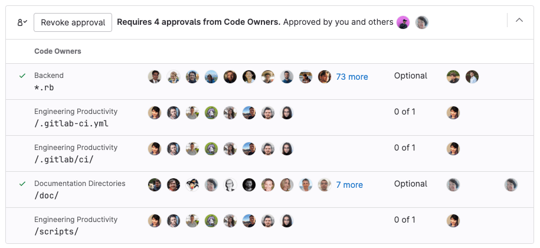
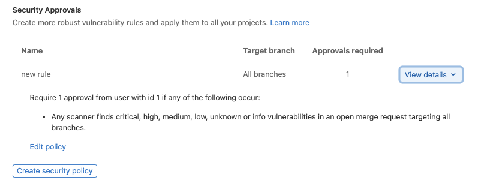
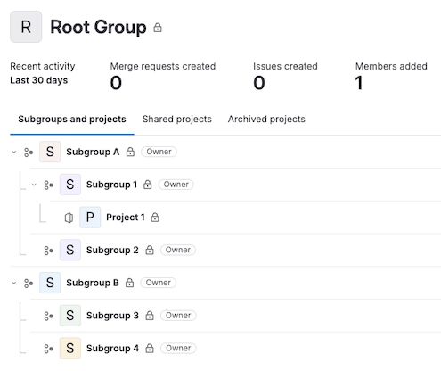
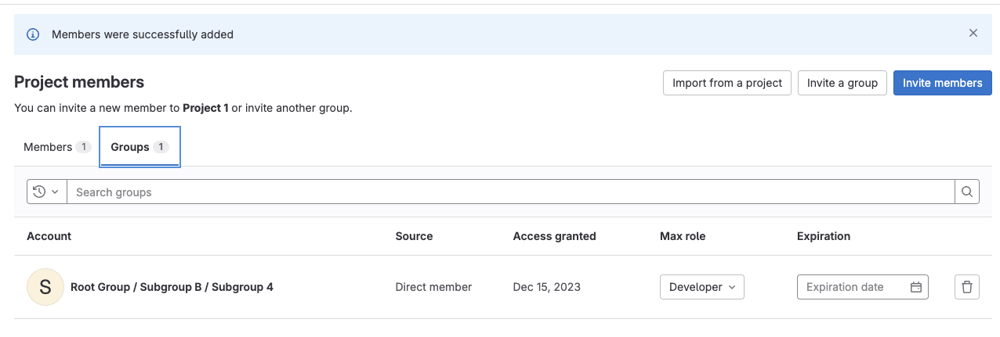



- Tier: 专业版，旗舰版
- Offering: JihuLab.com，私有化部署



审批规则定义了合并请求在合并之前必须获得多少[审批](_index.md)，以及应由哪些用户进行审批。它们可以与[代码所有者](#code-owners-as-approvers)结合使用，以确保变更既由维护该功能的群组审查，也由负责特定监督领域的任何群组审查。

您可以通过以下方式定义审批规则：

- [作为项目默认值](#add-an-approval-rule)。
- [针对每个合并请求](#edit-or-override-merge-request-approval-rules)。

您可以通过以下方式配置审批规则：

- [针对整个实例](../../../../administration/merge_requests_approvals.md)。

如果您没有定义[默认审批规则](#add-an-approval-rule)，任何用户都可以批准合并请求。即使您没有定义规则，您仍然可以在项目设置中强制执行[最低必需审批人数](settings.md)。

针对不同项目的合并请求（例如从 fork 到上游项目）使用目标（上游）项目的默认审批规则，而不是源（fork）项目的默认审批规则。

合并请求审批可以通过[策略](../../../application_security/policies/_index.md)进行全局配置，以应用于所有（或部分）项目。[合并请求审批策略](../../../application_security/policies/merge_request_approval_policies.md)还通过更细粒度的配置选项提供了额外的灵活性。

## 添加审批规则

先决条件：

- 您必须具有项目的维护者或所有者角色。
- 要在 JihuLab.com 上将群组添加为审批人，您必须是该群组的成员，或者该群组必须是公开的。

要添加合并请求审批规则：

1. 在顶部栏中，选择**搜索或跳转到**并找到您的项目。
1. 在左侧边栏中，选择**设置** > **合并请求**。
1. 在**合并请求审批**部分的**审批规则**区域中，选择**添加审批规则**。
1. 在右侧边栏中，填写以下字段：
   - 在**所需审批**中，值为 `0` 会使[该规则成为可选规则](#configure-optional-approval-rules)，任何大于 `0`的数字都会创建必需规则。所需审批的最大数量为 `100`。
   - 在**添加审批人**中，选择[有资格审批](#eligible-approvers)的用户或群组。极狐GitLab 会根据合并请求所更改文件的先前作者来建议审批人。
1. 选择**保存更改**。您可以添加[多个审批规则](#multiple-approval-rules)。

您对审批规则覆盖的配置决定了新规则是否应用于现有合并请求：

- 如果允许[审批规则覆盖](settings.md#prevent-editing-approval-rules-in-merge-requests)，则对这些默认规则的更改不会应用于现有合并请求，但对该规则的[目标分支](#approvals-for-protected-branches)的更改除外。
- 如果不允许审批规则覆盖，则对默认规则的所有更改都会应用于现有合并请求。在允许审批规则覆盖期间，之前手动[覆盖](#edit-or-override-merge-request-approval-rules)的任何审批规则都不会被修改。

## 编辑审批规则

先决条件：

- 您必须具有项目的维护者或所有者角色。
- 要在 JihuLab.com 上将群组添加为审批人，您必须是该群组的成员，或者该群组必须是公开的。

要编辑合并请求审批规则：

1. 在顶部栏中，选择**搜索或跳转到**并找到您的项目。
1. 在左侧边栏中，选择**设置** > **合并请求**。
1. 在**合并请求审批**部分的**审批规则**区域中，在要编辑的规则旁边，选择**编辑**。
1. 在右侧边栏中，编辑以下字段：
   - 在**所需审批**中，值为 `0` 会使[该规则成为可选规则](#configure-optional-approval-rules)，任何大于 `0`的数字都会创建必需规则。所需审批的最大数量为 `100`。
   - 要移除用户或群组，请确定要移除的群组或用户，然后选择**移除**（）。
1. 选择**保存更改**。

## 删除审批规则

先决条件：

- 您必须具有项目的维护者或所有者角色。

要删除合并请求审批规则：

1. 在顶部栏中，选择**搜索或跳转到**并找到您的项目。
1. 在左侧边栏中，选择**设置** > **合并请求**。
1. 在**合并请求审批**部分中，在要删除的规则旁边，选择垃圾桶图标（）。
1. 选择**移除审批人**。

## 多个审批规则

要对合并请求强制执行多个审批规则，请为项目添加多个默认审批规则。

当[有资格的审批人](#eligible-approvers)批准合并请求时，它会减少该审批人所属的所有规则的剩余审批数量（**审批**列）：

## 获取有关您可以批准的所有合并请求的通知

要在每次创建您有资格批准的合并请求时收到电子邮件通知：

- [将您的通知级别](../../../profile/notifications.md#edit-notification-settings)设置为**自定义**，然后选择**创建了您有资格批准的合并请求**事件。

## 编辑或覆盖合并请求审批规则

您可以通过以下任一方式覆盖项目的合并请求审批规则：

- 编辑现有合并请求。
- 创建新的合并请求。

先决条件：

- 项目设置[**禁止在合并请求中编辑审批规则**](settings.md#prevent-editing-approval-rules-in-merge-requests)已禁用。
- 必须满足以下条件之一：
  - 您具有管理员访问权限。
  - 您是合并请求的作者，并且在项目中具有开发者、维护者或所有者角色。
  - 您具有项目的维护者或所有者角色。

要覆盖合并请求的审批人：

1. 在[创建新的合并请求](../creating_merge_requests.md)时，滚动到**审批规则**部分，在选择**创建合并请求**之前添加或移除您想要的审批规则。
1. 在查看现有合并请求时：
   1. 在顶部栏中，选择**搜索或跳转到**并找到您的项目。
   1. 在左侧边栏中，选择**代码** > **合并请求**并找到您的合并请求。
   1. 选择**编辑**。
   1. 滚动到**审批规则**部分。
   1. 添加或移除您想要的审批规则。
   1. 选择**保存更改**。

管理员可以更改[合并请求审批设置](settings.md#prevent-editing-approval-rules-in-merge-requests)，以防止用户覆盖合并请求的审批规则。

## 要求规则获得多个审批

要创建需要多个审批的审批规则：

- 在[创建](#add-an-approval-rule)或[编辑](#edit-an-approval-rule)规则时，将**所需审批**设置为 `2` 或更多。

要要求规则获得多个审批，您也可以使用[合并请求审批 API](../../../../api/merge_request_approvals.md#update-an-approval-rule-for-a-project) 将 `approvals_required` 属性设置为 `2` 或更多。

## 配置可选审批规则

对于希望获得审批但并非必需的项目，合并请求审批可以是可选的。要使审批规则成为可选规则：

- 在[创建或编辑规则](#edit-an-approval-rule)时，将**所需审批**设置为 `0`。

要使审批规则成为可选规则，您也可以使用 API [更新项目的审批规则](../../../../api/merge_request_approvals.md#update-an-approval-rule-for-a-project)，并将 `approvals_required` 属性设置为 `0`。

## 受保护分支的审批

审批规则通常只与特定分支相关，例如您的[默认分支](../../repository/branches/default.md)。要为某些分支配置审批规则：

1. [创建审批规则](#add-an-approval-rule)。
1. 转到您的项目，然后选择**设置** > **合并请求**。
1. 在**合并请求审批**部分中，滚动到**审批规则**。
1. 对于**目标分支**：
   - 要将规则应用于所有受保护分支，请选择**所有受保护分支**。
   - 要将规则应用于特定分支，请从列表中选择该分支。
1. 要启用此配置，请按照[在受保护分支上要求代码所有者审批](../../repository/branches/protected.md#require-code-owner-approval)操作。

## 为其他用户启用审批权限

在具有计划者或报告者角色的用户能够合并到受保护分支之前，您必须授予他们批准合并请求的权限。某些用户（如经理）可能不需要推送或合并代码的权限，但仍需要对拟议工作进行监督。

具有计划者或报告者角色的用户只能通过常规审批规则批准合并请求。代码所有者审批规则要求用户具有开发者、维护者或所有者角色。有关更多信息，请参阅[有资格的审批人](#eligible-approvers)。

先决条件：

- 您必须选择特定分支，因为此方法不适用于 `All Branches` 或 `All protected branches` 设置。
- 必须将共享群组（而不是单个用户）添加到审批规则中，即使所添加的用户是该群组的一部分也是如此。

要在不授予这些用户推送访问权限的情况下为其启用审批权限：

1. [创建受保护分支](../../repository/branches/protected.md)
1. 为需要审批权限且具有计划者或报告者角色的用户[创建一个新群组](../../../group/_index.md#create-a-group)。
1. [将用户添加到群组](../../../group/_index.md#add-users-to-a-group)。这些用户必须具有计划者、报告者、开发者、维护者或所有者角色。
1. [与您的群组共享项目](../../members/sharing_projects_groups.md#invite-a-group-to-a-project)，并赋予报告者、开发者、维护者或所有者角色。
1. 在顶部栏中，选择**搜索或跳转到**并找到您的项目。
1. 在左侧边栏中，选择**设置** > **合并请求**。
1. 在**合并请求审批**部分的**审批规则**区域中：
   - 对于新规则，选择**添加审批规则**并以受保护分支为目标。
   - 对于现有规则，选择**编辑**并以受保护分支为目标。
1. 在右侧边栏的**添加审批人**中，选择您创建的群组。
1. 选择**保存更改**。

## 安全审批



- Tier: 旗舰版
- Offering: JihuLab.com，私有化部署



您可以使用[合并请求审批策略](../../../application_security/policies/merge_request_approval_policies.md#merge-request-approval-policy-editor)根据合并请求和默认分支中漏洞的状态来定义安全审批。每个安全策略的详细信息显示在合并请求配置的“安全审批”部分中。

安全审批规则会应用于所有合并请求，直到流水线完成。安全审批规则的应用可防止用户在安全扫描运行之前合并代码。流水线完成后，会检查安全审批规则以确定是否仍需要安全审批。如果流水线中的扫描程序识别出问题并且需要安全审批，则会在合并请求上生成机器人评论，以指示需要执行哪些步骤才能继续。

这些策略均在[安全策略编辑器](../../../application_security/policies/_index.md#policy-editor)中创建和编辑。

## 有资格的审批人

要成为项目的合格审批人，用户必须是以下至少一项的直接成员：

- 您的项目。
- 您项目的群组。
- 您项目群组的任何父群组。
- 已[与您的项目共享](../../members/sharing_projects_groups.md#sharing-projects)的另一个群组。
- 已[与您的项目群组或该群组的任何父级共享](../../members/sharing_projects_groups.md#sharing-groups)的另一个群组。
- [添加为审批人的群组](#group-approvers)。

具有开发者角色的用户在满足以下条件之一时可以批准合并请求：

- 在项目或合并请求级别添加为审批人的用户。
- 是合并请求中所更改文件的[代码所有者](#code-owners-as-approvers)的用户。

具有计划者或报告者角色的用户只有在满足以下所有条件时才能批准：

- 这些用户属于已与项目[共享](../../members/sharing_projects_groups.md)的群组。该群组必须具有报告者、开发者、维护者或所有者角色。
- 具有计划者和报告者角色的用户的审批权限[已启用](#enable-approval-permissions-for-additional-users)。

为了显示谁参与了合并请求审查，合并请求中的审批组件会显示**评论者**列。此列列出了对合并请求发表评论的有资格的审批人。它帮助作者和审核人确定就合并请求内容联系谁。

如果所需审批的数量大于已分配审批人的数量，则项目中具有开发者、维护者或所有者角色的其他用户的审批也会计入满足所需审批数量，即使这些用户未明确列在审批规则中。

### 代码所有者作为审批人

如果您将[代码所有者](../../codeowners/_index.md)添加到代码仓库中，文件的所有者将成为项目中有资格的审批人。要启用此合并请求审批规则：

1. 在顶部栏中，选择**搜索或跳转到**并找到您的项目。
1. 在左侧边栏中，选择**设置** > **合并请求**。
1. 在**合并请求审批**部分的**审批规则**区域中，找到**所有有资格的用户**规则。
1. 在**所需审批**列中，输入所需的审批数量。

您也可以为受保护分支[要求代码所有者审批](../../repository/branches/protected.md#require-code-owner-approval)。

### 按成员资格类型划分的审批人

以下表格显示了成员资格类型如何影响审批规则和代码所有者的资格。

#### 用户资格

当您将单个用户分配为审批规则的审批人，或在 `CODEOWNERS` 文件中引用用户（如 `@username`）时：

| 成员资格类型                                                                                                    | 审批规则 | 代码所有者 |
|--------------------------------------------------------------------------------------------------------------------|----------------|-------------|
| 项目的直接成员                                                                                       |     |  |
| 项目群组的直接成员                                                                               |     |  |
| 项目群组的继承成员                                                                            |     |  |
| [受邀加入项目的群组](../../members/sharing_projects_groups.md#sharing-projects)的直接成员       |     |  |
| 受邀加入项目的群组的继承成员                                                                 |      |   |
| [受邀加入项目群组的群组](../../members/sharing_projects_groups.md#sharing-groups)的直接成员 |     |  |
| 受邀加入项目群组的群组的继承成员                                                         |      |   |
| 受邀加入项目群组的父群组的群组的直接成员                                            |     |  |
| 受邀加入项目群组的父群组的群组的继承成员                                         |      |   |

#### 群组资格

当您将群组分配为审批规则的审批人，或在 `CODEOWNERS` 文件中引用群组（如 `@group-name`）时，只有有资格群组的直接成员才能提供审批：

| 群组类型                                                                                       | 审批规则 | 代码所有者 |
|--------------------------------------------------------------------------------------------------|----------------|-------------|
| [受邀加入项目的群组](../../members/sharing_projects_groups.md#sharing-projects)       |     |  |
| [受邀加入项目群组的群组](../../members/sharing_projects_groups.md#sharing-groups) |     |   |
| 受邀加入项目群组的父级的群组                                                |     |   |
| 项目的群组                                                                              |     |  |
| 项目群组的父级                                                                  |     |  |

> [!note]
> 对于基于群组的审批，只有群组的直接成员才能批准合并请求。有资格群组的继承成员不能提供审批。

### 群组审批人

您可以将一组用户添加为审批人。此群组的所有直接成员都可以批准该规则。继承成员不能批准该规则。

通常，该群组是顶级命名空间中的一个子群组，除非您正在与外部群组协作。如果您正在与另一个群组协作，并希望使用该群组的成员作为审批人，您可以：

- [共享项目的访问权限](../../members/sharing_projects_groups.md#sharing-projects)。
- [共享项目群组的访问权限](../../members/sharing_projects_groups.md#sharing-groups)，这将使外部群组获得对项目群组中所有项目的审批访问权限。

用户在审批人群组中的成员资格通过以下方式决定其个人审批权限：

- 继承成员不被视为审批人。只有直接成员才能批准合并请求。
- 来自群组审批人群组的用户，如果后来也被添加为个人审批人，则只计为一个审批人，而不是两个。
- 默认情况下，合并请求作者不计入自己合并请求的有资格审批人。要更改此行为，请禁用[**禁止合并请求创建者审批**](settings.md#prevent-approval-by-merge-request-creator)项目设置。
- 默认情况下，合并请求的提交者可以批准合并请求。要更改此行为，请启用[**禁止提交者审批**](settings.md#prevent-approvals-by-users-who-add-commits)项目设置。

## 故障排除

### 审批规则名称不能为空

作为此验证错误的变通方法，您可以通过 API 删除审批规则。

1. [列出项目的所有审批规则](../../../../api/merge_request_approvals.md#list-all-approval-rules-for-a-project)。
1. [删除该规则](../../../../api/merge_request_approvals.md#delete-an-approval-rule-for-a-project)。

有关此验证错误的更多信息，请阅读[议题 285129](https://gitlab.com/gitlab-org/gitlab/-/issues/285129)。

### 群组需要在项目上具有显式或继承的开发者角色

为处理审批而创建的群组可能创建在项目层次结构中与需要审查的项目不同的区域。如果发生这种情况，群组成员可能没有权限批准合并请求，因为他们无权访问该合并请求。

例如：

在下面的群组结构中，项目 1 属于子群组 1，子群组 4 中有用户。

项目 1 为该项目配置了一条审批规则，将子群组 4 分配为审批人。创建合并请求时，子群组 4 中的审批人会出现在有资格的审批人列表中。但是，由于子群组 4 中的用户没有查看合并请求的权限，因此会返回 `404` 错误。要授予成员资格，必须将该群组邀请为项目成员。现在子群组 4 中的用户可以批准了。

