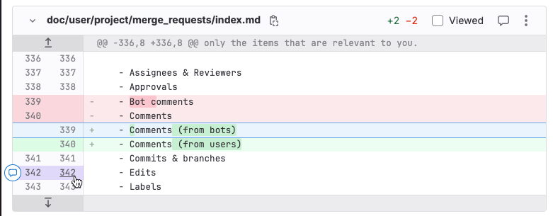
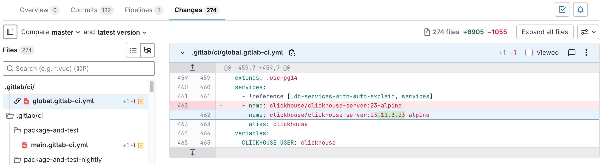
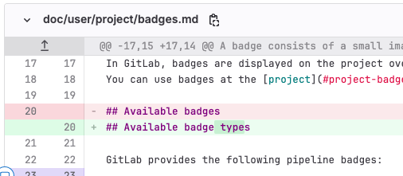
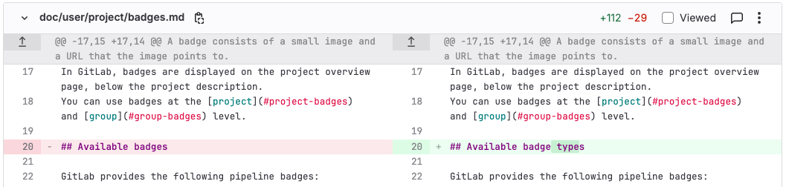
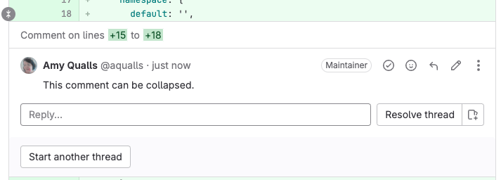
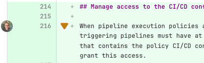
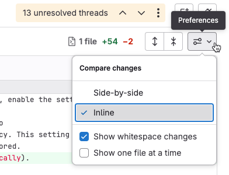
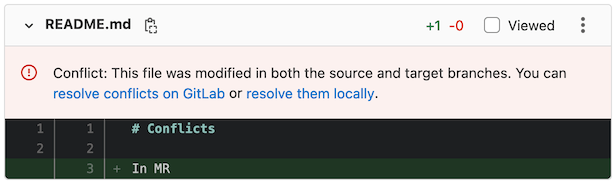



- Tier: 基础版，专业版，旗舰版
- Offering: JihuLab.com，私有化部署



[合并请求](_index.md)会针对您代码仓库中某个分支内的文件提议一组变更。极狐GitLab 会将这些变更以 _diff_（差异）的形式展示，即当前状态与提议变更之间的差异。默认情况下，diff 会将您提议的变更（源分支）与目标分支进行比较。默认情况下，极狐GitLab 仅显示文件中发生变更的部分。

以下示例展示了对一个文本文件的变更。在默认语法高亮主题中：

- *当前*版本以红色显示，行前带有减号（`-`）。
- *提议*版本以绿色显示，行前带有加号（`+`）。



diff 中每个文件的标题包含：

- **隐藏文件内容**（），用于隐藏对该文件的所有变更。
- **路径**：此文件的完整路径。要复制此路径，请选择
  **复制文件路径**（）。
- **变更行数**：此文件中新增和删除的行数，格式为 `+2 -2`。
- **已查看**：选中此复选框可[将文件标记为已查看](#mark-files-as-viewed)，
  直到该文件再次发生变更。
- **对此文件发表评论**（），用于对该文件留下一般性评论，而无需
  将评论固定到特定行。
- **选项**：选择（）以显示更多文件查看选项。

diff 还在文件左侧的边栏中提供了导航和评论辅助功能：

- 显示更多上下文：选择**前 20 行**（）以显示
  前 20 行未变更的行，或选择**后 20 行**（）以
  显示后 20 行未变更的行。
- 行号分两列显示。之前的行号显示在
  左侧，提议的行号显示在右侧。要与某一行交互：
  - 要显示[评论选项](#add-a-comment-to-a-merge-request-file)，请将鼠标悬停在行号上。
  - 要复制指向该行的链接，请按 <kbd>Command</kbd> 并选择（或右键单击）
    某个行号，然后选择**复制链接地址**。
  - 要突出显示某一行，请选择该行号。

<a id="show-a-list-of-changed-files"></a>

## 显示已变更文件的列表

使用文件浏览器查看合并请求中已变更文件的列表：

1. 在顶部栏中，选择**搜索或跳转到**并找到您的项目。
1. 在左侧边栏中，选择**代码** > **合并请求**并找到您的合并请求。
1. 在合并请求标题下方，选择**变更**。
1. 选择**显示文件浏览器**（）或按 <kbd>F</kbd> 以显示
   文件树。
   - 要查看显示嵌套结构的树状视图，请选择**树状视图**（）。
   - 要查看不带嵌套结构的文件列表，请选择**列表视图**（）。

<a id="show-all-changes-in-a-merge-request"></a>

## 显示合并请求中的所有变更

要查看合并请求中所含变更的差异：

1. 在顶部栏中，选择**搜索或跳转到**并找到您的项目。
1. 在左侧边栏中，选择**代码** > **合并请求**并找到您的合并请求。
1. 在合并请求标题下方，选择**变更**。
1. 如果合并请求变更了许多文件，您可以直接跳转到特定文件：
   1. 选择**显示文件浏览器**（）或按 <kbd>F</kbd> 以显示文件树。
   1. 选择您想要查看的文件。
   1. 要隐藏文件浏览器，请再次选择**显示文件浏览器**或按 <kbd>F</kbd>。

极狐GitLab 会折叠包含大量变更的文件以提高性能，并显示消息：**部分变更未显示**。要查看该文件的变更，请选择**展开文件**。

<a id="show-a-linked-file-first"></a>

### 优先显示链接的文件



- Tier: 基础版，专业版，旗舰版
- Offering: JihuLab.com



当您与团队成员分享合并请求链接时，您可能希望优先显示已变更文件列表中的某个特定文件。要复制一个优先显示您所需文件的合并请求链接：

1. 在顶部栏中，选择**搜索或跳转到**并找到您的项目。
1. 在左侧边栏中，选择**代码** > **合并请求**并找到您的合并请求。
1. 在合并请求标题下方，选择**变更**。
1. 找到您想优先显示的文件。右键单击该文件名以复制指向它的链接。
1. 当您访问该链接时，您选择的文件会显示在列表顶部。文件浏览器
   会在文件名旁显示一个链接图标（）：

   

<a id="collapse-generated-files"></a>

## 折叠生成的文件



- Tier: 基础版，专业版，旗舰版
- Offering: JihuLab.com，私有化部署



为帮助审核人专注于执行代码评审所需的文件，极狐GitLab 会折叠几种常见的生成文件类型。极狐GitLab 默认折叠这些文件，因为它们很少需要代码评审：

1. 扩展名为 `.nib`、`.xcworkspacedata` 或 `.xcuserstate`的文件。
1. 软件包锁定文件，例如 `package-lock.json` 或 `Gopkg.lock`。
1. `node_modules` 文件夹中的文件。
1. 压缩的 `js` 或 `css` 文件。
1. 源映射引用文件。
1. 生成的 Go 文件，包括由 protocol buffer 编译器生成的文件。

要将某个文件或路径标记为生成文件，请在您的 [`.gitattributes` 文件](../repository/files/git_attributes.md)中为其设置 `gitlab-generated` 属性。

<a id="view-a-collapsed-file"></a>

### 查看已折叠的文件

1. 在顶部栏中，选择**搜索或跳转到**并找到您的项目。
1. 在左侧边栏中，选择**代码** > **合并请求**并找到您的合并请求。
1. 在合并请求标题下方，选择**变更**。
1. 找到您想查看的文件，然后选择**展开文件**。

<a id="configure-collapse-behavior-for-a-file-type"></a>

### 为某种文件类型配置折叠行为

要更改某种文件类型的默认折叠行为：

1. 如果您的项目根目录中不存在 `.gitattributes` 文件，
   请创建一个使用此名称的空文件。
1. 对于您想修改的每种文件类型，请在 `.gitattributes` 文件中添加一行，
   声明该文件扩展名以及您期望的行为：

   ```conf
   # Collapse all files with a .txt extension
   *.txt gitlab-generated

   # Collapse all files within the docs directory
   docs/** gitlab-generated

   # Do not collapse package-lock.json
   package-lock.json -gitlab-generated
   ```

1. 提交、推送您的变更并将其合并到您的默认分支。

变更合并到您的[默认分支](../repository/branches/default.md)后，您项目中该类型的所有文件都会在合并请求中使用此行为。

有关极狐GitLab 如何检测生成文件的技术细节，请参阅 [`go-enry`](https://github.com/go-enry/go-enry/blob/master/data/generated.go) 代码仓库。

<a id="show-one-file-at-a-time"></a>

## 一次显示一个文件

对于较大的合并请求，您可以一次评审一个文件。您可以在用户偏好设置中更改此设置，也可以在评审合并请求时更改。如果您在合并请求中更改此设置，它也会更新您的用户设置。





1. 在顶部栏中，选择**搜索或跳转到**并找到您的项目。
1. 在左侧边栏中，选择**代码** > **合并请求**并找到您的合并请求。
1. 在合并请求标题下方，选择**变更**。
1. 选择**偏好设置**（）。
1. 选中或清除**一次显示一个文件**。





1. 在右上角，选择您的头像。
1. 选择**偏好设置**。
1. 滚动到**行为**部分，然后选中**在合并请求的变更标签页中一次显示一个文件**复选框。
1. 选择**保存更改**。





启用此设置后，要选择另一个文件进行查看，您可以：

- 滚动到文件末尾，然后选择**上一个**或**下一个**。
- 如果[已启用键盘快捷键](../../shortcuts.md#enable-keyboard-shortcuts)，
  请按 <kbd>\[</kbd>, <kbd>]</kbd>, <kbd>k</kbd> 或 <kbd>j</kbd>。
- 选择**显示文件浏览器**（）并选择另一个要查看的文件。

<a id="compare-changes"></a>

## 比较变更

您可以通过以下任一方式查看合并请求中的变更：

- 内联，即垂直显示变更。先显示某一行的旧版本，
  新版本直接显示在其下方。
  内联模式通常更适合单行的变更。
- 并排，即在单独的列中显示行的新旧版本。
  并排模式通常更适合影响大量连续行的变更。

要更改合并请求显示变更行的方式：

1. 在顶部栏中，选择**搜索或跳转到**并找到您的项目。
1. 在左侧边栏中，选择**代码** > **合并请求**并找到您的合并请求。
1. 在标题下方，选择**变更**。
1. 选择**偏好设置**（）。选择**并排**或**内联**。
   以下示例展示了极狐GitLab 如何在内联和并排模式下呈现同一变更：

   

   

   

   

   

   

   

   

<a id="rapid-diffs"></a>

## Rapid Diffs



- Status: 测试版



> [!flag]
> 此功能的可用性由功能标志控制。

Rapid Diffs 是一种更快加载和交互合并请求中代码变更的方式。它缩短了评审差异时看到第一个文件所需的时间。

Rapid Diffs 处于测试版。经典差异体验中的某些功能尚不可用。有关已知限制的列表，请参阅[反馈议题 596236](https://gitlab.com/gitlab-org/gitlab/-/issues/596236)。有关功能对等路线图，请参阅[史诗 19380](https://gitlab.com/groups/gitlab-org/-/epics/19380)。

<a id="turn-on-rapid-diffs"></a>

### 开启 Rapid Diffs

Rapid Diffs 在合并请求的**变更**标签页中默认开启。

如果您之前将其关闭，可以为所有合并请求重新开启：

1. 在顶部栏中，选择**搜索或跳转到**并找到您的项目。
1. 在左侧边栏中，选择**代码** > **合并请求**并找到您的合并请求。
1. 在合并请求标题下方，选择**变更**。
1. 选择**试用 Rapid Diffs**。

页面会以新体验重新加载。您的偏好设置会在各会话之间保留。

要分享有关 Rapid Diffs 的反馈，请选择 **Rapid Diffs** > **留下反馈**。

<a id="turn-off-rapid-diffs"></a>

### 关闭 Rapid Diffs

要关闭 Rapid Diffs 并切换回经典差异加载体验：

1. 在顶部栏中，选择**搜索或跳转到**并找到您的项目。
1. 在左侧边栏中，选择**代码** > **合并请求**并找到您的合并请求。
1. 在合并请求标题下方，选择**变更**。
1. 选择 **Rapid Diffs** 以打开下拉列表。
1. 选择**切换到经典加载**。

<a id="explain-code-in-a-merge-request"></a>

## 解释合并请求中的代码



- Tier: 专业版，旗舰版
- Add-on: 极狐GitLab Duo Pro 或 Enterprise、极狐GitLab Duo with Amazon Q
- Offering: JihuLab.com，私有化部署





- [默认 LLM](../../gitlab_duo/model_selection.md#default-models)
- Amazon Q 的 LLM：Amazon Q Developer



如果您花费大量时间试图理解他人编写的代码，或者难以理解用您不熟悉的语言编写的代码，您可以请极狐GitLab Duo 为您解释代码。

先决条件：

- 您必须至少属于一个已启用
  [实验和测试版功能设置](../../gitlab_duo/turn_on_off.md#turn-on-beta-and-experimental-features)的群组。
- 您必须有权查看该项目。

要解释合并请求中的代码：

1. 在顶部栏中，选择**搜索或跳转到**并找到您的项目。
1. 在左侧边栏中，选择**代码** > **合并请求**，然后选择您的合并请求。
1. 选择**变更**。
1. 在您希望解释的文件上，选择三个点（）并选择**查看文件 @ $SHA**。

   会打开一个单独的浏览器标签页，显示包含最新变更的完整文件。

1. 在新标签页中，选择您希望解释的行。
1. 在左侧，选择问号（）。您可能需要滚动到所选内容的第一行才能看到它。

   

极狐GitLab Duo Chat 会解释代码。生成解释可能需要一些时间。

如果您愿意，可以就解释的质量提供反馈。

极狐GitLab 无法保证大型语言模型生成的结果是正确的。请谨慎使用该解释。

您还可以在以下位置解释代码：

- [文件](../repository/code_explain.md)中。
- [IDE](../../gitlab_duo_chat/examples.md#explain-selected-code)中。

<a id="expand-or-collapse-comments"></a>

## 展开或折叠评论

在评审代码变更时，您可以隐藏内联评论：

1. 在顶部栏中，选择**搜索或跳转到**并找到您的项目。
1. 在左侧边栏中，选择**代码** > **合并请求**并找到您的合并请求。
1. 在标题下方，选择**变更**。
1. 滚动到包含您想隐藏的评论的文件。
1. 滚动到该评论所附着的行。在边栏中，选择**折叠**（）：
   

要展开内联评论并再次显示它们：

1. 在顶部栏中，选择**搜索或跳转到**并找到您的项目。
1. 在左侧边栏中，选择**代码** > **合并请求**并找到您的合并请求。
1. 在标题下方，选择**变更**。
1. 滚动到包含您想显示的已折叠评论的文件。
1. 滚动到该评论所附着的行。在边栏中，选择用户头像：
   

<a id="ignore-whitespace-changes"></a>

## 忽略空白变更

空白变更可能会使您更难看到合并请求中的实质性变更。您可以选择隐藏或显示空白变更：

1. 在顶部栏中，选择**搜索或跳转到**并找到您的项目。
1. 在左侧边栏中，选择**代码** > **合并请求**并找到您的合并请求。
1. 在标题下方，选择**变更**。
1. 在已变更文件列表之前，选择**偏好设置**（）。
1. 选中或清除**显示空白变更**：

   

<a id="mark-files-as-viewed"></a>

## 将文件标记为已查看

当多次评审包含许多文件的合并请求时，您可以忽略已评审过的文件。要隐藏上次评审后未发生变更的文件：

1. 在顶部栏中，选择**搜索或跳转到**并找到您的项目。
1. 在左侧边栏中，选择**代码** > **合并请求**并找到您的合并请求。
1. 在标题下方，选择**变更**。
1. 在文件的标题中，选中**已查看**复选框。

标记为已查看的文件不会再次显示给您，除非满足以下任一条件：

- 文件内容发生变更。
- 您清除**已查看**复选框。

<a id="show-merge-request-conflicts-in-diff"></a>

## 在差异中显示合并请求冲突

为避免显示目标分支上已有的变更，极狐GitLab 会将合并请求的源分支与目标分支的 `HEAD` 进行比较。

当源分支和目标分支发生冲突时，极狐GitLab 会在合并请求差异中为每个冲突文件显示一条提醒：



<a id="show-scanner-findings-in-diff"></a>

## 在差异中显示扫描器发现结果



- Tier: 旗舰版
- Offering: JihuLab.com，私有化部署



您可以在差异中显示扫描器发现结果。有关详情，请参阅：

- [代码质量发现结果](../../../ci/testing/code_quality.md#merge-request-changes-view)
- [静态分析发现结果](../../application_security/sast/_index.md#merge-request-changes-view)

<a id="download-merge-request-changes"></a>

## 下载合并请求变更

您可以下载合并请求中包含的变更，以便在极狐GitLab 之外使用。

<a id="as-a-diff"></a>

### 作为差异

要将变更下载为差异：

1. 在顶部栏中，选择**搜索或跳转到**并找到您的项目。
1. 在左侧边栏中，选择**代码** > **合并请求**并找到您的合并请求。
1. 选择该合并请求。
1. 在右上角，选择**代码** > **纯文本差异**。

如果您知道合并请求的 URL，还可以通过在 URL 后追加 `.diff` 从命令行下载差异。以下示例下载合并请求 `000000`的差异：

```plaintext
https://gitlab.com/gitlab-org/gitlab/-/merge_requests/000000.diff
```

要在一行 CLI 命令中下载并应用差异：

```shell
curl "https://gitlab.com/gitlab-org/gitlab/-/merge_requests/000000.diff" | git apply
```

<a id="as-a-patch-file"></a>

### 作为补丁文件

要将变更下载为补丁文件：

1. 在顶部栏中，选择**搜索或跳转到**并找到您的项目。
1. 在左侧边栏中，选择**代码** > **合并请求**并找到您的合并请求。
1. 选择该合并请求。
1. 在右上角，选择**代码** > **补丁**。

如果您知道合并请求的 URL，还可以通过在 URL 后追加 `.patch` 从命令行下载补丁。以下示例下载合并请求 `000000`的补丁文件：

```plaintext
https://gitlab.com/gitlab-org/gitlab/-/merge_requests/000000.patch
```

要使用 [`git am`](https://git-scm.com/docs/git-am) 下载并应用补丁：

```shell
# Download and preview the patch
curl "https://gitlab.com/gitlab-org/gitlab/-/merge_requests/000000.patch" > changes.patch
git apply --check changes.patch

# Apply the patch
git am changes.patch
```

您还可以在单条命令中下载并应用补丁：

```shell
curl "https://gitlab.com/gitlab-org/gitlab/-/merge_requests/000000.patch" | git am
```

`git am` 默认使用 `-p1` 选项。有关更多信息，请参阅 [`git-apply`](https://git-scm.com/docs/git-apply)。

<a id="download-older-diff-versions"></a>

### 下载较旧的差异版本

要将较旧的差异版本下载为补丁或差异文件：

1. [比较差异版本](versions.md#compare-diff-versions)，找到您想下载的版本。
1. 在 URL 路径后追加 `.diff` 或 `.patch`。

例如：

```plaintext
# As a diff file:
https://gitlab.com/gitlab-org/gitlab/-/merge_requests/123456/diffs.diff?diff_id=525410&start_sha=a1b2c3d4

# As a patch file:
https://gitlab.com/gitlab-org/gitlab/-/merge_requests/123456/diffs.patch?diff_id=525410&start_sha=a1b2c3d4
```

<a id="add-a-comment-to-a-merge-request-file"></a>

## 为合并请求文件添加评论

您可以为合并请求差异文件添加评论。这些评论会在变基和文件变更后保留。

要为合并请求文件添加评论：

1. 在顶部栏中，选择**搜索或跳转到**并找到您的项目。
1. 在左侧边栏中，选择**代码** > **合并请求**并找到您的合并请求。
1. 选择**变更**。
1. 在您想评论的文件的标题中，选择**对此文件发表评论**（）。

<a id="add-a-comment-to-an-image"></a>

## 为图像添加评论

在合并请求和提交详情视图中，您可以为图像添加评论。此评论也可以是一个讨论串。

1. 将鼠标悬停在图像上。
1. 选择您想评论的位置。

极狐GitLab 会在图像上显示一个图标和一个评论字段。
