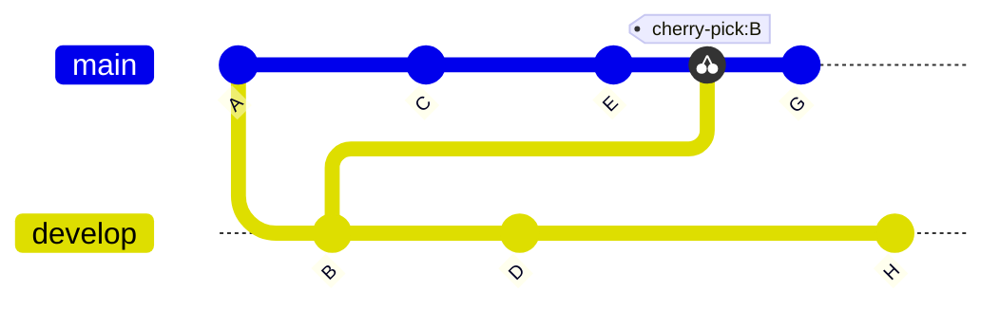
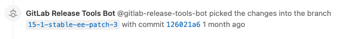
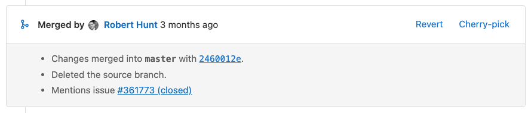



- Tier: 基础版，专业版，旗舰版
- Offering: JihuLab.com，私有化部署



在 Git 中，*拣选*是指从一个分支中取出单个提交，并将其作为最新提交添加到另一个分支。源分支中的其余提交不会添加到目标分支。当您只需要单个提交中的内容，而不需要整个分支的内容时，可以拣选提交。例如，当您：

- 将缺陷修复从默认分支向后移植到之前的发布分支时。
- 将变更从 fork 复制到上游代码仓库时。

使用极狐GitLab UI 可以从项目或项目 fork 中拣选单个提交或整个合并请求的内容。

在此示例中，一个 Git 代码仓库有两个分支：`develop` 和 `main`。提交 `B` 在 `main` 分支中的提交 `E` 之后，从 `develop` 分支拣选而来。提交 `G` 在拣选之后添加：

<!-- Diagram reused in `doc/topics/git/cherry_pick.md` -->

## 查看拣选提交的系统评论

当您在极狐GitLab UI 或 API 中拣选[合并提交](methods/_index.md#merge-commit)时，极狐GitLab 会向相关合并请求讨论串添加一条[系统评论](../system_notes.md)。

只有在拣选合并提交时才会创建系统评论。使用快进合并时不会创建系统评论。这适用于拣选单个提交和拣选合并请求中的所有变更两种情况。

在极狐GitLab UI 或 API 之外拣选的提交也不会创建系统评论。

创建系统评论时，格式为 
`[USER]` **将变更拣选到分支** `[BRANCHNAME]`，提交为
`[SHA]` `[DATE]`：

系统评论会将新提交与现有合并请求交叉链接。
每个部署的[关联合并请求列表](../../../api/deployments.md#list-all-merge-requests-associated-with-a-deployment)
都包含拣选的合并提交。

## 从合并请求中拣选所有变更

在合并请求合并后，您可以拣选该合并请求引入的所有变更。该合并请求可以位于上游项目中，也可以位于下游 fork 中。

先决条件：

- 您在项目中必须拥有允许您编辑合并请求并向代码仓库添加代码的角色。
- 您的项目必须使用[合并提交](methods/_index.md#merge-commit)方式，
  该方式在项目的**设置** > **合并请求**中设置。

  只有在压缩提交时，或者合并请求仅包含一个提交时，才能从极狐GitLab UI 中拣选快进的提交。
  您始终可以[拣选单个提交](#cherry-pick-a-single-commit)。

  > [!note]
  > 使用快进合并方式时，不会创建[系统评论](#view-system-notes-for-cherry-picked-commits)。

为此：

1. 在顶部栏中，选择**搜索或跳转到**，然后找到您的项目。
1. 在左侧边栏中，选择**代码** > **合并请求**，然后找到您的合并请求。
1. 滚动到合并请求报告部分，找到 **合并者** 报告。
1. 在该报告的右上角，选择 **拣选**：

   
1. 在对话框中，选择要拣选到的项目和分支。
1. 可选。选择 **使用这些变更创建新的合并请求**。
1. 可选。选择 **复制合并请求描述**，以根据您所拣选合并请求的描述（而不是描述模板）来创建新的合并请求。仅在您创建新合并请求时可用。
1. 选择 **拣选**。

## 拣选单个提交

您可以从极狐GitLab 项目中的多个位置拣选单个提交。

如果您拣选合并提交，极狐GitLab 会在相关合并请求中创建一条[系统评论](#view-system-notes-for-cherry-picked-commits)以跟踪该操作。

### 从项目的提交列表

要从项目的所有提交列表中拣选提交：

1. 在顶部栏中，选择**搜索或跳转到**，然后找到您的项目。
1. 在左侧边栏中，选择**代码** > **提交**。
1. 选择您要拣选的提交的[标题](https://git-scm.com/docs/git-commit#_discussion)。
1. 在右上角，选择**选项** > **拣选**。
1. 在拣选对话框中，选择要拣选到的项目和分支。
1. 可选。选择 **使用这些变更创建新的合并请求**。
1. 选择 **拣选**。

### 从代码仓库的文件视图

当您在项目的 Git 代码仓库中查看某个文件时，可以从影响该文件的先前提交列表中拣选：

1. 在顶部栏中，选择**搜索或跳转到**，然后找到您的项目。
1. 在左侧边栏中，选择**代码** > **代码仓库**。
1. 转到该提交更改的文件。在最后一个提交块中，选择**历史**。
1. 选择您要拣选的提交的[标题](https://git-scm.com/docs/git-commit#_discussion)。
1. 在右上角，选择**选项** > **拣选**。
1. 在拣选对话框中，选择要拣选到的项目和分支。
1. 可选。选择 **使用这些变更创建新的合并请求**。
1. 选择 **拣选**。

## 选择不同的父提交

当您在极狐GitLab UI 中拣选合并提交时，主线始终是第一个父提交。请使用命令行以不同的主线进行拣选。更多信息，请参见[复制整个分支的内容](../../../topics/git/cherry_pick.md#copy-the-contents-of-an-entire-branch)。
