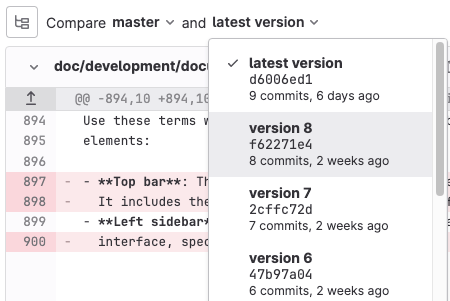



- Tier: 基础版，专业版，旗舰版
- Offering: JihuLab.com，私有化部署



提交会记录源代码变更并将其发送到[代码仓库](../repository/_index.md)。更多信息，请参阅[记录对代码仓库的变更](https://git-scm.com/book/en/v2/Git-Basics-Recording-Changes-to-the-Repository)。

## 使用命令行提交变更

使用命令行时，请使用 [`git commit`](../../../topics/git/commands.md#git-commit)。您可以在推送变更之前添加多个提交。

- 提交信息：

  提交信息用于说明变更的内容和原因。请使用描述性的信息来阐明变更。
  在极狐GitLab 中，您可以在提交信息中添加关键字，以执行以下操作之一：

  - 触发极狐GitLab CI/CD 流水线：

    如果项目配置了 [极狐GitLab CI/CD](../../../ci/_index.md)，
    则每次推送都会触发一次流水线，而不是每次提交。

  - 跳过流水线：

    在提交信息中添加 [`ci skip`](../../../ci/pipelines/_index.md#skip-a-pipeline) 关键字，
    使极狐GitLab CI/CD 跳过流水线。

  - 交叉链接议题和合并请求：

    使用[交叉链接](../issues/crosslinking_issues.md#from-commit-messages)
    来跟踪工作流中的相关部分。
    如果您在提交信息中提及某个议题或合并请求，它们会显示在
    各自的讨论串中。

- 拣选提交：

  在极狐GitLab 中，您可以从 UI [拣选提交](cherry_pick_changes.md#cherry-pick-a-single-commit)。

- 还原提交：

  从 UI 将提交[还原](revert_changes.md#revert-a-commit)
  到选定的分支。

- 签署提交：

  通过[签署提交](../repository/signed_commits/_index.md)增加额外的安全性。

更多信息，请参阅[暂存、提交和推送变更](../../../topics/git/commit.md)。

## 合并请求提交

每个合并请求都有一份提交历史，记录自合并请求创建以来对源分支所做的提交。

这些提交显示在合并请求的 **提交** 标签页中。在此标签页中，您可以查看提交信息，并在需要[拣选变更](cherry_pick_changes.md)时复制提交的 SHA。

### 查看合并请求中的提交

要查看合并请求中包含的提交：

1. 在顶部栏中，选择**搜索或跳转到**，然后找到您的项目。
1. 在左侧边栏中，选择**代码** > **合并请求**，然后选择您的合并请求。
1. 要显示合并请求中的提交列表（最新的在前），请选择 **提交**。
   要阅读有关该提交的更多信息，请选择任意提交上的 **切换提交描述** ()。
1. 要查看该提交中的变更，请选择提交链接的标题。
1. 要查看合并请求中的其他提交，您可以：

   - 选择 **上一个** 或 **下一个**。
   - 使用键盘快捷键：<kbd>X</kbd>（上一个提交）和 <kbd>C</kbd>（下一个提交）。

如果您的合并请求基于之前的合并请求构建，您可能需要[包含更多提交以提供上下文](#show-commits-from-previous-merge-requests)。

### 显示来自之前合并请求的提交

当您评审一个合并请求时，您可能需要来自之前提交的信息来帮助理解您正在评审的提交。如果另一个合并请求满足以下情况，您可能需要更多上下文：

- 更改了您当前合并请求未修改的文件，因此这些文件不会显示
  在您当前合并请求的差异中。
- 更改了您在当前合并请求中正在修改的文件，而您需要
  查看工作的进展。

要将之前已合并的提交添加到合并请求以获得更多上下文：

1. 在顶部栏中，选择**搜索或跳转到**，然后找到您的项目。
1. 在左侧边栏中，选择**代码** > **合并请求**，然后选择您的合并请求。
1. 选择 **提交**。
1. 滚动到提交列表的末尾，然后选择 **添加之前合并的提交**。
1. 选择您要添加的提交。
1. 选择 **保存更改**。

之前已合并的提交在
[合并请求上下文提交 API](../../../api/merge_request_context_commits.md)中称为 **上下文提交**。

### 为提交添加评论

> [!warning]
> 如果提交 ID 在强制推送后发生变化，以此方式创建的讨论串将会丢失。

要为特定提交添加讨论：

1. 在顶部栏中，选择**搜索或跳转到**，然后找到您的项目。
1. 在左侧边栏中，选择**代码** > **提交**。
1. 在提交下方，在 **评论** 字段中输入评论。
1. 将您的评论保存为独立评论或讨论串：
   - 要添加评论，请选择 **评论**。
   - 要开始一个讨论串，请选择向下箭头 ()，然后选择 **开始讨论串**。

### 查看提交之间的差异

要查看之前已合并的提交之间的变更：

1. 在顶部栏中，选择**搜索或跳转到**，然后找到您的项目。
1. 在左侧边栏中，选择**代码** > **合并请求**，然后选择您的合并请求。
1. 选择 **变更**。
1. 在 **对比** () 旁，选择要比较的提交：

   

如果您选择添加之前已合并的提交以提供上下文，这些提交也会显示在列表中。

### 查找引入变更的合并请求

当您查看提交详情页面时，极狐GitLab 会链接到一个或多个包含该提交的合并请求。

此行为仅适用于位于合并请求最新版本中的提交。如果这些提交曾位于某个合并请求中，但后来通过变基从该合并请求中移除，则这些提交不会被链接。
