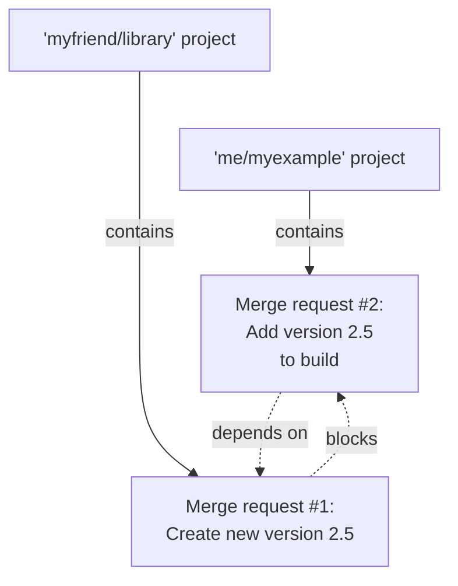



- Tier: 专业版，旗舰版
- Offering: JihuLab.com，私有化部署



单个功能可能涉及多个合并请求，分布在多个项目中，而合并的顺序可能非常重要。当您设置合并请求依赖关系后，在满足 **合并请求依赖项必须合并** 合并检查之前，依赖的合并请求无法合并。

合并请求依赖关系可以帮助您：

- 确保对所需库的更改先于导入该库的项目的更改合并。
- 防止仅涉及文档的合并请求在功能工作本身合并之前合并。
- 要求更新权限矩阵的合并请求先合并，然后再合并尚未拥有正确权限的人员的工作。

如果您的项目 `me/myexample` 从 `myfriend/library` 导入了一个库，那么当 `myfriend/library` 发布新功能时，您应更新您的项目。如果您在 `myfriend/library` 添加新功能之前将更改合并到 `me/myexample`，则会破坏您项目中的默认分支。合并请求依赖关系可防止您的工作过早合并：

您可以将 `me/myexample` 合并请求标记为[草稿](drafts.md)，并在评论中说明原因。这种方法需要手动操作，无法扩展，尤其是当您的合并请求依赖于不同项目中的多个其他合并请求时。相反，您应该：

- 通过 **草稿** 或 **就绪** 状态跟踪单个合并请求的准备情况。
- 使用合并请求依赖关系强制规定合并请求的合并顺序。

合并请求依赖关系是极狐GitLab 专业版中的功能，但极狐GitLab 仅对依赖方合并请求强制执行此限制：

- 极狐GitLab 专业版项目的合并请求可以依赖任何其他合并请求，即使该合并请求位于极狐GitLab 基础版项目中。
- 极狐GitLab 基础版项目的合并请求不能依赖其他合并请求。

## 嵌套依赖关系

极狐GitLab 16.7 及更高版本支持间接的嵌套依赖关系。一个合并请求最多可以有 10 个阻塞项，同时它最多可以阻塞 10 个其他合并请求。在此示例中，`myfriend/library!10` 依赖 `herfriend/another-lib!1`，而后者又依赖 `mycorp/example!100`：

嵌套依赖关系不会显示在极狐GitLab UI 中，但 UI 支持已在[史诗 5308](https://gitlab.com/groups/gitlab-org/-/epics/5308)中提出。

> [!note]
> 一个合并请求不能依赖自身（自引用），但可以创建循环依赖关系。

## 查看合并请求的依赖关系

如果一个合并请求依赖于另一个合并请求，则合并请求报告部分会显示有关该依赖关系的信息：

要查看合并请求上的依赖关系信息：

1. 在顶部栏中，选择**搜索或跳转到**，然后找到您的项目。
1. 在左侧边栏中，选择**代码** > **合并请求**，并找到您的合并请求。
1. 滚动到合并请求报告区域。依赖的合并请求会显示有关所设置依赖关系总数的信息，例如 **依赖于 1 个合并请求被合并**。
1. 选择 **展开** 以查看每个依赖关系的标题、里程碑、指派人和流水线状态。

在您的合并请求的所有依赖关系都合并之前，您的合并请求无法合并。

### 已关闭的合并请求

已关闭的合并请求仍会阻止其依赖方合并，因为一个合并请求可能在没有合并其计划工作的情况下关闭。如果一个合并请求已关闭，而该依赖关系不再相关，请将其作为依赖关系移除，以解除对依赖方合并请求的阻塞。

## 创建新的依赖方合并请求

创建新的合并请求时，您可以阻止其合并，直到其他特定工作合并之后。即使该合并请求位于不同的项目中，此依赖关系也有效。

先决条件：

- 您必须具有开发者、维护者或所有者角色，或者拥有在项目中创建合并请求的权限。
- 依赖方合并请求必须位于专业版或旗舰版的项目中。

要创建新的合并请求并将其标记为依赖另一个合并请求：

1. [创建新的合并请求](creating_merge_requests.md)。
1. 在 **合并请求依赖**中，粘贴应在此工作合并之前合并的合并请求的引用或完整 URL。例如：
   - `!1234`（用于同一项目中的合并请求）
   - `gitlab-org/gitlab!1234`
   - `https://gitlab.com/gitlab-org/gitlab/-/merge_requests/1234`
1. 选择 **创建合并请求**。

## 编辑合并请求以添加依赖关系

您可以编辑现有的合并请求，并将其标记为依赖另一个合并请求。

先决条件：

- 您必须具有开发者、维护者或所有者角色，或者拥有在项目中编辑合并请求的权限。

为此：

1. 在顶部栏中，选择**搜索或跳转到**，然后找到您的项目。
1. 在左侧边栏中，选择**代码** > **合并请求**，并找到您的合并请求。
1. 选择 **编辑**。
1. 在 **合并请求依赖**中，粘贴应在此工作合并之前合并的合并请求的引用或完整 URL。例如：
   - `!1234`（用于同一项目中的合并请求）
   - `gitlab-org/gitlab!1234`
   - `https://gitlab.com/gitlab-org/gitlab/-/merge_requests/1234`

## 从合并请求中移除依赖关系

您可以编辑依赖方合并请求并移除依赖关系。

先决条件：

- 您必须拥有允许您编辑合并请求的项目角色。

1. 在顶部栏中，选择**搜索或跳转到**，然后找到您的项目。
1. 在左侧边栏中，选择**代码** > **合并请求**，并找到您的合并请求。
1. 选择 **编辑**。
1. 滚动到 **合并请求依赖**，然后针对要移除的每个依赖关系，选择其引用旁边的 **删除**。

   > [!note]
   > 您没有权限查看的合并请求依赖关系会显示为
   > **1 个不可访问的合并请求**。您仍然可以移除该依赖关系。

1. 选择 **保存更改**。

## 故障排除

### 在项目导入或导出时保留依赖关系

导入或导出项目时不会保留依赖关系。有关更多信息，请参见[议题 #12549](https://gitlab.com/gitlab-org/gitlab/-/issues/12549)。
