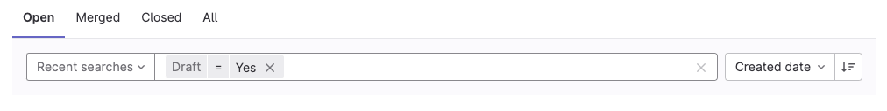



- Tier: 基础版，专业版，旗舰版
- Offering: JihuLab.com，私有化部署



如果某个合并请求尚未准备好合并，您可以阻止其合并，直到您[将其标记为就绪](#mark-merge-requests-as-ready)。标记为 **草稿**的合并请求在您移除 **草稿** 标记之前无法合并，即使它们满足所有其他合并条件：

## 将合并请求标记为草稿

您可以通过多种方式将合并请求标记为草稿：

- 查看合并请求时：在合并请求的右上角，
  选择 **合并请求操作**（），然后选择 **标记为草稿**。
- 创建或编辑合并请求时：您可以执行以下任一操作：
  - 在合并请求标题的开头添加 `[Draft]`、`Draft:` 或 `(Draft)`。
  - 在 **标题** 字段下方选择 **标记为草稿**。
- 在现有合并请求中发表评论时：在评论中添加
  [`/draft` 快速操作](../quick_actions.md#draft)。
  要将合并请求标记为就绪，请使用 [`/ready`](../quick_actions.md#ready) 快速操作。
- 创建提交时：在以合并请求源分支为目标的提交消息开头添加
  `draft:`、`Draft:`、`fixup!` 或 `Fixup!`。此
  方法不是切换开关。在后续提交中再次添加此文本不会将
  合并请求标记为就绪。

## 将合并请求标记为就绪

当合并请求准备好合并时，您可以通过多种方式移除 `Draft` 标记：

- 查看合并请求时：在合并请求的右上角，选择 **标记为就绪**。
  拥有开发者、维护者或所有者角色的用户还可以滚动到合并请求
  描述的底部，然后选择 **标记为就绪**。
- 编辑现有合并请求时：从标题开头移除 `[Draft]`、`Draft:` 或 `(Draft)`，
  或清除 **标题** 字段下方的 **标记为草稿**。
- 在现有合并请求中发表评论时：在合并请求的评论中添加
  [`/ready` 快速操作](../quick_actions.md#ready)。

当您将合并请求标记为就绪时，极狐GitLab 会通知[合并请求参与者和关注者](../../profile/notifications.md#issue-merge-request-and-epic-events)。

## 搜索时包含或排除草稿

当您在项目的合并请求列表中查看或搜索时，要包含或排除草稿合并请求：

1. 在顶部栏中，选择**搜索或跳转到**并找到您的项目。
1. 在左侧边栏中，选择**代码** > **合并请求**。
1. 要按合并请求状态筛选，请在导航栏中选择 **开放中**、**已合并**、**已关闭**
   或 **全部**。
1. 选择搜索框以显示筛选器列表，然后选择 **草稿**，或
   输入单词 `draft`。
1. 选择 `=`。
1. 选择 **是** 以包含草稿，或选择 **否** 以排除草稿，然后按 **回车**
   更新合并请求列表：

   

## 草稿的流水线

草稿合并请求运行的流水线与标记为就绪的合并请求相同。

要跳过草稿合并请求的流水线，请参阅[跳过草稿合并请求的流水线](../../../ci/yaml/workflow.md#skip-pipelines-for-draft-merge-requests)。
