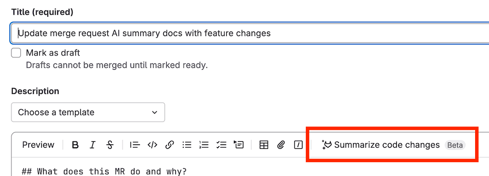

> [!disclaimer]

极狐GitLab Duo 旨在合并请求的整个生命周期中提供与上下文相关的信息。

<a id="generate-a-description-by-summarizing-code-changes"></a>

## 通过总结代码变更生成描述



- Tier: 专业版，旗舰版
- Add-on: 极狐GitLab Duo Enterprise
- Offering: JihuLab.com，私有化部署
- Status: 测试版





- [默认 LLM](../../gitlab_duo/model_selection.md#default-models)
- 可用于[自部署模型的极狐GitLab Duo](../../../administration/gitlab_duo_self_hosted/_index.md)



当您创建或编辑合并请求时，可使用极狐GitLab Duo 合并请求摘要来创建合并请求描述。

1. [新建合并请求](creating_merge_requests.md)。
1. 在**描述**字段中，将光标放在您想要插入描述的位置。
1. 在文本区域上方的工具栏上，选择**总结代码变更**（）。

   

描述会插入到光标所在位置。


请在 [议题 443236](https://gitlab.com/gitlab-org/gitlab/-/issues/443236)中提供有关此功能的反馈。

数据使用：源分支头部与目标分支之间的变更差异会发送给大语言模型。

<a id="use-gitlab-duo-to-review-your-code"></a>

## 使用极狐GitLab Duo 审查您的代码

极狐GitLab Duo 可以审查您的合并请求，查找潜在错误，并就是否符合标准提供反馈。

当您请求极狐GitLab Duo 进行审查时，它会根据您的附加组件自动运行两种代码评审功能之一。拥有群组所有者角色的用户可以为所有用户配置运行哪种功能。

| 详情              | [代码评审任务流](../../duo_agent_platform/flows/foundational_flows/code_review/_index.md) | [极狐GitLab Duo 代码评审](../../gitlab_duo/code_review.md) |
|---------------------|--------------------------------------------------------------------------------------|-----------------------------------------------------------|
| 审核人            | `@GitLabDuo`                                                                         | `@GitLabDuo`                                              |
| 类型                | Agentic                                                                              | Non-agentic                                               |
| 所需附加组件     | 无。使用极狐GitLab Credits。                                                           | 极狐GitLab Duo Enterprise                                     |
| 上下文感知   | 增强对代码仓库结构和跨文件依赖关系的理解           | 专注于合并请求及其中的文件差异 |
| 分析            | 多步骤 Agentic 推理                                                         | 单次执行                                               |
| 会话创建    |                                                                           |                                                 |
| 自动审查   |                                                                           |                                                |
| 自定义指令 |                                                                           |                                                |
| 自定义评论     |                                                                           |                                                |

<a id="determine-which-review-feature-runs"></a>

### 确定运行哪种审查功能

默认情况下，极狐GitLab 运行的代码评审功能取决于发起审查的用户。

| 审查触发方式                          | 发起用户                      |
|-----------------------------------------|--------------------------------------|
| 手动请求审查               | 请求审查的用户。    |
| 创建合并请求（非草稿）     | 合并请求作者。            |
| 草稿合并请求标记为就绪     | 合并请求作者。            |

如果发起用户拥有极狐GitLab Duo Enterprise 席位，则运行极狐GitLab Duo 代码评审。否则，运行代码评审任务流。两种功能可以在同一项目中运行。

拥有群组所有者角色的用户可以[将所有审查配置为使用代码评审任务流](#turn-on-code-review-flow-for-gitlab-duo-enterprise-seats)，无论席位类型如何。当代码评审任务流运行时，Credits 用量归属于发起用户。

要确定哪个功能运行了审查，请检查合并请求的活动记录。代码评审任务流在运行时会启动一个审查会话。如果没有出现审查会话，则说明极狐GitLab Duo 代码评审运行了审查。


审查完成后，您还可以在[项目的会话](../../duo_agent_platform/sessions/_index.md#view-sessions-for-your-project)中查找代码评审任务流会话。

<a id="turn-on-code-review-flow-for-gitlab-duo-enterprise-seats"></a>

#### 开启极狐GitLab Duo Enterprise 席位的代码评审任务流

为防止极狐GitLab Duo Enterprise 席位持有者使用消耗极狐GitLab Credits 的功能，他们发起的所有代码评审默认使用极狐GitLab Duo 代码评审。即使拥有所有者角色的用户为群组开启了代码评审任务流，此行为也会发生。

您可以更改此默认设置，并将所有代码评审配置为使用代码评审任务流，无论用户的席位如何。

要为极狐GitLab Duo Enterprise 席位覆盖默认代码评审功能：





先决条件：

- 拥有顶级群组的所有者角色。
- 已为您的顶级群组开启并正确配置[代码评审任务流](../../duo_agent_platform/flows/foundational_flows/code_review/_index.md#prerequisites)。

1. 在顶部栏中，选择**搜索或跳转到**并找到您的顶级群组。
1. 选择**设置** > **极狐GitLab Duo**。
1. 选择**更改配置**。
1. 在**任务流执行** > **允许内置任务流**下，清除**代码评审任务流**复选框，然后再次选中它。
1. 在确认对话框中，选择**启用代码评审任务流**。





先决条件：

- 拥有群组的维护者或所有者角色。
- 已为实例开启并正确配置[代码评审任务流](../../duo_agent_platform/flows/foundational_flows/code_review/_index.md#prerequisites)。

1. 在顶部栏中，选择**搜索或跳转到**并找到您的群组或子群组。
1. 选择**设置** > **通用**。
1. 展开**极狐GitLab Duo 功能**。
1. 在**任务流执行**下，清除**代码评审任务流**复选框，然后选择**保存更改**。
1. 再次展开**极狐GitLab Duo 功能**，在**任务流执行**下，选中**代码评审任务流**复选框。
1. 在确认对话框中，选择**启用代码评审任务流**。
1. 选择**保存更改**。





代码评审任务流现在会为群组中的所有代码评审运行，并消耗极狐GitLab Credits。要将所有审查切换回极狐GitLab Duo 代码评审，请关闭代码评审任务流。

<a id="interact-with-gitlab-duo"></a>

## 与极狐GitLab Duo 交互



- Tier: [基础版](../../../subscriptions/gitlab_credits.md#for-the-free-tier)，专业版，旗舰版
- Offering: JihuLab.com，私有化部署



极狐GitLab Duo 可以直接在合并请求评论讨论串中回答问题并讨论反馈。

要与极狐GitLab Duo 交互，请在您的合并请求中提及 `@GitLabDuo`：

- 在新的评论讨论串中，询问有关变更的问题。
- 在回复审查评论时，请求澄清或替代方案。

评论中的交互使用为代码评审任务流选择的模型，并[消耗极狐GitLab Credits](../../../subscriptions/gitlab_credits.md#models)，与任务流分开计费。

但是，如果您请求 `@GitLabDuo` 进行审查，极狐GitLab Duo 会启动代码评审任务流，并适用该任务流的计费方式。

提供给极狐GitLab Duo 的反馈不会影响后续对其他合并请求的审查。添加此功能的提议见 [议题 560116](https://gitlab.com/gitlab-org/gitlab/-/issues/560116)。

<a id="resolve-a-discussion-with-gitlab-duo"></a>

## 使用极狐GitLab Duo 解决讨论



- Tier: 专业版，旗舰版
- Offering: JihuLab.com，私有化部署



> [!flag]
> 此功能的可用性由功能标志控制。

使用极狐GitLab Duo 解决合并请求上的评审讨论。

当您要求极狐GitLab Duo 解决讨论时，它会读取审查评论和周围的代码，在源分支上进行所请求的更改，然后提交并推送更改。然后，极狐GitLab Duo 会回复该讨论，总结更改内容并解决该讨论串。

此功能使用[极狐GitLab Duo Agent Platform](../../duo_agent_platform/_index.md) 上的开发者任务流。

先决条件：

- 拥有项目的开发者、维护者或所有者角色。
- [极狐GitLab Duo Agent Platform 的先决条件](../../duo_agent_platform/_index.md#prerequisites)。
- 已[为顶级群组](../../duo_agent_platform/flows/foundational_flows/_index.md#turn-foundational-flows-on-or-off)开启**允许内置任务流**和**开发者**。
- [已配置推送规则以允许服务账号](../../duo_agent_platform/troubleshooting.md#configure-push-rules-to-allow-a-service-account)。
- 已[配置您自己的 Runner](../../duo_agent_platform/flows/execution/_index.md#configure-runners-to-execute-flows)，或已为您的项目开启[极狐GitLab 托管 Runner](../../../ci/runners/hosted_runners/_index.md)。

要使用极狐GitLab Duo 解决讨论：

1. 在合并请求中，转到未解决的讨论。
1. 在**解决讨论串**旁边，选择**更多解决选项**（）。
1. 选择**使用极狐GitLab Duo 解决**。

极狐GitLab Duo 会启动一个会话，您可以在[项目的会话](../../duo_agent_platform/sessions/_index.md#view-sessions-for-your-project)中跟踪该会话。

<a id="summarize-a-code-review"></a>

## 总结代码评审



- Tier: 专业版，旗舰版
- Add-on: 极狐GitLab Duo Enterprise
- Offering: JihuLab.com，私有化部署
- Status: 实验





- [默认 LLM](../../gitlab_duo/model_selection.md#default-models)
- 可用于[自部署模型的极狐GitLab Duo](../../../administration/gitlab_duo_self_hosted/_index.md)



当您完成对合并请求的审查并准备[提交审查](reviews/_index.md#submit-a-review)时，可使用极狐GitLab Duo 代码评审摘要来生成评论摘要。

1. 在顶部栏中，选择**搜索或跳转到**并找到您的项目。
1. 在左侧边栏中，选择**代码** > **合并请求**，然后找到您要审查的合并请求。
1. 当您准备好提交审查时，选择**完成审查**。
1. 选择**添加摘要**。

摘要会显示在评论框中。您可以在提交审查前编辑和完善摘要。


请在 [议题 408991](https://gitlab.com/gitlab-org/gitlab/-/issues/408991)中提供有关此实验性功能的反馈。

数据使用：当您使用此功能时，以下数据会发送给大语言模型：

- 草稿评论文本

<a id="generate-a-merge-commit-message"></a>

## 生成合并提交消息



- Tier: 专业版，旗舰版
- Add-on: 极狐GitLab Duo Enterprise、极狐GitLab Duo with Amazon Q
- Offering: JihuLab.com，私有化部署





- [默认 LLM](../../gitlab_duo/model_selection.md#default-models)
- Amazon Q 的 LLM：Amazon Q Developer
- 可用于[自部署模型的极狐GitLab Duo](../../../administration/gitlab_duo_self_hosted/_index.md)



在准备合并您的合并请求时，可使用极狐GitLab Duo 合并提交消息生成功能来编辑建议的合并提交消息。

1. 在顶部栏中，选择**搜索或跳转到**并找到您的项目。
1. 在左侧边栏中，选择**代码** > **合并请求**，然后找到您的合并请求。
1. 在合并组件上选中**编辑提交消息**复选框。
1. 选择**生成提交消息**。
1. 查看提供的提交消息，然后选择**插入**将其添加到提交中。


数据使用：当您使用此功能时，以下数据会发送给大语言模型：

- 文件内容
- 文件名

<a id="troubleshooting"></a>

## 故障排除

在合并请求中使用极狐GitLab Duo 时，您可能会遇到以下问题。

<a id="response-not-received"></a>

### 未收到响应

如果您通过提及或回复 `@GitLabDuo` 来请求极狐GitLab Duo 进行审查，但没有收到响应，这可能是因为您没有相应的极狐GitLab Duo 附加组件。

要检查您的极狐GitLab Duo 附加组件，请让您的群组所有者检查群组的[极狐GitLab Duo 席位分配](../../../subscriptions/subscription-add-ons.md#view-assigned-gitlab-duo-users)。

要更改您的极狐GitLab Duo 附加组件，请联系您的管理员。

<a id="unable-to-assign-gitlab-duo-to-review"></a>

### 无法分配极狐GitLab Duo 进行审查

如果您无法将极狐GitLab Duo 分配为审核人，这可能是因为您没有相应的极狐GitLab Duo 附加组件。

要检查您的极狐GitLab Duo 附加组件，请让您的群组所有者检查群组的[极狐GitLab Duo 席位分配](../../../subscriptions/subscription-add-ons.md#view-assigned-gitlab-duo-users)。

要更改您的极狐GitLab Duo 附加组件，请联系您的管理员。

<a id="error-gitlab-duo-code-review-was-not-automatically-added"></a>

### 错误：`GitLab Duo Code Review was not automatically added...`

如果您在开启极狐GitLab Duo 自动审查的情况下尝试创建合并请求，可能会收到以下错误消息：

```plaintext
GitLab Duo Code Review was not automatically added because your account requires
GitLab Duo Enterprise. Contact your administrator to upgrade your account.
```

请联系您的管理员，请他们[购买极狐GitLab Duo Enterprise 席位](../../../subscriptions/subscription-add-ons.md#purchase-gitlab-duo)并分配给您。
