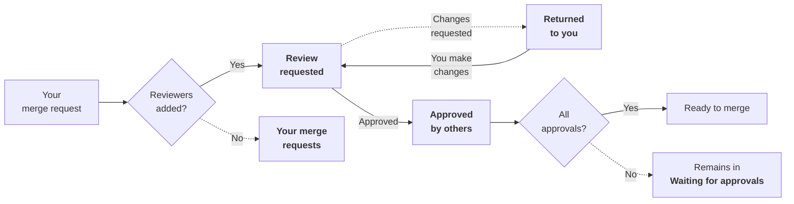



- Tier: 基础版，专业版，旗舰版
- Offering: JihuLab.com，私有化部署



如果您是合并请求的作者、指派人或审核人，该合并请求会显示在您的合并请求主页上。此页面按 **工作流** 或 **角色** 对您的合并请求进行排序。**工作流** 视图会显示哪些合并请求需要您优先处理，无论这些工作是您自己的还是他人的。工作流视图按合并请求在此评审流程中所处的阶段对其进行分组：

此评审流程假设审核人使用 **启动评审** 和 **提交评审** 功能。

**角色** 视图按您在合并请求中的角色对合并请求进行排序。

## 查看您的合并请求主页

> [!flag]
> 此功能的可用性由功能标志控制。

极狐GitLab 会在所有页面的右上角显示**活跃**合并请求的总数。例如，该用户有：

该用户有：

- 8 个未关闭的议题（）
- 3 个活跃的合并请求（）
- 6 个待办事项（）

您的合并请求主页会显示有关这些合并请求的更多信息。要查看这些信息，请使用以下任一方法：

- 使用 <kbd>Shift</kbd>+<kbd>m</kbd> [键盘快捷键](../../shortcuts.md)。
- 在左侧边栏中，选择 **合并请求**（）。
- 在顶部栏中，选择 **搜索或跳转到**，然后从下拉列表中选择 **合并请求**。

为帮助您专注于当前需要处理的事项，极狐GitLab 将您的合并请求主页分为三个标签页：

- **活跃**：这些合并请求需要您或您团队中的成员处理。
- **已合并**：这些合并请求在过去 14 天内合并。它们是您的工作，或包含您的评审。
- **搜索**：搜索所有合并请求，并根据需要进行筛选。

- **状态**：合并请求的当前状态。
- **标题**：合并请求的重要元数据，包括：
  - 合并请求标题。
  - 指派人的头像。
  - 添加和删除的文件及行数（`+` / `-`）。
  - 里程碑。
- **作者**：作者的头像。
- **审核人**：审核人的头像。带有绿色对勾的审核人已批准该合并请求。
- **检查**：对可合并性的简要评估。
  - 如果存在合并冲突，则显示警告（）。
  - 未解决的讨论串数量，例如 `0 of 3`。
  - 当前所需的[审批状态](approvals/_index.md#in-the-list-of-merge-requests)。
  - 最新的流水线状态。
  - 最后更新日期。

### 设置您的显示偏好

在合并请求主页的右上角，选择 **显示偏好**（）：

- 切换 **显示标记** 以显示或隐藏每个合并请求的标记。
- 排序偏好：**工作流** 或 **角色**。
  - **工作流** 按状态对合并请求进行分组。极狐GitLab 会优先显示
    需要您处理的合并请求，无论您是作者还是审核人。
  - **角色** 按您是审核人还是作者对合并请求进行分组。
- 切换 **显示您的草稿** 以在 **您的合并请求** 列表中显示或隐藏草稿合并请求。

活跃的合并请求会计入左侧边栏中显示的总数。极狐GitLab 会从您的评审计数中排除非活跃合并请求。

### 工作流视图：活跃状态

这些合并请求需要您处理。它们会计入左侧边栏中显示的总数：

- **您的合并请求**：您是合并请求的作者或指派人。添加审核人以开始评审流程。
  状态：
  - **草稿**：该合并请求是草稿。
  - **需要审核人**：该合并请求不是草稿，但没有审核人。
- **请求审查**：您是审核人。评审该合并请求。提供反馈。您可以选择
  批准或请求更改。状态：
  - **请求更改**：审核人已请求更改。该更改请求会阻止该合并请求，
    但[可以绕过](reviews/_index.md#bypass-a-request-for-changes)。
  - **审核人已评论**：审核人已留下评论，但未请求更改。
- **返还给您**：审核人已提供反馈或请求更改。处理审核人的评论，
  并应用建议的更改。状态：
  - **请求更改**：审核人已请求更改。
  - **审核人已评论**：审核人已留下评论，但未请求更改。

### 工作流视图：非活跃状态

极狐GitLab 会从活跃计数中排除这些合并请求，因为目前不需要您执行任何操作：

- **等待指派人**：如果您是作者，该合并请求正在等待评审。如果您是
  审核人，则您已请求更改。状态：
  - **您请求更改**：您已完成评审并请求更改。
  - **您评论了**：您已发表评论，但尚未完成评审。
- **等待批准**：您被指派的、正在等待审批的合并请求，以及您已请求更改的评审。
  状态：
  - **需要批准**：剩余所需的审批数量。
  - **已批准**：您已批准，或所有必需的审批均已满足。
  - **等待批准**。
- **由您批准**：您已评审并批准的合并请求。
  状态：
  - **已批准**：您已批准，且必需的审批均已满足。
  - **需要批准**：您已批准，但并非所有必需的审批均已满足。
- **由其他人批准**：已获得其他团队成员批准的合并请求。
  如果满足所有要求，则可能已准备好合并。状态：
  - **已批准**：您的合并请求已获得必要的审批。

### 角色视图

**角色** 视图按您是指派人或审核人对合并请求进行分组：

- **审核人（活跃）**：等待您评审。
- **审核人（非活跃）**：您已评审。
- **您的合并请求（活跃）**
- **您的合并请求（非活跃）**

**活跃**列表中的合并请求会计入左侧边栏中显示的总数。
