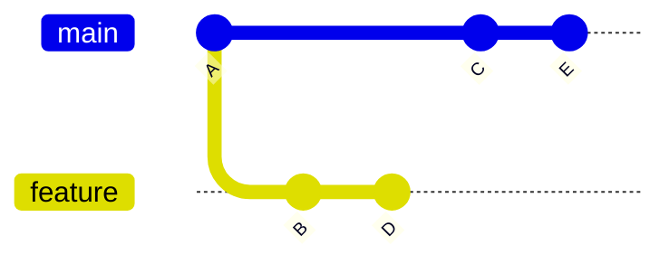
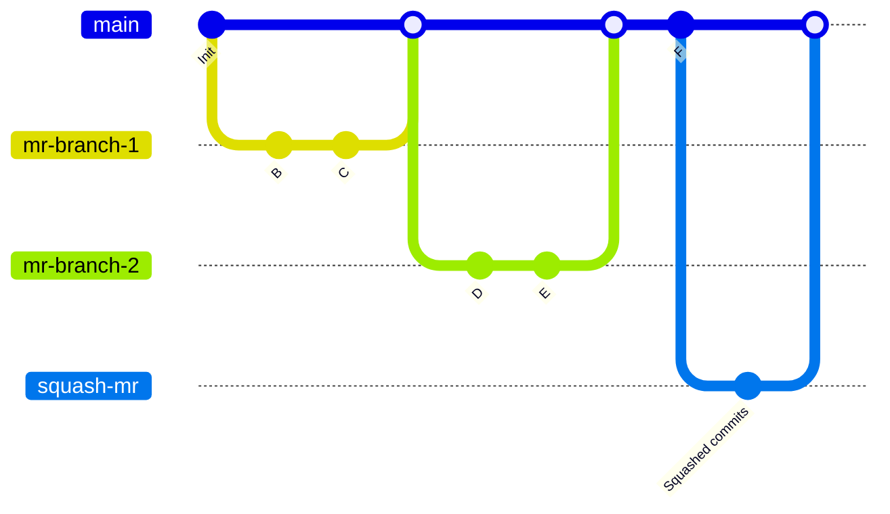
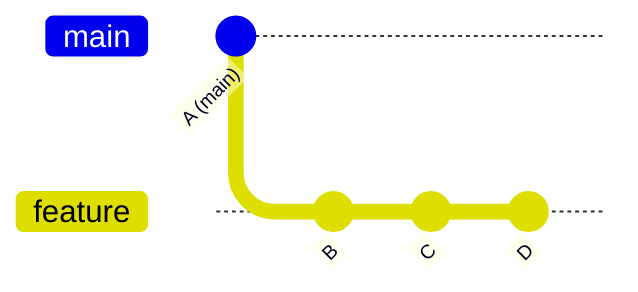
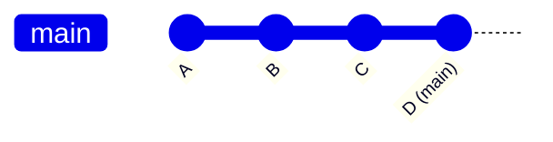
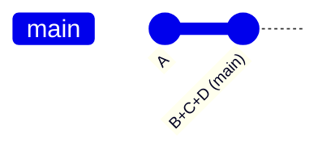



- Tier: 基础版，专业版，旗舰版
- Offering: JihuLab.com，私有化部署



您为项目选择的合并方法决定了合并请求中的变更如何合并到现有分支。

本页示例假设 `main` 分支包含提交 A、C 和 E，`feature` 分支包含提交 B 和 D：



<a id="configure-a-projects-merge-method"></a>

## 配置项目的合并方法

1. 在顶部栏中，选择**搜索或跳转到**，找到您的项目。
1. 在左侧边栏中，选择**设置** > **合并请求**。
1. 从以下选项中选择所需的**合并方法**：
   - 合并提交
   - 合并提交与半线性历史记录
   - 快进式(Fast-forward)合并
1. 在**合并时压缩提交**中，选择处理提交的默认行为：
   - **不允许**：从不执行压缩，用户无法更改此行为。
   - **允许**：默认关闭压缩，但用户可以更改此行为。
   - **鼓励**：默认开启压缩，但用户可以更改此行为。
   - **要求**：始终执行压缩，用户无法更改此行为。
1. 选择**保存更改**。

<a id="merge-commit"></a>

## 合并提交

默认情况下，当分支合并到 `main` 时，极狐GitLab 会创建一个合并提交。无论提交是否在[合并时压缩](../squash_and_merge.md)，都会始终创建一个单独的合并提交。此策略可能导致压缩提交和合并提交都被添加到您的 `main` 分支。

这些图展示了如果您使用**合并提交**策略，`feature` 分支如何合并到 `main`。它们等同于命令 `git merge --no-ff <feature>`，以及在极狐GitLab UI 中选择 `Merge commit` 作为**合并方法**：

- 使用**合并提交**方式合并功能分支后，您的 `main` 分支如下所示：

  ```mermaid
  %%{init: { 'gitGraph': {'logLevel': 'debug', 'showBranches': true, 'showCommitLabel':true,'mainBranchName': 'main', 'fontFamily': 'GitLab Sans'}} }%%
  gitGraph
     accTitle: Diagram of a merge commit
     accDescr: A Git graph showing how merge commits are created in GitLab when a feature branch is merged.
     commit id: "A"
     branch feature
     commit id: "B"
     commit id: "D"
     checkout main
     commit id: "C"
     commit id: "E"
     merge feature
  ```

- 相比之下，压缩合并会构造一个压缩提交，即 `feature` 分支中所有提交的虚拟副本。原始提交（B 和 D）在
  `feature` 分支上保持不变，然后在 `main` 分支上创建一个合并提交，以合并压缩后的分支：

  ```mermaid
  %%{init: { 'gitGraph': {'showBranches': true, 'showCommitLabel':true,'mainBranchName': 'main', 'fontFamily': 'GitLab Sans'}} }%%
  gitGraph
     accTitle: Diagram of a squash merge
     accDescr: A Git graph showing repository and branch structure after a squash commit is added to the main branch.
     commit id:"A"
     branch feature
     checkout main
     commit id:"C"
     checkout feature
     commit id:"B"
     commit id:"D"
     checkout main
     commit id:"E"
     branch "B+D"
     commit id: "B+D"
     checkout main
     merge "B+D"
  ```

压缩合并图等同于极狐GitLab UI 中的以下设置：

- **合并方法**：合并提交。
- **合并时压缩提交**应设置为以下之一：
  - 要求。
  - 允许或鼓励，并且必须在合并请求上选择压缩。

压缩合并图也等同于以下命令：

  ```shell
  git checkout `git merge-base feature main`
  git merge --squash feature
  git commit --no-edit
  SOURCE_SHA=`git rev-parse HEAD`
  git checkout main
  git merge --no-ff $SOURCE_SHA
  ```

如果您在压缩合并后继续在长期运行的源分支上工作，后续合并请求可能会显示之前已合并的提交，并警告源分支落后于目标分支。更多信息，请参见[长期运行分支的行为](../squash_and_merge.md#long-running-branch-behavior)。

<a id="merge-commit-with-semi-linear-history"></a>

## 合并提交与半线性历史记录

每次合并都会创建一个合并提交，但只有在可以进行快进式合并时才会合并分支。这确保了如果合并请求构建成功，目标分支在合并后也能构建成功。使用此合并方法生成的示例提交图：



当您访问合并请求页面并选择 `Merge commit with semi-linear history` 方式时，只有在可以进行快进式合并时才能接受它。当无法进行快进式合并时，用户可以选择变基，请参见[在（半）线性合并方法中变基](#rebasing-in-semi-linear-merge-methods)。

此方式等同于**合并提交**方式中使用的相同 Git 命令。但是，如果您的源分支基于目标分支（例如 `main`）的过时版本，则必须对源分支进行变基。此合并方法会创建更清晰的历史记录，同时仍能让您看到每个分支从何处开始以及何时被合并。

<a id="fast-forward-merge"></a>

## 快进式合并

有时，工作流策略可能要求没有合并提交的干净提交历史。在这种情况下，快进式合并是合适的选择。使用快进式合并请求，您可以保留线性的 Git 历史，而无需创建合并提交。

只有当目标分支（例如 `main`）未偏离源分支的基础提交时，才能进行快进式合并。如果目标分支有源分支中没有的新提交，则必须先对源分支进行变基。

当启用快进式合并（[`--ff-only`](https://git-scm.com/docs/git-merge#git-merge---ff-only)）设置时，只有在分支可以快进的情况下才允许合并。如果无法进行快进式合并，您可以选择变基。更多信息，请参见[在（半）线性合并方法中变基](#rebasing-in-semi-linear-merge-methods)。

<a id="without-squashing"></a>

### 不压缩

禁用压缩时，源分支中的所有提交会直接添加到目标分支，保留各自的提交历史。

合并前，`main` 位于提交 A，`feature` 包含提交 B、C 和 D：



快进式合并后，`main` 现在指向提交 D，包含功能分支中的所有提交：



此方式等同于 `git merge --ff-only <source-branch>`。

<a id="with-squashing"></a>

### 压缩

启用压缩时，源分支中的所有提交会先合并为单个提交，然后快进到目标分支。

合并前，`main` 位于提交 A，`feature` 包含提交 B、C 和 D：


压缩后的快进式合并后，`main` 现在包含一个包含 B、C 和 D 中所有变更的单个提交：



此方式等同于 `git merge --squash <source-branch>` 后跟 `git commit`。

<a id="rebasing-in-semi-linear-merge-methods"></a>

## 在（半）线性合并方法中变基

在这些合并方法中，只有当您的源分支与目标分支保持最新时才能合并：

- 合并提交与半线性历史记录。
- 快进式合并。

如果无法进行快进式合并但可以进行无冲突变基，
极狐GitLab 提供：

- [`/rebase` 快速操作](../conflicts.md#rebase)。
- 在用户界面中选择**变基**的选项。

如果以下两个条件都成立，则必须在快进式合并前在本地对源分支进行变基：

- 目标分支领先于源分支。
- 无法进行无冲突变基。

在压缩前可能需要进行变基，即使压缩本身可以被视为等同于变基。

<a id="automatic-rebase-before-merge"></a>

### 合并前自动变基

当您使用**合并提交与半线性历史记录**或**快进式(Fast-forward)合并**方式时，可以开启合并前自动变基。开启此设置后，当源分支落后于目标分支时，极狐GitLab 会在合并时自动将源分支变基到目标分支。您无需手动变基，也无需等待变基完成后再合并。

服务器端变基会移除提交中的 GPG 签名。如果您的项目要求签名提交，请考虑自动变基是否合适。

自动变基：

- 在服务器端对源分支进行变基，而不修改原始源分支。
- 快进目标分支以包含变基后的提交。
- 不会在变基结果上重新运行 CI/CD 流水线。
- 要求变基能在没有合并冲突的情况下完成。

> [!note]
> 由于自动变基后不会再次运行 CI/CD 流水线，
> 合并结果可能与上次流水线运行不同。要在合并前验证
> 变基结果，请使用[合并列车](../../../../ci/pipelines/merge_trains.md)。

<a id="turn-on-automatic-rebase-before-merge"></a>

#### 开启合并前自动变基

先决条件：

- 项目的维护者或所有者角色。
- 项目的[合并方法](#configure-a-projects-merge-method)必须设置为
  **合并提交与半线性历史记录**或**快进式(Fast-forward)合并**。

要开启自动变基：

1. 在顶部栏中，选择**搜索或跳转到**，找到您的项目。
1. 在左侧边栏中，选择**设置** > **合并请求**。
1. 在**合并方法**部分，选择**启用合并前自动变基**。
1. 选择**保存更改**。

<a id="rebase-without-cicd-pipeline"></a>

### 不运行 CI/CD 流水线的变基

要对合并请求的分支进行变基而不触发 CI/CD 流水线，请从合并请求报告部分选择**变基，不运行流水线**。

此选项：

- 在无法进行快进式合并但可以进行无冲突变基时可用。
- 在启用**流水线必须成功**选项时不可用。

在不运行 CI/CD 流水线的情况下变基，可在需要频繁变基的半线性工作流项目中节省资源。
