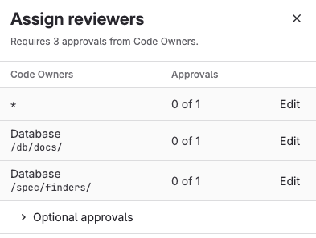
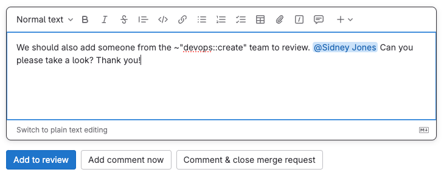
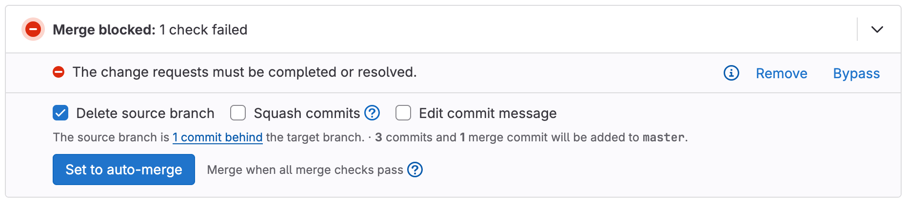
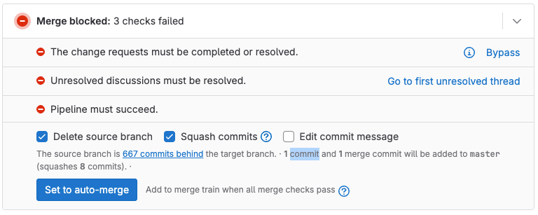
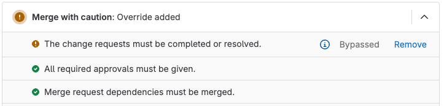



- Tier: 基础版，专业版，旗舰版
- Offering: JihuLab.com，私有化部署



合并请求评审流程确保在提议的变更合并之前，由领域专家进行评审。审核人为合并请求添加评审评论，作者可以直接从极狐GitLab UI 中应用[建议变更](suggestions.md)。

有关审核人与指派人的关系，请参阅[指派人和审核人](../_index.md#assignees-and-reviewers)。

审核人可以使用以下任一工具来评审合并请求：

- 极狐GitLab 界面。
- Visual Studio Code，配合
  [GitLab for VS Code 扩展](../../../../editor_extensions/visual_studio_code/_index.md)。
- 终端窗口，配合 [GitLab CLI](../../../../editor_extensions/gitlab_cli/_index.md)。

审批是多项合并检查之一，用于确保您的合并请求仅在真正就绪时才合并。根据项目配置，审核人还可以通过设置 **请求变更** 来阻止合并请求合并。

极狐GitLab 专业版和旗舰版提供 **指派审核人**抽屉，其中包含更多信息，帮助您找到[满足审批规则的审核人](#find-reviewers-who-fulfill-approval-rules)：

按照[定义的评审流程](#start-a-review)，每位审核人决定是接受还是拒绝合并请求。右侧边栏显示审核人列表，以及（如果他们遵循评审流程）他们的评审状态：

-  评审尚未开始。
-  评审正在进行中。
-  已评审并批准。
-  已评审、请求变更，并
  [阻止了此合并请求](#prevent-merge-when-you-request-changes)，直到做出变更。
  此阻止[可以被绕过](#prevent-merge-when-you-request-changes)。

## 查找要评审的合并请求

您的[合并请求主页](../homepage.md)显示您进行中的合并请求，以及等待您评审的合并请求。您需要评审的合并请求位于 **请求审查** 类别中。要查看所有需要您关注的合并请求，请使用以下任一方法：

- 按 <kbd>Shift</kbd>+<kbd>m</kbd> [键盘快捷键](../../../shortcuts.md)。
- 在左侧边栏中，选择**合并请求**（）。
- 在顶部栏中，选择**搜索或跳转到**，然后从下拉列表中选择 **我正在处理的合并请求**。

## 查看合并请求的评审状态

操作步骤：

1. 在顶部栏中，选择**搜索或跳转到**并找到您的项目。
1. 在左侧边栏中，选择**代码** > **合并请求**并找到您的合并请求。
1. 选择合并请求的标题以查看它。
1. 滚动到[合并请求小组件](../widgets.md)以查看合并请求的可合并性和
   审批状态。例如，缺少必需的审批会阻止此合并请求：

   

## 请求评审

当您完成变更准备后，就该请求评审了。要为您的合并请求指派审核人，可以在任意文本字段中使用 [`/assign_reviewer` 快速操作](../../quick_actions.md#assign_reviewer)，或者：

1. 在顶部栏中，选择**搜索或跳转到**并找到您的项目。
1. 在左侧边栏中，选择**代码** > **合并请求**并找到您的合并请求。
1. 选择合并请求的标题以查看它。
1. 要按名称查找审核人：在右侧边栏的**审核人**部分中，选择**编辑**。
1. 要查找在极狐GitLab 专业版和旗舰版中满足审批规则的审核人：
   1. 在右侧边栏的**审核人**部分中，选择**指派**以打开 **指派审核人**抽屉。
   1. 对于每条审批规则，选择**编辑**以查找满足该审批规则的审核人。

极狐GitLab 会将该合并请求添加到用户的评审请求中。

要将代码所有者指派为审核人而无需手动选择，请参阅[自动指派审核人](automatic_reviewer_assignment.md)。

### 查找满足审批规则的审核人



- Tier: 专业版，旗舰版
- Offering: JihuLab.com，私有化部署



极狐GitLab 专业版和旗舰版帮助您更快速地找到适合您合并请求的最佳审核人。使用 **指派审核人**抽屉筛选审核人列表。查看您合并请求中所更改文件的代码所有者，以及满足项目审批规则的用户。

在此示例中，该合并请求需要 3 项代码所有者审批，但目前一项都没有：

要在合并请求中指派符合条件的审批人：

1. 在**审核人**部分中，选择**指派**。
1. 要查看可选的审批规则或代码所有者，选择 **可选批准规则**（）以显示它们。
1. 在您需要的审核人类型旁边，选择**编辑**：
   - **代码所有者** 仅显示该文件类型的代码所有者。
   - **批准规则** 仅显示满足该审批规则的用户。
1. 选择您想要的审核人。（极狐GitLab 专业版和旗舰版允许您选择多个审核人。）
1. 对每个必需的 **代码所有者** 和 **批准规则** 项重复此操作。
1. 选择好审核人后，在右上角选择**关闭**（）
   以隐藏 **指派审核人**抽屉。

### 重新请求评审

在审核人完成其[合并请求评审](../../../discussions/_index.md)后，合并请求的作者可以请求审核人进行新的评审。为此，可以在合并请求的任意文本字段中使用 `/request_review @user` 快速操作，或者：

1. 在顶部栏中，选择**搜索或跳转到**并找到您的项目。
1. 在左侧边栏中，选择**代码** > **合并请求**并找到您的合并请求。
1. 选择合并请求的标题以查看它。
1. 如果您已折叠合并请求中的右侧边栏，请选择
    **展开侧边栏** 以展开它。
1. 在**审核人**部分中，选择审核人姓名旁边的 **重新请求审核** 图标（）。

极狐GitLab 会为审核人创建一个新的[待办事项](../../../todos.md)，并向他们发送通知邮件。

## 开始评审

评审合并请求时，请遵循评审流程，而不是留下单独的评论。当您选择 **启动评审** 时，右侧边栏的**审核人**部分会将
您的状态从 **待审阅**（）更新为
**审核人已开始评审**（）。

要开始评审合并请求：

1. 执行以下任一操作：
   - 按 <kbd>Shift</kbd>+<kbd>r</kbd> 转到您的**合并请求**页面。
   - 在右上角，选择**合并请求**（）。

1. 找到您的合并请求，并选择合并请求的标题以查看它。
1. 阅读合并请求的描述和评论，以了解该合并请求。
1. 选择**变更**以查看所提议变更的差异。要详细了解
   **变更**页面，请参阅[合并请求中的变更](../changes.md)。
1. 根据需要[建议多行或单行变更](suggestions.md)。准备好保存第一条
   评审评论时，选择 **启动评审** 以：

   - 将右侧边栏中的状态更新为**审核人已开始评审**（）。
   - 保存您的评审评论，但保持未发布，如下所示：

     

   如果您选择 **立即添加评论** 而不是 **启动评审**，极狐GitLab 会立即发布您的评论。

1. 继续在**变更**标签页或**概览**标签页上撰写评审评论。
   选择 **添加到评审** 会使其保持未发布状态，直到您提交评审：

   

接下来，提交您的评审。

### 通过评论解决或重新打开讨论串

评论也可以解决或重新打开评论讨论串。要在回复评论时解决或重新打开讨论串：

1. 在评论文本区域中，撰写您的评论。
1. 选中或清除 **解决主题** 或 **重新打开讨论**。
1. 选择 **立即添加评论** 或 **添加到评审**。

待处理的评论会显示有关延迟操作的信息。这些操作将在您提交评审时执行。

## 提交评审

当您提交评审时，极狐GitLab 会：

- 发布您评审中的评论。
- 向合并请求的每位可通知用户发送一封电子邮件，并附上您的
  评审评论。回复此电子邮件会在合并请求上创建一条新评论。
- 执行您添加到评审评论中的任何快速操作。
- 显示您评审的结果。

要快速提交对合并请求的评审：

- 转到合并请求小组件并选择**批准**。该合并请求也会被您批准。
- 在非评审评论的文本中使用 [`/submit_review` 快速操作](../../quick_actions.md#submit_review)。

要在提交评审时通读并编辑您的评审评论：

1. 在右上角，选择 **您的审查** 以显示有关您评审的详细信息：

   

1. 查看您待处理的评论。根据需要编辑它们。
1. 选择您评审的结果。

   - **批准**：留下反馈并批准变更。
   - **添加评论**：留下一般反馈，而不明确批准或请求变更。
   - **请求变更**：阻止合并请求合并，直到作者
     处理您的反馈。

1. 可选。撰写您的评审摘要。极狐GitLab 专业版和旗舰版用户可以选择
   **添加摘要**（）为您创建摘要。包含您希望执行的任何
   快速操作。

### 放弃待处理的评审

当您放弃评审时，未发布的评论会被删除，且无法恢复。操作步骤：

1. 在右上角，选择 **您的审查** 以显示有关您评审的详细信息：

   

1. 选择 **放弃审核**。

### 请求变更时阻止合并



- Tier: 专业版，旗舰版
- Offering: JihuLab.com，私有化部署



审核人[请求变更](#submit-a-review)会阻止合并请求合并。发生这种情况时，合并请求报告区域会显示消息
**变更请求必须由请求用户批准**。要解除对合并请求的阻止，
请求变更的审核人应[重新评审并批准](#re-request-a-review)该合并请求。

### 移除变更请求

如果您之前请求了变更，可以移除您的变更请求。在以下两种情况都成立时，您可能需要这样做：

- 您无法再批准该合并请求。
- 您想取消变更请求，但不想提交新的评审。

要在不提交新评审的情况下移除变更请求：

1. 在顶部栏中，选择**搜索或跳转到**并找到您的项目。
1. 在左侧边栏中，选择**代码** > **合并请求**并找到您的合并请求。
1. 选择合并请求的标题以查看它。
1. 在合并请求的**概览**上，滚动到合并请求报告区域。
1. 在 **变更请求必须由请求用户批准** 旁边，选择**移除**：

   

### 绕过变更请求

如果请求变更的用户无法重新评审或批准，另一位有权合并该合并请求的用户可以覆盖此检查：

1. 在顶部栏中，选择**搜索或跳转到**并找到您的项目。
1. 在左侧边栏中，选择**代码** > **合并请求**并找到您的合并请求。
1. 选择合并请求的标题以查看它。
1. 在合并请求的**概览**上，滚动到合并请求报告区域。
1. 在 **变更请求必须由请求用户批准** 旁边，选择**绕过**：

   

1. 合并报告区域显示 `Merge with caution: Override added`。要查看用户
   绕过了哪项检查，选择 **展开合并检查**（）并找到
   包含警告（）图标的检查。在此示例中，
   作者绕过了 **变更请求必须由请求用户批准**：

   

## 下载合并请求变更

您可以[从合并请求下载变更](../changes.md#download-merge-request-changes)，作为差异或补丁文件。

## 相关功能

合并请求与以下功能相关：

- [拣选变更](../cherry_pick_changes.md)：
  在极狐GitLab UI 中，在已合并的合并请求或提交中选择 **Cherry-pick** 以拣选它。
- [比较变更](../changes.md)：
  查看并下载合并请求中所包含变更的差异。
- [快进合并请求](../methods/_index.md#fast-forward-merge)：
  用于实现线性的 Git 历史记录，以及在不创建合并提交的情况下接受合并请求
- [查找引入变更的合并请求](../versions.md)：
  在查看提交详情页面时，极狐GitLab 会链接到包含该提交的合并请求。
- [合并请求版本](../versions.md)：
  选择和比较合并请求差异的不同版本
- [解决冲突](../conflicts.md)：
  极狐GitLab 可以提供在极狐GitLab UI 中解决某些合并请求冲突的选项。
- [还原变更](../revert_changes.md)：
  从合并请求中的任何提交还原变更。
- [键盘快捷键](../../../shortcuts.md#merge-requests)：
  使用键盘命令访问和更改合并请求的特定部分。
- [价值流分析](../../../group/value_stream_analytics/_index.md)：跟踪关键合并请求步骤（例如 `reviewed` 和 `approved`），以确定您的团队在软件开发生命周期中花费时间最多的地方。此信息有助于发现有价值的洞察，以优化群组和项目的合并请求工作流，并提高开发者生产力。在博客文章中阅读更多关于[我们如何使用价值流分析减少合并请求评审时间](https://about.gitlab.com/blog/how-we-reduced-mr-review-time-with-value-stream-management/)的内容。
