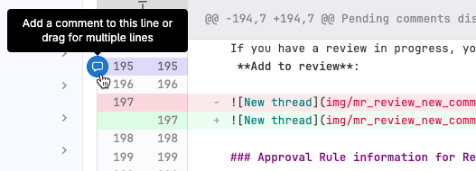
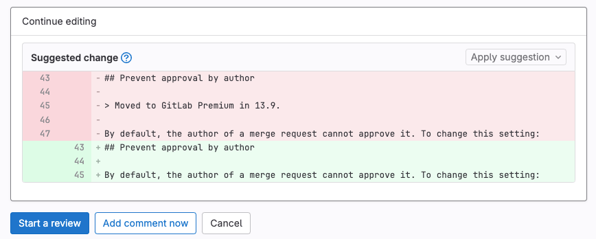
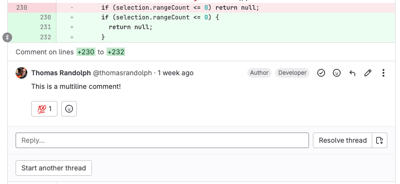
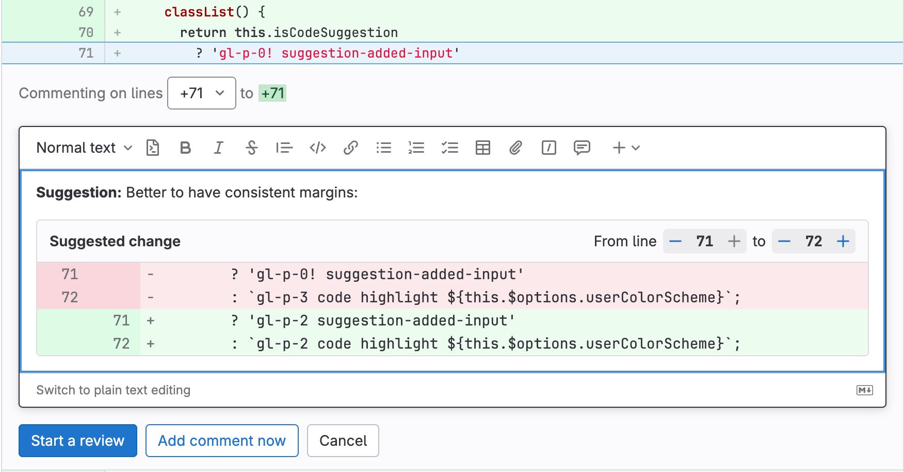



- Tier: 基础版，专业版，旗舰版
- Offering: JihuLab.com，私有化部署



审核人可以在合并请求差异讨论串中使用 Markdown 语法建议代码更改。合并请求作者（或其他具有相应角色的用户）可以从极狐GitLab UI 中应用任意或全部建议。应用建议会向合并请求添加一个提交，其作者为提出更改建议的用户。

<a id="create-suggestions"></a>

## 创建建议

1. 在顶部栏中，选择**搜索或跳转到**，然后找到您的项目。
1. 在左侧边栏中，选择**代码** > **合并请求**，然后找到您的合并请求。
1. 在二级菜单中，选择**更改**。
1. 找到您想要更改的代码行。
   - 要选择单行，请将鼠标悬停在该行号上，然后
     选择**向此行添加评论** ()。
   - 要选择多行：
     1. 将鼠标悬停在该行号上，然后选择**向此行添加评论** ()：

        

     1. 选择并拖动您的选择范围，以包含所有所需行。
        更多信息，请参见[多行建议](#multi-line-suggestions)。
   - 要对整个文件而不是特定行发表评论，请在文件的标题栏中，
     选择**对此文件发表评论** ()。
1. 在评论工具栏中，选择**插入建议** ()。极狐GitLab
   会在您的评论中插入一个预填充的代码块，如下所示：

   ````markdown
   ```suggestion:-0+0
   The content of the line you selected is shown here.
   ```
   ````

1. 编辑预填充的代码块，以添加您的建议。
1. 要立即添加您的评论，请选择**立即添加评论**，或使用键盘快捷键：
   - macOS：<kbd>Shift</kbd>+<kbd>Command</kbd>+<kbd>Enter</kbd>
   - 所有其他操作系统：<kbd>Shift</kbd>+<kbd>Control</kbd>+<kbd>Enter</kbd>
1. 要在完成[评审](_index.md)之前暂不发布您的评论，请选择
   **开始评审**，或使用键盘快捷键：
   - macOS：<kbd>Command</kbd>+<kbd>Enter</kbd>
   - 所有其他操作系统：<kbd>Control</kbd>+<kbd>Enter</kbd>

<a id="multi-line-suggestions"></a>

### 多行建议

当您评审合并请求差异时，您可以在单个建议中对多行（最多 200 行）提出更改，方法如下：

- 选择并拖动，如[创建建议](#create-suggestions)中所述。
  极狐GitLab 会为您创建一个建议块。
- 选择单行，然后手动编辑建议块中的范围偏移量。

建议第一行中的范围偏移量描述了相对于您所选行的行号。偏移量指定了您的建议打算替换的行。例如，此建议涵盖所评论行上方 2 行和下方 2 行：

````markdown
```suggestion:-2+2
## Prevent approval by author

By default, the author of a merge request cannot approve it. To change this setting:
```
````

应用后，该建议会替换从所评论行上方 2 行到下方 2 行的内容：



极狐GitLab 将多行建议限制为所评论差异行上方 100 行和下方 100 行。这样每个建议最多可更改 201 行。

多行评论会在评论正文上方显示该评论的行号：



<a id="using-the-rich-text-editor"></a>

#### 使用富文本编辑器

当您插入建议时，使用所见即所得[富文本编辑器](../../../rich_text_editor.md)在 UI 中上下移动源文件的行号。

要增加或减少更改的行，请在**起始行**旁边选择 **+** 或 **-**。



<a id="apply-suggestions"></a>

## 应用建议

先决条件：

- 您必须是合并请求的作者，或者拥有项目的开发者、维护者或所有者角色。

要直接从合并请求应用建议的更改：

1. 在顶部栏中，选择**搜索或跳转到**，然后找到您的项目。
1. 在左侧边栏中，选择**代码** > **合并请求**，然后找到您的合并请求。
1. 找到包含您想要应用的建议的评论。
   - 要单独应用建议，请选择**应用建议**。
   - 要在单个提交中应用多个建议，请选择**将建议添加到批处理**。
1. 可选。提供自定义提交消息来描述您的更改。如果您
   不提供自定义消息，则使用默认提交消息。
1. 选择**应用**。

应用建议后，极狐GitLab 会：

- 将该建议标记为**已应用**。
- 解决该评论讨论串。
- 使用这些更改创建一个新提交。
- （如果用户拥有开发者角色）将建议的更改直接推送到
  合并请求分支中的代码库。

<a id="reject-suggestions"></a>

## 拒绝建议

先决条件：

- 您必须是合并请求的作者，或者拥有项目的开发者、维护者或所有者角色。

要直接从合并请求拒绝建议的更改：

1. 在顶部栏中，选择**搜索或跳转到**，然后找到您的项目。
1. 在左侧边栏中，选择**代码** > **合并请求**，然后找到您的合并请求。
1. 找到包含您想要拒绝的建议的评论。
1. 可选。添加一条回复，说明拒绝该建议的原因。
1. 选择**解决讨论串**。

<a id="configure-the-commit-message-for-applied-suggestions"></a>

## 为已应用的建议配置提交消息

极狐GitLab 在应用建议时使用默认提交消息，但您可以更改它。此消息支持占位符。例如，默认消息
`Apply %{suggestions_count} suggestion(s) to %{files_count} file(s)` 在您将三个建议应用到两个不同文件时
呈现如下：

```plaintext
Apply 3 suggestion(s) to 2 file(s)
```

从 forks 创建的合并请求使用目标项目中定义的模板。为满足您项目的需求，请自定义这些消息并包含其他占位符变量。

先决条件：

- 您必须拥有维护者角色。

为此：

1. 在顶部栏中，选择**搜索或跳转到**，然后找到您的项目。
1. 在左侧边栏中，选择**设置** > **合并请求**。
1. 滚动到**合并建议**，并根据您的需求修改文本。
   有关可在此消息中使用的占位符列表，请参见[支持的变量](#supported-variables)。

<a id="supported-variables"></a>

### 支持的变量

已应用建议的提交消息模板支持以下变量：

| 变量               | 描述 | 输出示例 |
|------------------------|-------------|----------------|
| `%{branch_name}`       | 应用建议的目标分支名称。 | `my-feature-branch` |
| `%{files_count}`       | 应用建议的目标文件数量。| `2` |
| `%{file_paths}`        | 应用建议的目标文件路径。路径以逗号分隔。| `docs/index.md, docs/about.md` |
| `%{project_path}`      | 项目路径。 | `my-group/my-project` |
| `%{project_name}`      | 项目的可读名称。 | `My Project` |
| `%{suggestions_count}` | 已应用的建议数量。| `3` |
| `%{username}`          | 应用建议的用户的用户名。 | `user_1` |
| `%{user_full_name}`    | 应用建议的用户的全名。 | `User 1` |
| `%{co_authored_by}`    | 建议作者的姓名和电子邮件，采用 `Co-authored-by` Git 提交尾注格式。 | `Co-authored-by: Zane Doe <zdoe@example.com>` <br> `Co-authored-by: Blake Smith <bsmith@example.com>` |

例如，要将提交消息自定义为输出
`Addresses user_1's review`，请将自定义文本设置为
`Addresses %{username}'s review`。

<a id="batch-suggestions"></a>

## 批量建议

先决条件：

- 您必须拥有允许您提交到源分支的项目角色。

为减少添加到分支的提交数量，请在单个提交中应用多个建议。

1. 在顶部栏中，选择**搜索或跳转到**，然后找到您的项目。
1. 在左侧边栏中，选择**代码** > **合并请求**，然后找到您的合并请求。
1. 对于您想要应用的每个建议，选择**将建议添加到批处理**。
1. 可选。要移除某个建议，请选择**从批处理中移除**。
1. 添加您所需的建议后，选择**应用建议**。

   > [!warning]
   > 如果您应用一批包含来自多个作者的更改的建议，
   > 生成的提交会将您记为作者。如果您将项目配置为
   > [阻止添加提交的用户进行审批](../approvals/settings.md#prevent-approvals-by-users-who-add-commits)，您将不再是此合并请求的
   > 合格审批人。

1. 可选。为[批量建议](#batch-suggestions)提供自定义提交消息
   来描述您的更改。如果您不指定，则使用
   默认提交消息。
