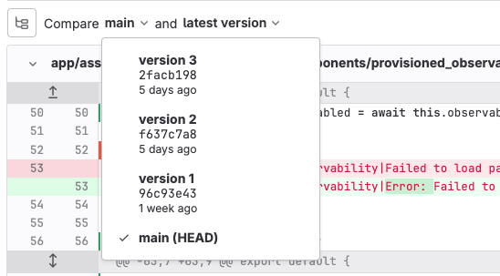
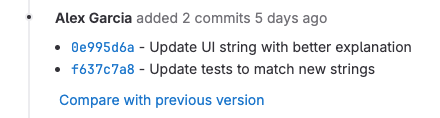



- Tier: 基础版，专业版，旗舰版
- Offering: JihuLab.com，私有化部署



创建合并请求时，您需要选择两个分支进行比较。两个分支之间的差异会以差异的形式显示在合并请求中。每当您将提交推送到与合并请求关联的分支时，极狐GitLab 都会将合并请求差异更新为新的差异版本。

> [!note]
> 差异版本在每次推送时更新，而不是每次提交时更新。如果一次推送包含多个提交，则只会创建一个新的差异版本。

默认情况下，极狐GitLab 会将源分支（`feature`）中的最新推送与目标分支（通常是 `main`）中的最新提交进行比较。

## 比较差异版本

如果您已多次推送到分支，则每次先前推送的差异版本都可供比较。当您的合并请求包含许多变更或对同一文件的连续变更时，您可能希望比较较少数量的变更。

先决条件：

- 合并请求分支必须包含来自多次推送的提交。同一次推送中的单个提交不会生成新的差异版本。

要比较差异版本：

1. 在顶部栏中，选择**搜索或跳转到**，然后找到您的项目。
1. 在左侧边栏中，选择**代码** > **合并请求**。
1. 选择一个合并请求。
1. 要查看此合并请求的当前差异版本，请选择**变更**。
1. 在**比较**（）旁边，选择要比较的推送。此示例将 `main` 与该分支的最新推送（最新差异版本）进行比较：

   

   此示例分支有四个提交，但该分支仅包含三个差异版本，因为有两个提交是同时推送的。

## 从系统评论查看差异版本

每当您向合并请求的分支推送新变更时，极狐GitLab 都会向该合并请求添加一条系统评论。在此示例中，一次推送添加了两个提交：

要查看该提交的差异，请选择提交 SHA。

有关更多信息，请参阅如何[在合并请求上显示或筛选系统评论](../system_notes.md#on-a-merge-request)。
