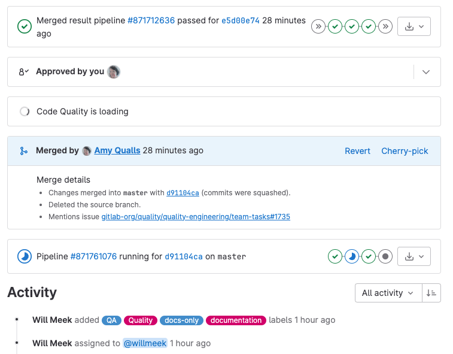



- Tier: 基础版，专业版，旗舰版
- Offering: JihuLab.com，私有化部署



合并请求的概览页面会显示对您的合并请求执行操作的服务所报告的状态更新。所有订阅级别都会显示小组件区域，但该区域的内容取决于您的订阅级别以及您为项目配置的服务。

## 流水线信息

如果您已在项目中设置 [极狐GitLab CI/CD](../../../ci/_index.md)，则[合并请求](_index.md)会在**概览**标签页的小组件区域中显示流水线信息：

- 合并前和合并后的流水线，以及环境信息（如有）。
- 哪些部署正在进行中。

如果应用成功部署到[环境](../../../ci/environments/_index.md)，则会同时显示已部署的环境以及指向[评审应用](../../../ci/review_apps/_index.md)的链接。

当流水线在合并请求中失败但仍可合并时，极狐GitLab 会以红色显示**合并**。

## 合并后流水线状态

合并合并请求后，您可以查看该合并请求所合并到的分支的合并后流水线状态。例如，当合并请求合并到[默认分支](../repository/branches/default.md)，然后触发向预发布环境的部署时。

极狐GitLab 会显示正在进行的部署，以及环境的状态（部署中或已部署）。如果这是该分支的首次部署，在完成之前该链接会返回 `404` 错误。在部署期间，极狐GitLab 会禁用停止按钮。如果流水线部署失败，极狐GitLab 会隐藏部署信息。

更多信息，请[阅读有关流水线的内容](../../../ci/pipelines/_index.md)。

## 设置自动合并

将看起来已准备好合并的合并请求设置为[在 CI 流水线成功时自动合并](auto_merge.md)。

## 使用评审应用进行实时预览

为您的项目配置[评审应用](../../../ci/review_apps/_index.md)，以便按分支预览通过合并请求提交到功能分支的更改。您无需检出该分支、在本地安装并预览。任何拥有评审应用链接的人都可以预览您的所有更改。

设置极狐GitLab [路由映射](../../../ci/review_apps/_index.md#route-maps)后，合并请求小组件会直接带您前往已更改的页面，从而更轻松、更快速地预览所提议的修改。

更多信息，请参见[评审应用](../../../ci/review_apps/_index.md)。

## 许可证合规

有关合并请求中的许可证合规信息，请参见[合并请求报告](reports.md)。

## 安全策略



- Tier: 旗舰版
- Offering: JihuLab.com，私有化部署



为防止开发者合并含有漏洞或使用不受支持许可证的更改，或在合并请求中强制执行必需的审批，请配置[安全策略](../../application_security/policies/merge_request_approval_policies.md)。您可以为项目、群组或实例配置安全策略。您也可以选择将安全策略设置为警告模式，以便让相关人员了解发现的问题，同时不阻止开发者进行合并。

## 外部状态检查



- Tier: 旗舰版
- Offering: JihuLab.com，私有化部署



如果您已配置[外部状态检查](status_checks.md)，则可以在合并请求中[通过特定小组件](status_checks.md#status-checks-widget)查看这些检查的状态。

## 应用安全扫描

有关合并请求中的应用安全扫描结果，请参见[合并请求报告](reports.md)。
