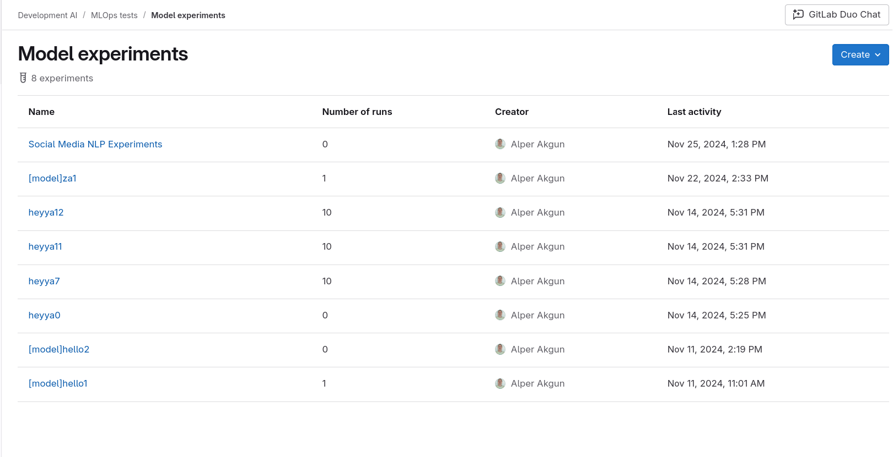
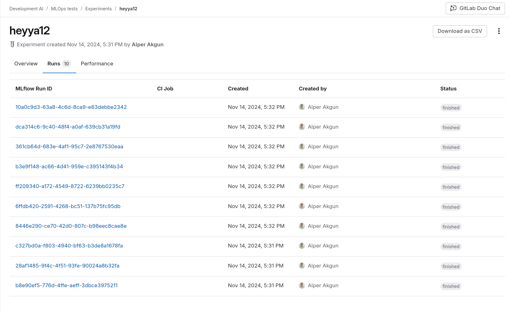
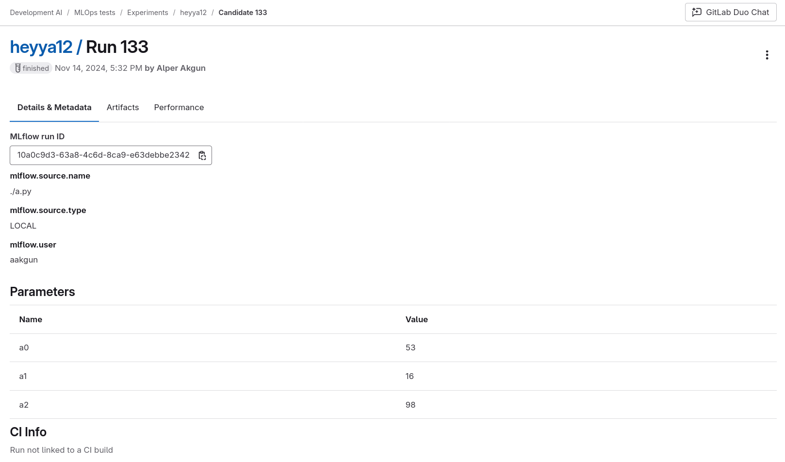
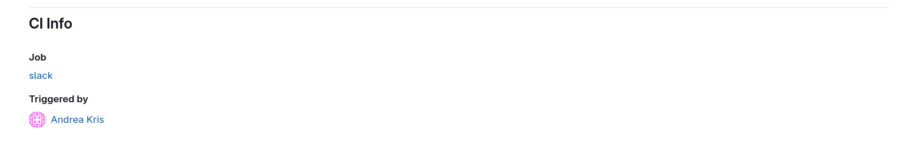
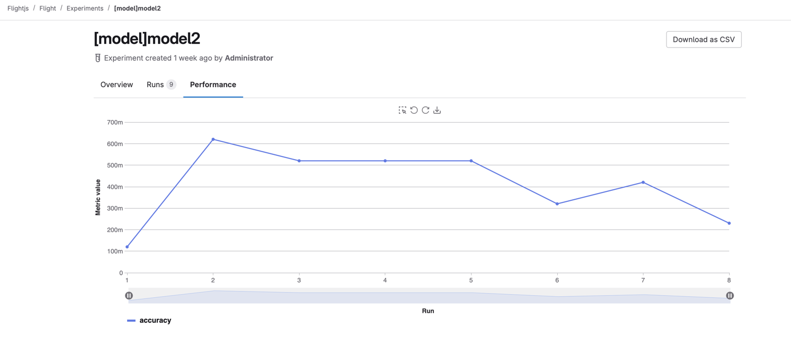



- Tier: 基础版，专业版，旗舰版
- Offering: JihuLab.com，私有化部署



在创建机器学习模型时，您可能会尝试不同的参数、配置和特征工程，以提升模型性能。为了之后能够复现您的实验，您需要有效地跟踪元数据和产物。使用极狐GitLab 模型实验，可以直接在极狐GitLab 中跟踪并记录参数、指标和产物。

## 什么是实验？

在项目中，实验是一组可比较的模型运行集合。实验可以是长期存在的（例如，当它们代表一个用例时），也可以是短期的（由合并请求触发的超参数调优结果），但通常包含一组具有相似参数集、并由相同指标衡量的模型运行。

## 模型运行

模型运行是机器学习模型训练的一种变体，最终可以提升为模型的某个版本。

数据科学家的目标是找到参数值能带来最佳模型性能的模型运行，这由给定指标来体现。

一些参数示例：

- 算法（例如线性回归问题或决策树）。
- 算法的超参数（学习率、树深度、轮数）。
- 包含的特征。

## 跟踪新实验和运行

实验和试验只能通过
[MLflow](https://www.mlflow.org/docs/latest/tracking/) 客户端兼容性进行跟踪。
有关如何将极狐GitLab 用作 MLflow 客户端后端的更多信息，请参见 [MLflow 客户端兼容性](mlflow_client.md)。

## 探索模型运行

要列出当前活跃的实验：

1. 在顶部栏中，选择**搜索或跳转到**并找到您的项目。
1. 在左侧边栏中，选择**分析** > **模型实验**。
1. 要显示所有已记录的运行及其指标、参数和元数据，请选择一个实验。
1. 要显示某个运行的详情，请选择**详情**。

## 查看日志产物

试验产物会保存为软件包。为某个运行记录产物后，该运行记录的所有产物都会列在软件包仓库中。某个运行的软件包名称是 `ml_experiment_<experiment_id>`，其中版本是运行 IID。也可以从**实验运行**列表或**运行详情**访问产物链接。

## 查看 CI 信息

您可以将运行与创建它们的 CI 作业关联起来，从而快速访问合并请求、流水线以及触发该流水线的用户：

## 查看已记录的指标

运行实验时，极狐GitLab 会记录某些相关数据，包括其指标、参数和元数据。您可以在图表中查看这些指标以进行分析。

要查看已记录的指标：

1. 在顶部栏中，选择**搜索或跳转到**并找到您的项目。
1. 在左侧边栏中，选择**分析** > **模型实验**。
1. 选择您要查看的实验。
1. 选择**性能**选项卡。

