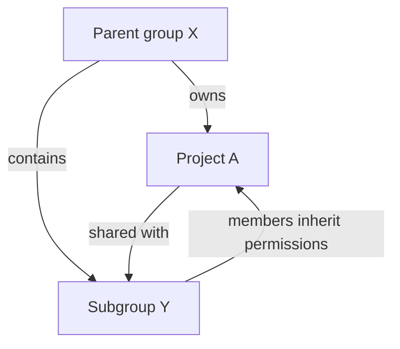
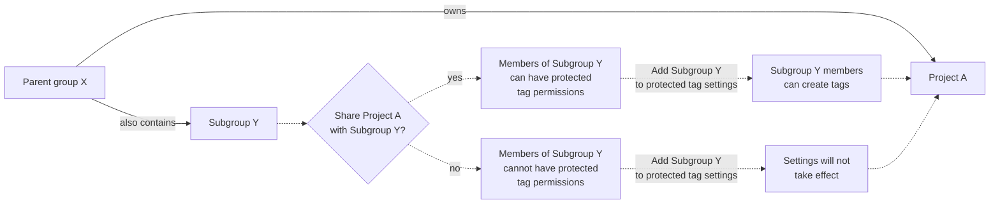



- Tier: 基础版，专业版，旗舰版
- Offering: JihuLab.com，私有化部署



受保护的[标签](repository/tags/_index.md)：

- 允许控制谁有权限创建标签。
- 防止创建后意外更新或删除。

每条规则都允许您匹配以下任一内容：

- 单个标签名称。
- 通配符，用于一次控制多个标签。

此功能源自[受保护分支](repository/branches/protected.md)。

> [!note]
> 要创建或删除受保护标签，您必须位于该受保护标签的**允许创建**列表中。

<a id="configure-protected-tags"></a>

## 配置受保护标签

先决条件：

- 您必须拥有该项目的维护者或所有者角色。

1. 在顶部栏中，选择**搜索或跳转到**，然后找到您的项目。
1. 在左侧边栏中，选择**设置** > **代码仓库**。
1. 展开**受保护标签**。
1. 选择**添加新项**。
1. 要保护单个标签，请选择**标签**，然后从下拉列表中选择您的标签。
1. 要保护名称匹配某个字符串的所有标签：
   1. 选择**标签**。
   1. 输入用于标签匹配的字符串。支持通配符（`*`）。
   1. 选择**创建通配符**。
1. 在**允许创建**中，选择可以创建受保护标签的角色。

   > [!note]
   > 在极狐GitLab 专业版和旗舰版中，您还可以将群组或单个用户
   > 添加到**允许创建**。

1. 选择**保护**。

受保护标签（或通配符）会显示在**受保护标签**列表中。

<a id="add-a-group-to-protected-tags"></a>

### 将群组添加到受保护标签

要将群组或子群组的成员设置为允许创建受保护标签：

1. 在左侧边栏中，选择**搜索或跳转到**，然后找到您的项目。
1. 选择**设置** > **代码仓库**。
1. 展开**受保护标签**。
1. 将群组添加到以下字段：

   ```plaintext
   # Allow group members to create protected tags
   Allowed to create: @group-x
   ```

<a id="group-inheritance-and-eligibility"></a>

#### 群组继承与资格



在此示例中：

- 父群组 X（`group-x`）拥有项目 A。
- 父群组 X 还包含一个子群组，即子群组 Y。（`group-x/subgroup-y`）
- 项目 A 与子群组 Y 共享。

符合受保护标签权限资格的群组为：

- 项目 A：群组 X 和子群组 Y，因为项目 A 与子群组 Y 共享。

<a id="share-projects-with-groups"></a>

#### 与群组共享项目

您可以将项目与群组或子群组共享，使其成员符合受保护标签权限的资格。



要授予子群组 Y 成员对项目 A 的访问权限，您必须将该项目与该子群组共享。将子群组直接添加到受保护标签设置中不会生效，也不适用于子群组成员。

> [!note]
> 群组要拥有受保护标签权限，项目必须直接与该群组共享。
> 从父群组继承的项目成员资格不足以获得受保护标签权限。

<a id="wildcard-protected-tags"></a>

## 通配符受保护标签

您可以指定通配符受保护标签，它会保护所有匹配该通配符的标签。例如：

| 通配符受保护标签 | 匹配的标签                 |
|------------------------|-------------------------------|
| `v*`                   | `v1.0.0`, `version-9.1`       |
| `*-deploy`             | `march-deploy`, `1.0-deploy`  |
| `*gitlab*`             | `gitlab`, `gitlab/v1`         |
| `*`                    | `v1.0.1rc2`, `accidental-tag` |

两个不同的通配符可能会匹配同一个标签。例如，`*-stable` 和 `production-*` 都会匹配 `production-stable` 标签。在这种情况下，如果这些受保护标签中*任一*个具有类似**允许创建**的设置，那么 `production-stable` 也会继承该设置。

如果您选择某个受保护标签的名称，极狐GitLab 会显示所有匹配标签的列表。

<a id="allow-deploy-keys-to-create-protected-tags"></a>

## 允许部署密钥创建受保护标签

您可以允许[部署密钥](deploy_keys/_index.md)创建受保护标签。

先决条件：

- 该部署密钥必须已为您的项目启用。项目部署密钥在创建时默认启用。
  但是，公共部署密钥必须
  [被授予](deploy_keys/_index.md#grant-project-access-to-a-public-deploy-key)对项目的
  访问权限。
- 该部署密钥必须对您的项目代码仓库具有[写入权限](deploy_keys/_index.md#permissions)。
- 该部署密钥的所有者必须至少对项目具有读取权限。
- 该部署密钥的所有者还必须是该项目的成员。

要允许部署密钥创建受保护标签：

1. 在顶部栏中，选择**搜索或跳转到**，然后找到您的项目。
1. 在左侧边栏中，选择**设置** > **代码仓库**。
1. 展开**受保护标签**。
1. 从**标签**下拉列表中，选择您要保护的标签。
1. 从**允许创建**列表中，选择该部署密钥。
1. 选择**保护**。

<a id="prevent-tag-creation-with-branch-names"></a>

## 防止创建与分支同名的标签

名称相同的标签和分支可以包含不同的提交。如果您的标签和分支使用相同的名称，运行 `git checkout` 命令的用户可能会检出*标签* `qa`，而他们本意是检出*分支* `qa`。作为一项额外的安全措施，请避免创建与分支同名的标签。混淆两者可能会导致潜在的安全或运维问题。

要防止此问题：

1. 确定您不希望用作标签的分支名称。
1. 按照[配置受保护标签](#configure-protected-tags)中所述创建受保护标签：

   - 对于**名称**，提供一个名称，例如 `stable`。您也可以创建通配符，
     例如 `stable-*`，以匹配多个名称，如 `stable-v1` 和 `stable-v2`。
   - 对于**允许创建**，选择**无人**。
   - 选择**保护**。

用户仍然可以创建使用这些受保护名称的分支，但不能创建标签。

<a id="run-pipelines-on-protected-tags"></a>

## 在受保护标签上运行流水线

创建受保护标签的权限决定了用户是否可以：

- 发起并运行 CI/CD 流水线。
- 对与这些标签关联的作业执行操作。

这些权限确保只有授权用户才能触发和管理受保护标签的 CI/CD 流程。

<a id="unprotect-a-tag"></a>

## 取消保护标签

您可以通过移除标签的保护规则来取消保护该标签。此操作会移除保护配置，而不是标签本身。该标签仍保留在代码仓库中，但不再受保护。

先决条件：

- 您必须拥有维护者或所有者角色。

要取消保护标签：

1. 在顶部栏中，选择**搜索或跳转到**，然后找到您的项目。
1. 在左侧边栏中，选择**设置** > **代码仓库**。
1. 展开**受保护标签**。
1. 在您要移除的受保护标签规则旁边，选择**取消保护**。

> [!warning]
> 取消保护某个标签模式后，任何拥有开发者、维护者或所有者角色的用户
> 都可以删除匹配该模式的标签。

<a id="delete-a-protected-tag"></a>

## 删除受保护标签

您可以删除已应用保护规则的标签。这会从代码仓库中移除该标签，而不是移除保护规则本身。如果您想在不删除标签的情况下移除保护规则，请参阅[取消保护标签](#unprotect-a-tag)。

先决条件：

- 位于该标签的角色或用户**允许创建**列表中。
- 在项目中拥有维护者或所有者角色。

要删除受保护标签：

1. 在顶部栏中，选择**搜索或跳转到**，然后找到您的项目。
1. 在左侧边栏中，选择**代码** > **标签**。
1. 在您要删除的标签旁边，选择**删除**（）。
1. 在确认对话框中，输入标签名称并选择**是，删除受保护标签**。

受保护标签只能通过极狐GitLab 的 UI 或 API 删除。这些保护措施可防止您通过本地 Git 命令或第三方 Git 客户端意外删除标签。
