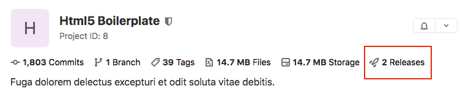
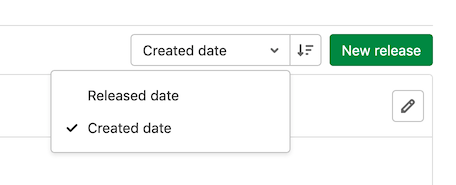
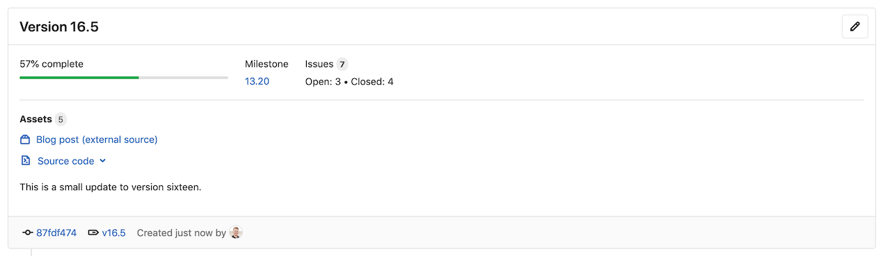
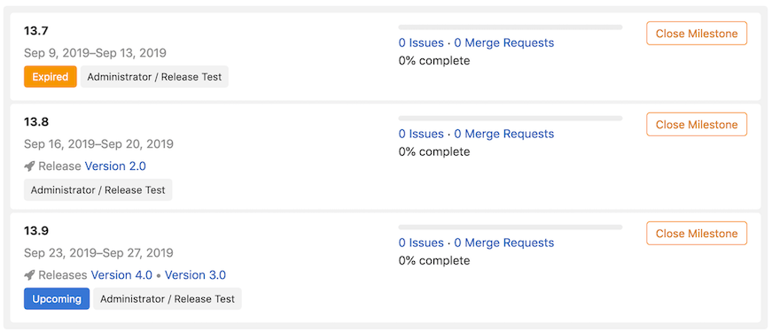
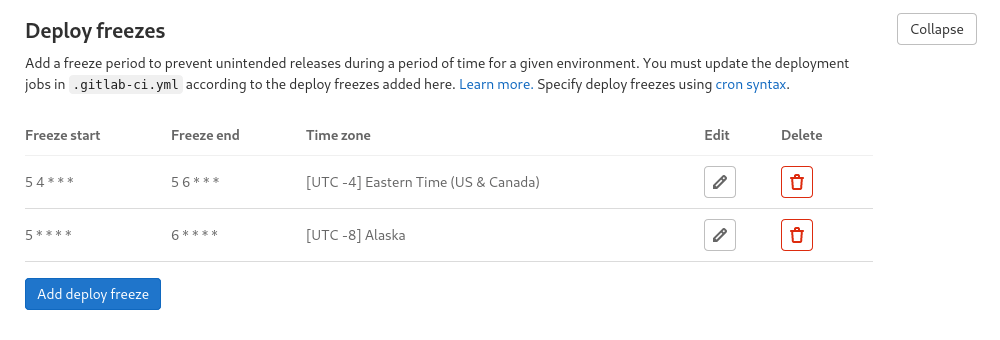



- Tier: 基础版，专业版，旗舰版
- Offering: JihuLab.com，私有化部署



创建发布，以便在关键里程碑为项目打包。发布将代码、二进制文件、文档和发布说明整合为项目的完整快照。创建发布时，极狐GitLab 会自动为您的代码打标签、归档快照，并生成可供审计的证据。这会创建一份永久记录，非常适合满足合规要求，也能让您的用户对您的开发流程更有信心。

您的用户将受益于：

- 轻松获取最新的稳定版本和安装包
- 清晰的新功能和修复文档
- 能够下载特定版本及其对应的资产
- 轻松跟踪项目随时间演变的简单方式

> [!warning]
> 删除与发布关联的 Git 标签也会删除该发布。

创建发布时或创建后，您可以：

- 添加发布说明。
- 为与该发布关联的 Git 标签添加消息。
- [将其与里程碑关联](#associate-milestones-with-a-release)。
- 附加[发布资产](release_fields.md#release-assets)，例如 Runbook 或软件包。

<a id="view-releases"></a>

## 查看发布

要查看发布列表：

- 在左侧边栏中，选择**部署** > **发布**，或
- 在项目概览页面上，如果至少存在一个发布，选择发布数量。

  

  - 在公开项目中，所有用户都可以看到此数量。
  - 在私有项目中，至少具有报告者[角色](../../permissions.md#project-permissions)的用户可以看到此数量。

<a id="sort-releases"></a>

### 排序发布

要按**发布日期**或**创建日期**对发布进行排序，请从排序顺序下拉列表中选择。要在升序或降序之间切换，请选择**排序顺序**。



<a id="permanent-link-to-latest-release"></a>

### 最新发布的永久链接

您可以通过永久链接访问最新发布页面。极狐GitLab 始终将永久链接 URL 重定向到最新发布页面的地址。

URL 的格式为：

```plaintext
https://gitlab.example.com/namespace/project/-/releases/permalink/latest
```

您还可以在永久链接 URL 后添加后缀。例如，如果最新发布是 `v17.7.0#release`，位于 `gitlab-org` 命名空间和 `gitlab-runner` 项目中，则可读链接将是：

```plaintext
https://gitlab.com/gitlab-org/gitlab-runner/-/releases/v17.7.0#release
```

您可以通过以下永久链接访问最新发布 URL：

```plaintext
https://gitlab.com/gitlab-org/gitlab-runner/-/releases/permalink/latest#release
```

要了解如何为发布资产添加永久链接，请参阅[最新发布资产的永久链接](release_fields.md#permanent-links-to-latest-release-assets)。

<a id="sorting-preferences"></a>

#### 排序偏好

默认情况下，极狐GitLab 使用 `released_at` 时间获取发布。查询参数 `?order_by=released_at`的使用是可选的，对 `?order_by=semver`的支持正在[此议题](https://gitlab.com/gitlab-org/gitlab/-/issues/352945)中跟踪。

<a id="track-releases-with-an-rss-feed"></a>

### 使用 RSS 订阅跟踪发布

极狐GitLab 提供项目发布的 RSS 订阅。要查看订阅：

1. 对于您是其成员的项目：
   1. 在顶部栏中，选择**搜索或跳转到**并找到您的项目。
   1. 选择**部署** > **发布**。
1. 对于所有项目：
   1. 转到**项目概览**页面。
   1. 在右侧边栏中，选择**发布**（）。
1. 在右上角，选择订阅符号（）。

<a id="create-a-release"></a>

## 创建发布

您可以通过以下方式创建发布：

- [在 CI/CD 流水线中使用作业](#creating-a-release-by-using-a-cicd-job)。
- [在发布页面中](#create-a-release-in-the-releases-page)。
- 使用 [Releases API](../../../api/releases/_index.md#create-a-release)。

<a id="create-a-release-in-the-releases-page"></a>

### 在发布页面中创建发布

先决条件：

- 您必须具有项目的开发者、维护者或所有者角色。有关更多信息，请阅读
  [发布权限](#release-permissions)。

要在发布页面中创建发布：

1. 在顶部栏中，选择**搜索或跳转到**并找到您的项目。
1. 在左侧边栏中，选择**部署** > **发布**，然后选择**新建发布**。
1. 从[**标签名称**](release_fields.md#tag-name)下拉列表中，执行以下任一操作：
   - 选择现有的 Git 标签。选择已与发布关联的现有标签会导致验证错误。
   - 输入新的 Git 标签名称。
     1. 从**创建标签**弹出框中，选择创建新标签时要使用的分支或提交 SHA。
     1. 可选。在**设置标签消息**文本框中，输入消息以创建
        [附注标签](https://git-scm.com/book/en/v2/Git-Basics-Tagging#_annotated_tags)。
     1. 选择**保存**。
1. 可选。输入有关发布的其他信息，包括：
   - [标题](release_fields.md#title)。
   - [里程碑](#associate-milestones-with-a-release)。
   - [发布说明](release_fields.md#release-notes-description)。
   - 是否包含[标签消息](../repository/tags/_index.md)。
   - [资产链接](release_fields.md#links)。
1. 选择**创建发布**。

<a id="creating-a-release-by-using-a-cicd-job"></a>

### 使用 CI/CD 作业创建发布

您可以通过在作业定义中使用 [`release` 关键字](../../../ci/yaml/_index.md#release)，直接在极狐GitLab CI/CD 流水线中创建发布。
您通常应该将创建发布作为 CI/CD 流水线的最后步骤之一。

只有当作业无错误地处理完成时，才会创建发布。如果在创建发布期间 API 返回错误，则发布作业会失败。

以下链接展示了使用 CI/CD 作业创建发布的典型示例配置：

- [创建 Git 标签时创建发布](release_cicd_examples.md#create-a-release-when-a-git-tag-is-created)。
- [提交合并到默认分支时创建发布](release_cicd_examples.md#create-a-release-when-a-commit-is-merged-to-the-default-branch)。
- [在自定义脚本中创建发布元数据](release_cicd_examples.md#create-release-metadata-in-a-custom-script)。

<a id="use-a-custom-ssl-ca-certificate-authority"></a>

### 使用自定义 SSL CA 证书颁发机构

您可以使用 `ADDITIONAL_CA_CERT_BUNDLE` CI/CD 变量来配置自定义 SSL CA 证书颁发机构，当 `glab` CLI 通过使用自定义证书的 HTTPS 调用 API 创建发布时，该证书颁发机构用于验证对端。
`ADDITIONAL_CA_CERT_BUNDLE`的值应包含
[X.509 PEM 公钥证书的文本表示](https://www.rfc-editor.org/rfc/rfc7468#section-5.1)
或包含证书颁发机构的 `path/to/file`。
例如，要在 `.gitlab-ci.yml` 文件中配置此值，请使用以下内容：

```yaml
release:
  variables:
    ADDITIONAL_CA_CERT_BUNDLE: |
        -----BEGIN CERTIFICATE-----
        MIIGqTCCBJGgAwIBAgIQI7AVxxVwg2kch4d56XNdDjANBgkqhkiG9w0BAQsFADCB
        ...
        jWgmPqF3vUbZE0EyScetPJquRFRKIesyJuBFMAs=
        -----END CERTIFICATE-----
  script:
    - echo "Create release"
  release:
    name: 'My awesome release'
    tag_name: '$CI_COMMIT_TAG'
```

`ADDITIONAL_CA_CERT_BUNDLE`的值也可以配置为
[UI 中的自定义变量](../../../ci/variables/_index.md#for-a-project)，
既可以作为 `file`（需要证书的路径），也可以作为变量（需要证书的文本表示）。

<a id="create-multiple-releases-in-a-single-pipeline"></a>

### 在单个流水线中创建多个发布

一个流水线可以有多个 `release` 作业，例如：

```yaml
ios-release:
  script:
    - echo "iOS release job"
  release:
    tag_name: v1.0.0-ios
    description: 'iOS release v1.0.0'

android-release:
  script:
    - echo "Android release job"
  release:
    tag_name: v1.0.0-android
    description: 'Android release v1.0.0'
```

<a id="release-assets-as-generic-packages"></a>

### 将发布资产作为 Generic 软件包

您可以使用 [Generic 软件包](../../packages/generic_packages/_index.md)来托管您的发布资产。

要创建带有打包资产的发布：

1. 从 CI/CD 流水线中构建您的软件包文件。
1. 使用 `glab` CLI 作业创建发布：

   ```yaml
   Create Release:
     stage: release
     image: registry.gitlab.com/gitlab-org/cli:latest
     rules:
       - if: $CI_COMMIT_TAG
     script:
       - |
         glab release create "$CI_COMMIT_TAG" \
         --name "Release ${VERSION}" \
         --notes "Your release notes here" \
         path/to/your/release-asset-file \
         --use-package-registry
   ```

   对于您想要包含的每个资产，添加一个额外的 `--assets-link` 链接。

<a id="upcoming-releases"></a>

## 即将发布的版本

您可以使用 [Releases API](../../../api/releases/_index.md#upcoming-releases) 提前创建发布。
当您设置未来的 `released_at` 日期时，发布标签旁边会显示一个**即将发布**徽章。当 `released_at` 日期和时间过去后，该徽章会自动移除。


<a id="historical-releases"></a>

## 历史发布

您可以使用 [Releases API](../../../api/releases/_index.md#historical-releases) 或 UI 创建过去的发布。当您设置过去的 `released_at` 日期时，发布标签旁边会显示一个**历史发布**徽章。由于是在过去发布的，[发布证据](release_evidence.md)不可用。

<a id="edit-a-release"></a>

## 编辑发布

要在创建后编辑发布的详细信息，您可以使用
[更新发布 API](../../../api/releases/_index.md#update-a-release) 或 UI。

先决条件：

- 您必须具有开发者、维护者或所有者角色。

在 UI 中：

1. 在左侧边栏中，选择**部署** > **发布**。
1. 在您要修改的发布的右上角，选择**编辑此发布**（铅笔图标）。
1. 在**编辑发布**页面上，更改发布的详细信息。
1. 选择**保存更改**。

<a id="delete-a-release"></a>

## 删除发布

删除发布时，其资产也会被删除。但是，关联的 Git 标签不会被删除。删除与发布关联的 Git 标签也会删除该发布。

先决条件：

- 您必须具有开发者、维护者或所有者角色。阅读有关[发布权限](#release-permissions)的更多信息。

要删除发布，请使用
[删除发布 API](../../../api/releases/_index.md#delete-a-release) 或 UI。

在 UI 中：

1. 在顶部栏中，选择**搜索或跳转到**并找到您的项目。
1. 在左侧边栏中，选择**部署** > **发布**。
1. 在您要删除的发布的右上角，选择**编辑此发布**
   （）。
1. 在**编辑发布**页面上，选择**删除**。
1. 选择**删除发布**。

<a id="associate-milestones-with-a-release"></a>

## 将里程碑与发布关联

您可以将发布与一个或多个[项目里程碑](../milestones/_index.md#project-milestones-and-group-milestones)关联。

[极狐GitLab 专业版](https://gitlab.cn/pricing)客户可以指定[群组里程碑](../milestones/_index.md#project-milestones-and-group-milestones)以与发布关联。

您可以在用户界面中执行此操作，也可以在向 [Releases API](../../../api/releases/_index.md#create-a-release) 发出的请求中包含 `milestones` 数组。

在用户界面中，要将里程碑关联到发布：

1. 在左侧边栏中，选择**部署** > **发布**。
1. 在您要修改的发布的右上角，选择**编辑此发布**（铅笔图标）。
1. 从**里程碑**列表中，选择您要关联的每个里程碑。您可以选择多个里程碑。
1. 选择**保存更改**。

在**部署** > **发布**页面上，**里程碑**列在顶部区域，并附有里程碑中议题的统计信息。



发布也会显示在**计划** > **里程碑**页面上，并且当您在此页面上选择里程碑时也会显示。

以下是无发布、一个发布和两个发布的里程碑示例。



> [!note]
> 子群组的项目发布不能与父群组的里程碑关联。要了解更多信息，请阅读议题 #328054，
> [发布无法与上级群组里程碑关联](https://gitlab.com/gitlab-org/gitlab/-/issues/328054)。

<a id="get-notified-when-a-release-is-created"></a>

## 创建发布时获得通知

当您的项目创建新发布时，您可以通过电子邮件收到通知。

要订阅发布通知：

1. 在左侧边栏中，选择**项目概览**。
1. 选择**通知设置**（铃铛图标）。
1. 在列表中，选择**自定义**。
1. 选中**新发布**复选框。
1. 关闭对话框以保存。

<a id="prevent-unintentional-releases-by-setting-a-deploy-freeze"></a>

## 通过设置部署冻结来防止意外发布

通过设置[*部署冻结*期](../../../ci/environments/deployment_safety.md)，防止在您指定的时间段内发生意外的生产发布。
部署冻结有助于在自动化部署时减少不确定性和风险。

维护者可以在用户界面中设置部署冻结窗口，或使用[冻结期 API](../../../api/freeze_periods.md) 设置 `freeze_start` 和 `freeze_end`，它们被定义为 [crontab](https://crontab.guru/) 条目。

如果正在执行的作业处于冻结期内，极狐GitLab CI/CD 会创建一个名为 `$CI_DEPLOY_FREEZE`的环境变量。

要防止部署作业在群组中的多个项目中执行，请在群组共享的文件中定义 `.freezedeployment` 作业。使用 [`includes`](../../../ci/yaml/includes.md) 关键字将模板合并到您项目的 `.gitlab-ci.yml` 文件中：

```yaml
.freezedeployment:
  stage: deploy
  before_script:
    - '[[ ! -z "$CI_DEPLOY_FREEZE" ]] && echo "INFRASTRUCTURE OUTAGE WINDOW" && exit 1; '
  rules:
    - if: '$CI_DEPLOY_FREEZE'
      when: manual
      allow_failure: true
    - when: on_success
```

要防止部署作业执行，请在您 `.gitlab-ci.yml` 文件的 `deploy_to_production` 作业中使用 [`extends`](../../../ci/yaml/_index.md#extends) 关键字，以从 `.freezedeployment` 模板作业继承配置：

```yaml
deploy_to_production:
  extends: .freezedeployment
  script: deploy_to_prod.sh
  environment: production
```

此配置有条件地阻止部署作业，并保持流水线的连续性。定义冻结期后，作业会失败，流水线可以在不部署的情况下继续。冻结期结束后可以手动部署。

这种方法在关键维护期间提供部署控制，并确保 CI/CD 流水线的不间断流动。

要在 UI 中设置部署冻结窗口，请完成以下步骤：

1. 以具有维护者角色的用户身份登录极狐GitLab。
1. 在顶部栏中，选择**搜索或跳转到**并找到您的项目。
1. 在左侧边栏中，选择**设置** > **CI/CD**。
1. 滚动到**部署冻结**。
1. 选择**展开**以查看部署冻结表。
1. 选择**添加部署冻结**以打开部署冻结模态框。
1. 输入所需部署冻结期的开始时间、结束时间和时区。
1. 在模态框中选择**添加部署冻结**。
1. 保存部署冻结后，您可以通过选择编辑按钮（）进行编辑，并通过选择删除按钮（）将其移除。
   

如果项目包含多个冻结期，则所有冻结期都适用。如果它们重叠，则冻结覆盖完整的重叠期。

有关更多信息，请参阅[部署安全](../../../ci/environments/deployment_safety.md)。

<a id="release-permissions"></a>

## 发布权限

<a id="view-a-release-and-download-assets"></a>

### 查看发布和下载资产

- 具有报告者、开发者、维护者或所有者角色的用户
  对项目发布具有读取和下载权限。
- 具有访客角色的用户
  对项目发布具有读取和下载权限。
  这包括关联的 Git 标签名称、发布描述和发布的作者信息。
  但是，其他与代码仓库相关的信息，例如[源代码](release_fields.md#source-code)和
  [发布证据](release_evidence.md)会被隐藏。

<a id="publish-releases-without-giving-access-to-source-code"></a>

### 在不授予源代码访问权限的情况下发布

您可以让非项目成员访问发布，同时将与代码仓库相关的信息（例如[源代码](release_fields.md#source-code)和[发布证据](release_evidence.md)）仅对项目成员可用。这些设置非常适合那些使用发布来提供新软件版本访问权限，但不希望源代码公开可用的项目。

要公开提供发布，请设置以下[项目设置](../settings/_index.md#configure-project-features-and-permissions)：

- **项目可见性**设置为**公开**
- **代码仓库**已启用并设置为**仅项目成员**
- **发布**已启用并设置为**所有有访问权限的人**

<a id="create-update-and-delete-a-release-and-its-assets"></a>

### 创建、更新和删除发布及其资产

- 具有开发者、维护者或所有者角色的用户
  对项目发布和资产具有写入权限。
- 如果发布与[受保护标签](../protected_tags.md)关联，
  用户还必须[被允许创建受保护标签](../protected_tags.md#configure-protected-tags)。

作为发布权限控制的示例，您可以只允许具有维护者或所有者角色的用户创建、更新和删除发布，方法是使用通配符（`*`）保护标签，并在**允许创建**列中设置**维护者**。

<a id="release-metrics"></a>

## 发布指标



- Tier: 旗舰版
- Offering: JihuLab.com，私有化部署



群组级发布指标可通过导航到**群组** > **分析** > **CI/CD** 获得。这些指标包括：

- 群组中的发布总数
- 群组中至少有一个发布的项目的百分比

<a id="working-example-project"></a>

## 可操作的示例项目

引导式探索项目[使用 GitVersion 实现全自动软件和工件版本管理](https://gitlab.com/guided-explorations/devops-patterns/utterly-automated-versioning)演示了：

- 使用极狐GitLab 发布。
- 使用 [GitLab CLI](../../../editor_extensions/gitlab_cli/_index.md)。
- 创建 Generic 软件包。
- 将软件包链接到发布。
- 使用名为 [GitVersion](https://gitversion.net/)的工具为复杂代码仓库自动确定和递增版本。

您可以将示例项目复制到您自己的群组或实例中进行测试。有关演示的其他极狐GitLab CI 模式的更多详细信息，请访问项目页面。

<a id="troubleshooting"></a>

## 故障排除

<a id="errors-when-creating-updating-or-deleting-releases-and-their-assets"></a>

### 创建、更新或删除发布及其资产时出错

如果发布与[受保护标签](../protected_tags.md)关联，
UI/API 请求可能会导致授权失败，例如：

- `403 Forbidden`
- `Something went wrong while creating a new release`

请确保用户或服务/机器人账号也被允许
[创建受保护标签](../protected_tags.md#configure-protected-tags)。

有关更多信息，请参阅[发布权限](#release-permissions)。

<a id="note-about-storage"></a>

### 关于存储的说明

此功能构建在 Git 标签之上，因此除了创建发布本身所需的内容外，几乎不需要额外的数据。附加资产和自动生成的发布证据会消耗存储空间。

<a id="gitlab-cli-version-requirement"></a>

### GitLab CLI 版本要求

使用 [`release` 关键字](../../../ci/yaml/_index.md#release)的方式计划更改。
`release-cli` 工具正在[被替换](https://gitlab.com/groups/gitlab-org/-/epics/15437)为 [GitLab CLI 工具](https://jihulab.com/gitlab-cn/cli)。

您必须使用 GitLab CLI 工具 `v1.58.0` 或更高版本，否则您可能会收到以下错误消息或警告之一：

- `Error: glab command not found. Please install glab v1.58.0 or higher.`
- `Error: Please use glab v1.58.0 or higher.`
- `Warning: release-cli will not be supported after 20.0. Please use glab version >= 1.58.0.`

有两种方法可以拥有 GitLab CLI 工具：

- 如果您使用 `registry.gitlab.com/gitlab-org/release-cli:<version>` 容器镜像，
  您可以开始使用 `registry.gitlab.com/gitlab-org/cli:v1.58.0` 或
  `registry.gitlab.com/gitlab-org/release-cli:v0.24.0`，其中包含 `glab` `v1.58.0`。
- 如果您在 Runner 上手动安装了 release-cli 或 GitLab CLI 工具，
  请确保 GitLab CLI 版本至少为 `v1.58.0`。
