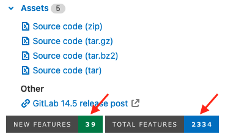

创建或编辑发布时，以下字段可用。

<a id="title"></a>

## 标题

创建或编辑发布时，可以使用**发布标题**字段自定义发布标题。如果未提供标题，则使用发布的标签名称。

<a id="tag-name"></a>

## 标签名称

发布标签名称应包含发布版本。极狐GitLab 使用[语义化版本控制](https://semver.org/)进行发布，您也可以使用它。请使用 `(Major).(Minor).(Patch)`，详见[极狐GitLab 版本控制策略](../../../policy/maintenance.md#versioning)。

例如，对于极狐GitLab 版本 `16.10.1`：

- `16` 代表主版本。主版本发布为 `16.0.0`，但通常称为 `16.0`。
- `10` 代表次版本。次版本发布为 `16.10.0`，但通常称为 `16.10`。
- `1` 代表补丁编号。

版本号的任何部分都可以是多位数字，例如 `16.10.11`。

<a id="release-notes-description"></a>

## 发布说明描述

每个发布都有描述。您可以添加任何您喜欢的文本，但建议包含变更日志来描述发布内容。这有助于用户快速浏览您发布的每个版本之间的差异。

通过选择**在发布说明中包含标签消息**，可以将 [Git 中的标签消息](https://git-scm.com/book/en/v2/Git-Basics-Tagging)包含在发布说明描述中。

描述支持 [Markdown](../../markdown.md)。

<a id="release-assets"></a>

## 发布资产

发布包含以下类型的资产：

- [源代码](#source-code)
- [相关材料链接](#links)

<a id="source-code"></a>

### 源代码

极狐GitLab 会自动从给定的 Git 标签生成 `zip`、`tar.gz`、`tar.bz2` 和 `tar` 归档源代码。这些资产是只读的，[可以下载](../repository/_index.md#download-repository-source-code)。

<a id="links"></a>

### 链接

链接是一个 URL，可以指向任何您想要的内容：文档、构建的二进制文件或其他相关材料。这些可以是来自极狐GitLab 实例的内部和外部链接。URL 必须使用 `http`、`https` 或 `ftp` 方案之一。每个作为资产的链接具有以下属性：

| 属性 | 必填 | 描述 |
|-------------|----------|-------------|
| `name` | 是 | 链接的名称。 |
| `url` | 是 | 下载文件的 URL。 |
| `filepath` | 否 | 指向 `url`的重定向链接。必须以斜杠（`/`）开头。更多信息请参见[本节](#permanent-links-to-release-assets)。 |
| `link_type` | 否 | 用户可以通过 `url` 下载的内容类型。更多信息请参见[本节](#link-types)。 |

<a id="permanent-links-to-release-assets"></a>

#### 发布资产的永久链接

与发布关联的资产可通过永久 URL 访问。极狐GitLab 始终将此 URL 重定向到实际的资产位置，因此即使资产移动到其他位置，您也可以继续使用相同的 URL。这是在[创建链接](../../../api/releases/links.md#create-a-release-link)或[更新链接](../../../api/releases/links.md#update-a-release-link)时使用 `filepath` API 属性定义的。

URL 的格式为：

```plaintext
https://host/namespace/project/-/releases/:release/downloads:filepath
```

例如，如果您在 `gitlab.com` 上的 `gitlab-org` 命名空间和 `gitlab-runner` 项目中有一个 `v16.9.0-rc2` 发布的资产：

```json
{
  "name": "linux amd64",
  "filepath": "/binaries/gitlab-runner-linux-amd64",
  "url": "https://gitlab-runner-downloads.s3.amazonaws.com/v16.9.0-rc2/binaries/gitlab-runner-linux-amd64",
  "link_type": "other"
}
```

该资产有一个直接链接：

```plaintext
https://gitlab.com/gitlab-org/gitlab-runner/-/releases/v16.9.0-rc2/downloads/binaries/gitlab-runner-linux-amd64
```

资产的物理位置可以随时更改，而直接链接保持不变。

如果发布是私有的，您需要在发起请求时使用 `private_token` 查询参数或 `HTTP_PRIVATE_TOKEN` 请求头提供具有 `api` 或 `read_api` 范围的个人访问令牌。例如：

```shell
curl --location --output filename "https://gitlab.example.com/my-group/my-project/-/releases/myrelease/downloads/<path-to-file>?private_token=<your_access_token>"
curl --location --output filename --header "PRIVATE-TOKEN: <your_access_token>" "https://gitlab.example.com/my-group/my-project/-/releases/myrelease/downloads/<path-to-file>"
```

<a id="permanent-links-to-latest-release-assets"></a>

#### 最新发布资产的永久链接

您可以将[发布资产的永久链接](#permanent-links-to-release-assets)中的 `filepath` 与[最新发布的永久链接](_index.md#permanent-link-to-latest-release)结合使用。`filepath` 必须以斜杠（`/`）开头。

URL 的格式为：

```plaintext
https://host/namespace/project/-/releases/permalink/latest/downloads:filepath
```

您可以使用此格式为最新发布中的资产提供永久链接。

例如，如果您在 `gitlab.com` 上的 `gitlab-org` 命名空间和 `gitlab-runner` 项目中有一个带有 [`filepath`](../../../api/releases/links.md#create-a-release-link)的 `v16.9.0-rc2` 最新发布资产：

```json
{
  "name": "linux amd64",
  "filepath": "/binaries/gitlab-runner-linux-amd64",
  "url": "https://gitlab-runner-downloads.s3.amazonaws.com/v16.9.0-rc2/binaries/gitlab-runner-linux-amd64",
  "link_type": "other"
}
```

该资产有一个直接链接：

```plaintext
https://gitlab.com/gitlab-org/gitlab-runner/-/releases/permalink/latest/downloads/binaries/gitlab-runner-linux-amd64
```

<a id="link-types"></a>

#### 链接类型

四种链接类型分别是“Runbook”、“软件包”、“镜像”和“其他”。
`link_type` 参数接受以下四个值之一：

- `runbook`
- `package`
- `image`
- `other`（默认）

此字段对 URL 没有影响，仅用于项目发布页面中的视觉展示。

<a id="use-a-generic-package-for-attaching-binaries"></a>

#### 使用通用软件包附加二进制文件

您可以使用[通用软件包](../../packages/generic_packages/_index.md)存储来自发布或标签流水线的任何产物，这些产物也可用于将二进制文件附加到单个发布条目。您基本上需要：

1. [将产物推送到通用软件包仓库](../../packages/generic_packages/_index.md#publish-a-package)。
1. [将软件包链接附加到发布](#links)。

以下示例生成发布资产，将其作为通用软件包发布，然后创建发布：

```yaml
stages:
  - build
  - upload
  - release

variables:
  # Package version can only contain numbers (0-9), and dots (.).
  # Must be in the format of X.Y.Z, and should match the /\A\d+\.\d+\.\d+\z/ regular expression.
  # See https://docs.gitlab.com/user/packages/generic_packages/#publish-a-package
  PACKAGE_VERSION: "1.2.3"
  DARWIN_AMD64_BINARY: "myawesomerelease-darwin-amd64-${PACKAGE_VERSION}"
  LINUX_AMD64_BINARY: "myawesomerelease-linux-amd64-${PACKAGE_VERSION}"
  PACKAGE_REGISTRY_URL: "${CI_API_V4_URL}/projects/${CI_PROJECT_ID}/packages/generic/myawesomerelease/${PACKAGE_VERSION}"

build:
  stage: build
  image: alpine:latest
  rules:
    - if: $CI_COMMIT_TAG
  script:
    - mkdir bin
    - echo "Mock binary for ${DARWIN_AMD64_BINARY}" > bin/${DARWIN_AMD64_BINARY}
    - echo "Mock binary for ${LINUX_AMD64_BINARY}" > bin/${LINUX_AMD64_BINARY}
  artifacts:
    paths:
      - bin/

upload:
  stage: upload
  image: curlimages/curl:latest
  rules:
    - if: $CI_COMMIT_TAG
  script:
    - |
      curl --header "JOB-TOKEN: ${CI_JOB_TOKEN}" --upload-file bin/${DARWIN_AMD64_BINARY} "${PACKAGE_REGISTRY_URL}/${DARWIN_AMD64_BINARY}"
    - |
      curl --header "JOB-TOKEN: ${CI_JOB_TOKEN}" --upload-file bin/${LINUX_AMD64_BINARY} "${PACKAGE_REGISTRY_URL}/${LINUX_AMD64_BINARY}"

release:
  # Caution, as of 2021-02-02 these assets links require a login, see:
  # https://gitlab.com/gitlab-org/gitlab/-/issues/299384
  stage: release
  image: registry.gitlab.com/gitlab-org/cli:latest
  rules:
    - if: $CI_COMMIT_TAG
  script:
    - |
      glab release create "$CI_COMMIT_TAG" --name "Release $CI_COMMIT_TAG" \
        --assets-links="[{\"name\":\"${DARWIN_AMD64_BINARY}\",\"url\":\"${PACKAGE_REGISTRY_URL}/${DARWIN_AMD64_BINARY}\"},{\"name\":\"${LINUX_AMD64_BINARY}\",\"url\":\"${PACKAGE_REGISTRY_URL}/${LINUX_AMD64_BINARY}\"}]"
```

PowerShell 用户可能需要转义 JSON 字符串中的双引号 `"`。对 `--assets-link` 和 `ConvertTo-Json`，请使用 `` ` ``（反引号）转义，然后再将该字符串传递给 `release-cli`。例如：

```yaml
release:
  script:
    - $env:assets = "[{`"name`":`"MyFooAsset`",`"url`":`"https://gitlab.com/upack/artifacts/download/$env:UPACK_GROUP/$env:UPACK_NAME/$($env:GitVersion_SemVer)?contentOnly=zip`"}]"
    - $env:assetsjson = $env:assets | ConvertTo-Json
    - glab release create $env:CI_COMMIT_TAG --name "Release $env:CI_COMMIT_TAG" --notes "Release $env:CI_COMMIT_TAG" --ref $env:CI_COMMIT_TAG --assets-links=$env:assetsjson
```

> [!note]
> 不建议直接将[作业产物](../../../ci/jobs/job_artifacts.md)
> 链接附加到发布，因为产物是临时的，用于在同一流水线中传递数据。这意味着它们存在过期或被他人手动删除的风险。

<a id="number-of-new-and-total-features"></a>

### 新增和总功能数量



- Tier: 基础版，专业版，旗舰版
- Offering: JihuLab.com



在 [GitLab.com](https://gitlab.com/gitlab-org/gitlab/-/releases) 上，您可以查看项目中的新增和总功能数量。



总数显示在 [shields](https://shields.io/) 上，并由 [`www-gitlab-com` 代码仓库中的 Rake 任务](https://gitlab.com/gitlab-com/www-gitlab-com/-/blob/master/lib/tasks/update_gitlab_project_releases_page.rake)按发布生成。

| 项目 | 公式 |
|------------------|------------------------------------------------------------------------------------|
| `New features` | 项目中单个发布在所有层级中的发布文章总数。 |
| `Total features` | 项目中所有发布按逆序排列的发布文章总数。 |

计数也按许可证层级显示。

| 项目 | 公式 |
|------------------|-----------------------------------------------------------------------------------------------------|
| `New features` | 项目中单个发布在单个层级中的发布文章总数。 |
| `Total features` | 项目中所有发布在单个层级中按逆序排列的发布文章总数。 |
