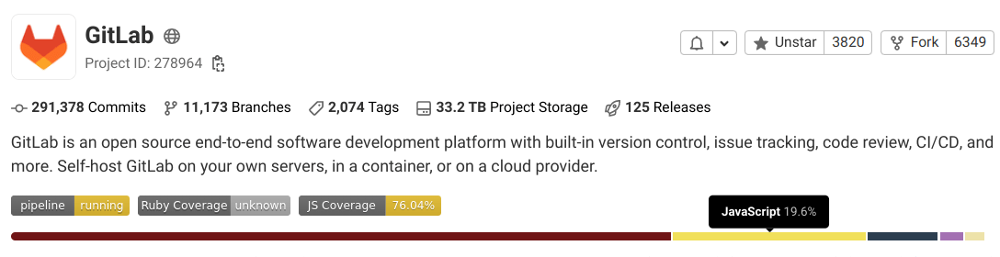
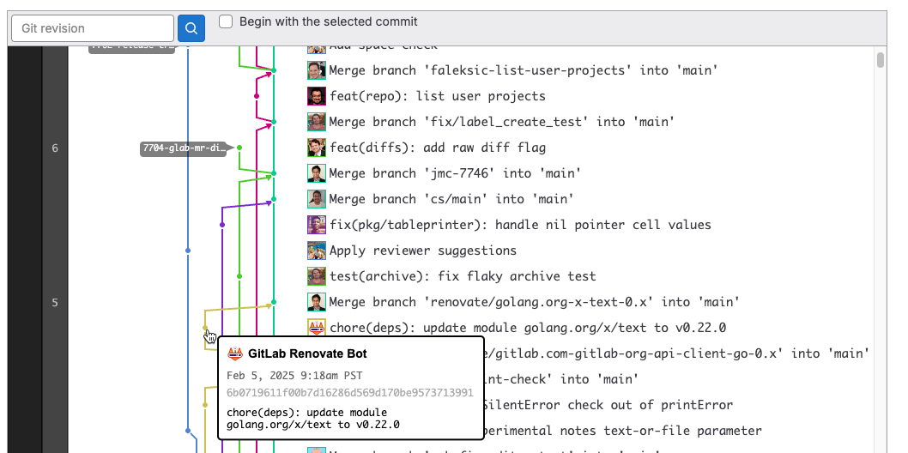



- Tier: 基础版，专业版，旗舰版
- Offering: JihuLab.com，私有化部署



您的[代码仓库](https://git-scm.com/book/en/v2/Git-Basics-Getting-a-Git-Repository)是极狐GitLab 项目的一个组成部分。您将代码存储在代码仓库中，并通过版本控制跟踪其变更。

每个代码仓库都属于一个[极狐GitLab 项目](../_index.md)，并且不能脱离极狐GitLab 项目而存在。您的项目为代码仓库提供配置选项。

<a id="create-a-repository"></a>

## 创建代码仓库

要创建代码仓库：

- [创建项目](../_index.md)或
- [Fork 一个现有项目](forking_workflow.md)。

<a id="add-files-to-a-repository"></a>

## 向代码仓库添加文件

您可以通过以下方式向代码仓库添加文件：

- 在[创建项目](../_index.md)时，或
- 在创建项目后，使用以下选项：
  - [Web 编辑器](web_editor.md#upload-a-file)。
  - [用户界面（UI）](#add-a-file-from-the-ui)。
  - [命令行](../../../topics/git/add_files.md)。

<a id="add-a-file-from-the-ui"></a>

### 从 UI 添加文件

要从极狐GitLab UI 添加或上传文件：

<!-- Original source for this list: doc/user/project/repository/web_editor.md#upload-a-file -->
<!-- For why we duplicated the info, see <https://gitlab.com/gitlab-org/gitlab/-/merge_requests/111072#note_1267429478> -->

1. 在顶部栏中，选择**搜索或跳转到**并找到您的项目。
1. 进入您想要上传文件的目标目录。
1. 在目录名称旁边，选择加号图标（）> **上传文件**。
1. 拖放或上传您的文件。
1. 输入提交消息。
1. 可选。要使用您的更改创建合并请求，请在**目标分支**中输入一个不是您代码仓库[默认分支](branches/default.md)的分支名称。
1. 选择**上传文件**。

<a id="commit-changes-to-a-repository"></a>

## 将更改提交到代码仓库

您可以将更改提交到代码仓库中的分支。使用命令行时，请使用 [`git commit`](../../../topics/git/commands.md#git-commit)。

有关如何使用提交来改善沟通与协作、触发或跳过流水线以及还原更改的信息，请参阅[提交](../merge_requests/commits.md)。

<a id="clone-a-repository"></a>

## 克隆代码仓库

您可以使用以下方式克隆代码仓库：

- 命令行：
  - [使用 SSH 克隆](../../../topics/git/clone.md#clone-with-ssh)
  - [使用 HTTPS 克隆](../../../topics/git/clone.md#clone-with-https)
- 极狐GitLab UI：
  - [克隆并在 Apple Xcode 中打开](../../../topics/git/clone.md#clone-and-open-in-apple-xcode)
  - [克隆并在 Visual Studio Code 中打开](../../../topics/git/clone.md#clone-and-open-in-visual-studio-code)
  - [克隆并在 IntelliJ IDEA 中打开](../../../topics/git/clone.md#clone-and-open-in-intellij-idea)

<a id="download-repository-source-code"></a>

## 下载代码仓库源代码

要将代码仓库的源代码下载为压缩文件：

1. 在顶部栏中，选择**搜索或跳转到**并找到您的项目。
1. 在文件列表上方，选择**代码**。
1. 从选项中选择您想要下载的文件：

   - **源代码**：

     从您当前正在查看的分支下载源代码。
     可用扩展名：`zip`、`tar`、`tar.gz` 和 `tar.bz2`。

   - **目录**：

     下载特定目录。仅在您查看子目录时可见。
     可用扩展名：`zip`、`tar`、`tar.gz` 和 `tar.bz2`。

   - **产物**：

     从最新的 CI/CD 作业下载产物。

即使代码仓库本身没有变化，生成归档文件的校验和也可能发生变化。例如，当 Git 或极狐GitLab 使用的第三方库发生变化时，就会出现这种情况。

<a id="view-repository-by-git-revision"></a>

## 按 Git 修订版本查看代码仓库

要在特定 Git 修订版本（例如提交 SHA、分支名称或标签）下查看所有代码仓库文件和文件夹：

1. 在顶部栏中，选择**搜索或跳转到**并找到您的项目。
1. 在顶部，选择以打开**选择 Git 修订版本**下拉列表。
1. 选择或搜索一个 Git 修订版本。

您也可以从[提交](commits/_index.md)页面查看和浏览特定 Git 修订版本下的文件。

<a id="repository-languages"></a>

## 代码仓库语言

极狐GitLab 会检测默认分支中使用的编程语言。此信息显示在**项目概览**页面上。



添加新文件后，此信息最多可能需要五分钟才能更新。

<a id="add-repository-languages"></a>

### 添加代码仓库语言

并非所有文件都会被检测并显示在**项目概览**页面上。文档、供应商代码和[大多数标记语言](files/_index.md#supported-markup-languages)会被排除。要查看支持的文件和语言列表，请参阅[支持的数据类型](https://github.com/github/linguist/blob/master/lib/linguist/languages.yml)。

要在默认设置中更改此行为并包含其他文件类型：

1. 在代码仓库的根目录中，创建一个名为 `.gitattributes`的文件。
1. 添加一行，告诉极狐GitLab 包含特定文件类型。例如，要启用 `.proto` 文件，请添加以下内容：

   ```plaintext
   *.proto linguist-detectable=true
   ```

此功能可能会占用过多 CPU。如果您遇到问题，请参阅 [CPU 占用过高](files/_index.md#repository-languages-excessive-cpu-use)故障排除部分。

<a id="repository-contributor-analytics"></a>

## 代码仓库贡献者分析

您可以查看一个折线图，显示所选项目分支随时间推移的提交数量，以及显示每个项目成员提交数量的折线图。有关更多信息，请参阅[贡献者分析](../../analytics/contributor_analytics.md)。

<a id="repository-history-graph"></a>

## 代码仓库历史图谱

代码仓库图谱以可视化方式展示代码仓库网络的历史，包括分支和合并。此图谱可帮助您了解代码仓库中的变更流向。

要查看代码仓库历史图谱，请转到项目的**代码** > **代码仓库图谱**。



<a id="repository-path-changes"></a>

## 代码仓库路径变更

当代码仓库路径发生变化时，极狐GitLab 会通过重定向处理从旧位置到新位置的过渡。

当您[重命名用户](../../profile/_index.md#change-your-username)、[更改群组路径](../../group/manage.md#change-a-groups-path)或[重命名代码仓库](../working_with_projects.md#rename-a-repository)时：

- 命名空间及其下所有内容（如项目）的 URL 会重定向到新的 URL。
- 命名空间下项目的 Git 远程 URL 会重定向到新的远程 URL。当您向已更改位置的代码仓库推送或拉取时，会显示一条警告消息，提示您更新远程地址。重命名后，自动化脚本或 Git 客户端仍可继续工作。
- 只要原始路径未被其他群组、用户或项目占用，重定向就一直可用。
- [API 重定向](../../../api/rest/_index.md#redirects)可能需要显式遵循。

更改路径后，您必须更新以下资源中的现有 URL：

- [Include 语句](../../../ci/yaml/includes.md)，但 [`include:component`](../../../ci/components/_index.md) 除外，否则流水线会因语法错误而失败。CI/CD 组件引用可以遵循重定向。
- 使用[编码路径](../../../api/rest/_index.md#namespaced-paths)而非数字命名空间和项目 ID 的命名空间 API 调用。
- [Docker 镜像引用](../../../ci/yaml/_index.md#image)。
- 指定项目或命名空间的变量。
- [`CODEOWNERS` 文件](../codeowners/_index.md#codeowners-file)。

<a id="troubleshooting"></a>

## 故障排除

<a id="search-sequence-of-pushes-to-a-repository"></a>

### 搜索对代码仓库的推送序列

如果某个提交似乎“丢失”了，请搜索对代码仓库的推送序列。此 [Stack Overflow 讨论串](https://stackoverflow.com/questions/13468027/the-mystery-of-the-missing-commit-across-merges)描述了在没有强制推送的情况下如何可能陷入这种状态。另一个原因可能是配置错误的[服务器钩子](../../../administration/server_hooks.md)在 `git reset` 操作中更改了 HEAD 引用。

如果您查看下面针对目标分支的示例代码输出，在逐步查看输出时会发现 from/to 提交之间存在不连续。每次新推送的 `commit_from` 应等于上一次推送的 `commit_to`。该序列的中断表明一个或多个提交已从代码仓库历史中“丢失”。

使用 [Rails 控制台](../../../administration/operations/rails_console.md#starting-a-rails-console-session)，以下示例检查最近 100 次推送并打印 `commit_from` 和 `commit_to` 条目：

```ruby
p = Project.find_by_full_path('project/path')
p.events.pushed_action.last(100).each do |e|
  printf "%-20.20s %8s...%8s (%s)", e.push_event_payload[:ref], e.push_event_payload[:commit_from], e.push_event_payload[:commit_to], e.author.try(:username)
end ; nil
```

示例输出显示第 4 行序列中断：

```plaintext
master f21b07713251e04575908149bdc8ac1f105aabc3...6bc56c1f46244792222f6c85b11606933af171de root
master 6bc56c1f46244792222f6c85b11606933af171de...132da6064f5d3453d445fd7cb452b148705bdc1b root
master 132da6064f5d3453d445fd7cb452b148705bdc1b...a62e1e693150a2e46ace0ce696cd4a52856dfa65 root
master 58b07b719a4b0039fec810efa52f479ba1b84756...f05321a5b5728bd8a89b7bf530aa44043c951dce root
master f05321a5b5728bd8a89b7bf530aa44043c951dce...7d02e575fd790e76a3284ee435368279a5eb3773 root
```

<a id="error-xcode-fails-to-clone-repository"></a>

### 错误：Xcode 无法克隆代码仓库

极狐GitLab 提供了[限制允许的 SSH 密钥列表](../../../security/ssh_keys_restrictions.md)的选项。如果您的 SSH 密钥不在允许名单上，您可能会遇到类似 `The repository rejected the provided credentials`的错误。

要解决此问题，请创建一个符合[支持的 SSH 密钥类型](../../ssh.md#supported-ssh-key-types)指南的新 SSH 密钥对。生成受支持的 SSH 密钥后，请再次尝试克隆代码仓库。
