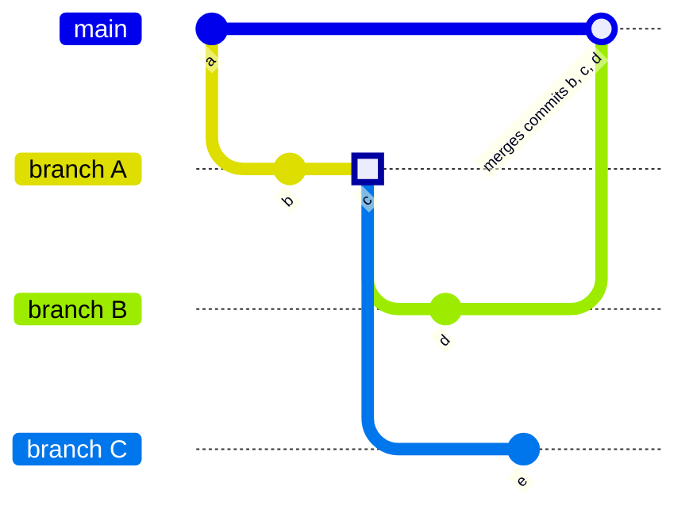



- Tier: 基础版，专业版，旗舰版
- Offering: JihuLab.com，私有化部署



分支可以让团队的开发工作保持井然有序、彼此隔离。当多人同时开发不同的功能时，分支可以防止变更相互冲突。每个分支都是一个独立的工作区，您可以在其中实现新功能、修复缺陷或试验新想法。

借助分支，您的团队可以：

- 在不干扰主代码库的情况下开发各自的功能。
- 在提议的变更影响到项目其他部分之前对其进行评审。
- 回滚有问题的变更，而不影响其他工作。
- 以可控、可预测的方式将变更部署到生产环境。

分支的开发工作流如下：

1. [创建分支](#create-a-branch)并向其中添加提交。
   为简化此过程，您应遵循
   [分支命名模式](#prefix-branch-names-with-a-number)。
1. 当工作已准备好接受评审时，创建一个[合并请求](../../merge_requests/_index.md)，提议合并您分支中的变更。
1. 使用[评审应用](../../../../ci/review_apps/_index.md)预览变更。
1. [请求评审](../../merge_requests/reviews/_index.md#request-a-review)。
1. 您的合并请求获得批准后，将您的分支合并到源分支。
   [合并方法](../../merge_requests/methods/_index.md)决定了项目中合并请求的处理方式。
1. 分支内容合并后，[删除已合并的分支](#delete-merged-branches)。

<a id="view-all-branches"></a>

## 查看所有分支

要在极狐GitLab 用户界面中查看和管理分支：

1. 在顶部栏中，选择**搜索或跳转到**，然后找到您的项目。
1. 在左侧边栏中，选择**代码** > **分支**。

在此页面上，您可以：

- 查看所有分支，或筛选出仅显示活跃或陈旧分支。

  如果某个分支在过去三个月内有提交，则该分支被视为活跃分支。
  否则，它被视为陈旧分支。

- [创建新分支](#create-a-branch)。
- [删除已合并的分支](#delete-merged-branches)。
- 查看指向默认分支的合并请求链接。

  如果分支的合并请求不指向默认分支，则会显示  **新建** 合并请求按钮。

- [查看分支规则](branch_rules.md#view-branch-rules)。
- 查看分支上最新的流水线状态。

<a id="create-a-branch"></a>

## 创建分支

先决条件：

- 您必须拥有该项目的开发者、维护者或所有者角色。

要从极狐GitLab UI 创建新分支：

1. 在顶部栏中，选择**搜索或跳转到**，然后找到您的项目。
1. 在左侧边栏中，选择**代码** > **分支**。
1. 在右上角，选择**新建分支**。
1. 输入**分支名称**。
1. 在**从以下位置创建**中，选择分支的基础：现有分支、现有
   标签或提交 SHA。
1. 选择**创建分支**。

<a id="in-a-blank-project"></a>

### 在空白项目中

[空白项目](../../_index.md#create-a-blank-project)不包含分支，但
您可以添加一个。

先决条件：

- 您必须拥有该项目的开发者、维护者或所有者角色。
- 如果您没有维护者或所有者角色，
  [默认分支保护](../../../group/manage.md#change-the-default-branch-protection-of-a-group)
  必须设置为 `Partially protected` 或 `Not protected`，您才能将提交推送到
  默认分支。

要向空白项目添加[默认分支](default.md)：

1. 在顶部栏中，选择**搜索或跳转到**，然后找到您的项目。
1. 滚动到**此项目的代码仓库为空**，然后选择您要添加的
   文件类型。
1. 在 Web IDE 中，对该文件进行所需的任何更改，然后选择**创建提交**。
1. 输入提交信息，然后选择**提交**。

极狐GitLab 会创建一个默认分支，并将您的文件添加到其中。

<a id="from-an-issue"></a>

### 从议题创建

查看议题时，您可以直接从该页面创建关联分支。以这种方式创建的分支会使用
[从议题创建分支名称的默认模式](#configure-default-pattern-for-branch-names-from-issues)，
包括其中的变量。

先决条件：

- 您必须拥有该项目的开发者、维护者或所有者角色。

要从议题创建分支：

1. 在顶部栏中，选择**搜索或跳转到**，然后找到您的项目。
1. 在左侧边栏中，选择**计划** > **工作项**，然后按**类型** = **议题**筛选并选择您的议题。
1. 在议题描述下方，选择**创建合并请求**  以显示下拉列表。
1. 选择**创建分支**。
1. 在对话框中，从**源（分支或标签）**下拉列表中选择源分支或标签。
1. 查看建议的分支名称。它基于您项目的
   [默认分支名称模式](#configure-default-pattern-for-branch-names-from-issues)。
1. 可选。如果您需要使用其他分支名称，请在**分支名称**文本框中输入。
1. 选择**创建分支**。

有关在空代码仓库中创建分支的信息，
请参阅[空代码仓库行为](#empty-repository-behavior)。

如果所创建分支的名称
[以议题编号为前缀](#prefix-branch-names-with-a-number)，极狐GitLab 会将
该议题与相关的合并请求相互交叉链接。

<a id="from-a-task"></a>

### 从任务创建

先决条件：

- 您必须拥有该项目的开发者、维护者或所有者角色。

要直接从任务创建分支：

1. 在顶部栏中，选择**搜索或跳转到**，然后找到您的项目。
1. 在左侧边栏中，选择**计划** > **工作项**，然后按**类型** = **任务**筛选并选择您的任务。
1. 在任务描述下方，选择**创建合并请求**  以显示下拉列表。
1. 选择**创建分支**。
1. 在对话框中，从**源分支或标签**下拉列表中选择源分支或标签。
1. 查看建议的分支名称。它基于您项目的
   [默认分支名称模式](#configure-default-pattern-for-branch-names-from-issues)。
1. 可选。如果您需要使用其他分支名称，请在**分支名称**文本框中输入。
1. 选择**创建分支**。

有关在空代码仓库中创建分支的信息，
请参阅[空代码仓库行为](#empty-repository-behavior)。

如果所创建分支的名称
[以任务编号为前缀](#prefix-branch-names-with-a-number)，极狐GitLab 会将
该议题与相关的合并请求相互交叉链接。

<a id="empty-repository-behavior"></a>

### 空代码仓库行为

如果您的 Git 代码仓库为空，极狐GitLab 会：

- 创建一个默认分支。
- 向其提交一个空白的 `README.md` 文件。
- 基于议题标题创建一个新分支，并将您重定向到该分支。
- 如果您的项目[配置了部署服务](../../integrations/_index.md)（如 Kubernetes），
  极狐GitLab 会通过帮助您创建 `.gitlab-ci.yml` 文件，提示您设置[自动部署](../../../../topics/autodevops/stages.md#auto-deploy)。

<a id="name-your-branch"></a>

## 命名分支

Git 会强制执行[分支名称规则](https://git-scm.com/docs/git-check-ref-format)，
以帮助确保分支名称与其他工具保持兼容。极狐GitLab 对分支名称增加了额外要求，并为结构良好的分支名称提供了诸多好处。

极狐GitLab 对所有分支强制执行以下额外规则：

- 分支名称中不允许有空格。
- 禁止使用包含 40 个十六进制字符的分支名称，因为它们与 Git 提交哈希相似。
- 分支名称区分大小写。

具有特定格式的分支名称可带来：

- 当您[为分支名称添加议题编号前缀](#prefix-branch-names-with-a-number)时，
  更顺畅的合并请求工作流。
- 基于分支名称的自动[分支保护](protected.md)。
- [推送规则](../push_rules.md)，用于在分支名称推送到极狐GitLab 之前对其进行测试。
- 控制哪些 [CI/CD 作业](../../../../ci/jobs/_index.md)在合并请求上运行。

<a id="software-packages"></a>

### 软件包

常见的软件包（如 Docker）可能会强制执行
[额外的分支命名限制](../../../../administration/packages/container_registry_troubleshooting.md#docker-connection-error)。

为获得与其他软件包的最佳兼容性，请仅使用：

- 数字
- 连字符（`-`）
- 下划线（`_`）
- ASCII 标准表中的小写字母

<a id="characters-to-avoid-in-branch-names"></a>

### 分支名称中应避免的字符

虽然 Git 在技术上允许分支名称中包含许多字符，但某些字符可能会导致极狐GitLab Runner 和其他工具出现问题，因此不建议使用：

- 空格和空白字符
- 特殊路径或 glob（通配符）字符：`~`、`^`、`:`、`?`、`*`、`[`、`\`、`'`、`"`
- 双点：`..`
- 特殊 Git 语法：`@{`
- 连续斜杠：`//`
- emoji
- 结尾的 `.` 或 `.lock` 后缀
- 以 `-` 或 `.` 开头
- ASCII 控制字符（包括 Delete）

为获得与极狐GitLab Runner 和其他工具的最大兼容性，请仅使用字母数字字符、连字符和下划线。

<a id="configure-default-pattern-for-branch-names-from-issues"></a>

### 配置从议题创建分支名称的默认模式

默认情况下，从议题创建分支时，极狐GitLab 使用模式 `%{id}-%{title}`，但您可以更改此模式。

先决条件：

- 您必须拥有该项目的维护者或所有者角色。

要更改从议题创建分支的默认模式：

1. 在顶部栏中，选择**搜索或跳转到**，然后找到您的项目。
1. 在左侧边栏中，选择**设置** > **代码仓库**。
1. 展开**分支默认设定**。
1. 滚动到**分支名称模板**并输入一个值。该字段支持以下变量：
   - `%{id}`：议题的数字 ID。
   - `%{title}`：议题的标题，经过修改，仅使用 Git 分支名称可接受的字符。
   - `%{branch_creator}`：创建分支的用户的用户名，经过修改，仅使用 Git 分支名称可接受的字符。
1. 选择**保存更改**。

<a id="prefix-branch-names-with-a-number"></a>

### 为分支名称添加编号前缀

为简化合并请求的创建，请在 Git 分支名称开头使用议题或任务编号，并紧接一个连字符。例如，要将分支链接到议题 `#123`，请以 `123-` 开头命名分支。

该分支必须与议题或任务位于同一项目中。

极狐GitLab 使用此编号将数据导入到合并请求中：

- 该项被标记为与合并请求相关，并且它们会相互显示链接。
- 该分支连接到该议题或任务。
- 如果您的项目配置了
  [默认关闭模式](../../issues/managing_issues.md#default-closing-pattern)，
  合并该合并请求还会[自动关闭](../../issues/managing_issues.md#closing-issues-automatically)
  相关议题。
- 如果该合并请求位于同一项目中，且不是 fork，则议题的里程碑
  和标记会复制到该合并请求。

<a id="manage-and-protect-branches"></a>

## 管理和保护分支

极狐GitLab 提供了多种方法来保护各个分支。这些方法可确保您的分支从创建到删除都受到监督和质量检查。要查看和编辑分支保护，请参阅[分支规则](branch_rules.md)。

<a id="download-branch-comparisons"></a>

### 下载分支比较

您可以将分支之间的比较下载为 diff 或 patch 文件，以便在极狐GitLab 之外使用。

<a id="as-a-diff"></a>

#### 作为 diff

要将分支比较下载为 diff，请在比较 URL 中添加 `format=diff`：

- 如果 URL 没有查询参数，请追加 `?format=diff`：

  ```plaintext
  https://gitlab.example.com/my-group/my-project/-/compare/main...feature-branch?format=diff
  ```

- 如果 URL 已有查询参数，请追加 `&format=diff`：

  ```plaintext
  https://gitlab.example.com/my-group/my-project/-/compare/main...feature-branch?from_project_id=2&format=diff
  ```

要下载并应用该 diff：

```shell
curl "https://gitlab.example.com/my-group/my-project/-/compare/main...feature-branch?format=diff" | git apply
```

<a id="as-a-patch-file"></a>

#### 作为 patch 文件

要将分支比较下载为 patch 文件，请在比较 URL 中添加 `format=patch`：

- 如果 URL 没有查询参数，请追加 `?format=patch`：

  ```plaintext
  https://gitlab.example.com/my-group/my-project/-/compare/main...feature-branch?format=patch
  ```

- 如果 URL 已有查询参数，请追加 `&format=patch`：

  ```plaintext
  https://gitlab.example.com/my-group/my-project/-/compare/main...feature-branch?from_project_id=2&format=patch
  ```

要使用 [`git am`](https://git-scm.com/docs/git-am) 下载并应用该 patch：

```shell
# Download and preview the patch
curl "https://gitlab.example.com/my-group/my-project/-/compare/main...feature-branch?format=patch" > changes.patch
git apply --check changes.patch

# Apply the patch
git am changes.patch
```

您也可以使用单条命令下载并应用该 patch：

```shell
curl "https://gitlab.example.com/my-group/my-project/-/compare/main...feature-branch?format=patch" | git am
```

<a id="delete-merged-branches"></a>

## 删除已合并的分支

如果已合并的分支满足以下所有条件，则可以批量删除：

- 它们不是[受保护分支](protected.md)。
- 它们已合并到项目的默认分支中。

先决条件：

- 您必须拥有该项目的开发者、维护者或所有者角色。

为此：

1. 在顶部栏中，选择**搜索或跳转到**，然后找到您的项目。
1. 在左侧边栏中，选择**代码** > **分支**。
1. 在页面右上角，选择**更多** 。
1. 选择**删除已合并的分支**。
1. 在对话框中，输入单词 `delete` 以确认，然后选择**删除已合并的分支**。

> [!note]
> 删除分支并不会完全清除所有相关数据。
> 某些信息会保留下来，以维护项目历史并支持恢复流程。
> 有关更多信息，请参阅[处理敏感信息](../../../../topics/git/undo.md#handle-sensitive-information)。

<a id="configure-workflows-for-target-branches"></a>

## 为目标分支配置工作流



- Tier: 专业版，旗舰版
- Offering: JihuLab.com，私有化部署



有些项目使用多个长期分支进行开发，例如 `develop` 和 `qa`。在这些项目中，您可能希望将 `main` 保留为默认分支，但希望合并请求改为以 `develop` 或 `qa` 为目标。目标分支工作流有助于确保合并请求以适合您项目的开发分支为目标。

当您创建合并请求时，该工作流会检查分支的名称。如果分支名称与工作流匹配，则该合并请求以您指定的分支为目标。如果分支名称不匹配，则该合并请求以项目的默认分支为目标。

规则按“首个匹配”原则处理。如果两条规则匹配同一分支名称，则应用最上面的规则。

先决条件：

- 您必须拥有维护者或所有者角色。

要创建目标分支工作流：

1. 在顶部栏中，选择**搜索或跳转到**，然后找到您的项目。
1. 在左侧边栏中，选择**设置** > **合并请求**。
1. 向下滚动到**合并请求分支工作流**。
1. 选择**添加分支目标**。
1. 对于**分支名称模式**，提供一个字符串或通配符，用于与分支名称进行比较。
1. 选择当分支名称匹配**分支名称模式**时要使用的**目标分支**。
1. 选择**保存**。

<a id="target-branch-workflow-example"></a>

### 目标分支工作流示例

您可以将项目配置为具有以下目标分支工作流：

| 分支名称模式   | 目标分支 |
|-------------|---------------|
| `feature/*` | `develop`     |
| `bug/*`     | `develop`     |
| `release/*` | `main`        |

这些目标分支可简化以下项目的合并请求创建过程：

- 使用 `main` 表示应用程序的已部署状态。
- 在另一个长期运行的分支（如 `develop`）中跟踪当前尚未发布的开发工作。

如果您的工作流最初将新功能放入 `develop` 而不是 `main`，这些目标分支可确保所有匹配 `feature/*` 或 `bug/*` 的分支不会错误地以 `main` 为目标。

当您准备好发布到 `main` 时，创建一个名为 `release/*` 的分支，并确保该分支以 `main` 为目标。

<a id="delete-a-target-branch-workflow"></a>

### 删除目标分支工作流

当您移除目标分支工作流时，现有合并请求保持不变。

先决条件：

- 您必须拥有维护者或所有者角色。

为此：

1. 在顶部栏中，选择**搜索或跳转到**，然后找到您的项目。
1. 在左侧边栏中，选择**设置** > **合并请求**。
1. 在您要删除的分支目标上选择**删除**。

<a id="troubleshooting"></a>

## 故障排除

<a id="multiple-branches-containing-the-same-commit"></a>

### 多个分支包含同一提交

在更深的技术层面上，Git 分支并不是独立的实体，而是附加到一组提交 SHA 上的标签。当极狐GitLab 判断某个分支是否已合并时，它会检查目标分支中是否存在这些提交 SHA。当两个合并请求包含相同的提交时，此行为可能会导致意外结果。在此示例中，分支 `B` 和 `C` 都从分支 `A` 上的同一提交（`3`）开始：



如果您合并分支 `B`，分支 `A` 也会显示为已合并（无需您执行任何操作），因为分支 `A`中的所有提交现在都出现在目标分支 `main`中。分支 `C` 仍保持未合并，因为提交 `5` 不属于分支 `A` 或 `B`。

即使您尝试向其分支推送新提交，合并请求 `A` 仍保持已合并状态。如果合并请求 `A`中有任何变更仍未合并（因为它们不属于合并请求 `A`），请为它们打开一个新的合并请求。

<a id="error-ambiguous-head-branch-exists"></a>

### 错误：存在有歧义的 `HEAD` 分支

在早于 2.16.0 的 Git 版本中，您可以创建一个名为 `HEAD`的分支。这个名为 `HEAD`的分支会与 Git 用于描述活动（已检出）分支的内部引用（同样名为 `HEAD`）发生冲突。这种命名冲突可能会阻止您更新代码仓库的默认分支：

```plaintext
Error: Could not set the default branch. Do you have a branch named 'HEAD' in your repository?
```

要解决此问题：

1. 在顶部栏中，选择**搜索或跳转到**，然后找到您的项目。
1. 在左侧边栏中，选择**代码** > **分支**。
1. 搜索名为 `HEAD`的分支。
1. 确保该分支没有未提交的更改。
1. 选择**删除分支**，然后选择**是，删除分支**。

Git [2.16.0 及更高版本](https://github.com/git/git/commit/a625b092cc59940521789fe8a3ff69c8d6b14eb2)
会阻止您创建使用此名称的分支。

<a id="find-all-branches-youve-authored"></a>

### 查找您创建的所有分支

要查找您在项目中创建的所有分支，请在 Git 代码仓库中运行以下命令：

```shell
git for-each-ref --format='%(authoremail) %(refname:short)' | grep $(git config --get user.email)
```

要获取项目中所有分支的总数（按作者排序），请在 Git 代码仓库中运行以下命令：

```shell
git for-each-ref --format='%(authoremail)'  | sort | uniq -c | sort -g
```

<a id="error-failed-to-create-branch-4deadline-exceeded"></a>

### 错误：`Failed to create branch 4:Deadline Exceeded`

此错误由 Gitaly 中的超时引起。当创建分支所需的时间超过配置的超时期限时，就会发生此错误。

要解决此问题，请选择以下方法之一：

- 禁用耗时的[服务器钩子](../../../../administration/server_hooks.md)。
- 增加 [Gitaly 超时](../../../../administration/settings/gitaly_timeouts.md)设置。
