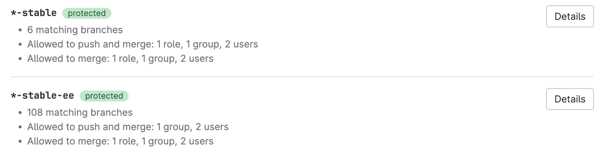



- Tier: 基础版，专业版，旗舰版
- Offering: JihuLab.com，私有化部署



极狐GitLab 提供多种方法来保护单个分支。这些方法可确保您的分支从创建到删除的整个生命周期都受到监督和质量检查：

- 为项目的[默认分支](default.md)应用增强的安全性和保护。
- 配置[受保护分支](protected.md)以：
  - 限制谁可以推送到分支并合并到分支。
  - 管理用户是否可以强制推送到分支。
  - 管理对 `CODEOWNERS` 文件中列出的文件的更改是否可以直接推送到分支。
- 配置[审批规则](../../merge_requests/approvals/rules.md#approvals-for-protected-branches)以管理评审要求并实施[与安全相关的审批](../../merge_requests/approvals/rules.md#security-approvals)。
- 与第三方[状态检查](../../merge_requests/status_checks.md)集成，
  以确保分支内容符合您定义的质量标准。

您可以通过以下方式管理分支：

- 使用极狐GitLab 用户界面。
- 在命令行中使用 Git。
- 使用[分支 API](../../../../api/branches.md)。

## 查看分支规则

分支规则概览页面显示所有配置了保护的分支及其保护方法：

先决条件：

- 您必须拥有该项目的维护者或所有者角色。

查看分支规则概览列表：

1. 在顶部栏中，选择**搜索或跳转到**，然后找到您的项目。
1. 在左侧边栏中，选择**设置** > **代码仓库**。
1. 展开**分支规则**以查看所有受保护的分支。

### 查看分支规则详情

查看单个分支的分支规则和保护：

1. 在顶部栏中，选择**搜索或跳转到**，然后找到您的项目。
1. 在左侧边栏中，选择**设置** > **代码仓库**。
1. 展开**分支规则**以查看所有受保护的分支。
1. 找到您想要的分支，然后选择**查看详情**。

## 创建分支规则

先决条件：

- 您必须拥有该项目的维护者或所有者角色。

创建分支规则：

1. 在顶部栏中，选择**搜索或跳转到**，然后找到您的项目。
1. 在左侧边栏中，选择**设置** > **代码仓库**。
1. 展开**分支规则**。
1. 选择**添加分支规则**。
1. 选择以下选项之一：
   - 要输入特定的分支名称或模式：
     1. 选择**分支名称或模式**。
     1. 从**创建分支规则**下拉列表中，选择一个分支名称，或使用 `*` 创建[通配符](protected.md#use-wildcard-rules)。
   - 要保护项目中的所有分支：
     1. 选择**所有分支**。
     1. 在规则的详情页面上，在**合并请求审批**下，输入该规则所需的审批数量。
   - 要保护项目中所有已指定为受保护的分支：
     1. 选择**所有受保护分支**。
     1. 在规则的详情页面上，在**合并请求审批**下，输入该规则所需的审批数量。

### 添加分支规则保护

> [!note]
> 不适用于 `all branches`。

为新分支添加保护：

1. 在顶部栏中，选择**搜索或跳转到**，然后找到您的项目。
1. 在左侧边栏中，选择**设置** > **代码仓库**。
1. 展开**分支规则**。
1. 选择**添加分支规则**。
1. 选择**所有受保护分支**或**分支名称或模式**之一。
1. 选择**创建分支规则**。

### 添加审批规则



- Tier: 专业版，旗舰版
- Offering: JihuLab.com，私有化部署



> [!note]
> 不适用于 `all branches`。

先决条件：

- 您必须拥有该项目的维护者或所有者角色。

添加合并请求审批规则：

1. 在[分支规则详情](#view-branch-rule-details)页面中，转到**合并请求审批**部分。
1. 在**审批规则**部分中，选择**添加审批规则**。
1. 在右侧边栏中，填写以下字段：
   - 输入**规则名称**。
   - 在**所需审批数量**中，输入一个值（`0`-`100`）。

     值为 `0` 会使[该规则成为可选规则](../../merge_requests/approvals/rules.md#configure-optional-approval-rules)，任何大于 `0`的数字都会创建必需规则。
     所需审批的最大数量为 `100`。
   - 选择[有资格审批](../../merge_requests/approvals/rules.md#eligible-approvers)的用户或群组。

     极狐GitLab 会根据合并请求所更改文件的以往作者来推荐审批人。
1. 选择**保存更改**。

有关更多信息，请参阅[审批规则](../../merge_requests/approvals/rules.md#approvals-for-protected-branches)。

### 编辑压缩提交选项



- Tier: 专业版，旗舰版
- Offering: JihuLab.com，私有化部署



先决条件：

- 您必须拥有该项目的维护者或所有者角色。
- 在极狐GitLab 基础版中，仅当分支规则针对**所有分支**时，此功能才可用。
- 在极狐GitLab 专业版和极狐GitLab 旗舰版中，此功能适用于所有分支规则。

编辑压缩选项：

1. 在[分支规则详情](#view-branch-rule-details)页面中，转到**合并时压缩提交**部分。
1. 选择**编辑**。
1. 选择以下选项之一：

   - **默认**：移除分支级别的压缩设置，并继承项目的默认设置。
     此选项不适用于**所有分支**规则，该规则定义了项目的默认设置。
   - **不允许**：永远不允许压缩，且该复选框处于隐藏状态。
   - **允许**：复选框可见，且默认未选中。
   - **鼓励**：复选框可见，且默认已选中。
   - **要求**：始终执行压缩。复选框可见且已选中，用户无法更改。

1. 选择**保存更改**。

### 添加状态检查服务



- Tier: 旗舰版
- Offering: JihuLab.com，私有化部署



> [!note]
> 不适用于 `all protected branches`。

添加状态检查服务：

1. 在[分支规则详情](#view-branch-rule-details)页面中，转到**状态检查**部分。
1. 选择**添加状态检查**。
1. 输入**服务名称**。
1. 在**要检查的 API** 字段中，输入 URL。

   您应使用 HTTPS URL 来保护传输中的合并请求数据。

有关更多信息，请参阅[外部状态检查](../../merge_requests/status_checks.md)。

## 编辑分支规则目标

先决条件：

- 您必须拥有该项目的维护者或所有者角色。

编辑分支规则目标：

1. 在顶部栏中，选择**搜索或跳转到**，然后找到您的项目。
1. 在左侧边栏中，选择**设置** > **代码仓库**。
1. 展开**分支规则**以查看所有受保护的分支。
1. 找到您想要的分支，然后选择**查看详情**。
1. 在**规则目标**部分中，选择**编辑**。
1. 根据需要编辑信息。
1. 选择**更新**。

### 编辑分支规则保护

有关分支保护控制的信息，请参阅[受保护分支](protected.md)。

> [!note]
> 不适用于 `all branches`。

## 删除分支规则

先决条件：

- 您必须拥有该项目的维护者或所有者角色。

删除分支规则：

1. 在顶部栏中，选择**搜索或跳转到**，然后找到您的项目。
1. 在左侧边栏中，选择**设置** > **代码仓库**。
1. 展开**分支规则**。
1. 在要删除的规则旁边，选择**查看详情**。
1. 在右上角，选择**删除规则**。
1. 在确认对话框中，选择**删除分支规则**。

> [!note]
> 删除分支规则不适用于针对 `all branches`的规则。
