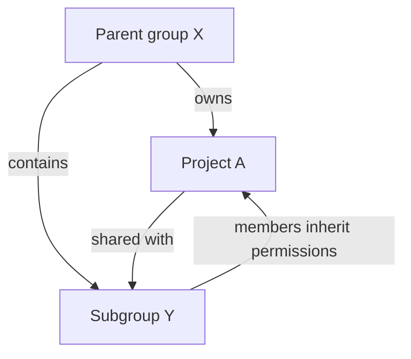
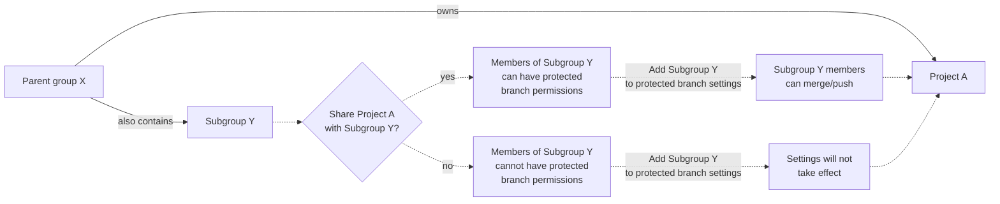



- Tier: 基础版，专业版，旗舰版
- Offering: JihuLab.com，私有化部署



> [!note]
> 项目的**受保护分支**设置将被移除。请改为从**设置** > **代码仓库** > **分支规则**配置受保护分支。

受保护分支对极狐GitLab 中的分支强制执行特定权限，以确保代码的稳定性和质量。受保护分支可以：

- 控制哪些用户可以合并和推送代码变更。
- 防止关键分支被意外删除。
- 强制执行代码评审和审批流程。
- 管理代码所有者审批要求。
- 规范强制推送权限，以维护提交历史。
- 通过 UI 和受保护分支 API 控制访问。

> [!note]
> 代码仓库的默认分支默认受保护。
> 有关默认分支设置的更多信息，请参阅[默认分支](default.md)。

有关当分支匹配多条规则或具有复杂权限要求时保护规则的行为方式，请参阅[保护规则](protection_rules.md)。

<a id="protect-a-branch"></a>

## 保护分支

为单个项目或群组中的所有项目配置受保护分支。

> [!note]
> 群组规则无法在项目中修改，但项目维护者可以为同一分支名称创建单独的规则。当两条规则都适用于同一分支时，
> 极狐GitLab 会一并评估所有匹配的规则，并对大多数设置应用最宽松的结果。
> 更多信息，请参阅
> [跨群组和项目的规则](protection_rules.md#rules-across-groups-and-projects)。
<!-- -->
> [!tip]
> 当您保护某个分支名称或模式时，请考虑也为标签保护相同的
> 名称或模式。Git 允许分支和标签使用相同的名称，因此
> 同时保护两者可确保所有引用具有一致的访问控制。
> 更多信息，请参阅[保护标签](../../protected_tags.md)。

<a id="in-a-project"></a>

### 在项目中

先决条件：

- 您必须具有维护者或所有者角色。
- 当为受保护分支授予群组**允许合并**或**允许推送和合并**权限时，
  项目必须可访问并与该群组共享。
  更多信息，请参阅[共享项目](../../members/sharing_projects_groups.md)。

要保护分支：

1. 在顶部栏中，选择**搜索或跳转到**并找到您的项目。
1. 在左侧边栏中，选择**设置** > **代码仓库**。
1. 展开**分支规则**。
1. 选择**添加分支规则** > **分支名称或模式**。
1. 从下拉列表中，搜索并选择您要保护的分支。
1. 要查看**分支规则详情**页面，请选择**创建分支规则**。
1. 在**保护分支**部分，选择以下选项之一：
   - 在**允许合并**中，选择**编辑**。
     1. 选择可以合并到该分支的角色。
     1. 选择**保存更改**。
   - 在**允许推送和合并**中，选择**编辑**。
     1. 选择可以推送到该分支的角色。
     1. 可选。搜索并选择**部署密钥**。
     1. 选择**保存更改**。

> [!note]
> 在极狐GitLab 专业版和旗舰版中，您还可以将群组或单个用户
> 添加到**允许合并**和**允许推送和合并**。

<a id="in-a-group"></a>

### 在群组中



- Tier: 专业版，旗舰版
- Offering: JihuLab.com，私有化部署



群组所有者可以为群组创建受保护分支。这些设置适用于该群组中的所有项目，且无法在项目中修改。

先决条件：

- 您必须具有该群组的所有者角色。
- 该群组必须是顶级群组。不支持子群组。

要为群组中的所有项目保护分支：

1. 在顶部栏中，选择**搜索或跳转到**并找到您的群组。
1. 在左侧边栏中，选择**设置** > **代码仓库**。
1. 展开**受保护分支**。
1. 选择**添加受保护分支**。
1. 在**分支**文本框中，输入分支名称或[通配符](#use-wildcard-rules)（`*`）。
   分支名称和通配符区分大小写。
1. 从**允许合并**列表中，选择可以合并到该分支的角色。
1. 从**允许推送和合并**列表中，选择可以推送到该分支的角色。
1. 为**允许强制推送**和**需要代码所有者审批**选择您的偏好设置。
1. 选择**保护**。

<a id="push-and-merge-permissions"></a>

## 推送和合并权限

**允许合并**和**允许推送和合并**设置控制分支保护的不同方面：

| 设置                       | 用途                                                                                                        | 默认行为（未配置） |
|-------------------------------|----------------------------------------------------------------------------------------------------------------|-----------------------------------|
| **允许合并**          | 控制谁可以通过合并请求合并变更，以及通过 UI 和 API 创建新的受保护分支 | 任何人都无法合并（除非他们具有**允许推送和合并**）。 |
| **允许推送和合并** | 控制谁可以直接推送到现有受保护分支，以及通过合并请求合并                 | 任何人都无法推送。                  |

> [!note]
> **允许推送和合并**同时授予推送和合并能力。
> 具有此权限的用户即使没有
> **允许合并**权限，也可以通过合并请求进行合并。

当您为**允许合并**或**允许推送和合并**选择**无**时，UI 会清除其他角色选择。此行为与 API 不同，在 API 中您可以同时设置多个访问级别。有关 API 行为的更多信息，请参阅[受保护分支 API](../../../../api/protected_branches.md)。

<a id="protection-strategies-by-branch-types"></a>

### 按分支类型的保护策略

不同的分支类型根据其用途和安全要求需要不同的保护级别。

对于部署到生产环境的分支：

- 将**允许合并**仅设置为**维护者**。
- 将**允许推送和合并**设置为**无**（而非空）。
- 启用**需要代码所有者审批**。
- 考虑要求多次审批。

使用此配置，所有变更都需要经过维护者批准的合并请求。

对于活跃的开发分支：

- 将**允许合并**设置为**开发者 + 维护者**。
- 将**允许推送和合并**设置为**无**（而非空）。

使用此配置，开发者可以合并已批准的合并请求，同时要求所有变更都经过代码评审。

> [!note]
> 当**允许推送和合并**未配置时，它不会限制
> 推送访问。要阻止直接推送，您必须显式将**允许推送和合并**
> 设置为**无**。

<a id="permission-combinations-for-developer-role"></a>

### 开发者角色的权限组合

以下示例展示了具有开发者角色的用户在不同保护配置下可以执行的操作：

| 允许合并         | 允许推送和合并 | 直接推送 | 通过合并请求合并 |
|--------------------------|---------------------------|-------------|------------------|
| 无                   | 开发者 + 维护者  |  |       |
| 未配置           | 开发者 + 维护者  |  |       |
| 开发者 + 维护者 | 未配置            |   |       |
| 未配置           | 未配置            |   |        |
| 维护者              | 未配置            |   |        |
| 维护者              | 维护者               |   |        |
| 开发者 + 维护者 | 维护者               |   |       |

<a id="default-branch-protection-settings"></a>

## 默认分支保护设置

管理员可以在**管理**区域中[设置默认分支保护级别](default.md#for-all-projects-in-an-instance)。

<a id="use-wildcard-rules"></a>

## 使用通配符规则

使用通配符时，多条规则可以应用于单个分支。如果有多条规则适用于某个分支，则最宽松的规则控制该分支的行为。为使合并控制正常工作，请将**允许推送和合并**设置为比**允许合并**更广泛的用户集合。

先决条件：

- 您必须具有维护者或所有者角色。

要同时保护多个分支：

1. 在顶部栏中，选择**搜索或跳转到**并找到您的项目。
1. 在左侧边栏中，选择**设置** > **代码仓库**。
1. 展开**分支规则**。
1. 选择**添加分支规则** > **分支名称或模式**。
1. 从下拉列表中，输入分支名称和通配符（`*`）。
   分支名称和通配符区分大小写。例如：

   | 通配符受保护分支 | 匹配的分支                                      |
   |---------------------------|--------------------------------------------------------|
   | `*-stable`                | `production-stable`, `staging-stable`                  |
   | `production/*`            | `production/app-server`, `production/load-balancer`    |
   | `*gitlab*`                | `gitlab`, `gitlab/staging`, `master/gitlab/production` |

1. 选择**创建通配符**。
1. 选择**创建分支规则**。您将被引导至**分支规则详情**页面。
1. 在**保护分支**部分，选择以下选项之一：
   - 在**允许合并**中，选择**编辑**。
     1. 选择可以合并到该分支的角色。
     1. 选择**保存更改**。
   - 在**允许推送和合并**中，选择**编辑**。
     1. 选择可以合并到该分支的角色。
     1. 如果需要，搜索以添加**部署密钥**。
     1. 选择**保存更改**。

<a id="configure-protection-options"></a>

## 配置保护选项

您可以设置各种保护选项来保护您的分支。

<a id="require-merge-requests"></a>

### 要求合并请求

您可以强制所有人提交合并请求，而不是允许他们直接检入受保护分支：

1. 在顶部栏中，选择**搜索或跳转到**并找到您的项目。
1. 在左侧边栏中，选择**设置** > **代码仓库**。
1. 展开**分支规则**。
1. 在您的分支旁边，选择**查看详情**。
1. 在**允许合并**部分，选择**编辑**
1. 选择**开发者 + 维护者**。
1. 选择**保存更改**。
1. 在**允许推送和合并**部分，选择**无**。
1. 选择**保存更改**。

<a id="allow-direct-push"></a>

### 允许直接推送

您可以允许所有具有写入权限的用户直接推送到受保护分支。

1. 在顶部栏中，选择**搜索或跳转到**并找到您的项目。
1. 在左侧边栏中，选择**设置** > **代码仓库**。
1. 展开**分支规则**。
1. 在您的分支旁边，选择**查看详情**。
1. 在**允许推送和合并**部分，选择**开发者 + 维护者**。
1. 选择**保存更改**。

<a id="with-group-permissions"></a>

### 使用群组权限



- Tier: 专业版，旗舰版
- Offering: JihuLab.com，私有化部署



要将群组或子群组的成员设置为受保护分支的**允许合并**或**允许推送和合并**：

1. 在顶部栏中，选择**搜索或跳转到**并找到您的项目。
1. 在左侧边栏中，选择**设置** > **代码仓库**。
1. 展开**分支规则**。
1. 在您的分支旁边，选择**查看详情**。
1. 在**允许合并**或**允许推送和合并**部分，选择**编辑**。
1. 在**群组**下，搜索以添加群组。例如：

   ```plaintext
   # Allow group members to merge into this branch
   Allowed to merge: @group-x

   # Allow group members to push and merge into this branch
   Allowed to push and merge: @group-x/subgroup-y
   ```

1. 选择**保存更改**。

> [!note]
> 当您将群组分配给受保护分支时，仅包含该群组的直接成员。
> 来自父群组的成员不会自动获得受保护分支的权限。

<a id="group-inheritance-requirements"></a>

#### 群组继承要求



在此示例中：

- 父群组 X（`group-x`）拥有项目 A。
- 父群组 X 还包含一个子群组，子群组 Y。（`group-x/subgroup-y`）
- 项目 A 与子群组 Y 共享。

符合受保护分支权限条件的群组为：

- 项目 A：群组 X 和子群组 Y 都符合，因为项目 A 与子群组 Y 共享。

<a id="share-projects-with-groups"></a>

#### 与群组共享项目

您可以将项目与群组或子群组共享，以便其成员符合受保护分支权限的条件。



要为项目 A 授予子群组 Y 成员的访问权限，您必须将项目与该子群组共享。将子群组直接添加到受保护分支设置中无效，且不适用于子群组成员。

> [!note]
> 要使群组具有受保护分支权限，项目必须直接与该群组共享。
> 从父群组继承的项目成员身份不足以获得受保护分支权限。

<a id="enable-deploy-key-access"></a>

### 启用部署密钥访问

您可以使用[部署密钥](../../deploy_keys/_index.md)推送到受保护分支。

先决条件：

- 必须为您的项目启用该部署密钥。项目部署密钥在创建时默认启用。
  但是，公共部署密钥必须被授予项目访问权限。
- 该部署密钥必须对您的项目代码仓库具有写入权限。
- 该部署密钥的所有者必须至少对项目具有读取权限。
- 该部署密钥的所有者还必须是该项目的成员。

要允许部署密钥推送到受保护分支：

1. 在顶部栏中，选择**搜索或跳转到**并找到您的项目。
1. 在左侧边栏中，选择**设置** > **代码仓库**。
1. 展开**分支规则**。
1. 在您的分支旁边，选择**查看详情**。
1. 在**允许推送和合并**部分，选择**编辑**。
1. 在**部署密钥**中，搜索以添加部署密钥。
1. 选择**保存更改**。

部署密钥在**允许合并**下拉列表中不可用。

<a id="allow-force-push"></a>

### 允许强制推送

您可以允许对受保护分支进行[强制推送](../../../../topics/git/git_rebase.md#force-push-to-a-remote-branch)。

要保护分支并启用强制推送：

1. 在顶部栏中，选择**搜索或跳转到**并找到您的项目。
1. 在左侧边栏中，选择**设置** > **代码仓库**。
1. 展开**分支规则**。
1. 选择**添加分支规则** > **分支名称或模式**。
1. 从下拉列表中，搜索并选择您要保护并启用强制推送的分支。
1. 选择**创建分支规则**。您将被引导至**分支规则详情**页面。
1. 在**允许推送和合并**和**允许合并**部分，选择您想要的设置。
1. 选择**保存更改**。
1. 要允许所有具有推送访问权限的用户强制推送，请打开**允许强制推送**开关。

要在已受保护的分支上启用强制推送：

1. 在顶部栏中，选择**搜索或跳转到**并找到您的项目。
1. 在左侧边栏中，选择**设置** > **代码仓库**。
1. 展开**分支规则**。
1. 在您的分支旁边，选择**查看详情**。
1. 打开**允许强制推送**开关。

<a id="require-code-owner-approval"></a>

### 要求代码所有者审批



- Tier: 专业版，旗舰版
- Offering: JihuLab.com，私有化部署



对于受保护分支，您可以要求至少由一名[代码所有者](../../codeowners/_index.md)审批。如果某个分支受多条规则保护，则只要启用了**需要代码所有者审批**，就需要代码所有者审批。

要保护新分支并启用代码所有者审批：

1. 在顶部栏中，选择**搜索或跳转到**并找到您的项目。
1. 在左侧边栏中，选择**设置** > **代码仓库**。
1. 展开**分支规则**。
1. 选择**添加分支规则** > **分支名称或模式**。
1. 从下拉列表中，搜索并选择您要保护并启用强制推送的分支。
1. 选择**创建分支规则**。您将被引导至**分支规则详情**页面。
1. 在**允许推送和合并**和**允许合并**部分，选择您想要的设置。
1. 选择**保存更改**。
1. 打开**需要代码所有者审批**开关。

要在已受保护的分支上启用代码所有者审批：

1. 在顶部栏中，选择**搜索或跳转到**并找到您的项目。
1. 在左侧边栏中，选择**设置** > **代码仓库**。
1. 展开**分支规则**。
1. 在您的分支旁边，选择**查看详情**。
1. 打开**代码所有者审批**开关。

启用后，这些分支的所有合并请求在合并前都需要由代码所有者按匹配的规则进行审批。此外，如果匹配到规则，直接推送到受保护分支将被拒绝。

任何未在 `CODEOWNERS` 文件中指定的用户都无法推送指定文件或路径的变更，除非他们被特别允许。您不必限制开发者直接推送到受保护分支。相反，您可以限制推送到需要代码所有者评审的特定文件。

被允许推送到受保护分支的用户和群组无需通过合并请求来合并他们的功能分支。因此，他们可以跳过合并请求审批规则，包括代码所有者。

<a id="control-who-can-unprotect-branches"></a>

### 控制谁可以取消保护分支



- Tier: 专业版，旗舰版
- Offering: JihuLab.com，私有化部署



当您保护分支时，您还可以控制以后谁可以取消保护它。默认情况下，具有维护者或所有者角色的用户可以取消保护受保护分支。

对于有监管或合规要求的组织，您可以将这些权限限制为特定用户、群组或访问级别。

> [!note]
> 为避免永久锁定某个分支的保护设置，请确保始终至少有一个用户或群组
> 保留该分支的取消保护权限。
>
> 除非用户自己可以取消保护该分支，否则他们无法创建、修改或删除受保护分支设置。
> 此安全机制旨在防止配置错误。

您只能通过 API 配置这些权限。将此功能用于：

- 监管合规：确保只有授权人员才能修改分支保护。
- 大型组织：防止在多个代码仓库中意外移除保护。
- 自动化治理：使脚本能够创建仅管理员可用的保护，开发团队
  无法覆盖。

有关取消保护权限的有效访问级别和约束的信息，请参阅[有效访问级别](../../../../api/protected_branches.md#valid-access-levels)。

<a id="unprotect-permissions"></a>

#### 取消保护权限

下表显示了根据您的配置谁可以取消保护分支：

| 配置                     | 谁可以取消保护 |
|-----------------------------------|-------------------|
| 默认行为                  | 具有维护者或所有者角色的用户 |
| 配置了特定用户         | 仅指定的用户 |
| 配置了特定群组         | 仅指定群组的成员 |
| 配置了多个访问级别 | 来自所配置访问级别的任何用户、群组或角色 |

<a id="cicd-on-protected-branches"></a>

## 受保护分支上的 CI/CD

合并或推送到受保护分支的权限决定了用户是否可以运行 CI/CD 流水线并在作业上执行操作。

合并请求流水线在源分支或基于源分支的合并请求引用上运行。如果用户没有合并或推送到源分支的权限，则不会创建流水线。

当合并请求位于受保护分支之间时，如果用户具有更新源分支和目标分支的权限，则受保护变量和 runner 可用于该流水线。更多信息，请参阅[控制对受保护变量和 runner 的访问](../../../../ci/pipelines/merge_request_pipelines.md#control-access-to-protected-variables-and-runners)。

<a id="create-protected-branches"></a>

## 创建受保护分支

先决条件：

- 您必须具有开发者、维护者或所有者角色。
- 要创建受保护分支，分支保护必须配置为
  [要求所有人为受保护分支提交合并请求](#require-merge-requests)。

要创建带保护的新分支：

1. 在顶部栏中，选择**搜索或跳转到**并找到您的项目。
1. 在左侧边栏中，选择**代码** > **分支**。
1. 选择**新建分支**。
1. 填写分支名称，并选择一个现有分支、标签或提交作为
   新分支的基础。如果您要求所有人为受保护分支提交合并请求，
   则只接受现有受保护分支以及已在受保护分支中的提交。

您也可以使用分支 API 创建带保护的分支。

如果分支保护配置为[允许所有人直接推送到受保护分支](#allow-direct-push)，则也可以从命令行或 Git 客户端应用程序创建带保护的分支。

<a id="delete-protected-branches"></a>

## 删除受保护分支

具有维护者或所有者角色的用户可以通过极狐GitLab Web 界面手动删除受保护分支：

1. 在顶部栏中，选择**搜索或跳转到**并找到您的项目。
1. 在左侧边栏中，选择**代码** > **分支**。
1. 在您要删除的分支旁边，选择**更多操作**（）。
1. 选择**删除受保护分支**。
1. 在确认对话框中，输入分支名称并选择**是，删除受保护分支**。
   分支名称区分大小写。

您只能使用极狐GitLab UI 或 API 删除受保护分支。您无法使用本地 Git 命令或第三方 Git 客户端删除受保护分支。

<a id="policy-enforcement"></a>

## 策略实施

为了安全和合规，您可以实施[合并请求审批策略](../../../application_security/policies/merge_request_approval_policies.md#approval_settings)，该策略会影响在您的实例、群组或项目中另行定义的设置。策略可能会影响用户取消保护或删除分支、推送或强制推送的能力。

<a id="troubleshooting"></a>

## 故障排除

<a id="branch-names-are-case-sensitive"></a>

### 分支名称区分大小写

`git`中的分支名称区分大小写。在配置受保护分支或[目标分支工作流](_index.md#configure-workflows-for-target-branches)时，`dev` 与 `DEV` 或 `Dev` 不同。
