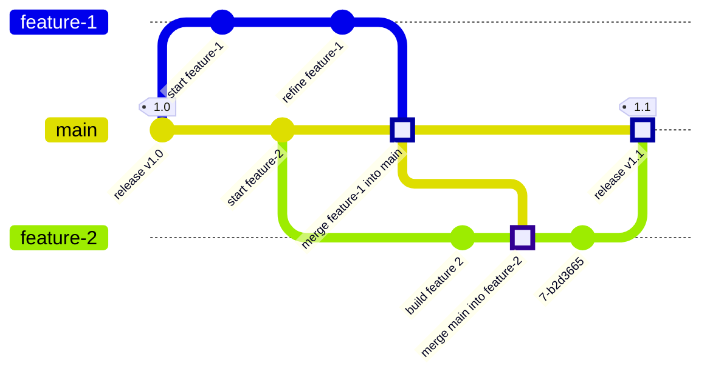
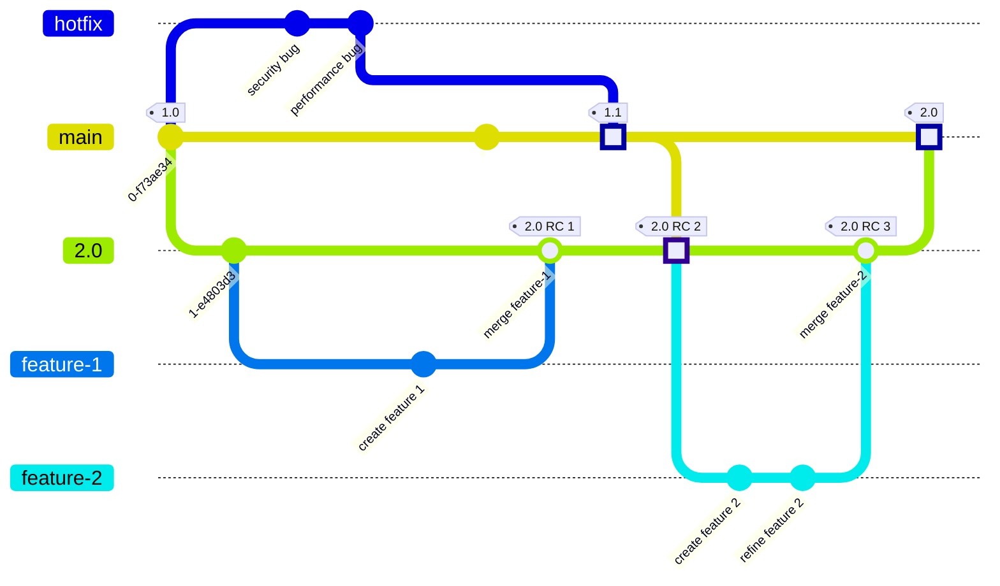
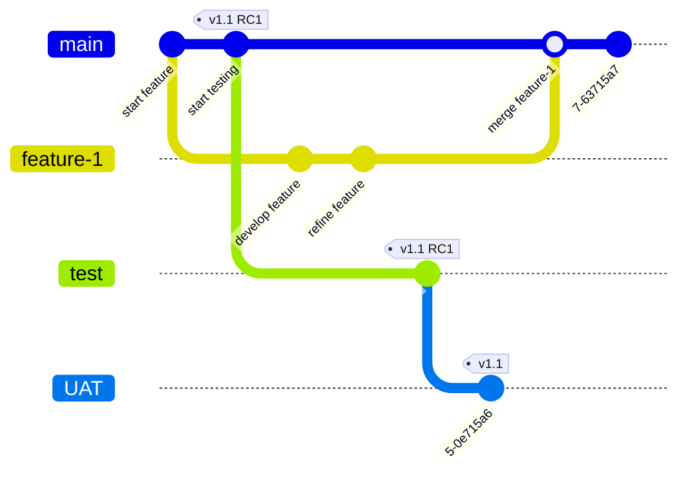

组织和合并 Git 分支的方式称为分支策略。对许多团队来说，最简单的方法既合理又有效：

1. 在功能分支中进行更改。
1. 将功能分支直接合并到 `main`。

不过，如果您的团队有复杂的需求（例如测试和合规要求），您可能需要考虑其他分支策略。

以下各节介绍一些较为常见的策略。并非每个团队都有 Git（或版本控制）专家。如果您的团队正在 Git 技能范围的边缘探索，这些信息会有所帮助。

当您使用极狐GitLab 替代多个彼此独立的工具时，您对 Git 分支策略所做的决策就变得很重要。通过仔细规划，您可以在以下各项之间建立清晰的关联：

- 您收到的初始缺陷报告。
- 您的团队为修复这些缺陷所做的提交。
- 将这些修复向后移植到其他版本或客户的过程。
- 让您的修复可供用户使用的部署。

谨慎的选择有助于您充分利用极狐GitLab 中的单一数据存储。

## 我是否需要更复杂的 Git 分支策略？

如果出现以下情况，说明您当前的分支策略可能已无法满足需求：

- 您使用持续交付。
- 您有大量的自动化测试。
- 您必须为某个客户修复关键缺陷，同时不影响其他客户。
- 您维护产品的多个历史版本。
- 您的产品没有单一的生产分支，因为它支持多个操作系统或平台。
- 您的产品对每个版本有不同的部署或认证要求。

不要实施比产品需求更复杂的策略。

### 何时将项目拆分为多个代码仓库

您应该维护一个具有复杂分支结构的 Git 代码仓库，还是将项目拆分到多个代码仓库？这没有唯一的正确答案。这取决于您拥有多少人员和专业知识来提供支持。

极狐GitLab 提供的自动化假定您的代码仓库用于单一产品，不过该产品可能包含多个版本。要确定您应该使用多个代码仓库，还是使用一个复杂的代码仓库，请问自己以下问题：

- 它们是同一个产品吗？
- 所有元素是否使用相同的构建过程？
- 底层代码是否相似，或者相同？

无论您选择哪种方式（一个复杂的单一代码仓库，还是一组较小的代码仓库），您都应该预期需要投入工程时间进行维护。确定您准备承担哪种类型的工程工作：

- 如果您在单个代码仓库中维护多个产品的代码，请为后续的定制工作做好规划，
  以便使用极狐GitLab 的所有功能。
- 跨多个代码仓库合并工作比在同一代码仓库中跨分支合并更复杂。
  请规划工程时间，以构建自定义发布流程并管理代码
  在多个代码仓库之间的流转。

> [!note]
> 如果您的组织使用大型 monorepo 或 megarepo，GitLab 的
> [专业服务](https://about.gitlab.com/services/)团队可以帮助您构建
> 满足您需求的自定义分支解决方案。

## 分支策略的主要类型

分支和代码管理策略取决于您的产品需求。没有哪种现成的策略能涵盖所有情况，但一些主要类别包括：

- [Web 服务](#web-services)
- [长期存在的发布分支](#long-lived-release-branches)
- [每个环境一个分支](#branch-per-environment)

### Web 服务

此策略遵循标准的 Git 实践。`main` 分支是您的生产分支，这非常适合单一 Web 服务：只有一个规范的生产版本，不支持以前的修订版本。

对于这种配置，[`git-flow`](https://nvie.com/posts/a-successful-git-branching-model/) 可能适合您。它是标准化的，您无需维护任何内容。

在此示例中，`feature-1` 直接从 `main` 分支出。完成后，`feature-1` 直接合并回 `main`。此合并提交用方块突出显示。存在时间较长的分支，例如 `feature-2`，可能会在开发过程中定期合并 `main`中的最新更新。完成后，`feature-2` 合并到 `main`，并切出发布版本 `1.1`：

### 长期存在的发布分支

如果您的产品有一些分支必须长期与 `main` 保持分离，那么此分支策略就很合适。一些示例包括：

- 同一软件包的多个生产版本。例如：一个当前版本，以及
  多个旧版本。当前版本接收功能更新和热修复，而以前的版本
  仅接收热修复和安全发布。
- 一个当前生产版本，以及一个长期存在的测试版。当某个主要
  软件依赖项（例如软件开发工具包，即 SDK）引入破坏性变更时，您可能需要这种方法。
  当前生产版本接收功能更新和热修复。测试版接收
  这些功能更新和热修复，同时您的团队还要构建对即将到来的 SDK 变更的支持。

如果您打算锁定一个长期存在的分支，那么定义并强制执行热修复流程至关重要。如果不定义也不强制执行，那么每次更改都会变成热修复。

在此示例中，`2.0` 分支是从 `main` 上对应 `1.0` 发布的提交创建的。功能分支从 `2.0` 分支分出，并合并回 `2.0`。同时，任何热修复分支都基于 `main`的最新发布版本（`1.0`），并作为发布版本 `1.1` 合并回 `main`。然后 `2.0` 分支拉取发布版本 `1.1`中的更改，并将它们作为 `2.0` 开发的一部分纳入。在添加另一个功能（`feature-2`）之后，`2.0` 分支就准备好投入生产了。它合并到 `main`，并切出发布版本 `2.0`：

#### 从 SVN 分支策略迁移

从 SVN 迁移到 Git 的旧项目应重新审视其分支方法。Git 中一些以 SVN 为中心的分支方法可能会妨碍您充分利用极狐GitLab。需要重新审视的一些工作流：

- 您从 `main` 创建一个长期存在的分支（例如 `1.0`），然后锁定 `1.0` 分支，以阻止任何
  未经预先批准的热修复更改。
  - Git 处理合并冲突的能力比 SVN 更好。
  - 避免创建长期存在的分支，除非您有合同
    义务必须使用它们。虽然 Git 能很好地处理冲突，但长期存在的分支需要您
    花时间将修复合并到多个分支。
- 您使用分支，是因为您的产品不支持功能标志。

### 每个环境一个分支

对于由不同团队构建多个相互依赖服务的组织来说，这种分支策略很常见。它通常与瀑布式或 V 模型开发流程一起使用。

在此示例中，标记为 `v1.1 RC1`的提交被标识为版本 `1.1`的发布候选版本。功能继续从 `main` 分支出并合并回其中，同时发布候选提交在 `test` 和 `UAT` 环境中进行测试。对于每个考虑发布的提交，都会重复此过程：

