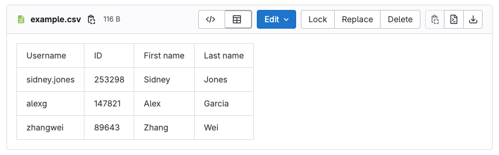



- Tier: 基础版，专业版，旗舰版
- Offering: JihuLab.com，私有化部署



逗号分隔值（CSV）文件是一种使用逗号分隔值的分隔文本文件。文件的每一行都是一条数据记录。每条记录由一个或多个字段组成，字段之间用逗号分隔。使用逗号作为字段分隔符正是这种文件格式名称的由来。CSV 文件通常以纯文本形式存储表格数据（数字和文本），此时每一行都具有相同数量的字段。

CSV 文件格式并未完全标准化。也可以使用其他字符作为列分隔符。字段可能会也可能不会用引号包围，以转义特殊字符。

添加到代码仓库后，扩展名为 `.csv`的文件在极狐GitLab 中查看时会渲染为表格：



<a id="csv-parsing-considerations"></a>

## CSV 解析注意事项

极狐GitLab 使用 [Papa Parse](https://github.com/mholt/PapaParse/) 库来解析 CSV 文件。
该库遵循 [RFC4180](https://datatracker.ietf.org/doc/html/rfc4180)，并具有严格的格式要求，这可能会导致某些 CSV 格式出现解析问题。

例如：

- 逗号（`,`）分隔符和双引号（`"`）周围的空格可能会导致解析错误。
- 同时包含逗号和双引号的字段可能会导致解析器错误识别字段边界。

以下格式会导致解析错误：

```plaintext
"field1", "field2", "field3"
```

以下格式可以成功解析：

```plaintext
"field1","field2","field3"
```

如果您的 CSV 文件在极狐GitLab 中无法正确显示：

- 如果字段用双引号（`"`）包围，请确保双引号和逗号（`,`）分隔符紧邻，中间没有空格。
- 将所有包含特殊字符的字段用双引号（`"`）包围。
- 进行更改后，测试 CSV 文件在极狐GitLab 中的显示效果。

这些解析要求仅影响 CSV 文件的视觉渲染，不会影响存储在代码仓库中的实际文件内容。
