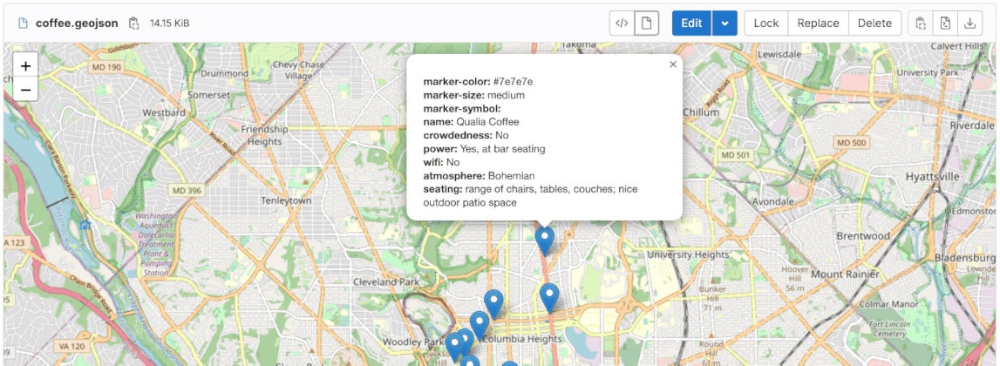



- Tier: 基础版，专业版，旗舰版
- Offering: JihuLab.com，私有化部署



GeoJSON 文件是一种使用 JavaScript 对象表示法（JSON）编码地理数据结构的格式。它通常用于表示地理要素，例如点、线和多边形，以及它们关联的属性。

添加到代码仓库后，扩展名为 `.geojson`的文件在极狐GitLab 中查看时会渲染为包含 GeoJSON 数据的地图。

地图数据来自 [OpenStreetMap](https://www.openstreetmap.org/)，遵循[开放数据库许可证](https://www.openstreetmap.org/copyright)。

