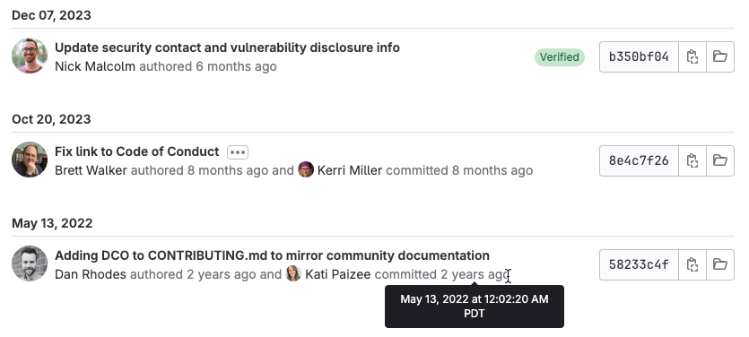



- Tier: 基础版，专业版，旗舰版
- Offering: JihuLab.com，私有化部署



Git 文件历史提供与某个文件相关的提交历史信息：



每个提交显示：

- 提交日期。极狐GitLab 会将同一天进行的所有提交归为一组。
- 用户的头像。
- 用户的名称。将鼠标悬停在名称上可查看用户的职位、位置、本地时间
  和当前状态消息。
- 提交日期，以相对时间格式显示。要查看提交的精确日期和时间，
  请将鼠标悬停在日期上。
- 如果[提交已签名](../signed_commits/_index.md)，则显示**已验证**徽章。
- 提交 SHA。极狐GitLab 显示前 8 个字符。
  选择**复制提交 SHA**（）可复制完整的 SHA。
- 一个用于浏览（）该文件在此提交时
  的内容的链接。

当用户创建提交时，极狐GitLab 会从贡献者的
[Git 配置](https://git-scm.com/book/en/v2/Customizing-Git-Git-Configuration)
中获取用户名和电子邮件信息。

<a id="view-a-files-git-history"></a>

## 查看文件的 Git 历史

要在 UI 中查看文件的 Git 历史：

1. 在顶部栏中，选择**搜索或跳转到**并找到您的项目。
1. 在左侧边栏中，选择**代码** > **代码仓库**。
1. 转到代码仓库中您想要查看的文件。
1. 在最后一个提交区块中，选择**历史**。

<a id="limit-history-range-of-results"></a>

## 限制历史记录的结果范围

在查看旧文件或包含大量提交的文件的历史时，您可以按日期限制搜索结果。限制提交的日期有助于修复超大代码仓库中的[提交历史请求超时](https://gitlab.com/gitlab-org/gitaly/-/issues/5426)。

在极狐GitLab UI 中，编辑 URL。以 `YYYY-MM-DD` 格式包含以下参数（日期按 UTC 解析）：

- `committed_before`
- `committed_after`

在查询字符串中使用与号（`&`）分隔每个键值对，如下所示：

```plaintext
?ref_type=heads&committed_after=2023-05-15&committed_before=2023-11-22
```

指向该提交范围的完整 URL 如下所示：

```plaintext
https://gitlab.com/gitlab-org/gitlab/-/commits/master/CONTRIBUTING.md?ref_type=heads&committed_after=2023-05-15&committed_before=2023-11-22
```
