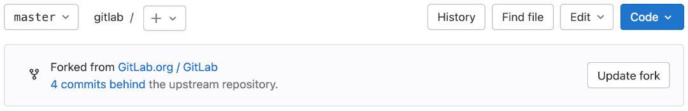



- Tier: 基础版，专业版，旗舰版
- Offering: JihuLab.com，私有化部署



fork 是另一个项目的个人副本，创建在您选择的命名空间中。您的 fork 包含上游项目代码仓库的副本以及部分项目设置，但不包含议题、合并请求或 Wiki 页面等项目内容。您可以创建从您的 fork 指向上游项目的合并请求。
也可以将单个提交从您的 fork[拣选](../merge_requests/cherry_pick_changes.md)到上游项目中。

如果您对原始项目具有写入权限，则无需 fork。此时应使用分支来管理您的工作。如果您对想要贡献的项目没有写入权限，请 fork 该项目。在您的 fork 中进行更改，然后通过合并请求提交到上游项目。

要创建[机密合并请求](../merge_requests/confidential.md)，
请使用公共项目的个人 fork。

> [!note]
> 如果上游项目已归档，fork 关系会自动移除。
> 因 fork 关系中断而关闭的合并请求不会重新打开，
> 即使之后 fork 关系恢复也是如此。
>
> 更多信息，请参见[归档项目](../working_with_projects.md#archive-a-project)。

<a id="create-a-fork"></a>

## 创建 fork

要在极狐GitLab 中 fork 现有项目：

1. 在项目主页的右上角，选择 **Fork**（）。
1. 可选。编辑 **项目名称**。
1. 对于 **项目 URL**，选择您的 fork 应归属的[命名空间](../../namespace/_index.md)。
1. 添加 **项目 slug**。该值会成为您的 fork URL 的一部分。
   它必须在命名空间中唯一。
1. 可选。添加 **项目描述**。
1. 选择以下 **要包含的分支** 选项之一：
   - **所有分支**（默认）。
   - **仅默认分支**。使用 `--single-branch` 和 `--no-tags`
     [Git 选项](https://git-scm.com/docs/git-clone)。
1. 为您的 fork 选择 **可见性级别**。
   fork 的可见性必须至少与上游项目以及您的 fork 所属命名空间的可见性一样严格。
   其他可见性级别不可选择。
   有关可见性级别的更多信息，请参见[项目和群组可见性](../../public_access.md)。

   > [!note]
   > 创建 fork 后，如果上游项目变得更严格，
   > fork 的可见性不会自动更改。您可以自行更改，
   > 但同样的规则适用：fork 必须至少与上游项目一样严格。

1. 选择 **Fork project**。

极狐GitLab 会创建您的 fork，将您重定向到新 fork 的页面，并在[审计日志](../../compliance/audit_event_types.md)中记录 fork 的创建。

如果您打算频繁向上游贡献更改，请考虑为您的 fork 设置[默认目标](../merge_requests/creating_merge_requests.md#set-the-default-target-project)。

<a id="update-your-fork"></a>

## 更新您的 fork

fork 可能会与上游项目不同步，需要更新：

- **领先**：您的 fork 包含上游代码仓库中不存在的新提交。
  要同步您的 fork，请创建合并请求，将更改推送到上游代码仓库。
- **落后**：上游代码仓库包含您的 fork 中不存在的新提交。
  要同步您的 fork，请将新提交拉取到您的 fork 中。
- **领先且落后**：上游代码仓库和您的 fork 都包含对方不存在的新提交。
  要完全同步您的 fork，请创建合并请求将您的更改推送上去，
  并将上游代码仓库的新更改拉取到您的 fork 中。

要将您的 fork 与其上游项目同步，可以从极狐GitLab UI 或命令行更新它。极狐GitLab 专业版和旗舰版还可以通过[将 forks 配置为上游项目的拉取镜像](#with-repository-mirroring)来自动更新。

<a id="from-the-ui"></a>

### 从 UI 更新

当您从 UI 更新 fork 时，fork 上的以下代码仓库保护设置会被绕过：

- 在 fork 上配置的推送规则。
- 应用于 fork 中文件的文件锁定。

此行为可防止上游项目与 fork 具有不同保护配置时出现同步失败。同步过程会从上游代码仓库拉取更改，并直接应用到 fork。

先决条件：

- 您必须从上游项目中的[未受保护分支](branches/protected.md)创建 fork。

要从极狐GitLab UI 更新您的 fork：

1. 在顶部栏中，选择**搜索或跳转到**。
1. 选择 **查看我的所有项目**。
1. 选择您要更新的 fork。
1. 在分支名称下拉列表下方，找到 **Forked from**（）
   信息框，以确定您的 fork 是领先、落后还是两者兼有。在此示例中，
   fork 落后于上游项目：

   

1. 如果您的 fork**领先**于上游项目，请选择
   **创建合并请求**，以提议将 fork 的更改添加到上游项目。
1. 如果您的 fork**落后**于上游项目，请选择**更新 fork**，
   以从上游代码仓库拉取更改。
1. 如果您的 fork**领先且落后**于上游项目，则只有在极狐GitLab 未检测到合并冲突时，
   才能从 UI 更新：
   - 如果您的 fork 不包含合并冲突，您可以选择**创建合并请求**
     以提议将更改推送到上游项目，选择**更新 fork**
     以将更改拉取到您的 fork，或两者都选。您的 fork 中更改的类型
     决定了哪些操作是合适的。
   - 如果您的 fork 包含合并冲突，极狐GitLab 会显示分步指南，指导您
     从命令行更新 fork。

<a id="from-the-command-line"></a>

### 从命令行更新

您也可以从命令行更新您的 fork。

先决条件：

- 您必须在本地机器上[下载并安装 Git 客户端](../../../topics/git/how_to_install_git/_index.md)。
- 您必须为要更新的项目[创建 fork](#create-a-fork)。

要从命令行更新您的 fork，请按照
[使用 Git 更新 fork](../../../topics/git/forks.md)中的说明操作。

<a id="with-repository-mirroring"></a>

### 使用代码仓库镜像



- Tier: 专业版，旗舰版
- Offering: JihuLab.com，私有化部署



如果满足以下所有条件，可以将 fork 配置为上游项目的镜像：

1. 您的订阅是极狐GitLab 专业版或极狐GitLab 旗舰版。
1. 您在分支（而非 `main`）中进行所有更改。
1. 您不处理[机密议题的合并请求](../merge_requests/confidential.md)，
   这需要更改 `main`。

[代码仓库镜像](mirror/_index.md)可使您的 fork 与原始项目保持同步。此方法每小时更新一次您的 fork，无需手动执行 `git pull`。
有关说明，请参见[配置拉取镜像](mirror/pull.md#configure-pull-mirroring)。

> [!warning]
> 使用镜像时，在批准合并请求之前，系统会要求您同步。您应将其自动化。

<a id="merge-changes-back-upstream"></a>

## 将更改合并回上游

当您准备好将代码发送回上游项目时，请按照
[当您在 fork 中工作时](../merge_requests/creating_merge_requests.md#when-you-work-in-a-fork)所述，
创建一个新的合并请求。成功合并后，您的更改会添加到上游代码仓库。

您的合并请求在上游合并后，您的 fork 中的分支不会自动被视为**已合并**以用于批量删除。只有当您的 fork 的默认分支包含这些更改时，该分支才会被视为已合并。要在您的 fork 中将这些分支标记为已合并，
请[更新您的 fork](#update-your-fork) 以与上游项目同步。

<a id="unlink-a-fork"></a>

## 取消关联 fork

移除 fork 关系会将您的 fork 与其上游项目取消关联。您的 fork 随后会成为独立项目。

先决条件：

- 您必须是项目所有者才能取消关联 fork。

> [!warning]
> 如果移除 fork 关系，您将无法向源项目发送新的合并请求。
> 从该 fork 到源项目的任何现有打开的合并请求也会被关闭。
> 如果有人 forked 了您的项目，他们的 fork 也会失去该关系。
> 要恢复 fork 关系，请使用[项目 forks API](../../../api/project_forks.md#create-a-fork-relationship)。

要移除 fork 关系：

1. 在顶部栏中，选择**搜索或跳转到**并找到您的项目。
1. 在左侧边栏中，选择**设置** > **通用**。
1. 展开**高级**。
1. 在**移除 fork 关系**部分，选择**移除 fork 关系**。
1. 要确认，请输入项目路径并选择**确认**。

极狐GitLab 会在[审计日志](../../compliance/audit_event_types.md)中记录取消关联操作。
当您取消关联使用[哈希存储池](../../../administration/repository_storage_paths.md#hashed-object-pools)
与另一个代码仓库共享对象的 fork 时：

- 所有对象都会从存储池复制到您的 fork 中。
- 复制过程完成后，存储池不会再向您的 fork 传播任何更新。

<a id="delete-a-fork"></a>

## 删除 fork

删除 fork 会永久移除该项目及其所有内容，包括 fork 关系。此操作与删除任何其他项目相同。

要删除 fork，请参见[删除项目](../working_with_projects.md#delete-a-project)。

<a id="check-a-forks-storage-usage"></a>

## 检查 fork 的存储用量

您的 fork 使用去重策略来减少所需的存储空间。您的 fork 可以访问连接到源项目的对象池。

有关更多信息以及检查存储用量，请参见[查看项目 fork 存储用量](../../storage_usage_quotas.md#view-project-fork-storage-usage)。

<a id="troubleshooting"></a>

## 故障排除

<a id="error-an-error-occurred-while-forking-the-project-please-try-again"></a>

### 错误：`An error occurred while forking the project. Please try again`

此错误可能是由于 forked 项目与新命名空间之间的实例 runner 设置不匹配所致。更多信息，请参见[在 forked 项目中使用实例 runner](../../../ci/runners/configure_runners.md#using-instance-runners-in-forked-projects)。

<a id="removing-fork-relationship-fails"></a>

### 移除 fork 关系失败

如果通过 UI 或 API 移除 fork 不起作用，您可以尝试在
[Rails 控制台会话](../../../administration/operations/rails_console.md#starting-a-rails-console-session)中
移除 fork 关系：

```ruby
p = Project.find_by_full_path('<project_path>')
u = User.find_by_username('<username>')
Projects::UnlinkForkService.new(p, u).execute
```

<a id="error-user-is-not-allowed-to-import-projects"></a>

### 错误：`User is not allowed to import projects`

使用服务账号 forking 项目时，您可能会收到如下错误：

```plaintext
{"message":["Namespace is not valid","User is not allowed to import projects"]}
```

出现此问题是因为服务账号是机器人用户，即使其项目数量上限已提高，也无法将项目 fork 到其个人命名空间。

使用服务账号 fork 项目时，变通方法是在[项目 forks API](../../../api/project_forks.md)中使用
`namespace_id` 或 `namespace_path` 指定目标群组命名空间。
该服务账号必须是目标群组的成员，并具有开发者、维护者或所有者角色。
