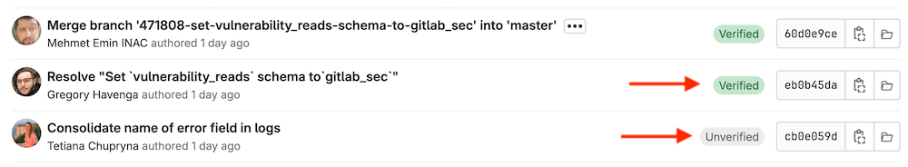
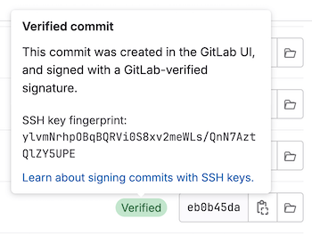
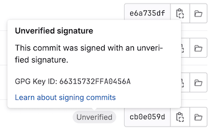



- Tier: 基础版，专业版，旗舰版
- Offering: JihuLab.com，私有化部署



当您为提交添加数字签名时，您就提供了额外的保证，证明该提交源自您本人，而非冒名顶替者。数字签名是一种用于验证真实性的加密输出。

理解已签名提交与已验证提交之间的区别很重要：

- 已签名提交附有加密签名，可证明该提交的完整性和真实性。签名使用私钥创建。
- 已验证提交的签名可由极狐GitLab 根据存储在用户极狐GitLab 个人资料中的已知公钥进行验证。

如果极狐GitLab 能够使用公钥验证提交者的身份，则该提交会在极狐GitLab UI 中标记为**已验证**。

> [!note]
> 在 Git 中，提交者和作者字段是不同的。作者编写提交，提交者应用提交。提交签名仅验证提交者的身份。

极狐GitLab 会验证提交和标签上的签名。支持以下签名方式：

- [SSH 密钥](ssh.md)
- [GPG 密钥](gpg.md)
- [X.509 证书](x509.md)

## 验证提交

要查看某个合并请求或整个项目的提交，并验证它们是否已签名：

1. 在顶部栏中，选择**搜索或跳转到**，然后找到您的项目。
1. 要查看提交：
   - 对于项目，选择**代码** > **提交**。
   - 对于合并请求：
     1. 在左侧边栏中，选择**代码** > **合并请求**，然后选择您的合并请求。
     1. 选择**提交**。
1. 找到您要查看的提交。根据签名的验证状态，已签名的提交会显示**已验证**或**未验证**徽章。

   

   未签名的提交不显示徽章。

1. 要显示某个提交的签名详情，选择**已验证**或**未验证**以查看指纹或密钥 ID：

   

   

您也可以[使用提交 API](../../../../api/commits.md#retrieve-commit-signature) 来检查提交的签名。

### 验证极狐GitLab 签名的提交

极狐GitLab 会使用实例上配置的密钥为其创建的提交（例如通过 Web UI 创建的提交）签名。要在本地验证这些提交，请使用 [Web 提交 API](../../../../api/web_commits.md#retrieve-public-signing-key) 获取用于为提交签名的极狐GitLab 公钥。

当提交被复制到另一个项目时（例如通过[代码仓库镜像](../mirror/_index.md)），签名会随提交一起保留。在目标项目中，仅当实例配置了为该提交签名的密钥时，极狐GitLab 才会显示**已验证**徽章。

### 未验证提交者电子邮件的警告徽章

当已验证签名提交的提交者电子邮件不再对签名用户验证时，极狐GitLab 会显示一个带有警告符号的橙色已验证徽章（ **已验证**）。

当提交者电子邮件从用户的已验证电子邮件中移除时，可能会出现这种情况。

要恢复绿色的**已验证**徽章，请将提交者电子邮件地址添加到您的极狐GitLab 个人资料中并进行验证。

## 使用推送规则强制要求已签名提交



- Tier: 专业版，旗舰版
- Offering: JihuLab.com，私有化部署



您可以使用推送规则在您的项目中要求已签名提交。**拒绝未签名的提交**推送规则会阻止任何未签名的提交被推送到代码仓库，帮助组织维护代码完整性并满足合规要求。

有关此规则如何工作及其限制的更多信息，请参阅[要求已签名提交](../push_rules.md#require-signed-commits)。

## 故障排除

### 修复已签名提交的验证问题

使用 GPG 密钥或 X.509 证书签名的提交，其验证过程可能因多种原因而失败：

| 值                       | 描述 | 可能的修复方法 |
|-----------------------------|-------------|----------------|
| `UNVERIFIED`                | 提交签名无效。 | 使用有效签名重新签署该提交。 |
| `SAME_USER_DIFFERENT_EMAIL` | 用于签署该提交的 GPG 密钥不包含提交者电子邮件，但包含该提交者的另一个有效电子邮件。 | 修改提交以使用与 GPG 密钥匹配的电子邮件地址，或更新 GPG 密钥[以包含该电子邮件地址](https://security.stackexchange.com/a/261468)。 |
| `OTHER_USER`                | 签名和 GPG 密钥有效，但该密钥属于与提交者不同的用户。 | 修改提交以使用正确的电子邮件地址，或修改提交以使用与您的用户关联的 GPG 密钥。 |
| `UNVERIFIED_KEY`            | 与 GPG 签名关联的密钥没有与提交者关联的已验证电子邮件地址。 | 将该电子邮件添加并验证到您的极狐GitLab 个人资料中，[更新 GPG 密钥以包含该电子邮件地址](https://security.stackexchange.com/a/261468)，或修改提交以使用其他提交者电子邮件地址。 |
| `UNKNOWN_KEY`               | 极狐GitLab 无法识别与该提交的 GPG 签名关联的 GPG 密钥。 | 将 GPG 密钥[添加](gpg.md#add-a-gpg-key-to-your-account)到您的极狐GitLab 个人资料中。 |
| `MULTIPLE_SIGNATURES`       | 检测到该提交存在多个 GPG 或 X.509 签名。 | 修改提交以仅使用一个 GPG 或 X.509 签名。 |
