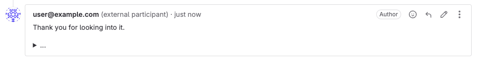
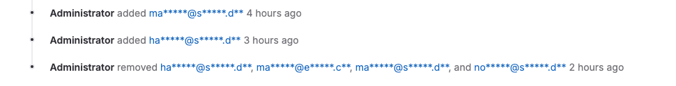
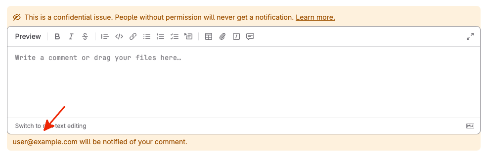



- Tier: 基础版，专业版，旗舰版
- Offering: JihuLab.com，私有化部署



外部参与者是没有极狐GitLab 账号的用户，只能通过电子邮件与议题或服务台工单进行交互。
他们会通过[服务台电子邮件](configure.md#customize-emails-sent-to-external-participants)收到议题或工单上公开评论的通知。

议题或工单上的外部参与者数量上限为 10。

## 服务台工单

极狐GitLab 会将服务台工单的外部作者添加为外部参与者。这通常是创建工单的初始电子邮件中 `From` 标头里的电子邮件地址。

### 从 `Cc` 标头添加外部参与者

默认情况下，极狐GitLab 只会将创建服务台工单的电子邮件发件人添加为外部参与者。

您可以将极狐GitLab 配置为同时将 `Cc` 标头中的所有电子邮件地址添加到服务台工单。
这适用于初始电子邮件以及对 [`thank_you` 电子邮件](configure.md#customize-emails-sent-to-external-participants)的所有回复。

从 `Cc` 标头添加的外部参与者会收到 `new_participant` 电子邮件，而不是 `thank_you` 电子邮件，以告知他们已被添加到工单。

先决条件：

- 您必须对项目具有维护者或所有者角色。

要为项目启用该设置：

1. 在顶部栏中，选择**搜索或跳转到**并找到您的项目。
1. 在左侧边栏中，选择**设置** > **通用**。
1. 展开**服务台**。
1. 选择**从 `Cc` 标头添加外部参与者**。
1. 选择**保存更改**。

## 作为外部参与者

外部参与者会通过[服务台电子邮件](configure.md#customize-emails-sent-to-external-participants)收到议题或工单上每条公开评论的通知。

### 回复通知电子邮件

外部参与者可以[回复收到的通知电子邮件](../../../administration/reply_by_email.md#you-reply-to-the-notification-email)。
这会在议题或工单上创建一条新评论，并显示外部参与者的电子邮件地址，而不是极狐GitLab 用户名。该电子邮件地址后面会带有 `(external participant)`。

### 退订通知电子邮件

外部参与者可以使用默认服务台电子邮件模板中的退订链接来退订议题或工单。

如果您[自定义 `thank_you`、`new_participant` 和 `new_note` 电子邮件模板](configure.md#customize-emails-sent-to-external-participants)，可以使用`%{UNSUBSCRIBE_URL}`占位符将退订链接添加到模板中。

您的极狐GitLab 实例必须可访问（例如，可从公共互联网访问），外部参与者才能成功退订。如果情况并非如此，请考虑从模板中移除退订链接。

来自极狐GitLab 的电子邮件还包含特殊标头，允许受支持的电子邮件客户端和其他软件[自动为外部参与者退订](../../profile/notifications.md#using-an-email-client-or-other-software)。

## 作为极狐GitLab 用户

要查看外部参与者的电子邮件地址，您必须对项目具有报告者、开发者、维护者或所有者角色。

如果同时满足以下两个条件，外部参与者的电子邮件地址会被隐藏：

- 您不是项目成员，或者只具有访客角色。
- 议题或工单是公开的（[非机密](../issues/confidential_issues.md)）。

外部参与者的电子邮件地址会在以下位置被隐藏：

- 服务台工单的作者字段。
- 所有提及外部参与者的[系统评论](../system_notes.md)。
- [REST](../../../api/notes.md) 和 [GraphQL](../../../api/graphql/_index.md) API。
- 评论编辑器下方的警告消息。

例如：

### 发送给外部参与者的通知

外部参与者会收到议题上所有公开评论的通知。
如需私下沟通，请使用[内部评论](../../discussions/_index.md#add-an-internal-note)。

外部参与者不会收到议题或工单上任何其他事件的通知。

### 查看所有外部参与者

查看所有会收到新评论服务台电子邮件的外部参与者的概览。

先决条件：

- 您必须对项目具有报告者、开发者、维护者或所有者角色。

要查看所有外部参与者的列表：

1. 前往议题或工单。
1. 向下滚动到评论编辑器。
1. 如果议题或工单有外部参与者，您可以在评论编辑器下方看到一条警告，其中列出了所有外部参与者。

### 添加外部参与者

当您希望随时将某人纳入对话时，可以使用[`/add_email` 快速操作](../quick_actions.md#add_email)添加外部参与者。

添加后，外部参与者会开始通过服务台电子邮件接收通知。

新外部参与者会收到 `new_participant` 电子邮件，以告知他们已被添加到工单。对于手动添加的外部参与者，极狐GitLab 不会发送 `thank_you` 电子邮件。

您应该在一条专门的评论中添加外部参与者，因为他们不会收到包含`/add_email` 快速操作的那条评论的通知电子邮件。

先决条件：

- 您必须对项目具有计划者、报告者、开发者、维护者或所有者角色。

要将外部参与者添加到议题或工单：

1. 前往议题或工单。
1. 添加一条仅包含快速操作`/add_email user@example.com`的评论。
   您最多可以串联 6 个电子邮件地址。例如，`/add_email user@example.com user2@example.com`

您应该会看到一条成功消息和一条包含该电子邮件地址的新系统评论。

### 移除外部参与者

当外部参与者应停止接收通知时，使用[`/remove_email` 快速操作](../quick_actions.md#remove_email)将其从议题或服务台工单中移除。

将其从议题或工单中移除后，他们不会再收到新通知。但他们仍然可以回复之前收到的电子邮件，并在议题或工单上创建新评论。

先决条件：

- 您必须对项目具有计划者、报告者、开发者、维护者或所有者角色。
- 议题或工单上必须至少有一个外部参与者。

要从议题或工单中移除现有外部参与者：

1. 前往议题或工单。
1. 添加一条仅包含快速操作`/remove_email user@example.com`的评论。
   您最多可以串联 6 个电子邮件地址。例如，`/remove_email user@example.com user2@example.com`

您应该会看到一条成功消息和一条包含该电子邮件地址的新系统评论。
