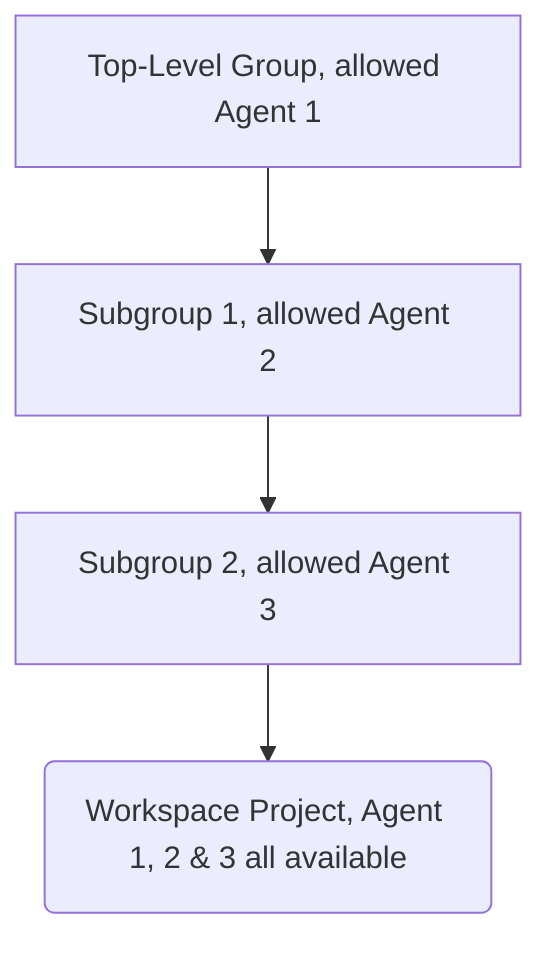



- Tier: 专业版，旗舰版
- Offering: JihuLab.com，私有化部署



当您[设置工作区基础设施](configuration.md#set-up-workspace-infrastructure)时，
必须配置极狐GitLab Kubernetes Agent 以支持工作区。本指南假设 Kubernetes 集群中
已安装极狐GitLab Kubernetes Agent。

先决条件：

- 您必须完成[设置极狐GitLab Kubernetes Agent 教程](set_up_gitlab_agent_and_proxies.md)中的设置步骤。
- Agent 配置必须启用 `remote_development` 模块，并且必须正确设置该模块的必填字段。

  > [!note]
  > 如果在具有活动工作区的 agent 上禁用 `remote_development` 模块，
  > 这些工作区将无法使用。有关更多信息，请参阅
  > [工作区设置](settings.md#enabled)。
- 必须允许在群组中使用该 agent 以创建工作区。创建工作区时，用户可以选择与工作区项目的任意父群组关联的已允许 agent。
- 工作区创建者必须对 agent 所在项目具有开发者角色。

## 在群组中为创建工作区进行 Agent 授权

新的授权策略取代了[旧版授权策略](#legacy-agent-authorization-strategy)。群组所有者和管理员可以控制哪些集群 agent 在其群组中托管工作区。

例如，如果您的工作区项目路径为 `top-level-group/subgroup-1/subgroup-2/workspace-project`，您可以使用为 `top-level-group`、`subgroup-1` 或 `subgroup-2` 群组配置的任意 agent。

如果您为特定群组（例如 `subgroup-1`）允许某个集群 agent，则该 agent 可用于在该群组下的所有项目中创建工作区。请仔细考虑所允许群组的范围，因为它决定了该集群 agent 可以在哪里托管工作区。

## 为群组中的工作区允许集群 agent

先决条件：

- 您必须[设置工作区基础设施](configuration.md#set-up-workspace-infrastructure)。
- 您必须具有实例的管理员访问权限或群组的所有者角色。

要为群组中的工作区允许集群 agent：

1. 在顶部栏中，选择**搜索或跳转到**，然后找到您的群组。
1. 在左侧边栏中，选择**设置** > **工作区**。
1. 在**群组 agent** 部分，选择**所有 agent** 标签页。
1. 从可用 agent 列表中，找到状态为**已阻止**的 agent，然后选择**允许**。
1. 在确认对话框中，选择**允许 agent**。

极狐GitLab 会将所选 agent 的状态更新为**已允许**，并在**已允许的 agent** 标签页中显示该 agent。

## 为群组中的工作区移除已允许的集群 agent

先决条件：

- 您必须[设置工作区基础设施](configuration.md#set-up-workspace-infrastructure)。
- 您必须具有实例的管理员访问权限或群组的所有者角色。

要从群组中移除已允许的集群 agent：

1. 在顶部栏中，选择**搜索或跳转到**，然后找到您的群组。
1. 在左侧边栏中，选择**设置** > **工作区**。
1. 在**群组 agent** 部分，选择**已允许的 agent** 标签页。
1. 从已允许的 agent 列表中，找到您要移除的 agent，然后选择**阻止**。
1. 在确认对话框中，选择**阻止 agent**。

极狐GitLab 会将所选 agent 的状态更新为**已阻止**，并从**已允许的 agent** 标签页中移除该 agent。

> [!note]
> 从群组中移除已允许的集群 agent 不会立即停止使用该 agent 的运行中工作区。
> 运行中的工作区会在自动终止或手动停止时停止。

## 为实例上的工作区允许集群 agent

先决条件：

- 您必须[设置工作区基础设施](configuration.md#set-up-workspace-infrastructure)。
- 您必须具有[已启用远程开发](settings.md#enabled)的 agent。
- 您必须具有实例的管理员访问权限。

要为实例上的工作区允许集群 agent：

1. 在右上角，选择**管理员**。
1. 在左侧边栏中，选择**设置** > **通用**。
1. 展开**工作区的可用 agent**。
1. 从已启用工作区的 agent 列表中，找到您要允许的 agent，然后选择
   可用性开关。

## 为实例上的工作区移除已允许的集群 agent

先决条件：

- 您必须具有实例的管理员访问权限。

要从实例中移除已允许的集群 agent：

1. 在右上角，选择**管理员**。
1. 在左侧边栏中，选择**设置** > **通用**。
1. 展开**工作区的可用 agent**。
1. 从已允许的 agent 列表中，找到您要移除的 agent，然后清除可用性开关。

> [!note]
> 从实例中移除已允许的集群 agent 不会立即停止使用该 agent 的运行中工作区。
> 运行中的工作区会在自动终止或手动停止时停止。

## 旧版 agent 授权策略

在极狐GitLab 17.1 及更早版本中，群组中 agent 的可用性不是创建工作区的先决条件。如果以下两个条件均成立，您可以使用工作区项目顶级群组中的任意 agent 来创建工作区：

- 已启用远程开发模块。
- 您对顶级群组具有开发者、维护者或所有者角色。

例如，如果您的工作区项目路径为 `top-level-group/subgroup-1/subgroup-2/workspace-project`，您可以使用 `top-level-group` 及其任意子群组中配置的任意 agent。

## 使用远程开发配置用户访问权限

您可以配置 `user_access` 模块，以使用您的极狐GitLab 凭据访问已连接的 Kubernetes 集群。此模块的配置和运行独立于 `remote_development` 模块。

在同一 agent 中同时配置 `user_access` 和 `remote_development` 时请务必小心。`remote_development` 集群会将用户凭据（例如个人访问令牌）作为 Kubernetes 密钥进行管理。`user_access`中的任何配置错误都可能导致这些私有数据可通过 Kubernetes API 访问。

有关配置 `user_access`的更多信息，请参阅
[配置 Kubernetes 访问权限](../clusters/agent/user_access.md#configure-kubernetes-access)。
